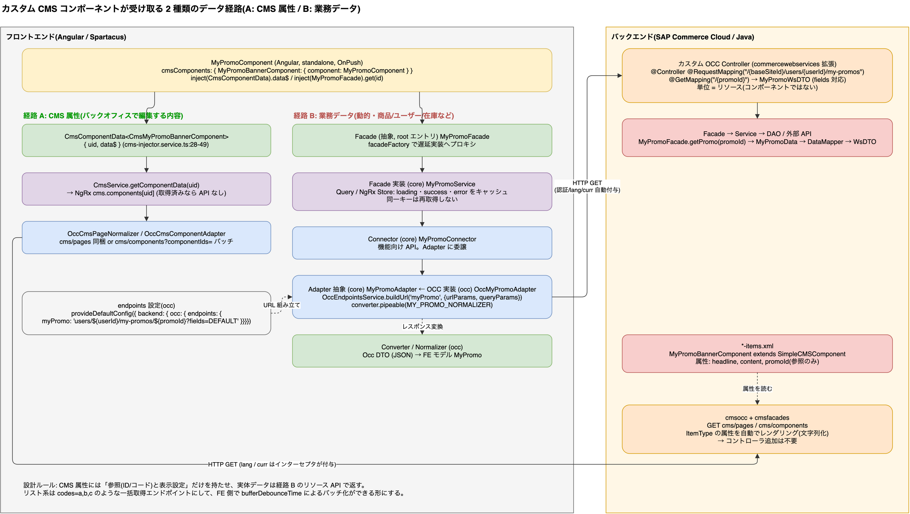

# 1.9 コンポーネントの書き方(標準ライブラリの実例)

> **図**: 03 カスタムコンポーネントのデータ経路(`diagrams/spartacus-architecture.drawio`)。本節の実コンポーネントは図の左の経路 A: CmsComponentData<T> を注入し data$ を async パイプで描く



> **この章が答える問い**: CMS コンポーネントの Angular 側は実際にどう書かれているか(雛形の根拠)

> 1 章の目次: [1. Angular 入門(バックエンド担当者向け)と Spartacus への対応](01-angular-basics.md)

`spartacus/core-libs/storefront/cms-components/content/paragraph/paragraph.component.ts:20-26, 44-47`
```ts
@Component({
  selector: 'cx-paragraph',
  templateUrl: './paragraph.component.html',
  changeDetection: ChangeDetectionStrategy.OnPush,
  imports: [NgIf, AsyncPipe, SupplementHashAnchorsPipe],
})
export class ParagraphComponent {
  ...
  constructor(
    public component: CmsComponentData<CmsParagraphComponent>,
    protected router: Router
  ) {}
```
`paragraph.component.html:1-4`
```html
<div
  *ngIf="component.data$ | async as data"
  [innerHTML]="bypassSecurityTrustHtml(data.content | cxSupplementHashAnchors)"
></div>
```
特徴: standalone、OnPush、コンストラクタ DI と `inject()` の併用(`banner.component.ts:32-63`, `product-carousel.component.ts:41-46`)、`*ngIf="x$ | async as data"` でストリームを購読。Signal の使用は storefront 内で 1 ファイルのみ。カスタムコンポーネントもこの形に合わせれば良い(5.3)。

---

[目次](README.md) | ← [1.8 i18n](01-8-i18n.md) | [2. Spartacus のパッケージ構成](02-package-layers.md) →
