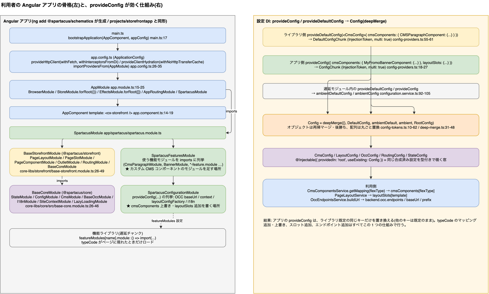

# 1. Angular 入門(バックエンド担当者向け)と Spartacus への対応

> **図**: 06 Angular アプリの骨格と設定 DI(`diagrams/spartacus-architecture.drawio`)。左: main.ts → AppModule → SpartacusModule の骨格。右: provideConfig / provideDefaultConfig が deepMerge で 1 つの Config になる流れ(1.3, 1.4)




> この章は、Angular を知らない読者が 2 章以降を読めるようにするための最小限の対応表です。各概念の「Spartacus ではここ」を実ファイルで示します。

### 1.1 技術スタック(根拠: `spartacus/package.json`)

| 技術 | バージョン | 役割 |
|---|---|---|
| Angular (`@angular/core`, `@angular/ssr`, `@angular/platform-server`) | ~21.2.23 | UI フレームワーク本体、SSR |
| NgRx (`@ngrx/store`, `@ngrx/effects`, `@ngrx/router-store`) | ~21.0.1 | 状態管理(Redux パターン) |
| RxJS | ~7.8.0 | 非同期ストリーム(`Observable`) |
| i18next (+ `i18next-http-backend`, `i18next-resources-to-backend`) | ~25.7.4 | 翻訳(Angular 標準 i18n ではない) |
| TypeScript / Node.js | ~5.9.3 / ^22.22.0 | `package.json:290`, `:11-13` |
| zone.js | ^0.16.0 | 変更検知(まだ zone ベース) |

利用者のアプリに `ng add @spartacus/schematics` で入る依存は `spartacus/core-libs/schematics/src/dependencies.json:10-23` に定義されている(`@angular/core ^21.2.23`, `@ngrx/store ^21.0.1`, `rxjs ^7.8.0` 等)。

### 1.2 Angular の基本概念 → Spartacus での実体

| Angular の概念 | 一言で | Spartacus での実体(ファイル) |
|---|---|---|
| **Component** | テンプレート(HTML)+クラス(TS)の UI 部品。`@Component` デコレータで定義 | 各 CMS コンポーネント。例 `core-libs/storefront/cms-components/content/paragraph/paragraph.component.ts:20-26` |
| **Standalone Component** | NgModule 無しで `imports: [...]` に依存を直接書く形式(Angular 19+ で既定) | storefront の 99 コンポーネント中 `standalone: false` は 0。`ParagraphComponent` も `imports: [NgIf, AsyncPipe, ...]` |
| **NgModule** | コンポーネント・プロバイダをまとめる単位。`forRoot()` は「アプリ全体に 1 回だけ」の慣用句 | `BaseStorefrontModule`(`core-libs/storefront/base-storefront.module.ts:26-49`)、`BaseCoreModule`(`core-libs/core/src/base-core.module.ts:26-46`)、各機能の `XxxModule` |
| **Directive** | 既存要素に振る舞いを足す | `[cxComponentWrapper]`(動的生成)、`[cxOutlet]`(差し替えポイント) |
| **Pipe** | テンプレート内の値変換 `{{ v \| pipe }}` | `async`(Observable を購読)、`cxTranslate`(`core-libs/core/src/i18n/translate.pipe.ts:25-29`)、`cxUrl`(`url.pipe.ts:11-18`) |
| **DI / Injector / InjectionToken** | 依存をコンストラクタや `inject()` で受け取る。`multi: true` で複数プロバイダを配列として集約 | `provideConfig` は `ConfigChunk` トークンへの `multi: true` プロバイダ(`config-providers.ts:18-27`)。`CmsComponentData` は子インジェクタで提供(3.8) |
| **Observable / RxJS** | 値が時間とともに流れるストリーム。テンプレートでは `\| async` で購読 | `CmsComponentData.data$`、Facade の戻り値はすべて Observable |
| **ChangeDetectionStrategy.OnPush** | 入力や Observable の変化時だけ再描画 | storefront 99 コンポーネント中 67 が OnPush(例 `paragraph.component.ts:23`) |
| **NgRx Store / Action / Effect / Reducer / Selector** | 単一ストア。Action を dispatch → Effect が HTTP → Success Action → Reducer が状態更新 → Selector で読む | `cms-store.module.ts:33-45`(`StoreModule.forFeature('cms')`)、`page.effect.ts`、`components.reducer.ts`、`components.selectors.ts` |
| **Facade** (Spartacus の慣習) | コンポーネントは Store を直接触らず Service 経由 | `CmsService`(`cms.service.ts:33-46`)、`ProductService`、`ProductSearchByCodeService` |
| **Router / Route / Guard** | URL → コンポーネント。`canActivate` ガードで遷移前処理 | `'**'` ルート + `CmsPageGuard`(3.1)。`@ngrx/router-store` でルーター状態もストアへ(`routing.module.ts:73-108`) |
| **Lazy loading `() => import()`** | 必要になった時にチャンクをダウンロード | `featureModules[...].module: () => import(...)`(5.3 (4)) |
| **APP_INITIALIZER** | 起動時に 1 回走る初期化フック | `'**'` ルート追加(`cms-route.module.ts:10-20`)、設定ルート適用、アウトレット登録 |
| **SSR / TransferState** | サーバで HTML を描画し、取得済みデータを HTML に埋めてブラウザへ渡す | `core-libs/setup/ssr/`、`transfer-state.reducer.ts:16`(`makeStateKey('cx-state')`) |
| **Angular CLI / schematics** | `ng add` などのコード生成 | `core-libs/schematics/src/add-spartacus/`(1.3) |

### 1.3 アプリの骨格(利用者が持つコード)

`ng add @spartacus/schematics` が生成する構造は、参照アプリ `spartacus/projects/storefrontapp/` と同じ形である。

**起動**: standalone ブートストラップ + 既存 NgModule ツリーの橋渡し
`spartacus/projects/storefrontapp/src/main.ts:17`
```ts
bootstrapApplication(AppComponent, appConfig)
```
`spartacus/projects/storefrontapp/src/app/app.config.ts:26-35`
```ts
export const appConfig: ApplicationConfig = {
  providers: [
    provideHttpClient(withFetch(), withInterceptorsFromDi()),
    provideClientHydration(withEventReplay(), withNoHttpTransferCache()),
    provideZoneChangeDetection({ eventCoalescing: true }),
    provideBrowserGlobalErrorListeners(),
    importProvidersFrom(AppModule),
  ],
};
```
`withNoHttpTransferCache()` は、Angular 標準の HTTP 転送キャッシュを切り、代わりに NgRx 経由で状態を転送するため(1.5)。

**ルートモジュール** `spartacus/projects/storefrontapp/src/app/app.module.ts:15-25`
```ts
@NgModule({
  imports: [
    BrowserModule,
    StoreModule.forRoot({}),      // NgRx ルートストア(空。各機能が forFeature で追加)
    AppRoutingModule,             // RouterModule.forRoot([]) のラッパ(core-libs/storefront/router/app-routing.module.ts:13-19)
    EffectsModule.forRoot([]),
    SpartacusModule,
  ],
})
export class AppModule {}
```
**ルートコンポーネント** `app.component.ts:14-19` — テンプレートは `<cx-storefront />` だけ。以降の DOM はすべて Spartacus が CMS データから生成する。

**Spartacus 組み込みの 3 モジュール**(schematics が `app/spartacus/` に生成: `core-libs/schematics/src/shared/utils/workspace-utils.ts:170-193`)

| ファイル | 役割 | 参照アプリ |
|---|---|---|
| `spartacus.module.ts` | `BaseStorefrontModule` + 下 2 つをまとめる | `spartacus.module.ts:12-20` |
| `spartacus-features.module.ts` | 使う機能モジュールを `imports` に列挙(`CmsParagraphModule`, `BannerModule`, `ProductCarouselModule`, 遅延ロード用の `*-feature.module.ts` …)。**カスタム CMS コンポーネントのモジュールを足す場所** | `spartacus-features.module.ts:7-60` |
| `spartacus-configuration.module.ts` | `provideConfig(...)` の列挙(OCC の `baseUrl`、`context`(baseSite/言語/通貨)、`layoutConfigFactory`、i18n)。**`cmsComponents` の上書きや `layoutSlots` 追加を書く場所** | `spartacus-configuration.module.ts:44-67` |

`BaseStorefrontModule`(`core-libs/storefront/base-storefront.module.ts:26-49`)が `BaseCoreModule.forRoot()`, `PageLayoutModule`, `PageSlotModule`, `PageComponentModule.forRoot()`, `OutletModule`, `RoutingModule.forRoot()` などを束ね、`BaseCoreModule`(`core-libs/core/src/base-core.module.ts:26-46`)が `StateModule`, `ConfigModule`, `CmsModule`, `BaseOccModule`, `I18nModule`, `SiteContextModule`, `LazyLoadingModule` などを束ねる。

ビルド設定は Nx ワークスペースのため `angular.json` ではなく `spartacus/projects/storefrontapp/project.json`(esbuild `application` ビルダー、`ssr.entry: server.ts`、`noSsr` 構成あり)。

### 1.4 設定の仕組み(`provideConfig` が効く理由)

Spartacus の設定はすべて Angular DI で集約される。`spartacus/core-libs/core/src/config/config-providers.ts:18-27, 55-61`
```ts
export function provideConfig(config: Config = {}, defaultConfig = false): ValueProvider {
  return {
    provide: defaultConfig ? DefaultConfigChunk : ConfigChunk,
    useValue: config,
    multi: true,
  };
}
export function provideDefaultConfig(config: Config = {}): ValueProvider {
  return { provide: DefaultConfigChunk, useValue: config, multi: true };
}
```
`spartacus/core-libs/core/src/config/config-tokens.ts:10-62`
```ts
export function configFactory() {
  return deepMerge({}, inject(DefaultConfig), inject(RootConfig));
}
@Injectable({ providedIn: 'root', useFactory: configFactory })
export abstract class Config {}
export function defaultConfigFactory() {
  return deepMerge({}, ...(inject(DefaultConfigChunk, { optional: true }) ?? []));
}
export function rootConfigFactory() {
  return deepMerge({}, ...(inject(ConfigChunk, { optional: true }) ?? []));
}
```
- ライブラリは `provideDefaultConfig`(既定値)、アプリは `provideConfig`(上書き)を使う。
- `deepMerge`(`utils/deep-merge.ts:31-48`)はオブジェクトを再帰的に合成し、後勝ち。配列は丸ごと置換。
- したがってアプリが `provideConfig({ cmsComponents: { CMSParagraphComponent: { component: MyParagraph } } })` と書けば、`paragraph.module.ts:22-31` の既定マッピングのその 1 キーだけが置き換わる。
- 遅延ロードモジュール内の設定は `ConfigurationService.emitUnifiedConfig`(`services/configuration.service.ts:92-105`)で `default → ambientDefault → ambient → root` の順に合成され、常にアプリ(root)が最後に勝つ。
- `CmsConfig`, `LayoutConfig`, `RoutingConfig`, `StateConfig` などは `@Injectable({ providedIn: 'root', useExisting: Config })` の抽象クラスで、同じ 1 つの合成済み設定を型付きで覗く窓にすぎない(例 `routing-config.ts:22-27`)。

### 1.5 状態管理(NgRx)と「取得済みなら取らない」の実装

- ルートストアはアプリ側 `StoreModule.forRoot({})`(1.3)。各機能が `StoreModule.forFeature(CMS_FEATURE, ...)` で自分のスライスを追加(`cms-store.module.ts:33-45`)。
- ローダー状態の共通形(`core-libs/core/src/state/utils/loader/loader-state.ts:7-12`):
```ts
export interface LoaderState<T> {
  loading?: boolean;
  error?: boolean;
  success?: boolean;
  value?: T;
}
```
- `entityLoaderReducer`(`entity-loader.reducer.ts:13-25`)が「ID ごとに loading/success/error を持つ」高階リデューサ。CMS の `LoadCmsComponent` は `EntityLoadAction` を継承(`components.action.ts:19, 28`)。
- Facade はこのフラグを見て、未試行のときだけ dispatch する(`cms.service.ts:112-133`、4.2 (b))。これが Angular/NgRx レベルでの API 削減の実装。
- 言語変更・ログイン・ログアウト時は CMS スライスを丸ごとクリアして再取得(`cms/store/reducers/index.ts:75-90` の `clearCmsState`、`page.effect.ts:34-52`)。

**SSR 時の状態転送**: サーバ側のメタリデューサが毎アクション後に設定済みスライスを `TransferState` のキー `'cx-state'` に書き(`transfer-state.reducer.ts:16, 51-61`)、ブラウザ側は NgRx `INIT` 時に読み戻して初期状態へ `deepMerge` する(同 `:74-95`、未ログイン時のみ)。転送対象は `cms`, `product`, `siteContext`, `siteTheme` の 4 スライス(各 `*-store.module.ts` の `ssrTransfer.keys`)。デモは CSR なのでこの経路は使われていない。

### 1.6 ルーティング

- `AppRoutingModule` は `RouterModule.forRoot([], { initialNavigation: 'enabledBlocking' })`(`core-libs/storefront/router/app-routing.module.ts:13-19`)。ルート配列は空。
- 機能ライブラリのルートは `data.cxRoute` 名だけを持ち、実パスは `RoutingConfig.routing.routes[name].paths` から `ConfigurableRoutesService` が起動時に埋める(`configurable-routes.service.ts:48-52, 77-97`)。既定は `core-libs/storefront/cms-structure/routing/default-routing-config.ts`(例 `product: { paths: ['product/:productCode/:name', 'product/:productCode'] }`)。
- 最後に `'**'` が追加され、残りはすべて CMS ページ(3.1)。
- ルーター状態は `@ngrx/router-store` + `CustomSerializer`(`router.reducer.ts:109-155`)でストアに入り、`PageContext` と `cmsRequired` を持つ。`CmsService` は `getNextPageContext` を見て、遷移先ページ応答で届く見込みのコンポーネント要求を抑止する(4.2 (c))。
- テンプレートからの URL 生成は `cxUrl` パイプ + `{ cxRoute: 'product', params: { code } }`(`url.pipe.ts:11-18`, `url-command.ts:7-10`)。

### 1.7 アウトレット(マッピングを変えずに差し込む仕組み)

`spartacus/core-libs/storefront/cms-structure/outlet/outlet.model.ts:9-13`
```ts
export enum OutletPosition {
  REPLACE = 'replace',
  BEFORE = 'before',
  AFTER = 'after',
}
```
`[cxOutlet]` ディレクティブは、登録されたテンプレート/コンポーネントを自身の前・置換・後に描画する(`outlet.directive.ts:121-139`)。ページテンプレート名(`page-layout.component.html:4`)、スロット位置、コンポーネントの `flexType`(`page-slot.component.html:1-15`)がそのままアウトレット ID になるため、**バックエンドの typeCode 名は、フロントにとってアウトレット名でもある**。登録は `provideOutlet({ id, position, component })`(`outlet.providers.ts:41-47`、既定 AFTER)または `<ng-template cxOutletRef="..." cxOutletPos="before">`。

### 1.8 i18n

Angular 標準 i18n ではなく i18next。`TranslationService` 抽象 → `I18nextTranslationService`(`i18n.module.ts:36-56`)。翻訳キーは `chunks` 設定で名前空間(チャンク)に割り当てられ、必要時にロードされる(`translation-chunk.service.ts:41-49`, `i18next-translation.service.ts:64-79`)。`CmsComponentMapping.i18nKeys` を設定すると、そのコンポーネントがページに現れたときにガード内でチャンクを先読みする(`cms-i18n.service.ts:21-28`, `cms-page-guard.service.ts:83`)。翻訳 JSON は `core-libs/assets/src/translations/<lang>/*.json`。

### 1.9 コンポーネントの書き方(標準ライブラリの実例)

`spartacus/core-libs/storefront/cms-components/content/paragraph/paragraph.component.ts:20-26, 44-47`
```ts
@Component({
  selector: 'cx-paragraph',
  templateUrl: './paragraph.component.html',
  changeDetection: ChangeDetectionStrategy.OnPush,
  imports: [NgIf, AsyncPipe, SupplementHashAnchorsPipe],
})
export class ParagraphComponent {
  ...
  constructor(
    public component: CmsComponentData<CmsParagraphComponent>,
    protected router: Router
  ) {}
```
`paragraph.component.html:1-4`
```html
<div
  *ngIf="component.data$ | async as data"
  [innerHTML]="bypassSecurityTrustHtml(data.content | cxSupplementHashAnchors)"
></div>
```
特徴: standalone、OnPush、コンストラクタ DI と `inject()` の併用(`banner.component.ts:32-63`, `product-carousel.component.ts:41-46`)、`*ngIf="x$ | async as data"` でストリームを購読。Signal の使用は storefront 内で 1 ファイルのみ。カスタムコンポーネントもこの形に合わせれば良い(5.3)。


---

[目次](README.md) | ← [0. 要約](00-summary.md) | [2. Spartacus のパッケージ構成](02-package-layers.md) →
