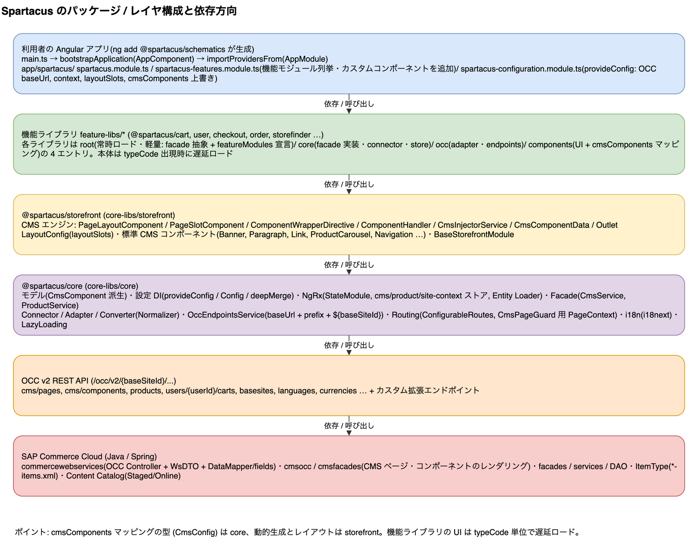

# 2. Spartacus のパッケージ構成

> **図**: 02 レイヤ構成(`diagrams/spartacus-architecture.drawio`)。利用者アプリ → 機能ライブラリ → @spartacus/storefront → @spartacus/core → OCC → SAP Commerce の依存方向

| パッケージ(npm 名) | リポジトリ内の場所 | 役割 |
|---|---|---|
| `@spartacus/core` | `spartacus/core-libs/core/` | 非 UI。モデル、NgRx ストア、OCC アダプタ(HTTP)、Facade サービス、設定の仕組み、ルーティング、i18n |
| `@spartacus/storefront` | `spartacus/core-libs/storefront/` | UI。CMS エンジン(ページレイアウト、スロット、コンポーネント動的生成)、レイアウト設定、標準 CMS コンポーネント群(バナー、段落、カルーセル等)、アウトレット |
| `@spartacus/styles` | `spartacus/core-libs/styles/` | SCSS |
| `@spartacus/setup` | `spartacus/core-libs/setup/` | SSR 用ユーティリティ |
| 機能ライブラリ(`@spartacus/cart`, `@spartacus/user`, `@spartacus/checkout`, …) | `spartacus/feature-libs/*` | 任意機能。`root` エントリ(常時ロード、軽量)と本体(遅延ロード)に分かれる |
| 連携ライブラリ | `spartacus/integration-libs/*` | CDC, CDS, OPF などバックエンドアドオンが必要なもの |
| 参照アプリ | `spartacus/projects/storefrontapp/` | SAP 自身が使う Angular アプリ。利用者のアプリの雛形として読める |

出典: `spartacus/.claude/CLAUDE.md`(リポジトリ同梱の構成説明)および各ディレクトリ。

依存方向は「アプリ → 機能ライブラリ → storefront → core」。バックエンド担当者が意識すべきなのは、**`cmsComponents` マッピングの型は core、動的生成とレイアウトは storefront** にあることと、**機能ライブラリは typeCode 単位で遅延ロードされる**ことの 2 点。

---

[目次](README.md) | ← [1. Angular 入門(バックエンド担当者向け)と Spartacus への対応](01-angular-basics.md) | [3. 全体像: URL からコンポーネント描画まで](03-rendering-flow.md) →
