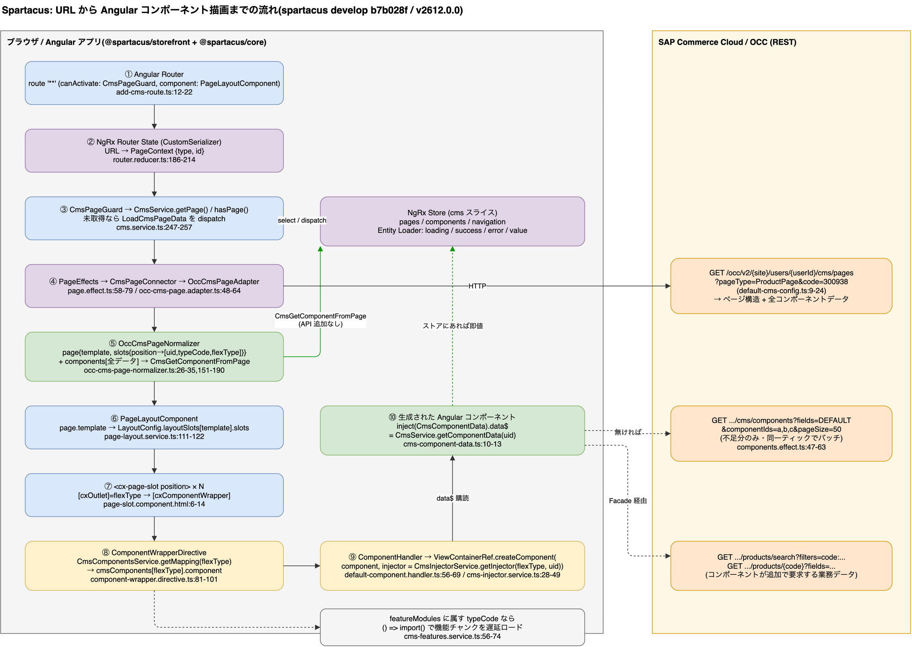

# 3. 全体像: URL からコンポーネント描画まで

> **図**: 01 全体フロー URL→描画(`diagrams/spartacus-architecture.drawio`)。本章の 10 ステップと、右側の OCC 呼び出しの対応




```
ブラウザ URL  /electronics-spa/en/USD/product/300938/...
   │
   ▼ Angular Router
[1] ワイルドカード route '**' (canActivate: CmsPageGuard, component: PageLayoutComponent)
   │
   ▼ NgRx Router State (CustomSerializer)
[2] PageContext を導出  { type: 'ProductPage', id: '300938' } / { type:'ContentPage', id:'__HOMEPAGE__' }
   │
   ▼ CmsPageGuard → CmsService.getPage() → hasPage()
[3] ストアに無ければ LoadCmsPageData を dispatch
   │
   ▼ PageEffects → CmsPageConnector → OccCmsPageAdapter
[4] GET users/{userId}/cms/pages?pageType=ProductPage&code=300938   (1 本)
   │
   ▼ OccCmsPageNormalizer
[5] レスポンス → { page: {template, slots{position → components[{uid,typeCode,flexType}]}}, components:[全データ] }
   │        └─ CmsGetComponentFromPage で全コンポーネントデータをストアへ(追加 API なし)
   ▼ PageLayoutComponent
[6] page.template ('ProductDetailsPageTemplate') → LayoutConfig.layoutSlots[template].slots で描画順を決定
   │
   ▼ <cx-page-slot position="Summary"> ×N
[7] slot.components を flexType ごとに <cxOutlet> → [cxComponentWrapper]
   │
   ▼ ComponentWrapperDirective
[8] CmsComponentsService.getMapping(flexType) → cmsComponents[flexType].component
   │   (featureModules に属す typeCode なら、ここで遅延 import())
   ▼ ComponentHandler (Default / Lazy / WebComponent)
[9] ViewContainerRef.createComponent(component, injector=CmsInjectorService.getInjector(flexType, uid))
   │
   ▼ 生成された Angular コンポーネント
[10] inject(CmsComponentData).data$ → CmsService.getComponentData(uid)  → ストアにあれば即値、無ければ cms/components をバッチ取得
```

### 3.1 [1] すべての URL を CMS ページとして受ける

`spartacus/core-libs/storefront/cms-structure/routing/cms-route/add-cms-route.ts:12-22`
```ts
const cmsRoute: Route = {
  path: '**',
  canActivate: [CmsPageGuard],
  component: PageLayoutComponent,
};
...
    const router = injector.get(Router);
    router.config.push(cmsRoute);
```
`CmsRouteModule` が `APP_INITIALIZER` でこれを実行する(`cms-route.module.ts:12-17`)。他のルートに一致しない URL はすべて `PageLayoutComponent` で描画される。リポジトリ同梱の開発ガイドも「CMS コンポーネントを Angular のルートに書いてはいけない」と明記している(`spartacus/core-libs/skills/skills/spartacus-developer/references/cms-component-wiring.md`)。

### 3.2 [2] URL → PageContext

`spartacus/core-libs/core/src/routing/store/reducers/router.reducer.ts:186-214`
```ts
      if (params['productCode']) {
        context = { id: params['productCode'], type: PageType.PRODUCT_PAGE };
      } else if (params['categoryCode']) {
        context = { id: params['categoryCode'], type: PageType.CATEGORY_PAGE };
      ...
      } else if (state.data.pageLabel !== undefined) {
        context = { id: state.data.pageLabel, type: PageType.CONTENT_PAGE };
...
    if (!context) {
      if (state.url.length > 0) {
        const pageLabel = '/' + state.url.map((urlSegment) => urlSegment.path).join('/');
        context = { id: pageLabel, type: PageType.CONTENT_PAGE };
      } else {
        context = { id: HOME_PAGE_CONTEXT, type: PageType.CONTENT_PAGE };
```
ルートパラメータから Product/Category、無ければ URL パスをそのままコンテンツページのラベルに、空 URL ならホーム(`'__HOMEPAGE__'`, `page-context.model.ts:15`)。

### 3.3 [3][4] ページ取得は「無ければ取る」

`spartacus/core-libs/core/src/cms/facade/cms.service.ts:247-257`
```ts
  hasPage(pageContext: PageContext, forceReload = false): Observable<boolean> {
    return this.store.pipe(
      select(CmsSelectors.getPageStateIndexLoaderState(pageContext)),
      tap((entity: LoaderState<string>) => {
        const attemptedLoad = entity.loading || entity.success || entity.error;
        const shouldReload = forceReload && !entity.loading;
        if (!attemptedLoad || shouldReload) {
          this.store.dispatch(new CmsActions.LoadCmsPageData(pageContext));
```
NgRx の Effect が OCC を呼ぶ(`spartacus/core-libs/core/src/cms/store/effects/page.effect.ts:58-79`):
```ts
      ofType(CmsActions.LOAD_CMS_PAGE_DATA),
      map((action: CmsActions.LoadCmsPageData) => action.payload),
      groupBy((pageContext) => serializePageContext(pageContext)),
      mergeMap((group) =>
        group.pipe(
          switchMap((pageContext) =>
            this.cmsPageConnector.get(pageContext).pipe(
              mergeMap((cmsStructure: CmsStructureModel) => {
                const actions: Action[] = [
                  new CmsActions.CmsGetComponentFromPage(
                    (cmsStructure.components ?? []).map((component) => ({ component, pageContext }))
                  ),
                  new CmsActions.LoadCmsPageDataSuccess(pageContext, cmsStructure.page ?? {}),
```
エンドポイント定義(`spartacus/core-libs/core/src/cms/config/default-cms-config.ts:9-24`):
```ts
      endpoints: {
        component: 'users/${userId}/cms/components/${id}',
        components: 'users/${userId}/cms/components',
        pages: 'users/${userId}/cms/pages',
        page: 'users/${userId}/cms/pages/${id}',
      },
  ...
  componentsLoading: { pageSize: 50 },
```
クエリの組み立て(`spartacus/core-libs/core/src/occ/adapters/cms/occ-cms-page.adapter.ts:86-101`): ホームは引数なし、コンテンツページは `pageType=ContentPage&pageLabelOrId=...`、それ以外は `pageType=ProductPage&code=...`。デモで観測した URL と一致する(付録 A)。

### 3.4 [5] ページ応答にコンポーネントデータが同梱されている

`spartacus/core-libs/core/src/occ/adapters/cms/converters/occ-cms-page-normalizer.ts:26-35`
```ts
  convert(source: Occ.CMSPage, target: CmsStructureModel = {}): CmsStructureModel {
    this.normalizePageData(source, target);
    this.normalizePageSlotData(source, target);
    this.normalizePageComponentData(source, target);
    this.normalizeComponentData(source, target);
    return target;
  }
```
`normalizeComponentData`(同 `:160-190`)は `contentSlots.contentSlot[].components.component[]` の各オブジェクトをそのまま `target.components` に積む。これが 3.3 の `CmsGetComponentFromPage` でストアに入るため、個別のコンポーネント取得 API は不要になる。

**flexType の決定(マッピングキーのルール)** `occ-cms-page-normalizer.ts:151-158`
```ts
  protected getFlexTypeFromComponent(component: Occ.Component | any): string {
    if (component.typeCode === CMS_FLEX_COMPONENT_TYPE) {
      return component.flexType;
    } else if (component.typeCode === JSP_INCLUDE_CMS_COMPONENT_TYPE) {
      return component.uid;
    }
    return component.typeCode;
  }
```

| バックエンドの typeCode | フロントが `cmsComponents` のキーに使う値 |
|---|---|
| `CMSFlexComponent` | 属性 `flexType` |
| `JspIncludeComponent` | `uid` |
| それ以外(カスタム ItemType を含む) | `typeCode` そのもの |

### 3.5 [6] テンプレート名 → スロットの描画順

`spartacus/core-libs/storefront/cms-structure/page/page-layout/page-layout.service.ts:111-122`
```ts
    const config = this.getSlotConfig(page.template ?? '', 'slots', section, breakpoint);
    if (config && config.slots) {
      const pageSlots = page.slots ? Object.keys(page.slots) : [];
      return config.slots.filter((slot) => pageSlots.includes(slot));
    } else if (!section) {
      this.logMissingLayoutConfig(page);
      return page.slots ? Object.keys(page.slots) : [];
```
`LayoutConfig.layoutSlots[テンプレート名].slots` が描画順を決め、**設定に無いスロットは描画されない**(設定自体が無いテンプレートは全スロットを描画)。既定値は `spartacus/core-libs/storefront/recipes/config/layout-config.ts:32-66`(例: `LandingPage2Template: { slots: ['Section1','Section2A','Section2B','Section2C','Section3','Section4','Section5'] }`)。現在は `layoutConfigFactory()`(同 `:190-198`)経由で提供される。

### 3.6 [7] スロット → コンポーネント

`spartacus/core-libs/storefront/cms-structure/page/slot/page-slot.component.html:6-14`
```html
  <ng-container *ngFor="let component of components">
    <ng-template
      *ngIf="component.flexType"
      [cxOutlet]="component.flexType"
      [cxOutletContext]="{ component: component }"
      [cxOutletDefer]="getComponentDeferOptions(component.flexType)"
      (loaded)="isLoaded($event)"
    >
      <ng-container [cxComponentWrapper]="component" />
```
各コンポーネントは `flexType` 名のアウトレットを通る(= 利用者がアウトレットで差し替え可能)。`cxOutletDefer` によりビューポート外のコンポーネントは描画が遅延される。

### 3.7 [8][9] マッピング解決と Angular コンポーネント生成

`spartacus/core-libs/storefront/cms-structure/page/component/component-wrapper.directive.ts:81-101`
```ts
  private launchComponent() {
    const componentMapping = this.cmsComponentsService.getMapping(this.cxComponentWrapper.flexType ?? '');
    ...
    this.launcherResource = this.componentHandler
      .getLauncher(
        componentMapping,
        this.vcr,
        this.cmsInjector.getInjector(this.cxComponentWrapper.flexType ?? '', this.cxComponentWrapper.uid ?? '', this.injector),
        this.cmsComponentsService.getModule(this.cxComponentWrapper.flexType ?? '')
      )
```
マッピングが無い場合は描画されず、開発モードでは警告が出る(`spartacus/core-libs/storefront/cms-structure/services/cms-components.service.ts:170-176`):
```
No component implementation found for the CMS component type '<flexType>'.
Make sure you implement a component and register it in the mapper.
```
→ **バックエンドで新 typeCode を追加しただけでは何も表示されない**。フロントのマッピング追加が必須。

生成は Angular 標準 API(`spartacus/core-libs/storefront/cms-structure/page/component/handlers/default-component.handler.ts:56-69`):
```ts
        componentRef = viewContainerRef.createComponent(factory, undefined, injector, undefined, module);
```

### 3.8 [10] コンポーネントがデータを受け取る方法

`spartacus/core-libs/storefront/cms-structure/page/component/services/cms-injector.service.ts:28-49`
```ts
  public getInjector(type: string, uid: string, parentInjector?: Injector): Injector {
    const configProviders = this.cmsComponentsService.getMapping(type)?.providers ?? [];
    return Injector.create({
      providers: [
        {
          provide: CmsComponentData,
          useFactory: (dataProvider: ComponentDataProvider) => ({
            uid,
            data$: dataProvider.get(uid, type),
          }),
          deps: [ComponentDataProvider],
        },
        provideLcpPresenceForCmsComponent(),
        ...configProviders,
      ],
      parent: parentInjector ?? this.injector,
```
`spartacus/core-libs/storefront/cms-structure/page/model/cms-component-data.ts:10-13`
```ts
export abstract class CmsComponentData<T extends CmsComponent> {
  uid: string;
  data$: Observable<T>;
}
```
`data$` の実体は `CmsService.getComponentData(uid)`(`component-data.provider.ts:39-53`)。マッピングに静的 `data` があればそれが先に流れ、バックエンドの値で上書きされる。


---

[目次](README.md) | ← [2. Spartacus のパッケージ構成](02-package-layers.md) | [4. なぜデモサイトの API 呼び出しが少ないのか](04-why-few-api-calls.md) →
