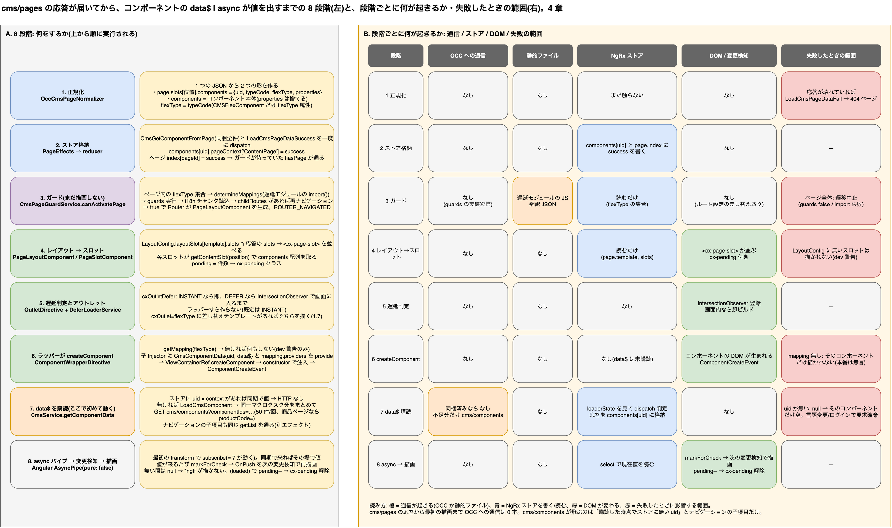

# 4. `cms/pages` 応答からコンポーネント描画まで: `async` パイプが値を出すまでに何が起きているか

> **図**: 12 cms/pages 応答 → async パイプまでの 8 段階(`diagrams/spartacus-architecture.drawio`)。左: 8 段階それぞれで「何をするか」。右: 段階ごとに OCC 通信 / 静的ファイル / NgRx ストア / DOM・変更検知 / 失敗したときの範囲を色分け



> **この章が答える問い**: `cms/pages` の応答が届いてから `cms/components` が飛ぶ(または飛ばない)までの間、そしてコンポーネントの `data$ | async` が値を出すまでの間に、何が・どの順で・どこで起きているか(①②)
>
> **位置づけ**: 3 章のステップ 5〜10(`cms/pages` 応答 → 描画)の拡大。Redux DevTools で見える形もここ

3 章は URL から描画までを 10 ステップで俯瞰し、7 章は「何が毎回で何が初回か」を実測した。この章はその間を埋める。`cms/pages` の HTTP 応答が JavaScript に渡った瞬間から、`ParagraphComponent` のテンプレートにある `data$ | async` が文字列を返す瞬間までを、ソースの実行順にたどる。

結論を先に書くと次の 3 点である。

- **応答が届いてから描画が始まるまでに、まだ HTTP の要らない仕事が 3 段階ある**。正規化(1)、ストア格納(2)、ガード(3)。ガードの中で遅延モジュールの `import()` と翻訳チャンクの読み込みが起き、`childRoutes` があれば遷移をやり直す。この間は画面に何も出ない。
- **`cms/components` は「誰かが `data$` を購読した時点でストアに無かった uid」についてだけ飛ぶ**(7)。`cms/pages` に同梱されたコンポーネントは段階 2 で `success` になっているので、購読した瞬間に同期で値が返り、HTTP は飛ばない。購読が起きるのは `async` パイプの最初の `transform` である(8)。
- **ナビゲーションの子項目は別経路で同じ `cms/components` を呼ぶ**。`CmsComponentConnector.getList` の呼び元は 2 箇所しかなく、デモのホームで観測した 2 本はこちらである。

## 4.1 全体の 8 段階

| 段階 | 何が起きる | 主なファイル | HTTP |
|---|---|---|---|
| 1 正規化 | 1 つの JSON から「スロットの配置」と「コンポーネント本体」の 2 つの形を作る | `occ-cms-page-normalizer.ts` | なし |
| 2 ストア格納 | 同梱コンポーネント全件とページを一度に NgRx へ入れる。`success` が立つ | `page.effect.ts`, `components.reducer.ts` | なし |
| 3 ガード | flexType の集合を取り、マッピング確定(遅延 `import()`)→ guards → i18n → childRoutes。通れば `PageLayoutComponent` を生成 | `cms-page.guard.ts`, `cms-page-guard.service.ts` | JS チャンク / 翻訳 JSON(静的ファイル) |
| 4 レイアウト → スロット | `LayoutConfig` と応答の slots の積集合で `<cx-page-slot>` を並べ、各スロットが components 配列を取る | `page-layout.service.ts`, `page-slot.component.ts` | なし |
| 5 遅延判定 | `cxOutletDefer` が INSTANT なら即、DEFER なら画面に入るまでラッパーを作らない | `outlet.directive.ts`, `defer-loader.service.ts` | なし |
| 6 `createComponent` | flexType → マッピング → 子 Injector に `CmsComponentData{uid, data$}` を provide して Angular コンポーネントを生成 | `component-wrapper.directive.ts`, `cms-injector.service.ts` | なし |
| 7 `data$` 購読 | ストアに uid があれば同期で値。無ければ `LoadCmsComponent` → まとめて `cms/components` | `cms.service.ts`, `components.effect.ts` | 不足分だけ OCC |
| 8 `async` → 描画 | 最初の `transform` で購読。値が来るたび `markForCheck`。`(loaded)` で `cx-pending` が外れる | Angular `AsyncPipe`, `page-slot.component.ts` | なし |

以下、段階ごとにソースで追う。引用はすべて `spartacus/core-libs/...`(コミット `b7b028f`)。

## 4.2 段階 1: 正規化。1 つの JSON から 2 つの形を作る

`OccCmsPageAdapter.load` が `GET .../cms/pages?pageType=...&pageLabelOrId=...` を投げ、応答を `CMS_PAGE_NORMALIZER` に通す(`core/src/occ/adapters/cms/occ-cms-page.adapter.ts:48-66`)。ホームだけは `pageLabelOrId` 無しで投げる(`:86-89`)。

`OccCmsPageNormalizer.convert` は 4 つの処理を順に呼ぶ(`core/src/occ/adapters/cms/converters/occ-cms-page-normalizer.ts:26-35`)。重要なのは後ろの 2 つで、**同じ `contentSlots[].components[]` を 2 回なめて別の形を作る**。

| 作るもの | 中身 | 根拠 |
|---|---|---|
| `page.slots[position].components[]` | `{ uid, typeCode, flexType, properties }` だけの軽い配置情報 | `:110-139` |
| `components[]` | コンポーネント本体(OCC の JSON そのまま)。ただし `properties` は捨てる | `:166-193`(`:183-186` で `properties = undefined`) |

`flexType` の決め方はここで固定される(`:151-158`)。`CMSFlexComponent` なら `flexType` 属性、`JspIncludeComponent` なら `uid`、それ以外は `typeCode`。**Angular 側のマッピング表のキーになるのはこの `flexType`** であり、11 章で「`typeCode` が Angular コンポーネントを選ぶ」と書いたのは、この変換を経た値である。

`properties` が捨てられる点はバックエンド担当者にとって重要である。SmartEdit 用の `properties`(`smartedit.componentId` など)はスロット側の配置情報にだけ残り(`:124`)、コンポーネント本体には入らない。つまり **`properties` に業務値を入れても `data$` には届かない**。

## 4.3 段階 2: ストア格納。同梱コンポーネント全件が `success` になる

`PageEffects.loadPageData$` が正規化結果を受け取り、1 回の応答から 2〜3 個のアクションを**まとめて** dispatch する(`core/src/cms/store/effects/page.effect.ts:58-108`)。

```
[ CmsSetPageSuccessIndex({id: label}) ]   ← 応答の label が URL 由来の id と違うときだけ(:84-91)
  CmsGetComponentFromPage([{component, pageContext}, ...])   ← 同梱コンポーネント全件(:69-74)
  LoadCmsPageDataSuccess(pageContext, page)                  ← ページ構造(:75-78)
```

`CmsGetComponentFromPage` は `EntitySuccessAction` で、`meta.entityId` に全 uid の配列を持つ(`core/src/cms/store/actions/components.action.ts:65-80`)。`entityReducer` は配列 ID と配列 payload を見ると **1 件ずつに分割して** 内側の reducer を呼ぶ(`core/src/state/utils/entity/entity.reducer.ts:40-57`)。内側の reducer は各 uid について次の形を書く(`core/src/cms/store/reducers/components.reducer.ts:71-87`)。

```
cms.components.entities[uid] = {
  component: { uid, typeCode, name, content, ... },   // 本体
  pageContext: {
    "ContentPage": { loading: false, error: false, success: true, value: true }
  }
}
```

キーの `"ContentPage"` は `serializePageContext(pageContext, true)` の結果である(`core/src/cms/utils/cms-utils.ts:21-34`)。**コンテンツページでは id を無視して型名だけ**、商品ページなどでは `"ProductPage-300938"` のように id 付きになる。従って

- 同じ uid のコンポーネント(ヘッダ、フッタ、共通バナー)は、**どのコンテンツページで取れたものでも全コンテンツページで共有**される。
- 商品ページのコンポーネントは**商品コードごとに別エントリ**になる。これが `cms/components?productCode=...` という問い合わせ(4.8)の理由であり、商品ごとに中身が変わりうるコンポーネント(制限付きバナー、商品参照)を正しく扱うための設計である。

ページ側は `page.index.content[pageId]` に `success` が立ち(`core/src/cms/store/reducers/index.ts:35-55`)、ガードが待っていた `hasPage` の `filter` が通る(`core/src/cms/facade/cms.service.ts:258-265`)。

### 2-a Redux DevTools で見える形

ここまでの結果は Redux DevTools でそのまま確認できる。見るべき場所は 2 つ、**State タブの `cms` 配下**と、**左ペインのアクション列**である。

**State の形**(`core/src/cms/store/cms-state.ts:12,80-84`、reducer の組み立ては `core/src/cms/store/reducers/index.ts:33-63`)

```
cms
├ page
│ ├ pageData.entities[pageId]        ← ページ本体。slots[pos].components は {uid,typeCode,flexType,properties} の配置情報だけ
│ └ index.{content|product|category|catalog}.entities[id]   ← ラベル/ID → pageId と loading/success
├ components.entities[uid]           ← コンポーネント本体。cms/pages 同梱分も cms/components 取得分もここ
│ ├ component: { uid, typeCode, name, content, ... }
│ └ pageContext: { "ContentPage": {loading,error,success,value} , "ProductPage-300938": {...} }
└ navigation.entities[navigationUid] ← ナビゲーションの子項目(4.8 の 7-d)
```

つまり **`cms/pages` で取れたコンポーネントは `page` ではなく `components` に入る**。ページ側には「どのスロットに何の uid があるか」だけが残り、本体は uid をキーにした別テーブルに移る。描画側(段階 7)は常に `components.entities[uid]` を見るので、本体がページ同梱で来たか `cms/components` で来たかを区別しない。

**アクション列**(型名は `core/src/cms/store/actions/page.action.ts:12-16`、`components.action.ts:13-17`)

| 順 | DevTools に出るアクション名 | ストアへの書き込み |
|---|---|---|
| 1 | `[Cms] Load Page Data` | `page.index.*[id]` を `loading: true` に |
| 2 | `[Cms] Get Component from Page` | 同梱全件を配列 1 発で dispatch。`entityReducer` が uid ごとに分割し、`components.entities[uid].component` に本体、`.pageContext["ContentPage"]` に `success: true, value: true` |
| 3 | `[Cms] Load Page Data Success` | `page.pageData.entities[pageId]` にスロット配置、`page.index.*[id]` を `success: true` に |
| (4) | `[Cms] Set Page Success Index` | URL 由来の id と応答の `label` が違うときだけ。別名でも同じ pageId を指すよう index に追加 |
| 後 | `[Cms] Load Component` → `[Cms] Load Component Success` | 段階 7 で足りなかった uid。書き込み先は 2 と同じ `components.entities[uid]`(`components.reducer.ts:56-69`) |
| 後 | `[Cms] Load NavigationEntry items` → Success | ナビゲーション子項目(7-d)。`navigation.entities[...]` |

2 と「後」の行は同じ reducer のケースに並んで書かれており(`components.reducer.ts:26-28,56-87`)、結果の形も同じである。DevTools 上で「このコンポーネントは同梱だったのか HTTP で取ったのか」を知りたいときは、State ではなく**直前のアクション名**で判断する。

**`pageContext` のキーを見る**。コンテンツページでは `"ContentPage"` の 1 キーだけで、ページ ID を含まない(`core/src/cms/utils/cms-utils.ts:21-34` の `ignoreContentPageId`)。ホームで取れたヘッダの uid は、別のコンテンツページに遷移しても同じキーが `success` のままなので再取得されない。商品ページに遷移すると同じ uid の下に `"ProductPage-300938"` のようなキーが増える。`value: false` のキーがあれば「問い合わせたが、そのコンテキストでは存在しない(制限で弾かれた)」の記録である(`cms-state.ts:25-58` のコメント)。

> 注: `cms-state.ts` のコメントには `ContentPage-homepage` という例が書かれているが、reducer は `serializePageContext(ctx, true)` を使うので実際のキーは `ContentPage` になる。DevTools で確認できるのは後者である。

## 4.4 段階 3: ガード。描画の前にマッピング・guards・i18n・childRoutes を片付ける

`CmsPageGuard.canActivate` は `getNextPageContext()` で**遷移先**のコンテキストを取り、`cmsService.getPage(pageContext, shouldReload())` が値を返すのを待っていた(`storefront/cms-structure/guards/cms-page.guard.ts:51-84`)。`shouldReload()` は `loadStrategy` が `ONCE` でない限り true で(`:89-91`)、これが 7 章の「`cms/pages` は毎回」の根拠である。

ページが取れると `CmsPageGuardService.canActivatePage` に進む(`storefront/cms-structure/guards/cms-page-guard.service.ts:65-99`)。ここで 5 つのことが順に起きる。

| 順 | 処理 | 根拠 | 何が読み込まれるか |
|---|---|---|---|
| a | `getPageComponentTypes`: ページ内の全スロットの `flexType` を集合にする | `cms-page-guard.service.ts:71-72`, `core/src/cms/store/selectors/page.selectors.ts:40-52` | ストアを読むだけ |
| b | `determineMappings(types)`: 型ごとに Angular 側マッピングを確定する | `storefront/cms-structure/services/cms-components.service.ts:79-115` | **遅延モジュールの JS チャンク** |
| c | `cmsPageCanActivate`: マッピングの `guards` を集めて実行する | `:76-80`, `storefront/cms-structure/services/cms-guards.service.ts:36-48` | guard の実装次第 |
| d | `loadForComponents`: マッピングの `i18nKeys` から翻訳チャンクを読み込む | `:81-85`, `storefront/cms-structure/services/cms-i18n.service.ts:21-28` | **翻訳 JSON** |
| e | `handleCmsRoutesInGuard`: `childRoutes` を持つ型があればルート設定を差し替えて再ナビゲーション | `:86-97`, `storefront/cms-structure/services/cms-routes-impl.service.ts:69-91` | なし(ただし遷移をやり直す) |

**b の中身**。`determineMappings` は型ごとに、`featureModules` 設定に属していなければ静的な `cmsComponents` 設定をそのままマッピングとして採用する(`cms-components.service.ts:100-105`)。属していれば `CmsFeaturesService.getCmsMapping` → `FeatureModulesService.resolveFeature` で**ここで初めて** `import()` が走り(`storefront/cms-structure/services/cms-features.service.ts:89-103, 134-152`)、読み込んだモジュールの `DefaultConfigChunk` / `ConfigChunk` を `deepMerge` してその機能の `cmsComponents` 設定を取り出す(`:188-205`)。機能側の設定を既定、アプリの `provideConfig` を上書きとして合成する(`cms-components.service.ts:129-133`)。1.4 章の「`provideConfig` が効く」が遅延モジュールでも成り立つのはこの合成のためである。

**e の中身**。`childRoutes` を持つ型(例: 注文履歴、アカウント系)がページにあると、`router.resetConfig` でそのページ専用のルートを先頭に差し込み(`cms-routes-impl.service.ts:107-119`)、`navigateByUrl(currentUrl)` を呼んで **ガード自身は false を返す**(`:86-87`)。つまり 1 回目の遷移は捨てられ、新しいルート設定で 2 回目の遷移が走る。2 回目は `cxCmsRouteContext` が付いているのでこの処理を飛ばす(`cms-page-guard.service.ts:88`)。ネットワーク上は `cms/pages` が 1 回しか飛ばないのに遷移が 2 回起きる、という現象の正体である。

ガードが true を返すと、Angular Router は `'**'` ルートに登録された `PageLayoutComponent` を生成する(`storefront/cms-structure/routing/cms-route/add-cms-route.ts:12-16`)。同時に NgRx の router 状態が `ROUTER_NAVIGATED` を受けて `nextState` を `state` に昇格させ(`core/src/routing/store/reducers/router.reducer.ts:77-89`)、以後 `getPageContext()`(`core/src/routing/facade/routing.service.ts:56-57`)が新しいページを指す。

**ここまでの失敗はページ全体に効く**。guards が false / UrlTree を返せば遷移中止、`import()` が失敗すればマッピングが確定せず遷移が進まない。段階 7 以降のコンポーネント単位の失敗とは影響範囲が違う。

## 4.5 段階 4: レイアウト → スロット。DOM の器ができる

`PageLayoutComponent` は `templateName$`(= 応答の `page.template`)と `slots$` を持つ(`storefront/cms-structure/page/page-layout/page-layout.component.ts:36-45`)。`slots$` は `LayoutConfig.layoutSlots[template].slots` を**応答に実在するスロット名で filter** した配列である(`storefront/cms-structure/page/page-layout/page-layout.service.ts:106-127`)。`LayoutConfig` に無いテンプレートなら応答のスロットをそのまま全部並べ、dev モードで警告を出す(`:120-122, 251-273`)。ブレークポイントごとの設定と `PAGE_LAYOUT_HANDLER` もここで効く(`:54-80`)。

テンプレートは `*ngFor` でスロット名ごとに `<cx-page-slot [position]="slot">` を置く(`page-layout.component.html:13-17`)。ヘッダ・ナビ・フッタは `<cx-storefront>` 側に固定で置かれた `<cx-page-layout section="header">` などが担当し(`storefront/layout/main/storefront.component.html:11, 13, 25`)、`<router-outlet>`(`:20`)に本文のレイアウトが入る。**同じ 1 本の `cms/pages` 応答を、ヘッダ・本文・フッタの 3 つのレイアウトが別々のスロット名で読んでいる**。

`PageSlotComponent` は `position` を受け取ると `cmsService.getContentSlot(position)` を購読する(`storefront/cms-structure/page/slot/page-slot.component.ts:97-106`)。これは `getPageContext()` → `getCurrentSlotSelectorFactory(pageContext, position)` で、ストアの `page.slots[position]` を返す(`cms.service.ts:152-165`, `page.selectors.ts:105-114`)。得た `components` 配列を保持し(`page-slot.component.ts:124-131`)、`decorate` で **`pending` = コンポーネント数** とし、ホスト要素に `cx-pending` クラスを付ける(`:133-173`)。`isDistinct` は uid の並びが同じなら再描画しない(`:201-213`)。これが「同じページに戻っても、スロットの中身が同じならコンポーネントは作り直されない」理由の 1 つである。

## 4.6 段階 5: 遅延判定とアウトレット。ラッパーを「いつ」作るか

スロットのテンプレートは、コンポーネント 1 件につき次の 3 つを重ねる(`page-slot.component.html:6-15`)。

```html
<ng-template [cxOutlet]="component.flexType"
             [cxOutletContext]="{ component: component }"
             [cxOutletDefer]="getComponentDeferOptions(component.flexType)"
             (loaded)="isLoaded($event)">
  <ng-container [cxComponentWrapper]="component" />
</ng-template>
```

`OutletDirective.ngOnChanges` が `render()` を呼び、`cxOutletDefer` があれば `deferLoading()`、無ければ即 `build()` する(`storefront/cms-structure/outlet/outlet.directive.ts:92-96, 78-90`)。`deferLoading` は `DeferLoaderService.load(hostElement, options)` が値を出すまで**ラッパーすら生成しない**(`:102-116`)。

`DeferLoaderService` の判定は次の通り(`storefront/layout/loading/defer-loader.service.ts:44-64`)。

| 条件 | 結果 |
|---|---|
| SSR 中 | 即 |
| コンポーネント型の `deferLoading` が `INSTANT` | 即 |
| 型が `DEFER`、またはグローバル設定が `DEFER` | `IntersectionObserver` で画面に入るまで待つ(`storefront/layout/loading/intersection.service.ts:106-110`) |
| グローバル設定の既定 | `INSTANT`(`defer-loader.service.ts:30-32`)。recipes のサンプル設定ではコメントアウトされている(`storefront/recipes/config/layout-config.ts:28`) |

さらに `PageSlotService` は、ブラウザ起動時に**すでに DOM にあって画面内にある** `cx-page-slot`(SSR で描かれたもの)を一度だけ `INSTANT` 扱いにする(`storefront/cms-structure/page/slot/page-slot.service.ts:30-42, 51-73`)。SSR 済みの画面を CSR が引き継ぐとき、見えている部分を遅延させないための処理である。

`build()` は `OutletService` に `flexType` 名の差し替えテンプレートがあればそれを、無ければ自分の `<ng-template>` を描く(`outlet.directive.ts:121-139`)。1.7 章の「マッピングを変えずに差し込む」はここで効く。既定では自分のテンプレート、つまり `cxComponentWrapper` が生成される(`:175-186`)。

## 4.7 段階 6: ラッパーが `createComponent` する。`CmsComponentData` が生まれる

`ComponentWrapperDirective.ngOnInit` は `determineMappings([flexType])` を購読する(`storefront/cms-structure/page/component/component-wrapper.directive.ts:67-79`)。段階 3 で確定済みの型なら同期で返る。`shouldRender`(SSR で `disableSSR` の型を除外。`cms-components.service.ts:187-190`)を通れば `launchComponent` に進む(`:81-117`)。

1. `getMapping(flexType)` でマッピングを取る(`:82-84`)。**無ければ何もせず return**(`:86-88`)。dev モードでは「No component implementation found for the CMS component type ...」が 1 回だけ出る(`cms-components.service.ts:170-178`)。本番では黙って空になる。バックエンドで新しい `typeCode` を作ったのにフロントの `provideConfig` が無い、という状態はここで止まる。
2. `CmsInjectorService.getInjector(flexType, uid, parentInjector)` で**子 Injector**を作る(`:94-98`, `storefront/cms-structure/page/component/services/cms-injector.service.ts:28-50`)。provide されるのは
   - `CmsComponentData` = `{ uid, data$: ComponentDataProvider.get(uid, type) }`(`:37-44`)。型は `storefront/cms-structure/page/model/cms-component-data.ts:10-13`
   - LCP 計測用の `LCP_PRESENCE`(`:45`)
   - マッピングの `providers`(`:46`)。コンポーネント固有のサービス差し替えはここに書く
3. `ComponentHandlerService.getLauncher` がマッピングの形に合うハンドラを選ぶ(`storefront/cms-structure/page/component/services/component-handler.service.ts:74-88`)。`component` がクラスなら `DefaultComponentHandler` で、`viewContainerRef.createComponent(factory, undefined, injector, undefined, module)` を呼ぶ(`storefront/cms-structure/page/component/handlers/default-component.handler.ts:56-70`)。**ここで Angular コンポーネントのインスタンスが生まれ、コンストラクタで `CmsComponentData` が注入される**(`storefront/cms-components/content/paragraph/paragraph.component.ts:44-47`)。`module` は遅延モジュールの `NgModuleRef` で、機能ライブラリ内の DI をそのコンポーネントから引けるようにする(`component-wrapper.directive.ts:99-101`)。
4. 生成後に `ComponentCreateEvent` を発行し、SmartEdit 用の `data-*` 属性を付け、親の `ChangeDetectorRef.markForCheck()` を呼ぶ(`:105-113`)。破棄時は `ComponentDestroyEvent`(`:114`)。

この時点で **`data$` はまだ誰も購読していない**。`ComponentDataProvider.get` は `defer` で包まれていて、購読されるまで中身を作らない(`storefront/cms-structure/page/component/services/component-data.provider.ts:35-59`)。

## 4.8 段階 7: `data$` を購読する。ストアにあれば同期、無ければ `cms/components`

### 7-a 購読で何が組み立てられるか

`ComponentDataProvider.get(uid, type)` は、マッピングに静的 `data` があれば `startWith(静的データ)` で先に流し、ストアの値をマージして上書きする(`component-data.provider.ts:44-51`)。無ければ `cmsService.getComponentData(uid)` をそのまま返す(`:53`)。

`CmsService.getComponentData(uid)` は uid × コンテキストごとに Observable をキャッシュする(`cms.service.ts:74-95`)。`pageContext` を渡さない呼び出しなので、`routingService.getPageContext()` の**現在値**を使って再帰する(`:101-108`)。段階 3 の終わりで `ROUTER_NAVIGATED` が済んでいるので、ここでの現在値は新しいページである。

`createComponentData` が作るのは 2 本の流れである(`:112-146`)。

```
loading$   = combineLatest([ getNextPageContext(),                       // 遷移中なら遷移先、遷移が終わっていれば undefined
                             select(componentsLoaderStateSelectorFactory(uid, "ContentPage")) ])
             .pipe(tap(([next, state]) => {
               attemptedLoad            = state.loading || state.success || state.error;
               couldBeLoadedWithPageData = next ? serialize(next) === "ContentPage" : false;
               if (!attemptedLoad && !couldBeLoadedWithPageData) dispatch(LoadCmsComponent({uid, pageContext}));
             }))                                                          // :112-135

component$ = select(componentsSelectorFactory(uid, "ContentPage")).pipe(filter(isNotUndefined))   // :137-140

return using(() => loading$.subscribe(), () => component$).pipe(shareReplay({bufferSize: 1, refCount: true}))   // :142-145
```

`using` は「`component$` を誰かが購読したときに `loading$` も購読し、全員が離れたら両方止める」という意味である。**購読が起きて初めて `LoadCmsComponent` を dispatch するかどうかの判定が走る**。`couldBeLoadedWithPageData` は、遷移中(`cms/pages` の応答待ち)に先走って `cms/components` を投げないための抑止で、遷移が終われば効かなくなる。

`componentsSelectorFactory` は 3 値を返す(`core/src/cms/store/selectors/components.selectors.ts:76-94`)。`success` なら本体、`error`(存在しない uid)なら `null`、どちらでもなければ `undefined`。`undefined` は `filter` で落とされるので、**データが無い間 `data$` は何も流さない**。

### 7-b 同梱されていた場合(段階 2 で `success` 済み)

`attemptedLoad` が true なので dispatch は起きない。`component$` は購読と同時に NgRx ストアの現在値を同期で流す。従って **`async` パイプの最初の `transform` の戻り値がすでにコンポーネント本体**であり、HTTP は 1 本も飛ばない。デモのホームで 33 コンポーネントがこの経路を通る。

### 7-c 同梱されていなかった場合

`LoadCmsComponent({uid, pageContext})` が dispatch され、`ComponentsEffects.loadComponent$` が受ける(`core/src/cms/store/effects/components.effect.ts:41-65`)。

1. `groupBy(serializePageContext(pageContext))` でページコンテキストごとに分ける(`:49-51`)。
2. `bufferDebounceTime(0)` で、**同じマクロタスク内に dispatch された uid を 1 つの配列にまとめる**(`:54`, `core/src/util/rxjs/buffer-debounce-time.ts:10-24`)。1 回の変更検知で 10 個のラッパーが購読すれば、10 uid が 1 配列になる。
3. `CmsComponentConnector.getList(uids, pageContext)`(`core/src/cms/connectors/component/cms-component.connector.ts:41-86`)。まず静的 `CmsStructureConfig` にある uid を除外し(`:42-54`, `core/src/cms/services/cms-structure-config.service.ts:75-78`)、残りを `componentsLoading.pageSize`(既定 50。`core/src/cms/config/default-cms-config.ts:21-23`)ずつに切って `findComponentsByIds` を並列に呼び、`zip` で結合する(`:55-80`)。
4. `OccCmsComponentAdapter.findComponentsByIds` が `GET .../cms/components?fields=DEFAULT&currentPage=0&pageSize=N&componentIds=a,b,c` を組み立てる(`core/src/occ/adapters/cms/occ-cms-component.adapter.ts:51-78`)。`pageContext` が商品ページなら `productCode=`、カテゴリなら `categoryCode=`、カタログなら `catalogCode=` が付く(`:132-152`)。これが 7 章で観測した `cms/components?productCode=300938` の形である。
5. 応答の `component[]` を 1 件ずつ `LoadCmsComponentSuccess` にし、**要求したのに返ってこなかった uid は `LoadCmsComponentFail`** にする(`components.effect.ts:80-103`)。reducer が `component` を書き、`pageContext[context]` を `success` / `error` にする(`components.reducer.ts:56-70, 41-55`)。
6. セレクタが本体(または `null`)を流し、`data$` が値を出す。

`withdrawOn(contextChange$)` が付いているので(`:63`)、応答待ちの間に言語変更・ログイン・ログアウトが起きると**その要求は捨てられる**(`:33-39`)。6 章のメタリデューサがストアも消すので、新しい言語で `cms/pages` からやり直しになる。

### 7-d もう 1 本の経路: ナビゲーションの子項目

`getList` を呼ぶのは `ComponentsEffects` と `NavigationEntryItemEffects` の 2 箇所だけである(`grep "\.getList(" core-libs/core/src/cms`)。後者は `NavigationComponent` が `data$`(`CMSNavigationComponent` 本体)を購読したあと、`navigationNode.entries[].itemId` のうち `itemSuperType === 'AbstractCMSComponent'` のものを集めて `cmsService.loadNavigationItems` を呼ぶことで始まる(`storefront/cms-components/navigation/navigation/navigation.component.ts:24-26`, `navigation.service.ts:45-87, 95-118`)。エフェクトは**ナビゲーションノード 1 本につき 1 回** `getList` を呼ぶ(`core/src/cms/store/effects/navigation-entry-item.effect.ts:35-63, 83-102`)。

7 章のデモ実測でホーム初回に `cms/components` が 2 本(26 件 + 8 件)飛んだのはこの経路である。ホームの 33 コンポーネントは全件同梱されていて 7-c は起きない。2 本はそれぞれ 1 つのナビゲーションコンポーネント(ヘッダのカテゴリナビ、フッタのナビ)が持つリンク項目の取得で、要求されているのは `CMSLinkComponent` の uid 群である。**つまりバックエンドで「ナビゲーションノードに大量のリンクを足す」と、ページ応答は変わらず `cms/components` の `componentIds` が増える**。

## 4.9 段階 8: `async` パイプが購読し、変更検知が描く

`ParagraphComponent` のテンプレートは次の形である(`storefront/cms-components/content/paragraph/paragraph.component.html:1-4`)。

```html
<div *ngIf="component.data$ | async as data"
     [innerHTML]="bypassSecurityTrustHtml(data.content | cxSupplementHashAnchors)"></div>
```

`AsyncPipe` は Angular 本体のクラスで(`packages/common/src/pipes/async_pipe.ts`。手元で確認したのは `@angular/common` 22.0.1 のビルド済みファイル `fesm2022/_common_module-chunk.mjs` の `class AsyncPipe`。Spartacus が使う 21.x と同じ実装)、`pure: false` なので変更検知のたびに `transform` が呼ばれる。動きは次の 3 つだけである。

| 呼び出し | 動き |
|---|---|
| 最初の `transform(obj)` | `_obj` が未設定なら `_subscribe(obj)`。**ここで段階 7 の購読が起きる**。同期で値が来ればその値を、来なければ `null` を返す(購読中の初回だけ `markForCheck` を抑止し、戻り値で返す) |
| 値が流れてきたとき | `_latestValue` を更新し、`ChangeDetectorRef.markForCheck()` を呼ぶ。`OnPush` のコンポーネントでも次の変更検知で再描画される |
| 2 回目以降の `transform` | 同じ Observable なら `_latestValue` を返すだけ。別の Observable に差し替わったら購読し直す |

従って

- **7-b(同梱済み)**: 最初の変更検知で `transform` → 同期で本体 → `*ngIf` が true → 同じサイクルで `innerHTML` が入る。応答が届いてから描画まで HTTP は 0 本。
- **7-c(未同梱)**: 最初の `transform` は `null` → `*ngIf` が false → 何も描かない。`cms/components` の応答がストアに入ると `data$` が流れ、`markForCheck` → 次の変更検知で描画。この間スロットは `cx-pending` のまま。
- `null` が「まだ無い」ではなく「存在しない」(段階 7 の `error`)の場合も `*ngIf` は false で、そのコンポーネントだけ空になる。ページ全体には影響しない。

最後に `cxOutletDefer` の `(loaded)` が `PageSlotComponent.isLoaded(true)` を呼び、`pending` を 1 減らす(`page-slot.component.html:12`, `page-slot.component.ts:183-188`)。0 になると `cx-pending` が外れる。注意点として、`loaded` は `OutletDirective` が `build()` した時点、つまり**ラッパー生成時に emit される**(`outlet.directive.ts:111-114`)。`data$` の到着ではない。「`cx-pending` が外れた = データが来た」ではない。

## 4.10 時間軸でまとめる

デモのホーム初回(CSR、7 章の①)を、この章の段階に当てはめると次のようになる。

```
t0   GET cms/pages 応答(73KB、33 コンポーネント同梱)
t0+  段階 1 正規化 → 段階 2 ストア格納(33 件 success)                    HTTP なし
     段階 3 ガード: flexType 集合 → マッピング確定(未ロードの機能モジュールがあれば JS チャンク取得)
                   → guards → 翻訳チャンク → childRoutes 無し → true      JS / JSON のみ
     段階 4〜6: cx-page-layout → cx-page-slot ×19 → ラッパー → createComponent ×33  HTTP なし
     段階 7-b: 33 件とも data$ が同期で値 → 段階 8: 同じ変更検知で描画           HTTP なし
t1   段階 7-d: NavigationComponent ×2 が子項目を要求 → GET cms/components ×2(26 件 + 8 件)
t1+  段階 3(コンポーネント単位): ProductCarouselComponent の data$ から productCodes
     → ProductService → GET products/search?filters=code:...(7 章の階層 3)
```

`cms/pages` の応答から最初の描画まで OCC への通信は 1 本も無い。`cms/components` が飛ぶのは、同梱されなかった uid を誰かが購読したときと、ナビゲーションの子項目だけである。

## 4.11 バックエンド担当者にとっての意味

| 観点 | この章からわかること | 根拠 |
|---|---|---|
| 追加 API は要るか | カスタムコンポーネントを普通にスロットへ置けば `cms/pages` に同梱され、`cms/components` も追加の API も要らない。描画は同期 | 4.3, 4.8 7-b |
| `flexType` の意味 | マッピング表のキーは `typeCode`(`CMSFlexComponent` だけ `flexType` 属性)。フロントに `provideConfig` が無い型は、本番では黙って空になる | 4.2, 4.7 |
| `properties` | SmartEdit 用。`data$` には入らないので業務値を入れても届かない | 4.2 |
| コンテキスト共有 | コンテンツページ間では同じ uid の本体が共有される。商品ページは商品コードごと。商品に依存する内容を持つコンポーネントは商品ページに置くこと | 4.3, 4.8 7-c |
| ナビゲーション | ナビゲーションノードのリンクは `cms/pages` ではなく `cms/components?componentIds=` で来る。リンク数がそのまま `componentIds` の長さになる | 4.8 7-d |
| 失敗の範囲 | guards / 遅延モジュール / 翻訳の失敗はページ全体(遷移中止)。コンポーネントデータの欠落はそのコンポーネントだけ空 | 4.4, 4.9 |
| 遅延描画 | 既定では遅延しない。`deferLoading: DEFER` を設定した型だけ画面に入るまでラッパーも作られず、`data$` の購読も起きない。業務データの API もそれまで飛ばない | 4.6 |
| 言語変更中 | 応答待ちの `cms/components` は捨てられ、ストアごと消えて `cms/pages` からやり直す | 4.8 7-c, 6 章 |

---

[目次](README.md) | ← [3. 全体像: URL からコンポーネント描画まで](03-rendering-flow.md) | [5. API の形と State の形はなぜ違うのか: Normalizer / Effect / Reducer の 3 層による作り変え](05-api-to-state.md) →
