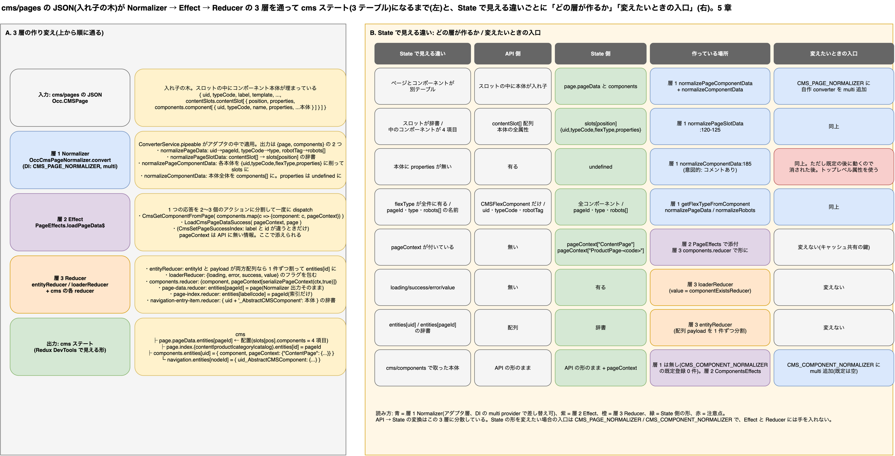

# 5. API の形と State の形はなぜ違うのか: Normalizer / Effect / Reducer の 3 層による作り変え

> **図**: 13 API の形 → State の形: 3 層の作り変え(`diagrams/spartacus-architecture.drawio`)。左: `cms/pages` の JSON が Normalizer → Effect → Reducer を通って `cms` ステートになるまでの 5 段。右: 「State で見える違い」ごとに API 側の形 / State 側の形 / 作っている場所 / 変えたいときの入口



> **この章が答える問い**: Redux DevTools で見える `cms` ステートの形(`page` / `components` / `navigation` の 3 テーブル、`entities[uid]` の辞書、`pageContext` のフラグ)は `cms/pages` の JSON と一致しない。この差はどのロジックが、どの順で作っているのか(①③)
>
> **位置づけ**: 4 章の段階 1〜2(正規化とストア格納)の拡大。API の JSON が State の形になるまで

### 5.0 先に話し言葉で: あなたの JSON は、届いた形では保存されない

バックエンド側の感覚だと、`cms/pages` の応答はそのまま画面の材料になるはずです。ところが Redux DevTools を開くと、返した JSON と似ても似つかない形が見えます。`page` と `components` と `navigation` という 3 つのテーブル、`entities` という uid をキーにした辞書、`loading / success / error` というフラグ。これは壊れているのではなく、**届いた JSON を「テーブル」に正規化して保存している**だけです。

理由は DB の正規化と同じです。応答の JSON は「ページを表示するために JOIN 済みのビュー」の形をしています。スロットの中にコンポーネントの本体が入れ子になっている。これをそのまま持つと、同じコンポーネントが別のページにも置かれたときに二重に持つことになり、「取得済みかどうか」の印をコンポーネント 1 件ずつに付けられません。8.0 の規則 1「State にあれば API を叩かない」を部品単位で成り立たせるには、部品単位の表が要ります。

作り変えは 3 つの層で、順番に起きます。

1. **Normalizer が形を割る。** 入れ子の JSON を、「どのスロットにどの uid が並ぶか」(配置)と「uid ごとの本体」(部品)の 2 つに引き剥がします。項目名もここで付け替わります(`uid` → `pageId`、`typeCode` → `type`)。あなたの JSON の形を知っているのはこの層だけです(5.2)。
2. **Effect が 1 つの応答を 2〜3 個のアクションに割り、文脈を添える。** 「このページはどの URL から来たか」(`pageContext`)は応答に入っていないので、ここで付け足します(5.3)。
3. **Reducer が配列を辞書にして、フラグを付ける。** 配列を `entities[uid]` の辞書に入れ替え、1 件ごとに `success: true` の印を付けます。次に同じ uid を購読したとき、この印を見て API を飛ばしません(5.4)。

ここから、バックエンド側に効くことは 3 つです。

- **属性を 1 つ足せば、フロントの State には何もしなくても届く。** Normalizer はコンポーネント本体を(`properties` を除いて)丸ごと通すので(`spartacus/core-libs/core/src/occ/adapters/cms/converters/occ-cms-page-normalizer.ts:183-190`)、`entities[uid].value` の中に新しい属性がそのまま現れます。フロント側が触るのは、それを描くテンプレートだけです(5.7、11 章)。
- **項目名や入れ子の形を変えると、Normalizer が壊れる。** `uid`、`typeCode`、`contentSlots.contentSlot[].components.component[]` の形は Normalizer が決め打ちで読んでいます。OCC 標準の形は崩さない(5.2)。
- **DevTools で見るときは、`cms.components.entities[uid].value` があなたの JSON の 1 件。** `cms.page.entities[pageId].value.slots` が配置。この 2 つを突き合わせれば、「どのスロットのどの部品がどの属性を持っているか」を API の応答を見ずに確認できます(5.6)。

以下、同じ流れを層ごとにソースの行番号付きで追う。

4 章で、`cms/pages` に同梱されたコンポーネント本体が `cms.page` ではなく `cms.components` に入ることを見た。この章はその一歩手前、「API の JSON がどこで State の形に作り変えられるか」だけを扱う。結論から書くと、変換は 1 箇所ではなく **3 つの層に分かれており、層ごとに担当する違いが決まっている**。

| 層 | 場所 | 担当する変換 |
|---|---|---|
| 1 Normalizer | OCC アダプタの中(`ConverterService` + `CMS_PAGE_NORMALIZER`) | 入れ子の JSON を `{page, components}` の **2 つに引き剥がす**。スロット配列を position キーの辞書に。コンポーネント本体から `properties` を落とす。項目名の付け替え(`uid`→`pageId`、`typeCode`→`type`) |
| 2 Effect | NgRx Effect(`PageEffects`) | 1 つの応答を **2〜3 個のアクションに分割**し、`pageContext` という API に無い情報を添える |
| 3 Reducer | NgRx Reducer(`entityReducer` + 各 reducer) | 配列を **`entities[id]` の辞書**に。`loading / success / error / value` のフラグを付ける。`navigation` は `uid_AbstractCMSComponent` キーの辞書に畳む |

## 5.1 入力: `cms/pages` の JSON の形

OCC の応答型は `Occ.CMSPage`(`core-libs/core/src/occ/occ-models/occ.models.ts:334-`)。構造は入れ子で、**スロットの中にコンポーネント本体が埋まっている**。

```
Occ.CMSPage {
  uid, name, typeCode, label, template, title, description, properties, robotTag,
  contentSlots: {
    contentSlot: [                           ← 配列(occ.models.ts:326-328)
      { position, slotId, slotShared, slotStatus, properties,
        components: {
          component: [                       ← 配列(occ.models.ts:298-300)
            { uid, typeCode, name, modifiedtime, properties, ...本体の全属性 }
          ]
        }
      }
    ]
  }
}
```

バックエンド側の `cmsocc` はページ・スロット・コンポーネントを 1 本の木として返す。Spartacus の State はこの木をそのまま持たない。

## 5.2 層 1: Normalizer。JSON を `{page, components}` に引き剥がす

### どこで呼ばれるか

`OccCmsPageAdapter.load` は HTTP 応答をそのまま返さず、`this.converter.pipeable(CMS_PAGE_NORMALIZER)` を通してから返す(`occ/adapters/cms/occ-cms-page.adapter.ts:48-66`)。

- `CMS_PAGE_NORMALIZER` は DI の `InjectionToken`(`cms/connectors/page/converters.ts:11`)。OCC モジュールが `OccCmsPageNormalizer` を `multi: true` で登録している(`occ/adapters/cms/cms-occ.module.ts:23-27`)。
- `ConverterService.pipeable` は、トークンに converter が 1 つ以上登録されていれば `map` で適用し、無ければ何もしない素通し演算子を返す(`util/converter.service.ts:80-88`)。複数登録されていれば `reduce` で**順に同じ target に書き足す**(`:130-136`)。

つまり「API 形 → Spartacus 形」の変換は Angular DI の multi provider として差し込まれており、HTTP 層でもストア層でもなく、その間の **アダプタ層**に置かれている。

### 何をするか

`OccCmsPageNormalizer.convert` は 4 つの関数を順に呼ぶ(`occ/adapters/cms/converters/occ-cms-page-normalizer.ts:26-35`)。出力は `CmsStructureModel {page?, components?}`(`cms/model/page.model.ts:31-34`)。

| 順 | 関数 | 入力 → 出力 | 行 |
|---|---|---|---|
| 1 | `normalizePageData` | `uid`→`pageId`、`typeCode`→`type`、`name/label/template/title/description/properties` はそのまま、`robotTag`→`robots[]` | :40-80, :198- |
| 2 | `normalizePageSlotData` | `contentSlots.contentSlot[]`(配列)→ `page.slots[position]`(辞書)。この時点ではスロットの `properties` だけ | :82-105 |
| 3 | `normalizePageComponentData` | 各スロットの `components.component[]` を `{uid, typeCode, flexType, properties}` の 4 項目に削り、`page.slots[pos].components[]` に積む。`flexType` はここで計算(`CMSFlexComponent` は `flexType` 属性、`JspIncludeComponent` は `uid`、他は `typeCode`) | :110-138, :151-158 |
| 4 | `normalizeComponentData` | 同じコンポーネントの**本体全体**を `components[]` に積む。`modifiedtime`→`modifiedTime` の付け替えと、**`properties` を `undefined` にする**処理がここ | :166-191, :185 |

3 と 4 が同じコンポーネント配列を 2 回なめていることが、State で「配置(`page.slots`)」と「本体(`components`)」が別テーブルになる起点である。ソースコメントにも `we don't put properties into component state`(:184)とあり、`properties` を本体から外すのは意図的である。

## 5.3 層 2: Effect。1 つの応答を複数アクションに割り、`pageContext` を添える

`PageEffects.loadPageData$` は `CmsStructureModel` を受け取り、`components` と `page` を**別々のアクション**にして一度に dispatch する(`cms/store/effects/page.effect.ts:62-78`)。

```
CmsGetComponentFromPage( components.map(c => ({ component: c, pageContext })) )   // :69-74
LoadCmsPageDataSuccess( pageContext, page )                                        // :75-78
```

ここで各コンポーネントに `pageContext`(`{type, id}`)が添えられる。これは**API には存在しない情報**で、「このコンポーネントはどのページ種別・ID の問い合わせで取れたか」を State に残すためのものである。4 章の `pageContext["ContentPage"]` キーの材料はここで生まれる。

## 5.4 層 3: Reducer。配列を `entities[id]` の辞書にし、フラグを付ける

### 共通部品: `entityReducer` と `loaderReducer`

`cms` の 3 テーブルはすべて `state/utils/` の汎用 reducer で組み立てられている(`cms/store/reducers/index.ts:33-63`)。

- `entityReducer(entityType, innerReducer)`(`state/utils/entity/entity.reducer.ts:18-`)は `{ entities: { [id]: T } }` の形を作る。アクションの `meta.entityId` と `payload` が**両方配列**なら 1 件ずつに割って内側の reducer を呼ぶ(`:40-57`)。`CmsGetComponentFromPage` が 33 件を 1 発で dispatch しても `entities[uid]` が 33 個できるのはこのためである。
- `loaderReducer` は `{loading, error, success, value}` のフラグを包む。`entityLoaderReducer` は両者の合成である(`state/utils/entity-loader/entity-loader.reducer.ts:17-25`)。

### テーブルごとの reducer

| State | reducer | 何を書くか | 行 |
|---|---|---|---|
| `page.pageData.entities[pageId]` | `page-data.reducer` | `LoadCmsPageDataSuccess` の `payload`(= Normalizer の `page`)を `pageId` キーで置く。形は Normalizer の出力そのまま | `page-data.reducer.ts:14-27` |
| `page.index.{content,product,category,catalog}.entities[id]` | `entityLoaderReducer(PageType, page-index.reducer)` | 値は **`pageId` 文字列だけ**。`LoadCmsPageData` で `loading`、`Success` で `success` + `pageId`。ラベル/商品コードから pageId への索引 | `reducers/index.ts:35-55`、`page-index.reducer.ts:11-45` |
| `components.entities[uid]` | `entityReducer(COMPONENT_ENTITY, components.reducer)` | `{component: 本体, pageContext: {[key]: LoaderState<boolean>}}`。key は `serializePageContext(ctx, true)`。`CmsGetComponentFromPage` と `LoadCmsComponentSuccess` は同じ形を書く | `components.reducer.ts:56-87`、`cms-utils.ts:21-34` |
| `navigation.entities[nodeId]` | `entityLoaderReducer(NAVIGATION_DETAIL_ENTITY, navigation-entry-item.reducer)` | `cms/components` で取った子項目配列を `` `${uid}_AbstractCMSComponent` `` キーの辞書に `reduce` | `navigation-entry-item.reducer.ts:17-33` |

`components.entities[uid].pageContext[key].value` が `true/false` なのは、`componentExistsReducer` が「そのコンテキストでコンポーネントが存在したか」を `LoaderState` の `value` に入れているからである(`components.reducer.ts:18-30`)。

## 5.5 `cms/components` と `cms/navigation` 経路ではどうか

`cms/components` の応答は `OccCmsComponentAdapter.findComponentsByIds` が `this.converter.pipeableMany(CMS_COMPONENT_NORMALIZER)` を通す(`occ/adapters/cms/occ-cms-component.adapter.ts:75`)。ただし **`CMS_COMPONENT_NORMALIZER` に既定の converter は 1 つも登録されていない**(リポジトリ全体を `provide: CMS_COMPONENT_NORMALIZER` で検索して 0 件)。`pipeable` は converter 無しなら素通しなので、`cms/components` の本体は **API の形のまま**ストアに入る。層 1 が実質無く、層 2(`ComponentsEffects` が uid ごとに `LoadCmsComponentSuccess` に割り、`pageContext` を添える。`components.effect.ts:80-91`)と層 3 だけで形ができる。

`cms/pages` 同梱分との違いはここに出る。同梱分は Normalizer で `properties` を落とされるが、`cms/components` で取った本体は落とされない。State 上で両者の形が揃っているように見えるのは、OCC 側が `cms/components` の既定 `fields=DEFAULT` で `properties` を返さないためであり、Spartacus 側が揃えているわけではない。

ナビゲーションは `NavigationEntryItemEffects` が同じ `getList` を呼び(`navigation-entry-item.effect.ts:35-63`)、結果を `LoadCmsNavigationItemsSuccess({nodeId, components})` に包む。層 3 で `nodeId` キーの下に `uid_AbstractCMSComponent` の辞書ができる(5.4 の表)。

## 5.6 対応表: State で見える違いはどの層が作るか

| State で見える違い | API 側 | State 側 | 作っている場所 |
|---|---|---|---|
| ページとコンポーネントが別テーブル | スロットの中に本体が入れ子 | `page.pageData` と `components` | 層 1 `normalizePageComponentData` + `normalizeComponentData` |
| スロットが辞書 | `contentSlot[]` 配列 | `slots[position]` | 層 1 `normalizePageSlotData` |
| スロット内のコンポーネントが 4 項目だけ | 本体の全属性 | `{uid, typeCode, flexType, properties}` | 層 1 `:120-125` |
| `flexType` という項目 | `CMSFlexComponent` 以外には無い | 全コンポーネントに有る | 層 1 `getFlexTypeFromComponent` |
| 本体に `properties` が無い | 有る | 無い(`undefined`) | 層 1 `:185` |
| `pageId` / `type` という項目名 | `uid` / `typeCode` | `pageId` / `type` | 層 1 `normalizePageData` |
| `robots` が配列 | `robotTag` 文字列 | `PageRobotsMeta[]` | 層 1 `normalizeRobots` |
| `pageContext` が付いている | 無い | `pageContext[key]` | 層 2 で添付、層 3 `components.reducer` で形に |
| `loading / success / error / value` | 無い | 有る | 層 3 `loaderReducer` |
| `entities[uid]` / `entities[pageId]` の辞書 | 配列 | 辞書 | 層 3 `entityReducer` |
| `page.index` のラベル → pageId 索引 | 無い | 有る | 層 3 `page-index.reducer` |
| `navigation` の `uid_AbstractCMSComponent` キー | 配列 | 辞書 | 層 3 `navigation-entry-item.reducer` |

## 5.7 バックエンド担当者にとっての意味

- **State の形を前提にした議論は Normalizer の出力を前提にしている**。フロントの担当者が「`data$` に届く形」と言うとき、それは `cms/components` の本体、または `cms/pages` 同梱本体から `properties` を除いたものである。API の JSON をそのまま渡しても一致しない項目(`properties`、入れ子のスロット)がある。
- **形を変えたいときの入口は `CMS_PAGE_NORMALIZER`**。`provideConfig` ではなく `{ provide: CMS_PAGE_NORMALIZER, useClass: MyNormalizer, multi: true }` を追加すると、既定の `OccCmsPageNormalizer` の後に同じ `target` を受け取って書き足せる(`converter.service.ts:130-136`)。reducer や Effect には手を入れない。`cms/components` 側は `CMS_COMPONENT_NORMALIZER` に登録すれば同様に差し込める(既定は空)。
- **API に項目を足すときは、層 1 で落とされる場所を避ける**。コンポーネントの `properties` に業務値を入れても State に届かない(4 章 4.11 と同じ結論だが、落としているのがこの関数であると特定できた)。コンポーネントのトップレベル属性なら素通しで `components.entities[uid].component` に入る。
- **DevTools での読み方**。`page.pageData` は Normalizer 出力そのもの、`components` は「本体 + Effect が添えた `pageContext` + Reducer のフラグ」、`page.index` は Reducer が作った索引、と層で分けて読むと API との対応が取れる。

---

[目次](README.md) | ← [4. `cms/pages` 応答からコンポーネント描画まで: `async` パイプが値を出すまでに何が起きているか](04-page-to-component.md) | [6. アプリケーションのライフサイクル: index.html 取得から永続化まで](06-application-lifecycle.md) →
