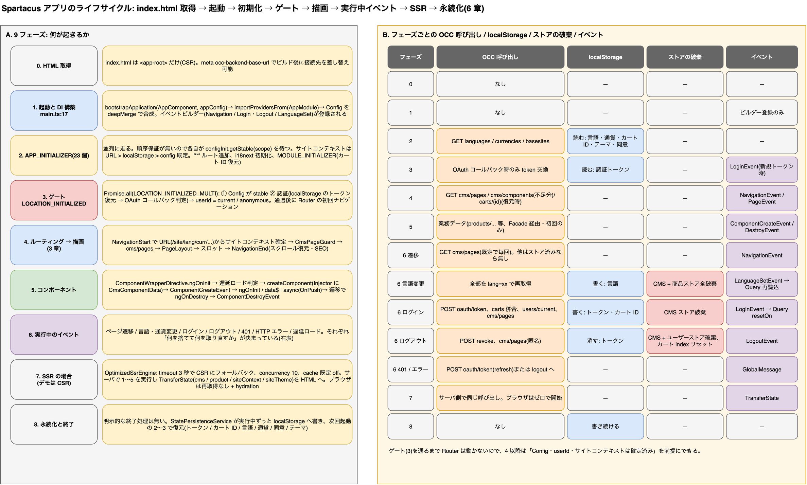

# 6. アプリケーションのライフサイクル: index.html 取得から永続化まで

> **図**: 09 アプリケーションのライフサイクル(`diagrams/spartacus-architecture.drawio`)。左: 0〜8 の 9 フェーズで何が起きるか。右: フェーズごとの OCC 呼び出し / localStorage の読み書き / ストアの破棄 / 発火するイベントの表



> **この章が答える問い**: アプリは起動から何をどの順にやり、いつ何を呼び、いつ何を捨てるか(②)
>
> **位置づけ**: 3 章の前後。初回アクセスの起動処理(3 章の前)と、描画後のイベント・永続化(3 章の後)

> 根拠は全て `spartacus/`(develop, b7b028f)のソース。参照アプリ `projects/storefrontapp` の起動構成を基準にしている。`ng add @spartacus/schematics` で生成したアプリも同じ構成になる(1.3)。

## 6.0 全体像: 9 フェーズと 1 つのゲート

| フェーズ | 何が起きるか | 誰が制御するか |
|---|---|---|
| 0. HTML 取得 | `index.html` が届く。中身はほぼ空(CSR)か描画済み(SSR) | ブラウザ / Node サーバ |
| 1. 起動と DI 構築 | `bootstrapApplication` → DI グラフ構築 → `Config` 合成 | Angular |
| 2. APP_INITIALIZER | 23 個の初期化関数が並列に走る。多くは「Config が stable になるまで待つ」 | Angular + Spartacus |
| **3. ゲート(LOCATION_INITIALIZED)** | Config が stable で、認証状態が確定するまで **Router を止める** | Spartacus |
| 4. ルーティング → 描画 | 初回ナビゲーション → URL からサイトコンテキスト確定 → `CmsPageGuard` → ページ描画(3 章) | Angular Router + Spartacus |
| 5. コンポーネントのライフサイクル | CMS コンポーネントの生成 → Angular フック → 破棄 | Angular + Spartacus |
| 6. 実行中のイベント | 遷移、言語・通貨変更、ログイン、ログアウト、401、HTTP エラー、遅延ロード | Spartacus(NgRx / EventService) |
| 7. SSR の場合 | サーバで 1〜5 を実行し、状態を HTML に埋めてブラウザに渡す | `@spartacus/setup/ssr` |
| 8. 永続化と終了 | 実行中ずっと `localStorage` に書き、次回起動で復元 | Spartacus |

フェーズ 3 のゲートが設計上の要である。ここを通るまで Router が動かないため、**フェーズ 4 以降のコードは「Config は確定済み、`userId` は確定済み、サイトコンテキストは URL から確定済み」を前提にできる**。

## 6.1 フェーズ 0: HTML 取得

`spartacus/projects/storefrontapp/src/index.html:84` の `<body>` は `<app-root>Loading...</app-root>` だけ。`<head>` には `occ-backend-base-url` / `media-backend-base-url` の `<meta>` があり(`:68-72`)、ビルド後に値を差し替えることで**同じ JS バンドルを別環境に向けられる**。読み取りは `spartacus/core-libs/core/src/occ/config/config-from-meta-tag-factory.ts:18-40`(プレースホルダ `OCC_BACKEND_BASE_URL_VALUE` のままなら無視)。

## 6.2 フェーズ 1: 起動と DI 構築

`spartacus/projects/storefrontapp/src/main.ts:17` の `bootstrapApplication(AppComponent, appConfig)`。`appConfig`(`app.config.ts:26-35`)は `provideHttpClient(withFetch(), withInterceptorsFromDi())`、`provideClientHydration(withEventReplay(), withNoHttpTransferCache())`、`importProvidersFrom(AppModule)` を並べ、`AppModule` が `SpartacusModule` を経由して全ライブラリのプロバイダを持ち込む(1.3)。

この時点で起きること:

- **`Config` の合成**: `provideConfig` / `provideDefaultConfig` で登録された設定片が `deepMerge` で 1 つになる(1.4)。ただし後述の `CONFIG_INITIALIZER` が非同期に書き足す分があるため、「stable」になるのはフェーズ 2 の途中。
- **イベントビルダーの登録**: サービスが最初に注入された時点のコンストラクタで、NgRx アクションや Router イベントを `CxEvent` に変換する購読が張られる。`NavigationEventBuilder`(`spartacus/core-libs/storefront/events/navigation/navigation-event.builder.ts:31-38`)、`UserAuthEventBuilder`(`spartacus/core-libs/core/src/auth/user-auth/events/user-auth-event.builder.ts:33-51`: `AuthActions.LOGIN` → `LoginEvent`、ログイン状態の `true → false` → `LogoutEvent`)、`SiteContextEventBuilder`(`site-context-event.builder.ts:43-53`: `SetActiveLanguage` → `LanguageSetEvent`)。
- **`ActiveCartService` の購読開始**: コンストラクタで `initActiveCart()` と `detectUserChange()` を呼ぶ(`spartacus/feature-libs/cart/base/core/facade/active-cart.service.ts:79-85`)。ただし実際にカートを取りに行くのは「安定していて、空で、未ロードで、カート ID が一時 ID でない」ときだけ(`:94-121`)。

## 6.3 フェーズ 2: APP_INITIALIZER(23 個)

Angular は `APP_INITIALIZER`(または `provideAppInitializer`)に登録された関数を全部実行し、返された Promise が全て解決するまでアプリを「初期化中」にする。Spartacus の登録箇所は 23 個(`grep "provide: APP_INITIALIZER\|provideAppInitializer("`)。主なもの:

| 初期化 | 登録箇所 | 何をするか | Config の stable を待つか |
|---|---|---|---|
| **ConfigInitializer** | `core-libs/core/src/config/config-initializer/config-initializer.module.ts:52-66` | `CONFIG_INITIALIZER` に登録された非同期設定ソース(各自が `scopes` を宣言)を実行し、全部終わると `ConfigInitializerService.getStable()` が解決(`config-initializer.service.ts:35-66`)。他の初期化は `getStable('context')` や `getStable('i18n')` のように**必要なスコープだけ**待てる | 自分が stable を作る側 |
| サイトコンテキスト(language / currency / baseSite) | `core-libs/core/src/site-context/providers/context-initializer-providers.ts:38-52` | 6.4 で詳述。順序は「config stable → URL セグメント → `localStorage` → config の既定値」 | `getStable('context')` |
| ルーティング | `core-libs/core/src/routing/routing.module.ts:93-95`(`ConfigurableRoutesService.init`)、`external-routes.module.ts:21-24`、`core-libs/storefront/cms-structure/routing/cms-route/add-cms-route.ts:12-22`(`'**'` を `router.config.push`)、`core-libs/storefront/router/app-routing.module.ts:13-19`(`initialNavigation: 'enabledBlocking'`、スクロール復元) | ルート表を完成させる。`'**'` は最後に足されるので、機能ライブラリの固定ルートが優先される | 一部 |
| i18next | `core-libs/core/src/i18n/i18next/i18next-providers.ts:15-27` → `i18next-initializer.ts:36-66, 104-105` | `getStable('i18n')` 後に `i18next.init`(`fallbackLng`、バックエンドからの chunk ロード)。以降 `LanguageService.getActive()` に追従して `changeLanguage` | `getStable('i18n')` |
| 遅延ロード基盤 | `core-libs/core/src/lazy-loading/lazy-loading.module.ts:12-33, 45-49` | `MODULE_INITIALIZER` に登録された関数を `Promise.all` で実行。**遅延ロードされたモジュールも、自分のインスタンス化時に同じ `MODULE_INITIALIZER` を実行される**(`lazy-modules.service.ts:98, 130, 150`)ので、機能モジュール用の「APP_INITIALIZER 相当」になる | モジュール次第 |
| カート ID の復元 | `feature-libs/cart/base/core/cart-persistence.module.ts:20-35, 55-70`(`MODULE_INITIALIZER`) | `getStable('context')` 後に `MultiCartStatePersistenceService.initSync()` で `localStorage` のカート ID をストアへ。同時にメタリデューサで `cart.index[ACTIVE]` を `undefined` に初期化し、復元前にカート取得が走らないようにする | `getStable('context')` |
| テーマ | `core-libs/core/src/site-theme/services/site-theme-initializer.ts:32-45` | `localStorage` → config 既定 → (トグル時)BaseSite の CMS テーマ | `getStable('context')` |
| アウトレット登録 | `core-libs/storefront/cms-structure/outlet/outlet.module.ts:25-45` | `provideOutlet(...)` で宣言されたコンポーネントを `OutletService` に登録(1.7) | 不要 |
| SEO | `core-libs/storefront/cms-structure/seo/seo.module.ts:27-29` → `seo-meta.service.ts:32-42` | `PageMetaService` を購読して `<title>` / `<meta>` を更新し続ける | 不要 |
| その他 | `skip-link.module.ts:38`、`direction.module.ts:27`(`<html dir>`)、`html-lang-provider.ts:11`(`<html lang>`)、`media.module.ts:35`(メディア preconnect)、`pwa.module.ts:48`、`structured-data.module.ts:29`、`anonymous-consents-store.module.ts:36`(匿名同意の `localStorage` 同期)、`config-validator.module.ts:52`(dev モードで設定を検証し警告)、`feature-libs/asm/root/asm-loader.module.ts:14-27`(URL に `?asm=true` があれば ASM 機能をロード) | | |

**初期化の順序は保証されない**(Angular は全部を同時に起動する)。そのため Spartacus 内部では「`ConfigInitializerService.getStable(scope)` を待つ」ことで依存関係を表現している。カスタム初期化を書くときも同じ作法に従う。

## 6.4 フェーズ 3: ゲート(LOCATION_INITIALIZED)と初回ナビゲーション

Angular の Router は `LOCATION_INITIALIZED` の Promise が解決するまで初回ナビゲーションを開始しない。Spartacus はこれを多重化し(`spartacus/core-libs/core/src/routing/location-initialized-multi/location-initialized-multi.ts:12-28`、`routing.module.ts:48-53` の `locationInitializedFactory = Promise.all(LOCATION_INITIALIZED_MULTI)`)、2 つの条件を入れている。

1. **Config が stable**(`config-initializer.module.ts:60-64` の `provideLocationInitializerFactory`)。
2. **認証状態が確定**(`spartacus/core-libs/core/src/auth/user-auth/user-auth.module.ts:39-79`): `AuthStatePersistenceService.initSync()` で `localStorage` のトークンをメモリへ同期 → `checkOAuthParamsInUrl()`(`auth.service.ts:90-110`)で OAuth コールバック(`code` / `token` パラメータ)または保存トークンを評価 → トークンがあれば `userIdService.setUserId('current')`、新規にトークンを受け取った場合だけ `AuthActions.Login` を dispatch してログイン前の URL へリダイレクト。トークンが無ければ `userId` は `anonymous` のまま(`user-id.service.ts:74-75`)。SSR では何もしない(`isPlatformBrowser` 判定)。

ゲートを通ると `initialNavigation: 'enabledBlocking'` により初回ナビゲーションが始まり、**`NavigationStart` で `SiteContextRoutesHandler` が URL のセグメントからサイトコンテキストを確定する**(`site-context-routes-handler.ts:137-160` の `setContextParamsFromRoute`)。デモの `/electronics-spa/en/USD/` はこの `urlParameters`(`baseSite`, `language`, `currency`)の並びである。

サイトコンテキストの決まり方(`language-initializer.ts:35-42`、`currency-initializer.ts:33-40`、`base-site-initializer.ts:31-36`):

```
getStable('context')
 → (Federated Login の言語があればそれ)
 → SiteContextRoutesHandler.initOnce()   … URL セグメントの値(最優先)
 → XxxStatePersistenceService.initSync()  … localStorage の前回値
 → setFallbackValue()                     … config の既定値(context.language[0] など)
```

既に値が入っていれば後段は上書きしない(`isInitialized()` チェック)。したがって優先順位は **URL > localStorage > config**。確定後、`SiteContextInterceptor`(`site-context.interceptor.ts:58-63`)が全 OCC リクエストに `lang` / `curr` を付け始める。

## 6.5 フェーズ 4: ルーティング → 描画

ここからは 3 章の 10 ステップそのもの。要点のみ:

- `'**'` ルートの `CmsPageGuard` が `CmsService.getPage()` を呼び、`cms/pages` を 1 本取得(既定の `loadStrategy: ALWAYS` では再訪でも取得する。7 章)。同一ページの重複要求は 8 章の止め弁②③で 1 本にまとまる。
- `PageLayoutComponent` → `LayoutConfig.layoutSlots` → `<cx-page-slot>` → `ComponentWrapperDirective`(フェーズ 5)。
- `NavigationEnd` 後: `OnNavigateService` がスクロール位置を復元(`on-navigate.service.ts:71-109`)、`SeoMetaService` が `<title>` / `<meta>` を更新、`NavigationEvent` / `PageEvent` が発火(`core-libs/storefront/events/`)。
- 起動時に無条件で飛ぶ OCC 呼び出しは、`languages` / `currencies` / `basesites`(context 初期化)、`cms/pages`、不足分の `cms/components`、復元したカート ID があれば `carts/{cartId}`、トークンがあれば `users/current` 系。デモ(CSR, 匿名)での実測は 8.1 のとおり 10 本。

## 6.6 フェーズ 5: コンポーネントのライフサイクル

CMS コンポーネント 1 個の一生(`spartacus/core-libs/storefront/cms-structure/page/component/component-wrapper.directive.ts:67-120, 146-150`):

1. `<cx-page-slot>` のテンプレートで `*ngFor` により `[cxComponentWrapper]` が生成される。`cxOutletDefer` が有効なら、ビューポートに入るまでここで止まる(`page-slot.component.html:11`、`defer-loader.service.ts:22-50`、`IntersectionObserver` 使用)。
2. `ngOnInit` → `CmsComponentsService.determineMappings([flexType])`。`flexType` が `featureModules` のどれかに属していれば、ここで機能チャンクを `import()` する(`cms-features.service.ts:56-74`、`feature-modules.service.ts:42-60`、依存モジュールを先に解決)。ロードされたモジュールの `provideDefaultConfig` / `provideConfig` は `ConfigurationService` が合成し直す(1.4.5)。
3. `ComponentHandler` が `ViewContainerRef.createComponent` を呼ぶ。子 `Injector` には `CmsComponentData { uid, data$ }` が入っている(3 章)。
4. `ComponentCreateEvent` 発火、`data-smartedit-*` 等の属性付与、`markForCheck()`。
5. **Angular 標準のフック**: `constructor`(`inject(CmsComponentData)`)→ `ngOnInit` → テンプレートの `data$ | async` が `CmsService.getComponentData(uid)` を購読(ストアに無ければ `cms/components` バッチへ)→ `ChangeDetectionStrategy.OnPush` のため、Observable の新値か `@Input` の変化でだけ再描画(1.9)。
6. ページ遷移で親スロットが破棄されると `ngOnDestroy` → `launcherResource.unsubscribe()` → `ComponentDestroyEvent`。

業務データを表示するコンポーネントは、この 5 の中で Facade を呼ぶ。そのときの文脈と再取得条件はリソースごとに異なる(10 章)。

## 6.7 フェーズ 6: 実行中のイベント

| イベント | 発火源 | 連鎖して起きること | OCC |
|---|---|---|---|
| **ページ遷移** | `RoutingService.go()` / リンク / ブラウザ戻る | `NavigationStart`(サイトコンテキスト再確認)→ `CmsPageGuard` → `cms/pages`(既定 `loadStrategy: ALWAYS` のため再訪でも取得。`ONCE` なら初回のみ。7 章)→ 旧コンポーネント破棄・新コンポーネント生成 → `NavigationEnd` → スクロール復元・SEO・`PageEvent` | `cms/pages`(毎回)。コンポーネント・業務データはストア済みなら無し。7.2 の実測: PDP 初回 6 本、ホーム再訪 1 本 |
| **言語変更** | `LanguageService.setActive()`(`language.service.ts:59-65`) | `SET_ACTIVE_LANGUAGE` → `activateLanguage$` が前回値と比較して `LANGUAGE_CHANGE` を dispatch(`languages.effect.ts:56-67`、初期設定時は発火しない)→ **CMS ストア全破棄**(`cms/store/reducers/index.ts:75-90`)と**商品ストア全破棄**(`product/store/reducers/index.ts:46-56`)→ `LanguageSetEvent`(Query の `reloadOn`)→ `SiteContextRoutesHandler.subscribeChanges` が URL を `replaceState`(`site-context-routes-handler.ts:111-124`)→ `i18next.changeLanguage` → 表示中のコンポーネントが再要求。フィーチャートグル `reloadOnLanguageChange` が有効なら `location.reload()`(`languages.effect.ts:73-86`) | `cms/pages` ほか全部を `lang=xx` で再取得 |
| **通貨変更** | `CurrencyService.setActive()` | 同様に `CURRENCY_CHANGE` → 商品ストア破棄(CMS は破棄しない)→ `CurrencySetEvent` | 商品系を `curr=XXX` で再取得 |
| **ログイン** | `AuthService.loginWithCredentials()`(`auth.service.ts:132-150`) | OAuth password flow でトークン取得 → `userIdService.setUserId('current')` → `AuthActions.Login` → `LoginEvent` → **CMS ストア破棄**(`LOGIN` もメタリデューサの対象)→ `ActiveCartService.detectUserChange` が `loadOrMerge`(匿名カートをユーザーカートへ併合、`active-cart.service.ts:139-168, 281-310`)→ Query の `resetOn: [LoginEvent]` → `AuthRedirectService.redirect()` | `POST .../oauth/token`、`users/current/carts`(併合)、`users/current` 系、`cms/pages` 再取得 |
| **ログアウト** | `AuthService.logout()` → `cxRoute: 'logout'` へ遷移(`auth.service.ts:222-224`)→ `LogoutGuard` | `coreLogout()`(`:192-205`): `clearUserId()`(`anonymous` に戻す)→ トークン失効 → `AuthActions.Logout` → `LogoutEvent` → CMS ストア破棄、ユーザーストア破棄(`user/store/reducers/index.ts:103`)、カート index リセット → ホームへ。トグル `propagateLogoutToAllTabs` で他タブにも伝播 | `POST .../revoke`、`cms/pages` を匿名で再取得 |
| **401 / トークン失効** | `AuthHttpHeaderService`(`auth-http-header.service.ts:96-136`) | リフレッシュトークンがあれば更新して元リクエストを再送、無ければログアウト処理へ。更新中・ログアウト中は二重実行しない | `POST .../oauth/token`(refresh) |
| **HTTP エラー** | `HttpErrorInterceptor`(`http-error.interceptor.ts:30-62`) | ステータス別ハンドラ(`handlers/`: bad-request, forbidden, not-found, conflict, gateway, bad-gateway, internal-server, unknown-error)が `GlobalMessageService` にメッセージを積む → 画面上部に表示。`resolveApplicable` で最も優先度の高いハンドラ 1 つ | なし |
| **遅延ロード** | `featureModules` に属す `flexType` の出現、または遅延ルートへの遷移 | 6.6 の 2。ロード完了まで該当コンポーネントだけ空(他は描画済み) | チャンク JS の取得(OCC ではない) |

## 6.8 フェーズ 7: SSR の場合

デモサイトは CSR だが、本番では SSR が一般的。流れ(`spartacus/projects/storefrontapp/src/server.ts:9-29, 53, 87`、`core-libs/setup/ssr/optimized-engine/ssr-optimization-options.ts:220-230`):

1. Express が `NgExpressEngineDecorator.get(engine, ssrOptions)` でラップした `OptimizedSsrEngine` を使う。既定値: `timeout: 3000`(3 秒で描画が終わらなければ CSR 用の空 HTML を返し、描画はバックグラウンドで続行)、`concurrency: 10`、`cache: false`、`reuseCurrentRendering: true`(同じ URL の同時リクエストは 1 回の描画を共有)、`forcedSsrTimeout: 60000`、`maxRenderTime: 300000`。
2. サーバで本章のフェーズ 1〜5 を実行する(`app.config.server.ts` が `appConfig` に `provideServerRendering()` と `AppServerModule` を足す)。OAuth コールバック処理など `isPlatformBrowser` ガードの中は skip。
3. 描画後、`ssrTransfer.keys` に登録されたストアのスライス(`cms`、`product`、`siteContext`、`siteTheme`: 各 `*-store.module.ts` の `ssrTransfer` 設定)を `TransferState` として HTML に埋め込む(8.2 (l))。
4. ブラウザは同じ JS で再びフェーズ 1〜3 を実行するが、`transfer-state.reducer.ts` がストアを転送状態で初期化するため、**フェーズ 4 の `cms/pages` 等は再取得されない**。Angular の hydration(`provideClientHydration(withEventReplay())`)により DOM は再生成されず、描画前のクリックも再生される。`withNoHttpTransferCache()` で Angular 標準の HTTP 転送キャッシュは切り、NgRx 経由の転送に一本化している。

## 6.9 フェーズ 8: 永続化と終了

SPA なので「終了処理」はなく、タブを閉じれば終わる。代わりに**実行中ずっと `localStorage` へ同期**している(`spartacus/core-libs/core/src/state/services/state-persistence.service.ts:44-90` の `syncWithStorage`、キーは `spartacus` + 区切り文字 + サイト ID + 区切り文字 + 名前、`:128-130`)。

| 何を | 誰が | 次回起動のどこで復元されるか |
|---|---|---|
| 認証トークン | `AuthStatePersistenceService` | フェーズ 3(`initSync`)→ `userId = current` |
| アクティブカート ID | `MultiCartStatePersistenceService`(`key: 'cart'`) | フェーズ 2(`MODULE_INITIALIZER`)→ フェーズ 4 でカート取得 |
| 言語 / 通貨 | `LanguageStatePersistenceService` / `CurrencyStatePersistenceService` | フェーズ 2(URL に無いときの第 2 優先) |
| テーマ | `SiteThemePersistenceService` | フェーズ 2 |
| 匿名同意 | `AnonymousConsentsStatePersistenceService` | フェーズ 2 |
| ASM セッション | `AsmStatePersistenceService` | フェーズ 2 |

サービス側の `ngOnDestroy`(`SiteContextRoutesHandler`, `SiteThemeInitializer`, `StorefrontComponent` など)は購読解除のみで、業務上の意味はない。

## 6.10 バックエンド担当者にとっての意味

- **起動時に必ず呼ばれる API** は `languages` / `currencies` / `basesites` / `cms/pages`(+ 不足分の `cms/components`)。これらが遅いと初回描画がその分遅れる(SSR では 3 秒でタイムアウトして CSR に落ちる)。
- **`userId` は起動時に一度だけ決まる**(`anonymous` か `current`)。ログイン・ログアウトで切り替わり、そのたびに CMS ストアが捨てられて `cms/pages` が取り直される。ユーザー別に出し分けたい CMS コンポーネントは、この再取得に乗せればよい。
- **言語変更で CMS と商品のキャッシュは全部捨てられる**が、ユーザー配下・カートは捨てられない。多言語の属性をカートや注文に足す場合は `lang` 依存で返しても、フロントが自動再取得しない点に注意(10 章の `reloadOn` を依頼する)。
- **バックエンド側でデータを変えても、フロントのストアに残っている間は反映されない**。反映されるタイミングは、CMS の構造・属性なら「次のページ遷移」(`cms/pages` は毎回)、業務データなら「言語・通貨変更」「ログイン / ログアウト」「リロード」(7 章)。即時反映が要るなら、更新 API の成功イベントで `reloadOn` させる設計(10.5)にする。
- **フェーズ 3 のゲートがあるため、トークンの検証や OAuth コールバックの処理は描画前に終わっている**。保護ページ(`routing.protected`)の判定もここに乗る。

---

[目次](README.md) | ← [5. API の形と State の形はなぜ違うのか: Normalizer / Effect / Reducer の 3 層による作り変え](05-api-to-state.md) | [7. 呼び出しの 4 階層と「毎回」「初回」の違い](07-call-tiers.md) →
