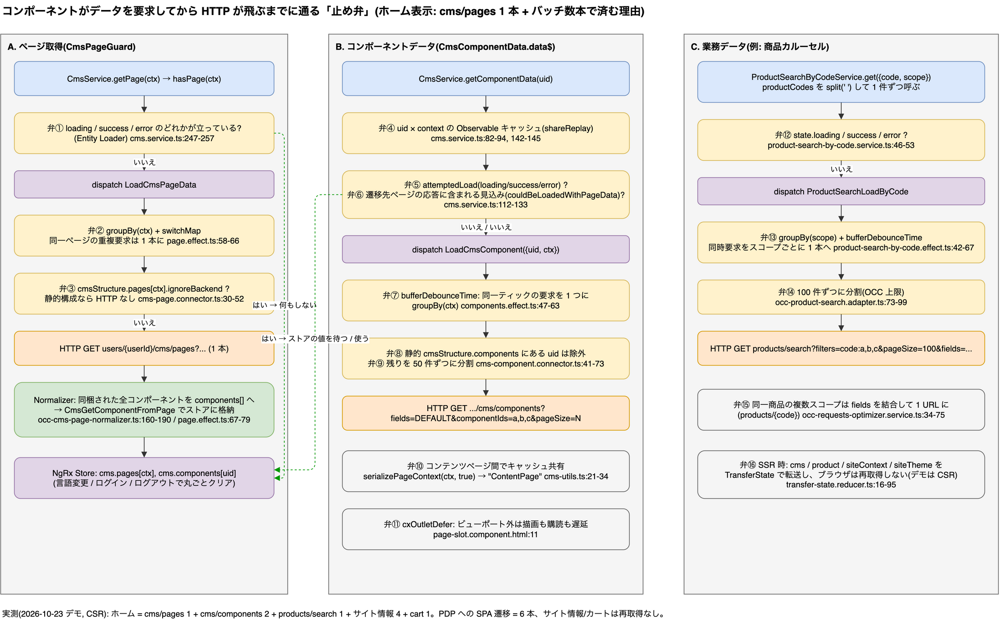

# 8. なぜデモサイトの API 呼び出しが少ないのか

> **図**: 07 API 呼び出しを減らす仕組み(`diagrams/spartacus-architecture.drawio`)。ページ取得 / コンポーネントデータ / 業務データの 3 系統で、HTTP が飛ぶ前に通る 16 個の「止め弁」

> **この章が答える問い**: なぜデモサイトの API 呼び出しが少ないのか。HTTP が飛ぶ前にどこで止まるか(②)
>
> **位置づけ**: 3〜7 章のまとめ。HTTP が飛ぶ前にどこで止まるかを 16 個の止め弁として一覧にする

### 8.0 先に話し言葉で: API はいつ飛ぶのか、を 4 文で

バックエンド側の感覚では「リクエストが来たらコントローラが走り、その応答が画面」です。SPA ではここが切れていて、API は State を埋めるだけ、描画は State を見ている側が勝手にやります。この切れ目を先に押さえると、呼び出しの数も順番も予測できるようになります。規則は 4 文です。

1. **読むときは State を先に見て、無ければ API を叩く。** 商品、カート、ナビゲーション、コンポーネント本体、全部これ。
2. **書くとき(カート追加、ログイン、注文)は必ず API を叩き、応答で State を更新する。** 読みと違って State を先に見ることはない。
3. **読みの引き金は「State に無いものを誰かが購読した瞬間」。** 「描画時」というのは、テンプレートの `async` パイプが購読する瞬間のこと。例外はページ本体だけで、`CmsPageGuard` が描画より前に先回りして取る(3 章)。
4. **API は State を埋めるだけで、描画は State を購読している view が勝手に更新する。** だから「この API が呼ばれたときにどの DOM が描かれるか」という問いは成り立たない。「応答で State のどこが変わり、それをどの view が購読しているか」に言い換える。

規則 1 の例外が 1 つだけあります。**`cms/pages` は State にあっても、ページ遷移のたびに取り直す**(既定の `routing.loadStrategy` が `ALWAYS`。`cms-page.guard.ts:89-91`、`routing-config.service.ts:45-47`、`cms.service.ts:247-257`)。ホーム → 商品詳細 → ホームと戻ったとき、ホームの `cms/pages` がもう一度飛ぶのはこのためです。CMS の編集やログイン状態による出し分けを、次の遷移で反映するための設計です。取り直しても応答のコンポーネント uid の並びは同じなので、ヘッダーもフッターも作り直されません。State が同じ値で上書きされるだけです(7.3)。`ONCE` にすれば初回だけになります(7.4)。

この 4 文を、よくある操作に当てはめると次の表になります。左 2 列が Network タブで見えるもの、右 2 列がその結果です。数字は 7.2 の実測(デモサイト、匿名、CSR)。

| きっかけ | 呼ばれる API | State のどこが変わるか | 画面のどこが変わるか |
|---|---|---|---|
| ブラウザ起動 → ホーム | `basesites` `languages` `currencies`、`cms/pages`、同梱されなかった分の `cms/components` ×2、カルーセル用 `products/search` 1 本、`carts/{id}`(9 本) | ほぼ全部が空から埋まる | 全部 |
| ホーム → 商品詳細(初回) | `cms/pages?pageType=ProductPage&code=…`、`cms/components?productCode=…`、`products/{code}` ×2、`references`、`reviews`(6 本) | `cms.page.index.product[code]` と entity、`cms.components`、`product.details[code]` | `<main>` の中身。ヘッダー・フッターは uid が同じなので作り直さない |
| 一度見たホームに戻る | **`cms/pages` だけ**(1 本)。`cms/components`、`products/search`、`carts` は飛ばない | `cms.page` の entity を同じ値で上書き | `<main>` の中身。値が同じ view は DOM を触らない |
| 同じ商品詳細に進む | `cms/pages` と `products/{code}/references`(2 本)。`references` は初期化のたびに捨てる設計の例外(7.3) | 同上 + `product.references` | `<main>` の中身 |
| 一覧でソート・ページング | `products/search` だけ。**Guard も `cms/pages` も走らない**(クエリは PageContext に入らない。`router.reducer.ts:169-215`) | `productSearch` | 一覧コンポーネントの内側だけ |
| 商品 A → 商品 B | `cms/pages?…code=B`(index のキーが違う)、`products/B` 系 | `cms.page.index.product[B]`、`product.details[B]` | 商品名・価格などの値だけ。`PageLayoutComponent` も各コンポーネントも再利用される |
| カート追加 | `POST carts/{id}/entries` → 成功後に `GET carts/{id}`(書きは必ず叩く) | `cart` | ミニカート、カートページ |
| 言語・通貨変更 | `cms/pages` 取り直し、商品ストア破棄 → 表示中の分だけ取り直し | `cms` と `product` を捨てて再構築 | 全部 |

質問の形を言い換える表も置いておきます。左が JSP の感覚で出てくる質問、右が SPA での同じ質問です。

| 聞かれる形 | 言い換え |
|---|---|
| `cms/pages` が呼ばれたとき、どの DOM が描かれるのか | 応答は `cms.page` と `cms.components` を更新する。それを購読しているのは `PageLayoutComponent`(スロットの並び)、各 `PageSlotComponent`(スロットの中身)、各コンポーネントの `data$`。値が変わったところだけ描き直る(4 章) |
| どのコンポーネントが API を呼ぶのか | コンポーネントは購読するだけ。呼ぶのは Facade の先の Effect。購読の時点で State に無ければ Effect が呼ぶ(6 章、15 章) |
| ソートはなぜ `cms/pages` を呼ばないのか | クエリは PageContext に入らないので Guard が走らない。一覧コンポーネントが URL を購読していて、`products/search` だけ呼ぶ(3.0) |
| 新しいコンポーネントを置いたら API は増えるのか | 置いた型が業務データを参照するなら、その型の追加リソースが「購読した瞬間」に増える。パラグラフやバナーなら `cms/pages` の中に収まる(7.1 の階層 3、9 章) |

以下、この表の裏付けを実測(8.1)と 16 個の止め弁(8.2)で示す。

### 8.1 実測(Chrome, 2026-10-23, OPTIONS プリフライト除外)

**ホーム初回ロード** `/electronics-spa/en/USD/`

| # | OCC リクエスト | 発生源 |
|---|---|---|
| 1 | `GET basesites?fields=FULL` | サイトコンテキスト初期化(`default-occ-site-context-config.ts:21`) |
| 2 | `GET electronics-spa/users/anonymous/cms/pages?lang=en&curr=USD` | ホームページ構造 + **33 コンポーネントのデータ同梱**(73KB) |
| 3 | `GET electronics-spa/languages` | 言語セレクタ |
| 4 | `GET electronics-spa/currencies` | 通貨セレクタ |
| 5 | `GET .../cms/components?fields=DEFAULT&currentPage=0&pageSize=26&componentIds=...` | ナビゲーション子ノード等、ページ応答に無かった分の一括取得 |
| 6 | `GET .../cms/components?...&pageSize=8&componentIds=...` | 同上(別コンテキスト) |
| 7 | `HEAD .../consenttemplates` ×2 | 匿名同意 |
| 8 | `GET products/search?fields=products(code,name,price(formattedValue),images(DEFAULT),baseProduct)&query=&filters=code:300938,358639,...(17 件)&pageSize=100` | 商品カルーセル 2 つ分を **1 本に集約** |
| 9 | `GET .../users/anonymous/carts/{guid}` | ミニカート(匿名カートが localStorage に存在) |

GET/HEAD は 10 本(9 種類)。`cms/pages` 単体で 19 スロット・33 コンポーネントの全データを返す(curl で確認、付録 B)。

**ホーム → 商品詳細へ SPA 遷移**(リロードなし)

| # | OCC リクエスト |
|---|---|
| 1 | `GET .../cms/pages?pageType=ProductPage&code=300938` |
| 2 | `GET .../cms/components?fields=DEFAULT&productCode=300938&currentPage=0&pageSize=4&componentIds=...` |
| 3 | `GET products/300938?fields=<複数スコープを結合した fields>` |
| 4 | `GET products/300938?fields=classifications` |
| 5 | `GET products/300938/references?...&referenceType=SIMILAR` |
| 6 | `GET products/300938/reviews` |

basesites / languages / currencies / carts / consenttemplates は**再取得されない**。

デモは `<title>Csr</title>` の空シェル HTML(`<app-root>` が空、`cx-state` スクリプトなし)を配信しており、SSR ではない。したがって以下はすべて**クライアント側の設計**による削減である。

### 8.2 削減メカニズム(ソース根拠)

| # | メカニズム | 根拠 |
|---|---|---|
| (a) | **ページ応答にコンポーネントデータを同梱**し、ノーマライザが `components[]` に集約、`CmsGetComponentFromPage` でストアへ | `occ-cms-page-normalizer.ts:160-190`, `page.effect.ts:67-79`, `components.reducer.ts:71-85` |
| (b) | **取得済み・取得中・失敗済みなら再要求しない**(Entity Loader の `loading/success/error` フラグ) | `cms.service.ts:112-133`(`attemptedLoad`)、`cms.service.ts:247-257`(ページ) |
| (c) | **遷移先ページの応答に含まれる見込みのコンポーネントは待つ**(`couldBeLoadedWithPageData`) | `cms.service.ts:121-133` |
| (d) | **同一ティック内の要求をバッファして 1 本の `componentIds=` に集約**、50 件単位で分割 | `components.effect.ts:47-63`(`bufferDebounceTime`)、`cms-component.connector.ts:41-73`、`default-cms-config.ts:22` |
| (e) | **コンテンツページ間でコンポーネントキャッシュを共有**(`serializePageContext(ctx, true)` → `"ContentPage"`) | `cms-utils.ts:21-34`, `cms.service.ts:82-94` |
| (f) | **同一ページの重複ロードを `groupBy`+`switchMap` で抑止**、`RouteLoadStrategy.ONCE` なら再訪問時も再取得しない | `page.effect.ts:58-66`, `cms-page.guard.ts:89-91` |
| (g) | **静的 `cmsStructure` にあるページ/コンポーネントはバックエンドを呼ばない**(`ignoreBackend`, `getComponentsFromConfig`) | `cms-page.connector.ts:30-52`, `cms-component.connector.ts:41-50`, `cms-structure-config.service.ts:38-60` |
| (h) | **商品カルーセルは `products/search?filters=code:a,b,c` で最大 100 件を 1 本に集約**(スコープごとに `bufferDebounceTime`) | `product-carousel.component.ts:69-83`, `product-search-by-code.effect.ts:42-67`, `occ-product-search.adapter.ts:73-99` |
| (i) | **同一商品の複数スコープ要求を `fields` 結合で 1 URL に最適化** | `occ-requests-optimizer.service.ts:34-75`, `occ-product.adapter.ts:35-50`, `default-occ-product-config.ts:53-57`(`details` は `list`,`variants` を include) |
| (j) | **ビューポート外のコンポーネント描画を遅延**(描画されるまでデータ購読も始まらない) | `page-slot.component.html:11`(`cxOutletDefer`) |
| (k) | **機能モジュールの遅延ロードは 1 回限りでキャッシュ**(`shareReplay`) | `cms-features.service.ts:138-147`, `feature-modules.service.ts:42-71` |
| (l) | (デモ未使用)**SSR 時は CMS / Product / SiteContext / SiteTheme ストアを HTML に埋め込み、ブラウザは再取得しない** | `cms-store.module.ts:25-26`, `product-store.module.ts:24-25`, `site-context-store.module.ts:24`, `site-theme-store.module.ts:23`, `transfer-state.reducer.ts:24-34` |

「本来はコンポーネント数だけ API が飛ぶはず」という直感は、Spartacus では (a)(b)(d)(h) によって成り立たない。**1 ページ = `cms/pages` 1 本 + 不足分のバッチ数本** が設計上の期待値である。

---

[目次](README.md) | ← [7. 呼び出しの 4 階層と「毎回」「初回」の違い](07-call-tiers.md) | [9. OCC リソース一覧: カスタムをどのリソースの中で考えるか](09-occ-resource-catalog.md) →
