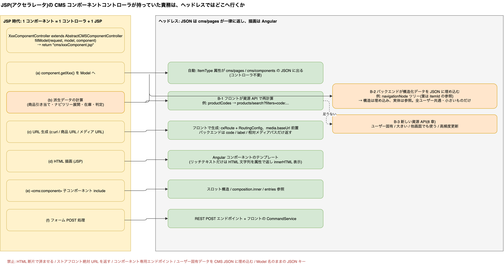

# 9. JSP(アクセラレータ)のコンポーネントコントローラをヘッドレスに移すとき、何を返すか

> **図**: 05 JSP→ヘッドレス 責務の移行(`diagrams/spartacus-architecture.drawio`)。JSP コントローラの責務 (a)〜(f) がヘッドレスでどこへ移るか



> **この章が答える問い**: JSP が返していた「ビュー」を REST 化するとき、何を返し、何をフロントに任せるか


### 9.1 何が変わるか

JSP ストアフロントでは、CMS コンポーネント 1 つに対して `AbstractCMSComponentController` 派生のコントローラがあり、`fillModel()` で派生データを計算して `Model` に詰め、`cms/<TypeCode>.jsp` を返していた。つまり 1 コントローラが **(a) 属性の取り出し、(b) 派生データの計算、(c) URL 生成、(d) HTML 描画、(e) 他コンポーネントのインクルード、(f) フォーム処理** をすべて担っていた。

ヘッドレスでは「返すもの」が **HTML ではなく JSON** になり、しかも**コンポーネント単位のエンドポイントは存在しない**。コンポーネントの JSON は `cms/pages` / `cms/components` が typeCode を問わず一律に返し(3.3、3.4)、描画は Angular が行う。したがって JSP コントローラの責務は次のように分散する。

| JSP コントローラが持っていた責務 | ヘッドレスでの置き場所 | 根拠 |
|---|---|---|
| (a) `component.getXxx()` を Model へ | **自動**。ItemType の属性が `cms/pages` の JSON に出る | 付録 B(33 コンポーネント全データ同梱)、5.2 の実 JSON |
| (b) 派生データの計算(商品の引き当て、ナビゲーションツリーの展開、在庫、パーソナライズ) | **B-1** フロントが資源 API で再計算(標準の選択) / **B-2** バックエンドがコンポーネント JSON に埋め込む(ナビゲーション方式) / **B-3** 新しい資源 API(8 章) | 9.2 |
| (c) URL 生成(`c:url`、商品 URL、メディア URL) | **フロント**。バックエンドは code / label / 相対メディアパスだけ返す | `banner.component.ts:137-160`(`cxRoute: 'product'` から URL 生成)、`media.service.ts:383-387`(相対 URL に `backend.media.baseUrl` を前置) |
| (d) HTML 描画(JSP) | **Angular コンポーネントのテンプレート**。リッチテキストだけは HTML 文字列を属性で返し `innerHTML` 表示 | `paragraph.component.html:1-4` |
| (e) `<cms:component>` による子コンポーネントのインクルード | スロット構造、または `composition.inner` / ナビゲーションの `entries` 参照 | `cms.model.ts:17-22`, `product-list.module.ts:68-75`、9.2 B-2 |
| (f) フォーム POST | REST の POST エンドポイント + フロントの `CommandService` | `command.service.ts:27-53`、`occ-user-account.adapter.ts:54-79` |
| セッション・ユーザー・カートのコンテキスト | フロントが Facade で保持済み。必要なら `users/{userId}/...` 配下の API | 7.3 |

### 9.2 派生データ(b)の 3 つの返し方

**B-1: 参照だけ返し、フロントが資源 API で解決する(標準の選択)**

`ProductCarouselComponent` が典型。JSP ではコントローラが商品を引いて Model に入れていたが、Spartacus では JSON に `productCodes` 文字列しか無く、フロントが `products/search?filters=code:...` で解決する(5.6、4.2 (h))。バックエンドは何も計算しない。

**B-2: バックエンドが構造化データをコンポーネント JSON に埋め込む(ナビゲーション方式)**

OCC の CMS コンポーネント JSON は文字列だけでなく**ネストしたオブジェクト**も返せる。デモの `CategoryNavigationComponent`(13.8KB)は `navigationNode` ツリーを同梱している:
```json
{
  "uid": "ElectronicsCategoryNavComponent",
  "typeCode": "CategoryNavigationComponent",
  "wrapAfter": "10",
  "navigationNode": {
    "uid": "ElectronicsCategoryNavNode",
    "entries": [],
    "children": [
      { "uid": "BrandsNavNode",
        "entries": [ { "itemId": "AllBrandsCategoryLink", "itemSuperType": "AbstractCMSComponent", "itemType": "CMSLinkComponent" } ],
        "children": [ ... ] }
    ]
  }
}
```
フロントのモデルはこれをそのまま型にしている(`spartacus/core-libs/core/src/model/cms.model.ts:170-191`):
```ts
export interface CmsNavigationNode {
  uid?: string;
  title?: string;
  children?: Array<CmsNavigationNode>;
  entries?: Array<CmsNavigationEntry>;
}
export interface CmsNavigationEntry {
  itemId?: string;
  itemSuperType?: string;
  itemType?: string;
}
export interface CmsNavigationComponent extends CmsComponent {
  ...
  navigationNode?: CmsNavigationNode;
}
```
注目点は、ツリーの**構造**は埋め込むが、葉の `entries` は `itemId` の**参照**に留めていること。フロントは参照を集めて `cms/components?componentIds=...` で一括取得する(`navigation.service.ts:45-86` の `loadNavigationEntryItems` → `cmsService.loadNavigationItems`)。ホーム表示で観測した `componentIds` 26 件 / 8 件のバッチ(4.1)がこれである。

→ **「構造や計算結果は埋め込む、実体は参照にする」** がバックエンド埋め込み型の設計規範。

B-2 を自分の typeCode で行うには、SAP Commerce 側で `cmsfacades` の CMS アイテムレンダリング(OCC 用のコンポーネント→JSON 変換)に typeCode 固有の変換を登録する。SAP Help の「Trail: Creating a Custom Component Type」が属性コンバータの一覧(Collections, Maps, Products, Categories, Media Containers, CMS Items とそのローカライズ版)を示している。Bean 名はバージョン差があるため、自プラットフォームの `cmsfacades` 拡張のソースで確認すること(本書は Java 側をクローンしていない。8 章冒頭の注記参照)。

**B-3: 新しい資源 API を切る(8 章)**

派生データが「そのコンポーネント以外でも使う」「ユーザー固有」「大きい」「更新頻度が高い」のいずれかなら、CMS JSON に埋め込まず資源 API にする。CMS 側には引数(ID)だけ残す。

### 9.3 どれを選ぶかの基準

| 条件 | 選択 |
|---|---|
| 既存 OCC 資源(商品・カテゴリ・カート・注文・店舗)で取れる | **B-1** |
| CMS 構造そのもの(ナビツリー、タブ構成、スロット内の並び)で、キャッシュ可能で全ユーザー共通 | **B-2**(構造を埋め込み、実体は参照) |
| バックエンドでしか計算できないが、ユーザー共通で小さい(例: キャンペーンの残り時間、表示 ON/OFF の判定結果) | **B-2** |
| ユーザー固有、サイズが大きい、他画面でも使う、高頻度更新 | **B-3** |
| JSP が返していたのが装飾込みの HTML 断片だけ(静的なお知らせ等) | 属性に HTML 文字列を入れ `CMSParagraphComponent` 相当で表示。段落コンポーネントは内部リンクのクリックを Angular Router に横取りするので SPA 遷移は保たれる(`paragraph.component.ts:29-42`) |

CMS JSON は `cms/pages` に同梱されるため、B-2 で埋め込むデータは**ページ全体の初回応答サイズ**に直結する(デモのホームは 73KB、うちナビが 13.8KB)。全ユーザー共通で `lang`/`curr` 単位にキャッシュできるものに限る。

### 9.4 返却値の具体的な書き換え例

JSP 時代の `fillModel` が次のようなものだったとする:

```java
// JSP 時代(例)
protected void fillModel(HttpServletRequest request, Model model, StoreEventComponentModel component) {
  model.addAttribute("title", component.getTitle());
  model.addAttribute("event", eventFacade.getEvent(component.getEventCode()));      // 派生データ
  model.addAttribute("eventUrl", "/events/" + component.getEventCode());            // URL 生成
  model.addAttribute("imageUrl", mediaService.getUrlForMedia(component.getImage())); // メディア URL
  model.addAttribute("isLive", eventService.isLive(component.getEventCode()));      // サーバ判定
}
// → cms/storeEventComponent.jsp が HTML を描画
```

ヘッドレスでの返し方:

```json
// cms/pages の中の 1 コンポーネント(自動出力 + B-2 の埋め込み)
{
  "uid": "SummerSaleEventComponent",
  "typeCode": "StoreEventComponent",
  "title": "Summer Sale",
  "eventCode": "SUMMER-2026",
  "image": { "url": "/medias/summer.jpg?context=...", "altText": "Summer Sale", "mime": "image/jpeg" },
  "isLive": "true"
}
```
```
GET /occ/v2/{baseSiteId}/events/SUMMER-2026?fields=DEFAULT&lang=en&curr=USD      ← B-3(詳細は資源 API)
{ "code": "SUMMER-2026", "name": "...", "startDate": "...", "venue": { ... } }
```

| JSP の返却 | ヘッドレスでの返却 | 理由 |
|---|---|---|
| `title`(属性) | 属性のまま(自動) | 変更なし |
| `event`(オブジェクト) | `eventCode` + 資源 API `/events/{code}` | 他画面でも使う、ユーザー固有になり得る |
| `eventUrl`(ストアフロント URL) | 返さない。フロントが `cxRoute` から生成 | URL 体系はフロントの `RoutingConfig` が決める(1.6) |
| `imageUrl`(絶対 URL) | `image: { url: "/medias/..." }`(相対) | フロントが `backend.media.baseUrl` を前置(`media.service.ts:383-387`) |
| `isLive`(サーバ判定) | `"isLive": "true"` を埋め込む(B-2)。ユーザー依存なら資源 API 側へ | 共通・小さい・キャッシュ可 |
| JSP の HTML | Angular コンポーネント `StoreEventComponent` + `cmsComponents: { StoreEventComponent: { component } }` | 描画はフロント |

フロント側はこうなる:
```ts
export class StoreEventComponent {
  protected cms = inject<CmsComponentData<CmsStoreEventComponent>>(CmsComponentData);
  protected events = inject(EventFacade);                     // 7 章の一式
  data$ = this.cms.data$;                                     // title, image, isLive
  event$ = this.cms.data$.pipe(map((d) => d.eventCode), filter(Boolean), distinctUntilChanged(),
                               switchMap((code) => this.events.get(code)));
}
```

### 9.5 返却値に関する禁止事項(移行時に混入しやすいもの)

- **HTML の断片を属性に入れて済ませる**(リッチテキスト以外)。インタラクション・翻訳・ルーティングがフロントで扱えなくなる。
- **ストアフロントの絶対 URL / パス**を返す。URL 体系はフロント設定(`RoutingConfig`)が持つ。code / label を返す。
- **コンポーネント専用エンドポイント**(`/cms/components/{uid}/data` のようなもの)。8.1 のとおり資源単位にする。
- **ユーザー固有データを CMS JSON に埋め込む**。`cms/pages` はページ共通キャッシュの前提で設計されている(4.2 (e) コンテンツページ間でコンポーネントキャッシュを共有)。
- **Model 名のままの JSON キー**(`StoreEventComponentModel` → `storeEventComponentModel` 等)。キーはそのままフロントのプロパティ名になるので、FE モデルとして自然な camelCase にする。


---

[目次](README.md) | ← [8. バックエンド(Java)側: 何を、どの単位で返すか](08-backend-api-granularity.md) | [10. OCC リソース一覧: カスタムをどのリソースの中で考えるか](10-occ-resource-catalog.md) →
