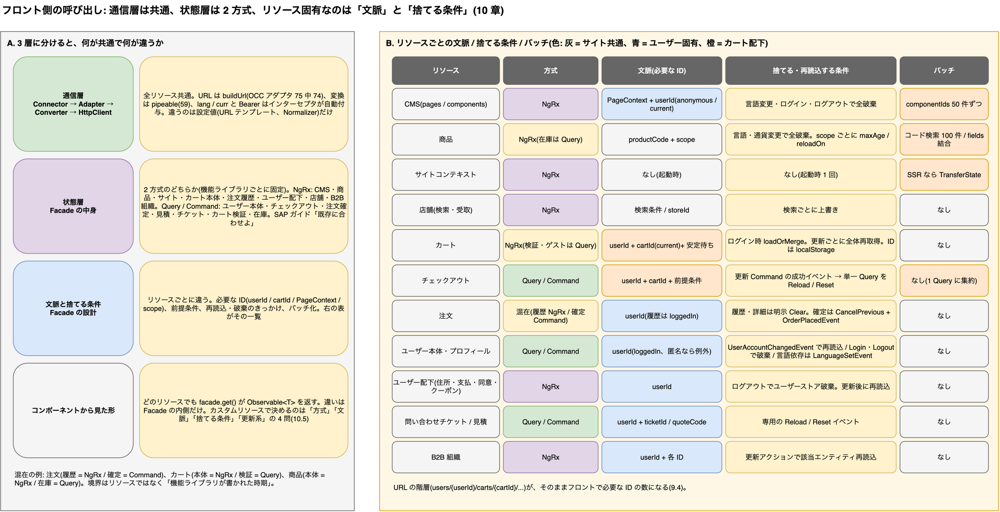

# 11. フロント側の呼び出し方法はリソースごとに違うのか

> **図**: 08 リソースごとの呼び出し方法の違い(`diagrams/spartacus-architecture.drawio`)。A: 通信層は全リソース共通、B: 状態層は NgRx と Query / Command の 2 方式、C: リソースごとの文脈(色 = 灰: サイト共通 / 青: ユーザー固有 / 橙: カート配下)・捨てる条件・バッチの比較表



## 11.1 結論

呼び出しの流れを 3 層に分けると、答えは「**通信層は完全に共通、状態層は 2 方式、リソース固有なのは『文脈』と『キャッシュの捨て方』**」になる。

| 層 | 共通か | 内容 |
|---|---|---|
| **通信層**(Connector → Adapter → Converter → HttpClient) | **全リソース共通** | URL 組み立て、`lang` / `curr` 付与、Bearer トークン、正規化の仕組みは 1 つ。リソースごとの違いは設定値(URL テンプレート、Normalizer)だけ |
| **状態層**(Facade の中身) | **2 方式のどちらか** | 古い機能は NgRx(Action / Effect / Reducer / Selector)、新しい機能は Query / Command。機能ライブラリごとに固定で、SAP は「既存に合わせよ」と明記 |
| **文脈とキャッシュ無効化** | **リソースごとに違う** | 必要な ID(`userId` / `cartId` / `PageContext` / `scope`)、前提条件、再読込・破棄のきっかけ、バッチ化の有無 |

コンポーネントから見ると、どのリソースでも「Facade のメソッドを呼ぶと `Observable<T>` が返る」点は同じである。違いは Facade の内側にあり、**カスタムリソースをフロントに足すときに決めなければならないのはこの「文脈」と「無効化条件」**である(11.5)。

## 11.2 共通部分(どのリソースでも同じ)

| 仕組み | 根拠 | 補足 |
|---|---|---|
| URL は設定から `OccEndpointsService.buildUrl(key, {urlParams, queryParams})` で組み立てる | OCC アダプタ 75 ファイルが使用(`grep buildUrl`)。使っていないのは CDS の通知アダプタ 1 件のみ | 7.2 |
| レスポンス変換は `ConverterService.pipeable(NORMALIZER_TOKEN)` | アダプタ 59 ファイルが使用 | 7.2 |
| `lang` / `curr` クエリは `SiteContextInterceptor` が OCC baseUrl 宛の全リクエストに自動付与 | `spartacus/core-libs/core/src/occ/adapters/site-context/site-context.interceptor.ts:58-63` | 7.3 |
| `Authorization: Bearer` は `AuthHttpHeaderService` が自動付与、401 時にトークン更新 | 7.3 | |
| `userId` は `UserIdService.takeUserId(loggedIn?)` で取り、`current` / `anonymous` を返す。`loggedIn = true` なら匿名時に例外 | `spartacus/core-libs/core/src/auth/user-auth/facade/user-id.service.ts:53-61` | 57 の Facade / Service が使用 |
| Facade は root 層の抽象クラス + `facadeFactory` で遅延ロード対応 | root 層に 51 箇所 | 7.2 |
| 禁止事項: コンポーネントやサービスで `HttpClient` を直接使わない、NgRx `Store` を直接参照しない | `spartacus/core-libs/skills/skills/spartacus-developer/references/backend-communication.md:5-16`、`facades-not-store.md:1-5` | SAP 公式の開発者ガイド |

つまり「新しいリソースを 1 つ足す」ときに書く通信層のコード(endpoints 設定、Adapter、Normalizer)は、どのリソースでも同じ形になる(7.4 の雛形)。

## 11.3 状態層は 2 方式(機能ライブラリごとに固定)

SAP のガイド `spartacus/core-libs/skills/skills/spartacus-developer/references/state-management.md:1-16` は、2 方式の存在と「カスタマイズ時は既存機能の方式に合わせ、第 3 の方式(素の `BehaviorSubject` など)を持ち込むな」と定めている。

| 方式 | 使っているリソース(ソースで確認) | Facade の中身 |
|---|---|---|
| **NgRx**(Action → Effect → Reducer → Selector、Entity Loader) | CMS、商品(詳細・検索・レビュー・参照)、サイトコンテキスト(言語・通貨・ベースサイト)、認証、カート本体(`MultiCartService` / `ActiveCartService`)、保存カート、ウィッシュリスト、注文履歴・返品・定期注文履歴、ユーザーの住所・支払・同意・クーポン・通知設定、店舗検索、B2B 組織管理(予算・コストセンタ・ユニット・ユーザー) | `store.dispatch(new LoadXxx(userId, ...))` と `store.pipe(select(...))`。読み込み状態は `LoaderState { loading, success, error, value }` |
| **Query / Command**(`QueryService` / `CommandService`) | ユーザーアカウント・プロフィール・登録・パスワード、チェックアウト全般(配送先・配送方法・支払・請求先・B2B コストセンタ・支払種別)、注文確定(`placeOrder`)・再注文、見積(Quote)、問い合わせチケット、カートの検証・アクセスコード・ゲストユーザー、商品在庫(`ProductAvailabilityService`)、サブスクリプション課金、OPF / Digital Payments / S4 Service / Punchout | `query.create(loader, { reloadOn, resetOn })` が `QueryState<T> { loading, error, data }` を保持。`command.create(fn, { strategy })` が更新系 |

**Query の中身**(`spartacus/core-libs/core/src/util/command-query/query.service.ts:52-141`): 初回購読で loader を 1 回実行し結果を共有、`reloadOn` のイベントで再実行(`loading: true` に戻す)、`resetOn` のイベントで `data: undefined` に戻す。NgRx の Entity Loader と同じ「取得済みなら取らない」を、ストアなしで実現している。

**Command の中身**(`command.service.ts:31-35`): 同時実行の扱いを `Parallel` / `Queue` / `CancelPrevious` / `ErrorPrevious` から選ぶ。例: 注文確定は `CancelPrevious`(`spartacus/feature-libs/order/core/facade/order.service.ts:26-52`)。

**同じリソースでも世代が混在する**例:
- 注文: 履歴・詳細は NgRx(`order-history.service.ts:42-65`、`takeUserId` → `dispatch(LoadOrderDetails)`)、注文確定は Command(`order.service.ts:26-52`、成功時に `OrderPlacedEvent` を発火)。
- カート: 本体は NgRx(`multi-cart.service.ts:183, 388`)、検証・アクセスコード・ゲストは Query / Command(`cart-validation.service.ts` 等)。

### 11.3.1 10 章のリソース一覧に対応させた方式一覧

「どのリソースで方式の違いが起きているか」を、10 章の分類(A / B / C-1〜C-6)に合わせて Facade の実装ファイルで確認した結果。判定基準は SAP ガイドと同じ(`store.dispatch` / `select` を使えば NgRx、`queryService.create` / `commandService.create` を使えば Query / Command)。

| 10 章の分類 | リソース | 方式 | Facade 実装(`spartacus/` 配下) |
|---|---|---|---|
| A. サイト設定 | basesites / languages / currencies | NgRx | `core-libs/core/src/site-context/facade/base-site.service.ts`, `language.service.ts`, `currency.service.ts` |
| B. CMS | cms/pages, cms/components | NgRx | `core-libs/core/src/cms/facade/cms.service.ts` |
| C-1 商品 | products/{code}(スコープ別)、search、suggestions、categories/{code}/products | NgRx | `core-libs/core/src/product/facade/product.service.ts`, `product-search.service.ts`, `product-search-by-code.service.ts`, `product-search-by-category.service.ts` |
| C-1 商品 | products/{code}/reviews, /references | NgRx | `core-libs/core/src/product/facade/product-review.service.ts`, `product-reference.service.ts` |
| C-1 商品 | products/{code}/stock(在庫) | **Query** | `core-libs/core/src/product/facade/product-availability.service.ts` |
| C-1 商品 | 店舗受取(pickup-in-store の在庫・受取場所) | NgRx | `feature-libs/pickup-in-store/core/facade/pickup-locations-search.service.ts`, `pickup-option.service.ts`, `intended-pickup-location.service.ts` |
| C-2 ユーザー | users/{userId}(本体) | **Query / Command** | `feature-libs/user/account/core/facade/user-account.service.ts` |
| C-2 ユーザー | プロフィール更新・メール・パスワード・登録 | **Command**(+ 言語依存の Query) | `feature-libs/user/profile/core/facade/user-profile.service.ts`, `user-email.service.ts`, `user-password.service.ts`, `user-register.service.ts` |
| C-2 ユーザー | addresses, paymentdetails, consents, customercoupons, notificationpreferences, productinterests | NgRx | `core-libs/core/src/user/facade/user-address.service.ts`, `user-payment.service.ts`, `user-consent.service.ts`, `customer-coupon.service.ts`, `user-notification-preference.service.ts`, `user-interests.service.ts` |
| C-2 ユーザー | wishlists | NgRx | `feature-libs/cart/wish-list/core/facade/wish-list.service.ts` |
| C-2 ユーザー | tickets(問い合わせ) | **Query / Command** | `feature-libs/customer-ticketing/core/facade/customer-ticketing.service.ts` |
| C-3 カート | carts/{cartId}, entries, vouchers(本体) | NgRx | `feature-libs/cart/base/core/facade/multi-cart.service.ts`, `active-cart.service.ts`, `cart-voucher.service.ts` |
| C-3 カート | 保存カート | NgRx | `feature-libs/cart/saved-cart/core/facade/saved-cart.service.ts` |
| C-3 カート | validate, accessCode, guestuser | **Query / Command** | `feature-libs/cart/base/core/facade/cart-validation.service.ts`, `cart-access-code.service.ts`, `cart-guest-user.service.ts` |
| C-3 チェックアウト | addresses/delivery・billing, deliverymodes, paymentdetails, costcenter, paymenttype | **Query / Command** | `feature-libs/checkout/base/core/facade/checkout-query.service.ts`, `checkout-delivery-address.service.ts`, `checkout-delivery-modes.service.ts`, `checkout-payment.service.ts`, `checkout-billing-address.service.ts`, `feature-libs/checkout/b2b/core/facade/*` |
| C-4 注文 | orders(履歴・詳細・キャンセル・追跡)、orderReturns、replenishmentOrders(履歴) | NgRx | `feature-libs/order/core/facade/order-history.service.ts`, `order-return-request.service.ts`, `replenishment-order-history.service.ts` |
| C-4 注文 | 注文確定、再注文、定期注文の確定 | **Command** | `feature-libs/order/core/facade/order.service.ts`, `reorder-order.service.ts`, `scheduled-replenishment-order.service.ts` |
| C-5 店舗 | stores(検索・1 件) | NgRx | `feature-libs/storefinder/core/facade/store-finder.service.ts` |
| C-6 B2B 組織 | orgUnits, orgCustomers, budgets, costcenters, 承認, ユーザーグループ | NgRx | `feature-libs/organization/administration/core/services/b2b-user.service.ts`, `budget.service.ts` ほか |
| C-6 B2B 組織 | quotes(見積) | **Query / Command** | `feature-libs/quote/core/facade/quote.service.ts` |
| C-6 B2B 組織 | orgUsers(B2B ユーザー登録) | **Command** | `feature-libs/organization/user-registration/core/facade/user-registration.service.ts` |
| D. 別 Web サービス | ASM | NgRx(+ 一部 Query / Command) | `feature-libs/asm/core/facade/asm.service.ts`, `asm-bind-cart.service.ts`, `asm-create-customer.service.ts` |
| D. 別 Web サービス | subscriptions, OPF, Digital Payments, S4 Service, Punchout | **Query / Command** | `feature-libs/subscription-billing/core/facade/*`, `integration-libs/opf/**/core/facade/*`, `integration-libs/digital-payments/src/checkout/facade/*`, `integration-libs/s4-service/**/core/facade/*`, `integration-libs/punchout/core/facade/punchout.service.ts` |

読み方:

- **境界は「リソース」ではなく「機能ライブラリが書かれた時期」**。`@spartacus/core` と初期の機能ライブラリ(cart base、order history、storefinder、organization)は NgRx、2021 年以降に追加・再設計された機能(user account / profile、checkout、quote、customer ticketing、OPF 等)は Query / Command になっている。
- そのため**同じリソースの「読む側」と「更新する側」で方式が分かれる**: カート本体(NgRx)と検証(Query)、注文履歴(NgRx)と注文確定(Command)、商品本体(NgRx)と在庫(Query)。
- バックエンド担当者にとっての意味: **既存リソースの DTO 拡張(8.1 ③)なら、フロントは上の表の方式のまま Normalizer とモデルを足すだけ**。新リソース(8.1 ④)なら Query / Command で書く(11.5)。

## 11.4 リソースごとに違う点

| リソース | 必要な文脈(ID) | 取得の単位 | キャッシュを捨てる条件 | バッチ / 最適化 | 根拠 |
|---|---|---|---|---|---|
| **CMS**(pages / components) | `PageContext {type, id}` + `userId`(`anonymous` / `current`) | ページ 1 件、コンポーネント `uid` 単位(`uid × context` の Observable をメモ化) | 言語変更・ログイン・ログアウトで **CMS ストア全体を破棄**(メタリデューサ) | 同一ティックの `uid` を `componentIds` にまとめ 50 件ずつ。遷移先ページ応答に含まれる見込みなら要求しない | `cms.service.ts:82-95, 113`、`cms/store/reducers/index.ts:75-90`(4 章) |
| **商品** | `productCode` + **`scope`**(`details` / `list` / `price` / `stock` …) | コード × スコープ。複数スコープは `uniteLatest` で合成 | 言語・**通貨**変更で商品ストア全体を破棄。スコープごとに `maxAge` と `reloadOn` イベントを設定可能 | スコープの `include` 展開(`details` ⊃ `list`, `variants`)、同一 URL の `fields` 結合、コード検索は 100 件バッチ | `product.service.ts:39-44`、`product-loading.service.ts:49-55, 146-191`、`product/store/reducers/index.ts:46-56`、`default-occ-product-config.ts:52-58`、`loading-scopes.service.ts:56-76` |
| **カート** | `userId` + `cartId`(未確定なら `current`) | 常にカート全体を再取得(`fields` に明細・プロモーションを含む) | ログイン時に匿名カートを `loadOrMerge`。更新系は `processesCount` で「安定」を管理し、安定するまで次の操作・ID 取得を待たせる。`localStorage` に ID を永続化 | なし(更新 1 回 = PATCH/POST 1 回 + 再取得) | `active-cart.service.ts:60-67, 100-121, 153-168, 197-215`、`multi-cart-state-persistence.service.ts:24-28` |
| **チェックアウト** | `userId` + `cartId` + **前提条件**(匿名ならゲストカートであること) | `carts/{cartId}?fields=deliveryAddress,deliveryMode,paymentInfo` を **1 つの Query** にまとめる | 各 Command が成功時に専用イベントを発火し、リスナーが `CheckoutQueryReloadEvent` / `CheckoutQueryResetEvent` を発火して Query を更新 | なし | `checkout-query.service.ts:32-52, 66-80`、`checkout-delivery-address.service.ts:34-110, 135-136`、`checkout-payment.service.ts:119` |
| **注文** | `userId`(履歴は `loggedIn = true`) | 履歴ページ単位・詳細 1 件 | 履歴は明示 `ClearUserOrders`、詳細は `ClearOrderDetails`。確定は Command | なし | `order-history.service.ts:51-65, 103-136`、`order.service.ts:26-52` |
| **ユーザー本体** | `userId`(`loggedIn = true`、匿名なら例外) | `users/{userId}` 1 件の Query | `UserAccountChangedEvent` で再読込、`LoginEvent` / `LogoutEvent` で破棄 | なし | `user-account.service.ts:26-35` |
| **ユーザー配下**(住所・支払・同意・クーポン) | `userId` | 一覧単位(NgRx) | ログアウトでユーザーストアを破棄 | なし | `user-address.service.ts:46-142`、`user/store/reducers/index.ts:103` |
| **問い合わせチケット** | `userId` + `ticketId`(ルートから) | チケット 1 件 / 一覧 / カテゴリの 3 Query | それぞれ専用の Reload / Reset イベント | なし | `customer-ticketing.service.ts:70-76, 192-203` |
| **サイトコンテキスト** | なし(起動時) | 一覧 | なし(起動時 1 回) | SSR なら TransferState | `base-site.service.ts`、`language.service.ts`(NgRx) |
| **店舗** | 検索条件 / `storeId` | 検索結果・1 件(NgRx) | 検索ごとに上書き | なし | `storefinder/core/facade/store-finder.service.ts` |
| **B2B 組織** | `userId` + 各 ID | 一覧・1 件(NgRx の汎用エンティティ) | 更新アクションで該当エンティティを再読込 | なし | `organization/administration/core/services/b2b-user.service.ts:38` |

**違いが生まれる理由**は、リソースの性質に対応している。

- **誰のものか**(文脈): サイト共通(CMS、商品、店舗)は `lang` / `curr` だけ。ユーザー固有(`users/{userId}/...`)は `userId`。カート配下はさらに `cartId` と「安定待ち」。チェックアウトは前提条件まで必要。URL の階層(10.4 のルール 2・3)がそのままフロントの文脈の数になる。
- **何で古くなるか**(無効化): 言語に依存するもの(CMS、商品)は言語変更で全破棄。通貨に依存するもの(商品)は通貨変更でも破棄。ユーザーに依存するものはログイン / ログアウトで破棄。更新系があるもの(カート、チェックアウト、チケット)は、更新の成功イベントで再読込。
- **何件まとめて要るか**(バッチ): 1 画面に多数現れるもの(CMS コンポーネント、商品カード)だけがバッチ化される。

## 11.5 カスタムリソースをフロントに足すときの決め方

10 章で「どのリソースか」を決めたら、フロントは次の 4 問に答えて Facade を設計する。通信層(7.4)は共通なので、ここで決めるのは状態層だけである。

| 問い | 答えで決まるもの | 選択肢 |
|---|---|---|
| **① どの方式か** | Facade の中身 | 既存機能の拡張なら**その機能と同じ方式**。新規リソースなら **Query / Command**(SAP ガイドの「newer features」側。NgRx の 4 ファイルが不要) |
| **② 文脈は何か** | loader の前段 | サイト共通 → なし(interceptor が `lang` / `curr` を付ける)。ユーザー固有 → `takeUserId()`(匿名可)または `takeUserId(true)`(ログイン必須)。カート配下 → `takeActiveCartId()`。チェックアウト中 → `checkoutPreconditions()` 相当 |
| **③ いつ古くなるか** | `reloadOn` / `resetOn` | 言語依存 → `reloadOn: [LanguageSetEvent]`(実例 `user-profile.service.ts:65`)。通貨依存 → `CurrencySetEvent`。ユーザー依存 → `resetOn: [LoginEvent, LogoutEvent]`。自分の更新で変わる → 自作イベントを `reloadOn` に |
| **④ 更新系があるか** | Command と strategy | 二重送信を防ぐ → `Queue` または `CancelPrevious`。成功時に `eventService.dispatch(..., MyChangedEvent)` して ③ の Query を再読込 |

**雛形**(10.3 の「キャンペーン応募状況」を例に。SAP ガイド `state-management.md:20-39` と同じ形)

```ts
// my-campaign/core/facade/campaign-entry.service.ts
@Injectable()
export class CampaignEntryService implements CampaignEntryFacade {
  protected userIdService = inject(UserIdService);
  protected queryService = inject(QueryService);
  protected commandService = inject(CommandService);
  protected eventService = inject(EventService);
  protected connector = inject(CampaignEntryConnector);

  // ② ユーザー固有・ログイン必須  ③ ユーザー切替で破棄、自分の更新で再読込
  protected entriesQuery: Query<CampaignEntry[]> = this.queryService.create(
    () =>
      this.userIdService
        .takeUserId(true)
        .pipe(switchMap((userId) => this.connector.getAll(userId))),
    {
      reloadOn: [CampaignEntryChangedEvent],
      resetOn: [LoginEvent, LogoutEvent],
    }
  );

  // ④ 応募(更新系): 二重送信防止、成功時にイベント発火 → entriesQuery が再読込
  protected applyCommand: Command<{ code: string }, CampaignEntry> =
    this.commandService.create(
      ({ code }) =>
        this.userIdService.takeUserId(true).pipe(
          switchMap((userId) => this.connector.apply(userId, code)),
          tap((entry) =>
            this.eventService.dispatch({ entry }, CampaignEntryChangedEvent)
          )
        ),
      { strategy: CommandStrategy.Queue }
    );

  getEntries(): Observable<CampaignEntry[] | undefined> {
    return this.entriesQuery.get();
  }
  getEntriesState(): Observable<QueryState<CampaignEntry[]>> {
    return this.entriesQuery.getState(); // loading / error / data
  }
  apply(code: string): Observable<CampaignEntry> {
    return this.applyCommand.execute({ code });
  }
}
```

Connector / Adapter / Normalizer / endpoints 設定は 7.4 の雛形をそのまま使う。コンポーネント側は `facade.getEntries() | async` で描く(1.9 と同じ)。

## 11.6 依頼書に追加する項目(8.5 の続き)

15. **文脈**: この API は `users/{userId}` 配下か(匿名ユーザーも呼べるか / ログイン必須か)。カート ID を取るか。
16. **言語・通貨依存**: レスポンスが `lang` / `curr` で変わるか(変わるならフロントは言語・通貨変更時に再取得する)。
17. **更新系の一覧と、更新後に古くなる取得系**: 「`POST .../campaignEntries` の後は `GET .../campaignEntries` を取り直す」のような対応表。フロントはこれをイベント → `reloadOn` に写す。
18. **同時実行の期待**: 同じ更新を連打されたとき、順次処理(`Queue`)でよいか、最後だけ有効(`CancelPrevious`)か。

---

[目次](README.md) | ← [10. OCC リソース一覧: カスタムをどのリソースの中で考えるか](10-occ-resource-catalog.md) | [12. アプリケーションのライフサイクル: index.html 取得から永続化まで](12-application-lifecycle.md) →
