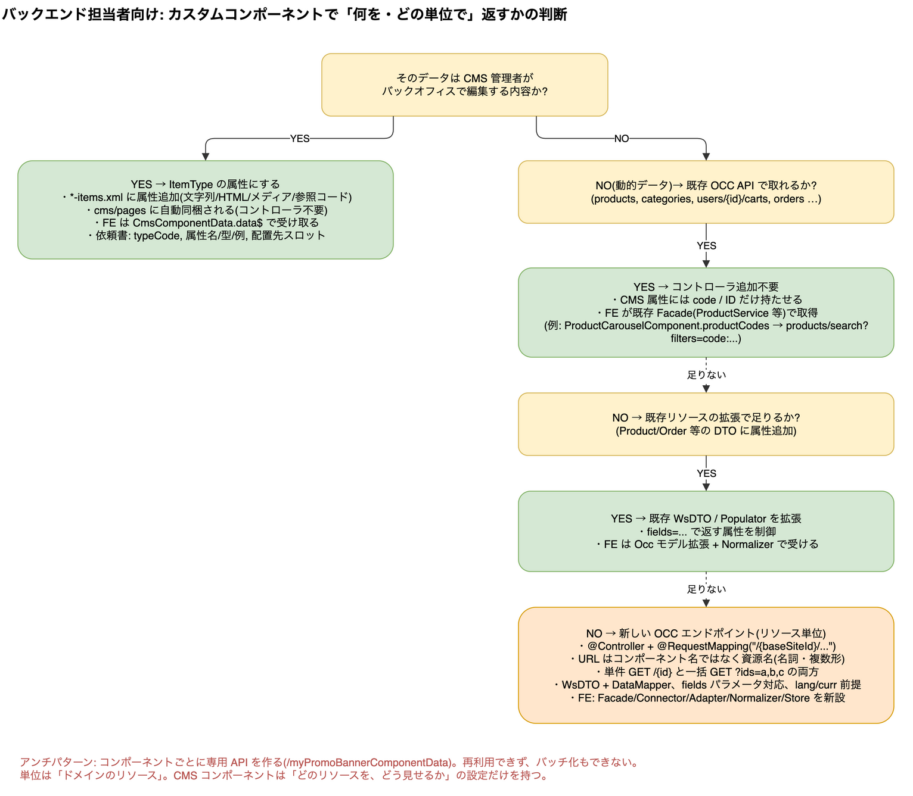

# 12. バックエンド(Java)側: 何を、どの単位で返すか

> **図**: 04 バックエンド判断フロー(`diagrams/spartacus-architecture.drawio`)。12.1 の判断順を図にしたもの



> **この章が答える問い**: `@RestController` をどの単位で作るか。何を返し、何を CMS 属性に留めるか(③)
>
> **位置づけ**: 11 章の続き。コンポーネントが業務データを要するとき、Java 側は何をどの単位で返すか


> **根拠の範囲について**: SAP Commerce Cloud 本体(Java)は公開リポジトリが無いためクローンできない。本章のうち Java の API 名は SAP Help の公開ドキュメント([DataMapper](https://help.sap.com/doc/9fef7037b3304324b8891e84f19f2bf3/2211/en-US/de/hybris/platform/webservicescommons/mapping/DataMapper.html)、[Data Mapping Mechanism](https://help.sap.com/docs/SAP_COMMERCE/9d346683b0084da2938be8a285c0c27a/e571a0e6f7524d4ab62e29cc2b387aeb.html)、[KBA 2693560 field level configuration](https://userapps.support.sap.com/sap/support/knowledge/en/2693560))に基づく。**フロントが何を期待するか**は 15.3 のとおり Spartacus ソースで裏付けている。デモ OCC の実レスポンス(11.2、付録 B)も根拠に含む。

### 12.1 結論: 「コンポーネント単位」ではなく「リソース単位」

> **用語「リソース」について**: これは REST(Web API の設計様式)の用語で、SAP Commerce や Backoffice の画面には出てこない。REST では **URL が指し示す「もの」(名詞)** をリソースと呼び、返ってくる JSON はその「表現」と呼ぶ。SAP Commerce の語彙に置き換えると次のとおり。
>
> | REST の言い方 | SAP Commerce / Backoffice での実体 | 例 |
> |---|---|---|
> | リソース | **ItemType のアイテム**(Backoffice で開く 1 件のデータ) | 商品 `300938`、カート、注文、店舗(PointOfService) |
> | リソースの集合 | その型の検索結果 | 商品検索、注文一覧 |
> | 表現(JSON) | OCC の WsDTO(`ProductWsDTO` など) | `{"code":"300938","name":...}` |
> | URL | 型名の複数形 + 識別子 | `products/{productCode}`、`users/{userId}/orders/{orderId}` |
>
> OCC の既定 URL が実際にこの形になっていることは Spartacus 側のエンドポイント設定で確認できる(`spartacus/core-libs/core/src/occ/adapters/product/default-occ-product-config.ts:16-36` の `products/${productCode}`、`products/${productCode}/reviews`、`spartacus/feature-libs/order/occ/config/default-occ-order-config.ts:14` の `users/${userId}/orders/${orderId}`)。
>
> 既存リソースの一覧(サイト設定 / CMS / 業務データの 3 層、45 設定ファイル分)と「どのリソースの中でカスタムを考えるか」の決め方は [9 章](09-occ-resource-catalog.md) にまとめた。
>
> したがって本章の「コンポーネント単位ではなくリソース単位」は、Backoffice の言葉で言えば **「CMS コンポーネントの型ごとに API を作るのではなく、そのコンポーネントが参照している業務アイテムの型(商品・プロモーション・店舗など)ごとに API を作る」** という意味である。

`@RestController`(SAP Commerce の OCC では `@Controller` + `@RequestMapping` + `@ResponseBody`)を**CMS コンポーネントごとに作ってはいけない**。判断は次の順(図「04 バックエンド判断フロー」):

| 問い | YES の場合 | 作るもの |
|---|---|---|
| ① CMS 管理者がバックオフィスで編集する内容か | ItemType の属性にする | **コントローラ不要**。`cms/pages` / `cms/components` が属性を自動で返す |
| ② 既存 OCC API(products, categories, carts, orders, users …)で取れるか | CMS 属性には code / ID だけ持たせ、FE が既存 Facade で取得 | **コントローラ不要**(例: `ProductCarouselComponent.productCodes`) |
| ③ 既存リソースに属性を足せば足りるか | 既存 WsDTO と Populator を拡張し、`fields` レベルに追加 | **DTO 拡張のみ**。FE は Occ モデル拡張 + Normalizer(`normalizers.md:17-26`) |
| ④ 上記で足りない | **新しいリソース**としてエンドポイントを設計 | 新コントローラ + WsDTO。FE は 15.4 の一式 |

「単位」の答え: **URL はドメインのリソース(名詞)で切る**。CMS コンポーネントは「どのリソースを、どう見せるか」の設定(参照 ID と表示オプション)だけを持つ。こうすると同じ API を複数コンポーネント・複数画面で再利用でき、FE 側のキャッシュ(Query / Entity Loader)とバッチ化(`bufferDebounceTime`)が効く。

### 12.2 ① CMS 属性で返す場合(コントローラ不要)

デモの実レスポンス(11.2)から読み取れる OCC CMS の出力規則:

| 観測事実 | 含意 |
|---|---|
| `"container": "false"`, `"external": "false"` | 真偽値も **文字列**。FE モデルは `string` で受け、`=== 'true'` で判定(`banner.component.ts:133-135` は `'true'` と `true` 両対応) |
| `"productCodes": "300938 358639 ..."` | 複数値は **スペース区切りの 1 文字列**。FE で `split(' ')`(`product-carousel.component.ts:74`) |
| `"media": { "desktop": {url, altText, mime, code}, "tablet": …, "mobile": …, "widescreen": … }` | メディアコンテナは breakpoint ごとのオブジェクト(`cms.model.ts:99-117`) |
| `"content": "<div class=...>…</div>"` | リッチテキストは HTML 文字列のまま |
| `uid`, `uuid`, `typeCode`, `modifiedtime`, `name`, `synchronizationBlocked` | 全コンポーネント共通の自動属性 |
| 言語依存属性 | `?lang=en` で解決済みの 1 値が返る(ローカライズは OCC 側で解決) |

バックエンド作業は `*-items.xml` に ItemType と属性を定義してバックオフィスで値を入れるだけ。依頼書には「属性名・型(文字列化後の表現)・例」を書く。**既存 typeCode のインスタンスを増やすだけならフロント作業ゼロ**(11.1)。

### 12.3 ③④ 新しいリソースを返す場合の設計ルール

フロント(15.3)と OCC の慣習から導かれるチェックリスト:

1. **URL**: `/{baseSiteId}/...` 配下。利用者固有なら `/{baseSiteId}/users/{userId}/my-promos/{promoId}`。`userId` には `current` / `anonymous` が来る前提で解決する(`occ-user-ids.ts:7-8`)。Spartacus 側の endpoints 設定は `'users/${userId}/my-promos/${promoId}'` と 1 対 1 になる。
2. **単件と一括の両方**: `GET /my-promos/{id}` と `GET /my-promos?ids=a,b,c`(または `filters=`)。FE は同一ティックの要求をまとめて 1 本にする設計なので(8.2 (d)(h))、一括エンドポイントが無いとコンポーネント数だけ API が飛ぶ。
3. **`fields` パラメータ**: `BASIC` / `DEFAULT` / `FULL` のレベルを `dto-level-mappings` に定義し、`DataMapper.map(data, XxxWsDTO.class, fields)` で返す。Spartacus の endpoints 設定は `?fields=DEFAULT` や `?fields=code,name,price(formattedValue)` を URL テンプレートに持つのが慣習(`default-occ-product-config.ts:14-27`、`default-occ-store-finder-config.ts:12-17`)。
4. **`lang` / `curr`**: 必ずクエリで来る(15.3)。ローカライズ属性と価格はこれで解決して返す。
5. **認証**: `users/{userId}` 配下はログイン時に Bearer トークンが付く。匿名可否はサーバ側で判断。
6. **エラー形式**: `ErrorListWsDTO`(`{ errors: [{ type, message, reason, subject, subjectType }] }`)で返す。FE はこれを `HttpErrorModel.details` に写して表示する(`try-normalize-http-error.ts:44-50`)。
7. **DTO の形**: フラットで、ネストはリソース参照(`product: { code, name }`)程度に抑える。FE の Normalizer は `{ ...source }` から始めて差分だけ変換するのが定石(`occ-order-approval-normalizer.ts:20-26`)なので、JSON のキー名がそのまま FE モデルのプロパティ名になる。キー名は camelCase。
8. **命名**: URL はコンポーネント名(`/myPromoBannerComponentData`)ではなくリソース名(`/my-promos`)。コンポーネントが変わっても API は残る。

### 12.4 Java 側の最小構成(参考・SAP Help の公開情報に基づく一般形)

```java
// OCC 拡張 (yocc テンプレートから生成した *occ 拡張) の web/src 配下
@Controller
@RequestMapping(value = "/{baseSiteId}/users/{userId}/my-promos")
public class MyPromosController extends BaseController {

  @Resource private MyPromoFacade myPromoFacade;   // facades 層: MyPromoData を返す
  @Resource private DataMapper dataMapper;          // webservicescommons の DataMapper

  @GetMapping(value = "/{promoId}")
  @ResponseBody
  public MyPromoWsDTO getPromo(
      @PathVariable String promoId,
      @RequestParam(defaultValue = DEFAULT_FIELD_SET) String fields) {
    MyPromoData data = myPromoFacade.getPromo(promoId);     // Service → DAO
    return dataMapper.map(data, MyPromoWsDTO.class, fields); // fields = BASIC/DEFAULT/FULL or 明示列挙
  }

  @GetMapping
  @ResponseBody
  public MyPromoListWsDTO getPromos(
      @RequestParam List<String> ids,
      @RequestParam(defaultValue = DEFAULT_FIELD_SET) String fields) {
    MyPromoListData data = myPromoFacade.getPromos(ids);     // 一括取得
    return dataMapper.map(data, MyPromoListWsDTO.class, fields);
  }
}
```
- `MyPromoWsDTO` は `*-beans.xml` で定義し、`dto-level-mappings` で `BASIC` / `DEFAULT` / `FULL` に含めるフィールドを宣言する(KBA 2693560)。
- `MyPromoData`(facades の Data オブジェクト)と `WsDTO` の名前を揃えると DataMapper の自動マッピングで済む。
- Spartacus 側の設定は `myPromo: 'users/${userId}/my-promos/${promoId}?fields=DEFAULT'`, `myPromos: 'users/${userId}/my-promos?fields=DEFAULT'` の 2 行。

### 12.5 依頼書に追加する項目(業務データがある場合)

11.8 の 8 項目に加えて:

9. **リソース名と URL**(単件 / 一括)、パス・クエリパラメータ
10. **WsDTO の JSON サンプル**(`fields=DEFAULT` と `FULL` の両方)
11. **`fields` レベルに含まれる属性一覧**
12. **認証要否**(匿名可 / ログイン必須)、`userId` の扱い
13. **エラー応答の `type` / `reason` 一覧**(FE でメッセージ表示に使う)
14. **CMS 属性との対応**: どの CMS 属性(例 `promoId`)がこの API の引数になるか


---

[目次](README.md) | ← [11. バックエンドでカスタム CMS コンポーネントを作るとき、フロントへ渡す仕様](11-custom-cms-component-spec.md) | [13. JSP(アクセラレータ)のコンポーネントコントローラをヘッドレスに移すとき、何を返すか](13-jsp-to-headless.md) →
