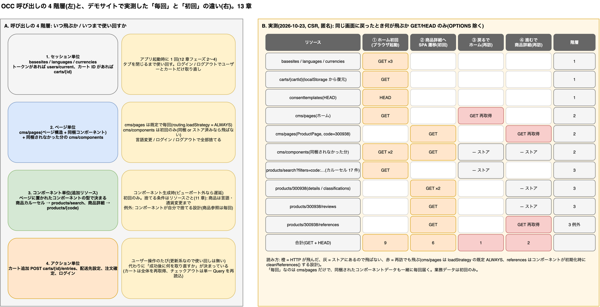

# 13. 呼び出しの 4 階層と「毎回」「初回」の違い

> **図**: 10 呼び出しの 4 階層と毎回・初回(`diagrams/spartacus-architecture.drawio`)。左: セッション / ページ / コンポーネント / アクションの 4 階層と「いつ飛ぶか・いつまで使い回すか」。右: デモサイトで「ホーム → 商品詳細 → 戻る → 進む」を実測し、再訪で何が飛ぶかを色分け



> **この章が答える問い**: ページを開くとき必ず呼ぶものと追加で呼ぶものは何か。「毎回」と「初回」は何が違うか(②③)

## 13.1 4 階層

OCC 呼び出しは「いつ飛ぶか」と「いつまで使い回すか」で 4 つに分けられる。

| 階層 | 何が呼ばれるか | いつ飛ぶか | いつまで使い回すか | 誰が決めるか |
|---|---|---|---|---|
| **1. セッション単位** | `basesites`, `languages`, `currencies`。トークンがあれば `users/current`、`localStorage` にカート ID があれば `carts/{id}` | アプリ起動時に 1 回(12 章フェーズ 2〜4) | タブを閉じるまで。ログイン / ログアウトでユーザーとカートだけ取り直し | Spartacus(固定) |
| **2. ページ単位** | `cms/pages`(ページ構造 + 同梱コンポーネント)と、同梱されなかった分の `cms/components` | `cms/pages` は**既定で毎回**(13.3)。`cms/components` は初回のみ | 言語変更 / ログイン / ログアウトで全部捨てる | バックエンドの CMS 設定(どのページに何を置くか) |
| **3. コンポーネント単位(追加リソース)** | ページに置かれたコンポーネントの型で決まる業務データ。商品カルーセル → `products/search`、商品詳細 → `products/{code}`、店舗 → `stores/{id}` | コンポーネント生成時(ビューポート外なら遅延) | 初回のみ。捨てる条件はリソースごと(11 章): 商品は言語・通貨変更まで、ユーザー系はログアウトまで | コンポーネントの型(= バックエンドが置いた型)と、その Facade の設計 |
| **4. アクション単位** | カート追加 `POST carts/{id}/entries`、配送先設定、注文確定、ログインなど | ユーザー操作のたび | 更新系なので使い回しは無い。代わりに「成功後に何を取り直すか」が決まっている(カートは全体再取得、チェックアウトは単一 Query 再読込) | Facade の Command と `reloadOn` の設計(11.5) |

ページアクセス時の呼び出しを式にすると次のとおり。

```
ページアクセス時の呼び出し
  = cms/pages                                  … 階層 2(既定で毎回)
  + ページ応答に同梱されなかった cms/components   … 階層 2(初回のみ)
  + 配置されたコンポーネントの型ごとの追加リソース  … 階層 3(初回のみ。捨てる条件はリソースごと)
```

アクションは「どの更新系リソースを叩くか」と「成功後にどの取得系を古くするか」のペアで定義される(依頼書項目 17)。

## 13.2 「毎回」と「初回」の違い(実測)

デモサイト(CSR、匿名)で 4 ステップを実測した。GET / HEAD のみを数え、CORS の OPTIONS は除く。

| ステップ | 飛んだ呼び出し | 本数 |
|---|---|---|
| ① ブラウザ起動 → ホーム | `basesites`, `languages`, `currencies`, `cms/pages`(ホーム), `cms/components` ×2(26 件 + 8 件), `consenttemplates`(HEAD), `products/search?filters=code:...`(カルーセル 17 件), `carts/{guid}`(`localStorage` から復元した ID) | 9 |
| ② 商品詳細へ SPA 遷移(初回) | `cms/pages?pageType=ProductPage&code=300938`, `cms/components?productCode=300938`(4 件), `products/300938?fields=...`, `products/300938?fields=classifications`, `products/300938/references`, `products/300938/reviews` | 6 |
| ③ ブラウザ「戻る」でホーム(再訪) | **`cms/pages`(ホーム)だけ**。`cms/components`、`products/search`、`carts` は飛ばない | 1 |
| ④ 「進む」で同じ商品詳細(再訪) | **`cms/pages`(ProductPage)と `products/300938/references`**。`products/300938` ×2、`reviews`、`cms/components` は飛ばない | 2 |

ここから読み取れる規則:

- **「毎回」なのは `cms/pages` だけ**。再訪でも 1 本飛ぶ。ただしその応答にコンポーネントのデータが同梱されているので、別途 `cms/components` を呼ぶ必要が無い。
- **`cms/components`(同梱されなかった分)と業務データは「初回」だけ**。ストアにある限り飛ばない。ホーム再訪で `products/search` が飛ばないのは、17 件の商品がストアに残っているから。
- **例外は設計で作れる**。`products/300938/references` は再訪でも飛ぶが、これは商品参照コンポーネントが初期化のたびに `cleanReferences()` でストアを捨てる設計だから(13.3)。

つまり前回の説明の「毎回」と「初回」は、**階層 2 の `cms/pages` が毎回、それ以外(階層 2 の残りと階層 3)が初回**という意味である。

## 13.3 なぜそうなるか(ソース)

| 対象 | 挙動 | 根拠 |
|---|---|---|
| `cms/pages` | `CmsPageGuard` は `routing.loadStrategy` が `ONCE` でない限り `getPage(ctx, forceReload = true)` を呼ぶ。既定値は **`ALWAYS`**。`hasPage` は `forceReload && !loading` のとき取得済みでも `LoadCmsPageData` を dispatch する | `spartacus/core-libs/storefront/cms-structure/guards/cms-page.guard.ts:62, 89-91`、`spartacus/core-libs/core/src/routing/configurable-routes/routing-config.service.ts:45-47`、`spartacus/core-libs/core/src/cms/facade/cms.service.ts:247-257` |
| `cms/components` | `cms/pages` 応答の同梱コンポーネントは `CmsGetComponentFromPage` でストアへ入るので、再訪時も同梱分は再要求されない。同梱されなかった分は Entity Loader の `attemptedLoad` 判定で初回だけ | `page.effect.ts:67-79`、`cms.service.ts:112-133`(4 章 (c)(d)) |
| 商品本体 | 商品ストアを捨てるのは `LANGUAGE_CHANGE` と `CURRENCY_CHANGE` だけ。ページ遷移では消えない | `spartacus/core-libs/core/src/product/store/reducers/index.ts:46-56` |
| 商品参照(例外) | `ProductReferencesComponent` が初期化時に `productReferenceService.cleanReferences()` を呼び、`CleanProductReferences` でストアを捨ててから取り直す | `spartacus/core-libs/storefront/cms-components/product/carousel/product-references/product-references.component.ts:60`、`spartacus/core-libs/core/src/product/facade/product-reference.service.ts:49-50` |
| カート | 起動時に `localStorage` のカート ID を `SetActiveCartId` で復元し、`ActiveCartService` が 1 回だけ取得。以降は更新アクションのたびに全体を再取得 | `spartacus/feature-libs/cart/base/core/services/multi-cart-state-persistence.service.ts:36-69`、`active-cart.service.ts:94-121` |
| セッション系 | `languages` / `currencies` / `basesites` はサイトコンテキスト初期化で 1 回 | 12 章フェーズ 2 |

## 13.4 「毎回」と「初回」を切り替える手段

| したいこと | 手段 | 根拠 |
|---|---|---|
| `cms/pages` を初回だけにする(再訪を速くする) | `provideConfig({ routing: { loadStrategy: RouteLoadStrategy.ONCE } })`。CMS の変更は言語変更・ログイン・リロードまで反映されなくなる | `routing-config.ts:36-44`、`cms-page.guard.ts:89-91` |
| 業務データを一定時間で取り直す | 商品なら `backend.loadingScopes.product[scope].maxAge`(ミリ秒)と `reloadOn` イベント | `loading-scopes.service.ts:56-76`、`product-loading.service.ts:146-191` |
| あるアクションの後に取り直す | Query の `reloadOn: [MyChangedEvent]`、Command 成功時に `eventService.dispatch` | 11.5 |
| コンポーネントが表示されるたびに取り直す | コンポーネントの初期化で明示的に捨てる(商品参照と同じ設計)。NgRx なら Clean アクション、Query なら `resetOn` に自作イベント | 13.3 の例外 |
| ページ遷移時に特定のストアを捨てる | `RoutingService` の `NavigationEvent` を `resetOn` に指定 | 12.7 |

## 13.5 バックエンド担当者にとっての意味

- **`cms/pages` は毎回飛ぶので、CMS 側の変更(配置・属性)は次のページ遷移で反映される**。一方で同梱コンポーネントのデータも毎回届くため、`cms/pages` の応答サイズ(デモのホームで 73KB)がページ遷移の体感速度に直結する。コンポーネントの属性を増やすときはここを意識する。
- **業務データは初回だけ**なので、バックエンドで商品や店舗のデータを変えても、ユーザーが言語を変えるかリロードするまで画面は古いまま。即時反映が要るなら 13.4 の手段をフロントに依頼する。
- **コンポーネントを置く = 階層 3 の呼び出しを増やす**。追加リソースが要らない型(パラグラフ、バナー、リンク)はページ単位の `cms/pages` だけで済み、業務データを参照する型を置いた瞬間にそのリソースの呼び出しが加わる。10 章の一覧で「どのリソースを参照する型か」を決めるのはこのためである。
- **アクションは「更新 API + 古くなる取得系」のペアで依頼する**。カート追加なら「`POST carts/{id}/entries` の後に `GET carts/{id}` を取り直す」のように書けば、フロントは Command と `reloadOn` にそのまま写せる。

---

[目次](README.md) | ← [12. アプリケーションのライフサイクル: index.html 取得から永続化まで](12-application-lifecycle.md) | [14. cms/pages 応答からコンポーネント描画まで](14-page-to-component.md) →
