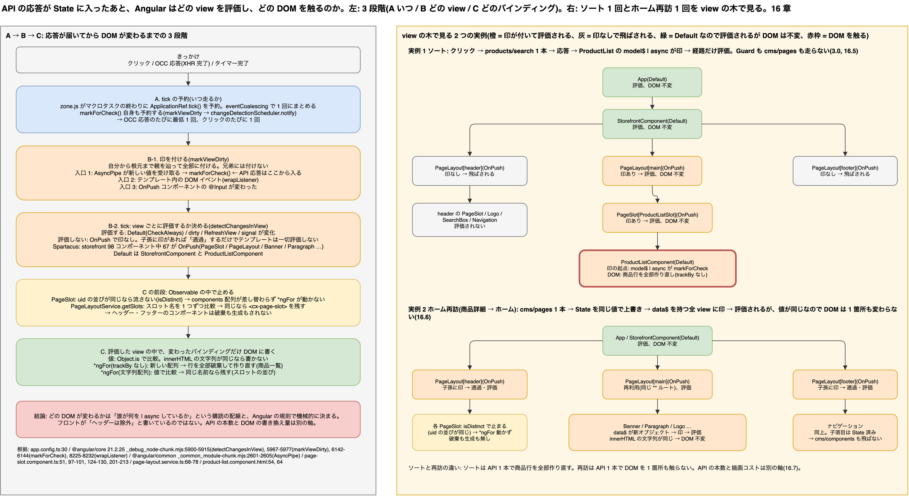

# 16. 変更検知と dirty フラグ: API の応答が届いたあと、どの view が描き直るのか

> **図**: 15 変更検知の 3 段階と dirty の経路(`diagrams/spartacus-architecture.drawio`)。左: A「いつ tick が走るか」/ B「どの view を評価するか」/ C「どのバインディングが DOM を触るか」の 3 段階。右: ソート 1 回と、ホーム再訪 1 回で、view の木のどこが dirty になり、どこが飛ばされ、DOM のどこが触られるか



> **この章が答える問い**: `cms/pages` や `products/search` の応答が State に入ったあと、Angular はどの view を評価し、どの DOM を触るのか。ヘッダーとフッターはなぜ残り、一覧の行はなぜ作り直されるのか(③)

> **位置づけ**: 8.0 の規則 4「描画は State を購読している view が勝手に更新する」の「勝手に」の中身。4.9(`async` パイプ)の続きで、3.0 のソートとページ遷移を描画側から見直す

> 根拠は `spartacus/`(develop, b7b028f)と、Angular 本体は `playground/mini-spartacus/node_modules/@angular/core` 21.2.25 のビルド済みファイル(`fesm2022/_debug_node-chunk.mjs`)、`@angular/common` 同版(`fesm2022/_common_module-chunk.mjs`)。Spartacus 本体が要求する Angular も 21 系(1.1)。

### 16.0 先に話し言葉で: 応答が届いても、描き直されるのは「印の付いた道筋」だけ

バックエンドの感覚では「応答が返れば画面が描かれる」の 1 工程ですが、Angular では応答が State に入ったあとに 3 つの問いが順に立ちます。

- **A. いつ描画の処理(tick)が走るか。** クリック、HTTP 応答、タイマーが終わった瞬間に、Angular は根元から 1 回なめ直します。これが tick です。
- **B. その tick で、どの view(コンポーネントのテンプレート)を評価し直すか。** 全部ではありません。**dirty という印が付いた view と、その先祖だけ**です。印を付けるのは `async` パイプで、「State の新しい値を受け取った view」に付きます。印の無い view は、テンプレートの評価そのものが飛ばされます。
- **C. 評価した view の中で、どのバインディングが DOM を触るか。** 前回の値と比べて変わったものだけです。文字列が同じなら `innerHTML` は書き換えません。配列が新しくなれば `*ngFor` は行を作り直します。

だから「`cms/pages` が呼ばれたらヘッダーも描き直るのか」の答えは、「ヘッダーの view には印が付かないか、付いても値が同じなので DOM は触られない」です。ソートで一覧だけが変わるのも同じ理屈で、フロントエンジニアが「ヘッダーは残す」と書いているわけではありません。**どの DOM が変わるかは、誰が何を購読しているかという配線と、Angular の規則で機械的に決まります。**

以下、3 段階をソースで確認し(16.1〜16.4)、ソートとページ遷移の 2 つの実例を view の木の上で追う(16.5〜16.6)。最後に API の実行との関係を 1 つの表にする(16.7)。

## 16.1 用語: view、tick、dirty、OnPush

| 用語 | 意味 | Spartacus ではどこか |
|---|---|---|
| **view** | コンポーネント 1 個分のテンプレートの実体。親子で木になる | `App › StorefrontComponent › PageLayoutComponent › PageSlotComponent › ParagraphComponent` のような木(3 章、4.5) |
| **tick** | 根元の view から下へ 1 回なめる処理。`ApplicationRef.tick()` | zone.js が「何か終わった」と判断するたびに 1 回 |
| **dirty** | 「次の tick で私のテンプレートを評価し直して」という印。view 単位のフラグ | `async` パイプと `markForCheck()` が付ける |
| **Default** | 印が無くても毎 tick 評価される設定(`CheckAlways`) | `StorefrontComponent`、`ProductListComponent`(`changeDetection` 指定なし) |
| **OnPush** | 印が付いたとき、`@Input` が変わったとき、自分の中で DOM イベントが起きたときだけ評価される設定 | storefront ライブラリ 98 コンポーネント中 67 個。`PageSlotComponent`(`page-slot.component.ts:51`)、`PageLayoutComponent`(`page-layout.component.ts:20`)、`BannerComponent`(`:35`)、`ParagraphComponent`(`:23`) |

## 16.2 段階 A: いつ tick が走るか

参照アプリは zone ベースの変更検知で起動している(`spartacus/projects/storefrontapp/src/app/app.config.ts:30`):

```ts
provideZoneChangeDetection({ eventCoalescing: true }),
```

zone.js は DOM イベントのハンドラ、`XMLHttpRequest` の完了、`setTimeout` の完了を横取りし、そのマクロタスクが終わると tick を 1 回予約する。`eventCoalescing: true` は、同じマクロタスク内で複数のイベントが起きても tick を 1 回にまとめる設定である。

これとは別に、`markForCheck()` 自身も tick を予約する。`markViewDirty` の先頭で `changeDetectionScheduler?.notify(source)` を呼んでいる(`_debug_node-chunk.mjs:5967-5969`)。Angular 18 以降はこの「zone が予約する tick」と「印を付けたときに予約される tick」が同じスケジューラに合流する(ハイブリッドスケジューラ)。

バックエンド担当者が押さえるのはこの 2 つだけでよい。

- **OCC の応答が届くたびに、少なくとも 1 回 tick が走る。** ただし次の 16.3 のとおり、印の無い view は評価されないので、tick 自体は安い。
- **クリックのたびに 1 回 tick が走る。** API が飛ぶ前に走るので、「クリック → tick → (応答) → tick」の 2 回になる。

## 16.3 段階 B: どの view を評価するか(dirty フラグ)

### 評価するかどうかの判定

Angular が view ごとに評価するかどうかを決めている関数が `detectChangesInView` である(`_debug_node-chunk.mjs:5900-5915`)。要点を抜くとこうなる(数値は `LViewFlags` のビット。16 = `CheckAlways`、64 = `Dirty`、1024 = `RefreshView`、8192 = `HasChildViewsToRefresh`):

```js
let shouldRefreshView = !!(mode === 0 && flags & 16);        // Default のコンポーネントは常に
shouldRefreshView ||= !!(flags & 64 && mode === 0 && ...);  // dirty の印が付いている
shouldRefreshView ||= !!(flags & 1024);                      // markForCheck で付く RefreshView
shouldRefreshView ||= !!(consumer?.dirty && ...);            // signal が変わった
if (shouldRefreshView) {
  refreshView(...);                       // テンプレートを評価する
} else if (flags & 8192) {                // 自分は評価しないが、子孫に印があるので
  detectChangesInEmbeddedViews(lView, 1); // 子だけ辿る
  detectChangesInChildComponents(lView, components, 1);
}
```

つまり OnPush の view は、**印が無ければテンプレートを評価せず、子孫に印があるときだけ「通過」する**。通過する view のバインディングは一切評価されない。

### 誰が印を付けるか

印を付ける関数は `markViewDirty` で、**自分から根元まで親を辿りながら全部に印を付ける**(`:5970-5977`)。兄弟には付けない。

```js
while (lView) {
  lView[FLAGS] |= dirtyBitsToUse;
  const parent = getLViewParent(lView);
  if (isRootView(lView) && !parent) return lView;
  lView = parent;
}
```

これを呼ぶ入口は 3 つある。

| 入口 | 根拠 | Spartacus でいつ起きるか |
|---|---|---|
| `ChangeDetectorRef.markForCheck()` | `:6142-6144` が `markViewDirty(view, 4)` を呼ぶ | `AsyncPipe` が新しい値を受け取るたび(`_common_module-chunk.mjs:2601-2605`)。`PageSlotComponent` がスロット内容を受け取ったとき(`page-slot.component.ts:124-130`)とコンポーネント生成完了時(`:183-187`)。`ComponentWrapperDirective` が `createComponent` した直後(`component-wrapper.directive.ts:112`) |
| テンプレート内の DOM イベント | `wrapListener` がハンドラ実行前に `markViewDirty(startView, 5)`(`:8225-8232`) | ソートの `<cx-sorting (sortListEvent)>`(`product-list.component.html:18`)をクリックした瞬間、`ProductListComponent` から根元までに印が付く |
| `@Input` の値が変わった | `markDirtyIfOnPush`(`:5191`) | `<cx-page-slot [position]>` の位置名が変わったとき、`<cx-page-layout section>` は固定なので起きない |

### API の応答から印までの経路

8.0 の規則 4 を、この入口に当てはめるとこうなる。

1. 応答が Reducer で State に入る(5 章)。
2. その State を `select` している Observable が新しい値を流す。
3. テンプレートで `| async` している view の `AsyncPipe` が値を受け取り、`markForCheck()` を呼ぶ。
4. その view から根元までに印が付く。**同じ State を購読していない view には何も起きない。**
5. 次の tick で、印の付いた view だけが評価される。

「購読している view が勝手に更新する」の実体はこの 5 段で、フロントのコードがどこかで「ヘッダーは除外」と書いているわけではない。ヘッダーの view に印が付くかどうかは、ヘッダーの中の `async` パイプが新しい値を受け取ったかどうかだけで決まる。

## 16.4 段階 C: どのバインディングが DOM を触るか

view が評価されても、DOM が書き換わるとは限らない。バインディングは 1 つずつ前回の値と比較され(`Object.is`)、変わったものだけが DOM に書く。構造ディレクティブは別の比較をする。

| 構造 | 比較の単位 | Spartacus での結果 |
|---|---|---|
| 属性・テキストバインディング(`[innerHTML]`、`{{ }}`) | 値の同一性 | `ParagraphComponent` は `data.content` の文字列が同じなら `innerHTML` を触らない(`paragraph.component.html:1-4`) |
| `*ngFor`(`trackBy` なし) | 要素の同一性。新しいオブジェクトは別物 | `ProductListComponent` の商品行は `*ngFor="let product of model?.products"` で `trackBy` が無い(`product-list.component.html:54, :64`)。`products/search` の応答で配列が差し替わると、**全行を破棄して作り直す** |
| `*ngFor`(文字列配列) | 文字列は値で比較 | `PageLayoutComponent` のスロット並び `*ngFor="let slot of slots$ \| async"`(`page-layout.component.html:13-17`)。同じ名前なら `<cx-page-slot>` は作り直されない |
| 上流の `distinctUntilChanged` | Observable が流す前に止める | `PageSlotComponent` は uid の並びが同じなら流さない(`page-slot.component.ts:97-101`、`isDistinct` `:201-213`)。`PageLayoutService.getSlots` もスロット名を 1 つずつ比較して同じなら流さない(`page-layout.service.ts:68-78`) |

最後の行が、ヘッダーとフッターが残る本当の理由である。段階 B で印が付く前に、段階 C 相当の比較が Observable の中で先に行われていて、**uid の並びが同じ限り `components` 配列は差し替わらず、`*ngFor`(`page-slot.component.html:6-14`)は何もしない**。中のコンポーネントの `data$` だけは新しい値を受け取るが(16.6)、値が同じなら DOM は触られない。

## 16.5 実例 1: ソート(クエリだけ変わる)

3.0 と 8.0 で「ソートは `products/search` だけで Guard も `cms/pages` も走らない」と書いた。描画側から見ると次の順になる。

| # | 何が起きるか | 段階 | 根拠 |
|---|---|---|---|
| 1 | 並び替えをクリック。`wrapListener` が `ProductListComponent` から根元まで印を付け、tick が 1 回走る。この時点で State は変わっていないので DOM は変わらない | A, B | `_debug_node-chunk.mjs:8225-8232` |
| 2 | `sortList()` → `ProductListComponentService.sort()` → `router.navigate([], { queryParams, queryParamsHandling: 'merge' })` | — | `product-list.component.ts:95-97`、`product-list-component.service.ts:270-284` |
| 3 | URL のクエリだけ変わる。PageContext にクエリは入らないので Guard は走らず、`cms/pages` も飛ばない | — | `router.reducer.ts:169-215`、3.0 |
| 4 | `searchByRouting$` が URL の変化を受けて `searchIfCriteriaHasChanged` → `products/search` を 1 本 | — | `product-list-component.service.ts:69-90, 96-114` |
| 5 | 応答が `productSearch` State に入る。`model$ \| async` を持つ `ProductListComponent` の `AsyncPipe` が `markForCheck()`。印が付くのは `ProductList › PageSlot[ProductListSlot] › PageLayout[main] › Storefront › App` の経路だけ | B | `_common_module-chunk.mjs:2601-2605` |
| 6 | tick。ヘッダーの `PageLayoutComponent` は OnPush で印が無く、`section` 入力も変わっていないので**評価されない**。`StorefrontComponent` は Default なので評価されるが、バインディングの値は変わらないので DOM は触らない | B | `detectChangesInView :5900-5915` |
| 7 | `ProductListComponent` のテンプレートで `*ngFor` が新しい配列を受け取り、行を全部作り直す(`trackBy` なし) | C | `product-list.component.html:54, :64` |

ミニアプリ(`playground/mini-spartacus`、実験 3)では、この tick の観測行がそのまま出る: `App › Storefront › PageLayout[main] › PageSlot[ProductListSlot] › ProductList › Tile…`。`PageLayout[header]` は出ず、`created Tile` と `destroyed Tile` が商品数ぶん出る。`track p` を `track p.code` に変えると作り直しが消える。

## 16.6 実例 2: ページ遷移(ホーム → 商品詳細 → ホーム)

### ホーム → 商品詳細

1. Guard が `cms/pages?pageType=ProductPage` を取り、State に入る(3 章)。PageContext が `ProductPage/300938` に変わる。
2. ヘッダーの `PageLayoutComponent` は `<router-outlet>` の外にあり(`storefront.component.html:11, :25`)、破棄されない。ただしその中のスロットは `getContentSlot` が **現在の PageContext** のページから読んでいるので(`cms.service.ts:152-165`)、新しいページ応答のヘッダースロットを流し直す。
3. `isDistinct` が uid の並びを比較し、同じなら流さない(`page-slot.component.ts:201-213`)。デモのホームと商品詳細はヘッダーの uid 並びが同じなので、ロゴ、検索ボックス、ナビゲーションは**破棄も生成もされない**。
4. `<router-outlet>` の中は、商品ルート(`path: null, cxRoute: 'product'`、`product-details-page.module.ts:19-22`)と `**` ルートが別のルート定義なので、Angular Router が `PageLayoutComponent` を破棄して作り直す。新しいテンプレート名でスロットが並び、各スロットがコンポーネントを生成する(4 章)。
5. 新しく生成された各コンポーネントの `async` パイプが初回の値を受け取って印を付け、tick で描かれる(4.9)。

### 商品詳細 → ホーム(再訪)

1. 既定の `loadStrategy: ALWAYS` なので `cms/pages` がもう 1 回飛ぶ(8.0 の例外、7.3)。
2. 応答が Reducer で State に入る。**内容は前回と同じだが、オブジェクトとしては新しい**。
3. `cms.page` を `select` している Observable は新しいオブジェクトを流す。`PageSlotComponent` の `isDistinct` は uid の並びで比較するので、ここで止まる。`components` 配列は差し替わらず、`*ngFor` は動かない。
4. 各コンポーネントの `data$`(`getComponentData(uid)`)は新しいオブジェクトを流すので、`AsyncPipe` が `markForCheck()` を呼び、その view と先祖に印が付く。
5. tick。印の付いた `ParagraphComponent` などは評価されるが、`innerHTML` に渡す文字列は同じなので DOM は書き換わらない(16.4)。

つまり再訪では「API は飛ぶ、State は上書きされる、view は評価される、**DOM は触られない**」になる。ミニアプリの実験 2 で、再訪時に `created` も `destroyed` も出ないのはこの 3 と 5 による。

### 商品 A → 商品 B(同じルート)

商品ルート同士なので Router は `PageLayoutComponent` を再利用する。PageContext が `ProductPage/B` に変わり、`cms/pages?code=B` が飛ぶ。スロットの uid 並びが同じなら `ProductSummaryComponent` などは作り直されず、`product$ | async` が新しい商品を流して印が付き、商品名や価格のバインディングだけが DOM を書き換える(ミニアプリ実験 4)。

## 16.7 API の実行と描画の関係(まとめ)

| 出来事 | tick | 印が付く view | DOM を触る範囲 | API |
|---|---|---|---|---|
| ソートをクリック | 1 | `ProductList` から根元まで | 無し | ここで `products/search` が発行される |
| `products/search` の応答 | 1 | `ProductList` から根元まで | 商品行(全部作り直し) | — |
| ホーム → 商品詳細 | 複数 | `<router-outlet>` の中の新しい view 全部 + その先祖 | `<main>` の中身。ヘッダー・フッターは uid が同じなら無し | `cms/pages`、商品系(7.2 ②) |
| ホーム再訪 | 1〜2 | `data$` を持つ各コンポーネントから根元まで | ほぼ無し(値が同じ) | `cms/pages` 1 本(7.2 ③) |
| 言語変更 | 多数 | 全部(State が捨てられ、再取得のたびに印) | 全部 | 多数(6.7) |
| CMS でスロット内の並びを変えて再訪 | 1〜2 | そのスロットから根元まで | そのスロットの中身を全部作り直し(`isDistinct` が false) | `cms/pages` 1 本 |

ここから 2 つのことが言える。

- **API の本数と DOM の書き換え量は別の軸である。** `cms/pages` は毎回飛ぶが、応答が同じなら DOM は 1 箇所も変わらない。逆にソートは API 1 本でも商品行を全部作り直す。「API を減らせば描画が速くなる」は必ずしも成り立たない。
- **どの DOM が変わるかは、購読の配線と Angular の規則で決まっていて、フロントが画面ごとに制御しているのではない。** 「このコンポーネントは再描画してほしくない」という要望は、`OnPush` と `distinctUntilChanged` と `trackBy` の組み合わせで実現され、個別の if 文ではない。

## 16.8 バックエンド担当者にとっての意味

- **応答が前回と同じなら、画面は触られない。** `cms/pages` を遷移のたびに返していても、内容が同じ限りブラウザ側の描画コストはほぼゼロ。応答を軽くする価値は転送量にあって、描画にはない。
- **uid の並びを変える CMS 編集は、そのスロット全体の作り直しになる。** コンポーネントの追加・削除・並び替えは `isDistinct` を false にし、スロット内の全コンポーネントが破棄・再生成される。属性だけの変更なら、その 1 コンポーネントの中のバインディングしか動かない。
- **一覧系の応答は、行の識別子が安定していても、標準の一覧コンポーネントは行を作り直す。** `trackBy` を足すかどうかはフロント側の判断で、バックエンドにできることは無い。性能の話をするときに「API を減らす」と「行の作り直しを減らす」を混ぜないこと。
- 質問の言い換え: 「`cms/pages` を呼ぶとどの DOM が再描画されるか」→「応答で State のどこが新しい値になり、それを `async` で購読している view はどれか。その view の中で値が変わったバインディングはどれか」。前半が 16.3、後半が 16.4。

---

[目次](README.md) | ← [15. 業務データを扱うカスタムコンポーネント: Facade / Connector / Adapter の作り方](15-facade-connector-adapter.md) | [付録](appendix.md) →
