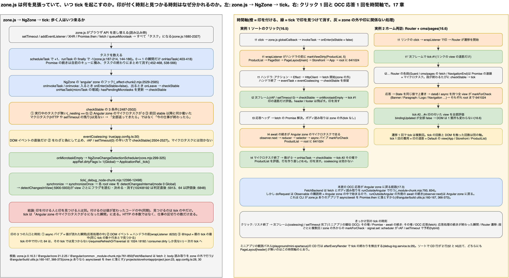

# 17. zone.js と変更検知の実行モデル: 印が付く瞬間と、印が見つかる瞬間

> **図**: 16 zone.js の見張りと dirty の 2 つの時刻(`diagrams/spartacus-architecture.drawio`)。左: zone.js がブラウザ API を差し替えてタスクを数え、Angular zone のマイクロタスクが 0 になった瞬間に tick を起こすまで。右: クリック 1 回と OCC 応答 1 回を時間軸に並べ、「印を付ける(同期)」と「印を見つける(tick)」がいつ起きるか



> **この章が答える問い**: zone.js は何を見張っていて、いつ `ApplicationRef.tick()` を起こすのか。dirty の印は「いつ」「誰が」付け、「いつ」「誰が」見つけて消すのか(③の時刻の話)

> **位置づけ**: 16 章の段階 A(いつ tick が走るか)と段階 B(どの view を評価するか)を、1 本の時間軸に展開する。16 章が「どこに印が付くか」なら、この章は「印が付く時刻と見つかる時刻は別で、その間に何が挟まるか」。18 章(Signal)は、この章の「印の付け方」が置き換わる話

> **根拠の取り方**: Spartacus のクローンには `node_modules` が無いため、Angular 本体と zone.js の根拠はミニアプリ(`playground/mini-spartacus`)の `node_modules` にあるビルド済みファイルを行番号で引く。版は `@angular/core` 21.2.25、`zone.js` 0.16.3、`@angular/build` 21.2.28。Spartacus 本体の要求は `@angular/core ~21.2.23`、`zone.js ^0.16.0`(`spartacus/package.json:169, 197`)なので同じ系列。ファイル名は `@angular/core/fesm2022/` 配下の `_effect-chunk2.mjs`(NgZone と view フラグの補助関数)、`_debug_node-chunk.mjs`(ApplicationRef と view の評価)、`core.mjs`(zone と tick の接続)、`zone.js/fesm2015/zone.js`。列挙型の名前(`Dirty`、`RefreshView` など)は Angular の TypeScript ソースの名前で、ビルド済みファイルでは数値になっている。本文では数値と名前を併記する。

### 17.0 先に話し言葉で: 時計は 2 つある

16 章で「API の応答が State に入ると、`async` パイプが自分の view から根元まで印を付け、次の tick でその道筋だけ評価される」と書いた。この文には時刻が 2 つ入っている。

1 つ目は**印を付ける時刻**。これは応答を処理しているコードの真ん中で、同期的に起きる。`fetch` の続きが動き、NgRx の reducer が State を書き換え、selector が流れ、`async` パイプの `_updateLatestValue` が呼ばれ、その場で `markForCheck()` が走る。ここまで 1 つの関数呼び出しの連鎖で、誰も待たない。

2 つ目は**印を見つける時刻**。これは tick の中でしか起きない。tick は view の木を根元から順に歩き、各 view のフラグを読んで消す。誰かが印を付けただけでは何も描き直らない。歩く人が来て初めて印は意味を持つ。

では歩く人はいつ来るのか。zone.js が「Angular zone の中で始まった仕事が全部終わった」と判断した瞬間に、`NgZone` が `onMicrotaskEmpty` を鳴らし、それを聞いている `NgZoneChangeDetectionScheduler` が `ApplicationRef._tick()` を呼ぶ。「仕事が全部終わった」の定義は「マイクロタスクのキューが空」で、「HTTP が全部返ってきた」ではない。だから OCC の応答 1 本ごとに tick が 1 回走り、クリック 1 回ごとに tick が 1 回走る。

この章は、この 2 つの時刻がどの関数で決まるかを順に追う。

## 17.1 用語

| 用語 | 意味 | ここで出てくる場所 |
|---|---|---|
| Zone | 非同期処理をまたいで引き継がれる実行コンテキスト。zone.js がブラウザ API を差し替えて実現する | 17.2 |
| タスク | zone.js が数える仕事の単位。`microTask`(Promise の続き)、`macroTask`(`setTimeout`、XHR)、`eventTask`(DOM イベントのリスナ)の 3 種類(`zone.js:570`) | 17.2 |
| Angular zone | `NgZone` が `Zone.current.fork` で作る名前 `angular` の zone。アプリのコードは原則この中で動く(`_effect-chunk2.mjs:2533-2540`) | 17.3 |
| tick | `ApplicationRef.tick()` 1 回。view の木を 1 回歩く | 17.5 |
| 印 | view のフラグ。`64 Dirty`、`1024 RefreshView`、`8192 HasChildViewsToRefresh`、および signal 用の `consumer.dirty`(18 章) | 17.4 |
| Global / Targeted | tick の歩き方。zone が起こす tick は常に Global(`mode 0`、Default の view は印が無くても評価)。印だけを頼りに歩くのが Targeted(`mode 1`) | 17.5 |

## 17.2 zone.js は何を差し替え、何を数えているか

zone.js は読み込まれた瞬間にブラウザの非同期 API を差し替える。差し替えの一覧は `zone.js` 内の `__load_patch` 呼び出しで追える。

| 差し替える API | 行 | zone.js 上のタスク種別 |
|---|---|---|
| `setTimeout` / `setInterval` | `zone.js:1680`(`patchTimer` 本体は `:1467-1545`) | `macroTask`(`scheduleMacroTaskWithCurrentZone`、`:1515`) |
| `addEventListener` | `:1703`(本体 `:974-1300`) | `eventTask`(`zone.scheduleEventTask`、`:1257`) |
| `XMLHttpRequest.send` | `:1727`(`send` の差し替え `:1819-1838`) | `macroTask`。`readystatechange` で `DONE` になると `task.invoke()`(`:1769-1798`) |
| `queueMicrotask` | `:1878` | `microTask` |
| `Promise` 全体 | `:1885`、`global.Promise = ZoneAwarePromise`(`:2289`) | `then` の続きは `zone.scheduleMicroTask`(`:2075`) |
| ネイティブ Promise の `then` と `fetch` | `patchThen(NativePromise)`(`:2322`)、`fetch`(`:2327`) | `fetch` が返すネイティブ Promise にも `then` 差し替えを適用し、続きを zone のマイクロタスクにする |

差し替えた API が呼ばれるたびに、zone.js はタスクを 1 つ作って**数える**。`Zone.scheduleTask` が `_updateTaskCount(task, 1)` を呼び(`:187-214`)、タスクが終わると `runTask` の `finally` で `_updateTaskCount(task, -1)` を呼ぶ(`:144-186`、減算は `:176`)。数が 0 から 1、または 1 から 0 に変わった瞬間だけ、zone の `onHasTask` フックが呼ばれる(`ZoneDelegate._updateTaskCount`、`:403-418`)。

```js
// zone.js:403-418 (抜粋)
_updateTaskCount(type, count) {
  const prev = counts[type];
  const next = counts[type] = prev + count;
  if (prev == 0 || next == 0) {
    const isEmpty = { microTask: counts["microTask"] > 0, macroTask: ..., eventTask: ..., change: type };
    this.hasTask(this._zone, isEmpty);
  }
}
```

もう 1 つ重要なのが**マイクロタスクのキュー**。zone.js は Promise の続きを自前のキュー `_microTaskQueue` に入れ(`:527-536`)、タスクの実行が一番外側(`_numberOfNestedTaskFrames === 1`)で終わった直後に `drainMicroTaskQueueSynchronously` で全部実行する(`:452-468`、`:538-566`)。つまり「クリックのリスナが終わった直後」「`setTimeout` のコールバックが終わった直後」に、そこで積まれた Promise の続きがまとめて走る。

タスクの実行自体は `Zone.runTask` → `ZoneDelegate.invokeTask` を通り(`:144-186`、`:380-382`)、zone に `onInvokeTask` フックがあればそれが呼ばれる。DOM イベントなら `globalCallback`(`:1005-1035`)がネイティブのイベントを受けて `invokeTask` に渡す。Angular が割り込むのはこのフックの位置である。

## 17.3 NgZone が tick を起こす条件

`NgZone` はコンストラクタで `Zone.current` を `_outer` として覚え、そこから `angular` という名前の zone を fork する(`_effect-chunk2.mjs:2417-2456`、fork 本体 `:2529-2585`)。fork に渡すフックが 3 つある。

```js
// _effect-chunk2.mjs:2541-2578 (抜粋)
onInvokeTask: (delegate, current, target, task, applyThis, applyArgs) => {
  try {
    onEnter(zone);                                   // _nesting++, isStable=false, onUnstable
    return delegate.invokeTask(target, task, applyThis, applyArgs);
  } finally {
    if (zone.shouldCoalesceEventChangeDetection && task.type === 'eventTask' || zone.shouldCoalesceRunChangeDetection) {
      delayChangeDetectionForEventsDelegate();       // eventCoalescing: true のときだけ
    }
    onLeave(zone);                                   // _nesting--, checkStable
  }
},
onInvoke: (...) => { try { onEnter(zone); return delegate.invoke(...); } finally { ...; onLeave(zone); } },
onHasTask: (delegate, current, target, hasTaskState) => {
  delegate.hasTask(target, hasTaskState);
  if (current === target) {
    if (hasTaskState.change == 'microTask') {
      zone._hasPendingMicrotasks = hasTaskState.microTask;
      updateMicroTaskStatus(zone);
      checkStable(zone);
    } else if (hasTaskState.change == 'macroTask') {
      zone.hasPendingMacrotasks = hasTaskState.macroTask;
    }
  }
},
```

`checkStable` が tick の引き金である。

```js
// _effect-chunk2.mjs:2487-2502
function checkStable(zone) {
  if (zone._nesting == 0 && !zone.hasPendingMicrotasks && !zone.isStable) {
    try {
      zone._nesting++;
      zone.onMicrotaskEmpty.emit(null);              // ← ここを ApplicationRef 側が聞いている
    } finally {
      zone._nesting--;
      if (!zone.hasPendingMicrotasks) {
        try { zone.runOutsideAngular(() => zone.onStable.emit(null)); }
        finally { zone.isStable = true; }
      }
    }
  }
}
```

条件は 3 つ。(1) Angular zone の中で実行中のタスクが無い(`_nesting == 0`)、(2) Angular zone に未実行のマイクロタスクが無い、(3) 前回 stable になってから何か動いた(`!isStable`)。**マクロタスクの残りは見ていない**。`setTimeout` が 3 つ待っていても、HTTP が 2 本飛んでいても、今動いているコードが終わってマイクロタスクが空なら tick は走る。`hasPendingMacrotasks` は `onStable` や `PendingTasks` の判定に使われるだけで(`core.mjs:424-431`)、tick の可否には関係しない。

`onMicrotaskEmpty` を聞いているのが `NgZoneChangeDetectionScheduler` である。

```js
// core.mjs:299-325 (抜粋)
this._onMicrotaskEmptySubscription = this.zone.onMicrotaskEmpty.subscribe({
  next: () => {
    if (this.changeDetectionScheduler.runningTick) return;
    this.zone.run(() => {
      try {
        this.applicationRef.dirtyFlags |= 1;          // 1 = ViewTreeGlobal: 印の有無に関係なく根元から歩く
        this.applicationRef._tick();
      } catch (e) { this.applicationErrorHandler(e); }
    });
  }
});
```

これが `provideZoneChangeDetection(...)` で登録される(`core.mjs:388-406`、`ENVIRONMENT_INITIALIZER` で `initialize()`、`:363-373`)。Spartacus は `provideZoneChangeDetection({ eventCoalescing: true })` を使う(`projects/storefrontapp/src/app/app.config.ts:30`)。`eventCoalescing` は `shouldCoalesceEventChangeDetection` になる(`core.mjs:407-413`)。

### eventCoalescing が変えるもの

`eventCoalescing: true` のとき、`eventTask`(DOM イベントのリスナ)が終わった直後は `checkStable` が**わざと止められる**。`delayChangeDetectionForEvents`(`_effect-chunk2.mjs:2504-2527`)が `callbackScheduled = true` にし、`updateMicroTaskStatus`(`:2586-2591`)がそれを見て `hasPendingMicrotasks = true` にするため、`checkStable` の条件 (2) が偽になる。代わりに `scheduleCallbackWithRafRace`(`:2359-2383`)で `requestAnimationFrame` と `setTimeout(0)` の早い方を予約し、そこで `callbackScheduled = false` → `checkStable` → tick。

効果は「同じフレームの中で連続して起きたイベント(例: `mousedown` → `focus` → `click`)の tick を 1 回にまとめる」。マイクロタスク(Promise の続き、`fetch` の応答)には効かない。だから後述の表で、クリックの tick は「次のフレーム」、OCC 応答の tick は「その場」になる。

### きっかけ別: tick はいつ走るか

| きっかけ | zone.js 上の種別 | Angular zone に入る経路 | tick が走る時刻 |
|---|---|---|---|
| クリック(テンプレートの `(click)`) | `eventTask` | `globalCallback` → `invokeTask` → `onInvokeTask`(`onEnter`) | リスナ終了 → `eventCoalescing` で保留 → 次の `requestAnimationFrame` か `setTimeout(0)` の早い方で `checkStable` → tick |
| `setTimeout` 完了(ミニアプリの擬似 OCC、`occ-fake-backend.ts:151` の `delay`) | `macroTask` | `onInvokeTask` | コールバック終了 → 積まれたマイクロタスクを全部流す → `onLeave` の `checkStable` → **その場で** tick |
| `Promise.then` / `await` の続き | `microTask` | `drainMicroTaskQueueSynchronously` → `runTask` → `onInvokeTask` | その続きが終わり、Angular zone のマイクロタスク数が 0 になった `onHasTask` → `checkStable` → **その場で** tick |
| OCC 応答(本家、`HttpClient` + `withFetch()`) | `fetch` の Promise → `microTask` | 17.3 末尾を参照 | 応答を処理した続きが終わった瞬間 → tick |
| Router の遷移 | Promise の連鎖 → `microTask` | 同上 | Guard や resolve の各段で tick が走り得る。遷移 1 回で tick は複数回 |
| `markForCheck()` を Angular zone の**外**から呼んだ | zone はタスクを見ない | `ChangeDetectionSchedulerImpl.notify` が自前で予約(17.4) | `requestAnimationFrame` / `setTimeout(0)` の早い方 |

### 本家の OCC 応答はどの経路で Angular zone に戻るか

Spartacus 本体は `provideHttpClient(withFetch(), ...)` を使っており(`app.config.ts:28`)、HTTP は XHR ではなく `FetchBackend` を通る。`FetchBackend.doRequest` は `fetch` 呼び出しとボディの読み取りを**わざと Angular zone の外**で行う(`@angular/common/fesm2022/_module-chunk.mjs:761-850`、`runOutsideAngular` が `:793` と `:834`)。チャンクを 1 つ読むたびに tick が走るのを防ぐためである。

```js
// _module-chunk.mjs:793-797, 834-845 (抜粋)
const fetchPromise = this.ngZone.runOutsideAngular(() => this.fetchImpl(request.urlWithParams, { signal, ...init }));
...
response = await fetchPromise;
...
await this.ngZone.runOutsideAngular(async () => {
  while (true) {
    const { done, value } = await reader.read();
    ...
  }
});
```

ところが `doRequest` 自体は `new Observable(observer => ...)` の購読時に呼ばれ(`:768-770`)、購読は NgRx の Effect から Angular zone の中で起きる。`await` の続きは「`then` を呼んだ時点の zone」で実行されるので、`runOutsideAngular` の外側にある `await` の続き、すなわち `observer.next(new HttpResponse(...))` は Angular zone に戻って走る。この「`await` の続きが zone を引き継ぐ」は、Angular CLI が zone.js を使うアプリではネイティブの `async/await` を使わず Promise の `then` に落とすことで成り立っている(`@angular/build/src/tools/esbuild/utils.js:160-167`、`:366-373`。`polyfills` に `zone.js` があれば `nativeAsyncAwait = false`。Spartacus の設定は `projects/storefrontapp/project.json:23`)。

したがって本家での時刻は次のとおり。

1. 応答ヘッダが届く → `fetch` の Promise が解決 → 続きは Angular zone のマイクロタスク
2. ボディの読み取りは zone の外で進む(tick なし)
3. 読み終わった `await` の続きが Angular zone のマイクロタスクとして走り、`observer.next` → interceptor → NgRx の Effect が success アクションを dispatch → reducer → selector → `async` パイプが `markForCheck()`(ここが**印を付ける時刻**)
4. そのマイクロタスクが終わり、Angular zone のマイクロタスク数が 0 → `onHasTask` → `checkStable` → `onMicrotaskEmpty` → `_tick()`(ここが**印を見つける時刻**)

3 と 4 は同じ JavaScript のターンの中で連続する。間にブラウザの描画は挟まらない。

## 17.4 印を付ける瞬間(同期)

印を付ける関数は 3 つしかない。どれも呼ばれたその場で `lView[FLAGS]` にビットを立て、同時に `changeDetectionScheduler.notify(source)` を呼ぶ。

| 関数 | 立てるビット | 立てる範囲 | 呼び元 |
|---|---|---|---|
| `markViewDirty(lView, source)`(`_debug_node-chunk.mjs:5967-5977`) | tick の外: `1024 RefreshView` と `64 Dirty`。tick の中(`isRefreshingViews()`): `64` だけ | 自分から根元(root view)まで。兄弟には付けない | `markForCheck()`(`:6142-6144`)← `AsyncPipe._updateLatestValue`(`_common_module-chunk.mjs:2601-2607`)。`wrapListener`(`:8225-8242`) |
| `markDirtyIfOnPush(lView, idx)`(`:5191-5196`) | 子コンポーネントが OnPush(`16 CheckAlways` 無し)なら `64 Dirty` | その子コンポーネントの view だけ | `setPropertyAndInputs`(`:5158-5168`)← `ɵɵproperty`(`:14172-14182`)。親テンプレートの `[input]="..."` の値が変わったとき |
| `markAncestorsForTraversal(lView)`(`_effect-chunk2.mjs:1793-1805`) | `8192 HasChildViewsToRefresh` | 自分には付けず、親から根元まで。途中で既に付いていれば止まる | signal を読んだ view の `consumerMarkedDirty`(18 章)、`markViewForRefresh`(`:1764-1772`)、view effect |

```js
// _debug_node-chunk.mjs:5967-5977
function markViewDirty(lView, source) {
  const dirtyBitsToUse = isRefreshingViews() ? 64 : 1024 | 64;
  lView[ENVIRONMENT].changeDetectionScheduler?.notify(source);
  while (lView) {
    lView[FLAGS] |= dirtyBitsToUse;
    const parent = getLViewParent(lView);
    if (isRootView(lView) && !parent) return lView;
    lView = parent;
  }
  return null;
}
```

### 3 つの入口の時刻

**入口 1: `async` パイプ。** Observable が値を流した瞬間。NgRx の selector は `store.select` の購読の中で同期的に動くので、reducer が State を書き換えた関数呼び出しの中で `markForCheck()` まで到達する。ただし `AsyncPipe.transform` が初めて購読する瞬間(テンプレート評価中)に同期的に流れてきた値は `markForCheckOnValueUpdate = false` の間なので印を付けない(`_common_module-chunk.mjs:2563-2571`)。評価中の view にわざわざ印を付け直す必要が無いからである。

**入口 2: DOM イベント。** `wrapListener` は**ハンドラ本体を呼ぶ前に** `markViewDirty(startView, 5)` を呼ぶ(`:8232`)。つまりクリックの印はハンドラが何をするかに関係なく付く。ハンドラが何も変えなくても、その view から根元までは次の tick で評価される。`source = 5`(Listener)は zone モードでは scheduler に無視される(`:18259-18261`)。zone が tick を起こすと分かっているからである。

**入口 3: `@Input` の変化。** これは tick の**最中**に付く。親の `refreshView` がテンプレートを評価し、`ɵɵproperty` が `bindingUpdated`(`:8191-8210`、`Object.is` 比較)で変化ありと判定したときだけ `setPropertyAndInputs` → `markDirtyIfOnPush` が走る。親のテンプレート評価が終わったあと、同じ `refreshView` が `detectChangesInChildComponents` で子を訪ねる(`:5816-5817`)ので、この印は**同じ tick の数十行あとで見つかる**。

### notify(source) と ChangeDetectionSchedulerImpl

3 つの関数はいずれも `changeDetectionScheduler.notify(source)` を呼ぶ。実体は `ChangeDetectionSchedulerImpl.notify`(`_debug_node-chunk.mjs:18258-18324`)で、まず `appRef.dirtyFlags` にビットを立てる(`source 0` → `2 ViewTreeTraversal`、`1〜5` → `4 ViewTreeCheck`、`12` → `16 RootEffects`、その他 → `8 AfterRender`)。次に `shouldScheduleTick()`(`:18325-18336`)で自前の tick を予約するか決める。

```js
// _debug_node-chunk.mjs:18325-18336
shouldScheduleTick() {
  if (this.appRef.destroyed) return false;
  if (this.pendingRenderTaskId !== null || this.runningTick || this.appRef._runningTick) return false;
  if (!this.zonelessEnabled && this.zoneIsDefined && Zone.current.get(angularZoneInstanceIdProperty + this.angularZoneId)) {
    return false;                                    // Angular zone の中なら zone に任せる
  }
  return true;
}
```

zone モードで Angular zone の中にいる間は常に `false` なので、通常の Spartacus の動作で tick を起こすのは 17.3 の `onMicrotaskEmpty` だけである。しかし Angular zone の**外**(`runOutsideAngular` の中、zone を知らない外部ライブラリのコールバック)から `markForCheck()` や signal の `set()` が呼ばれると、scheduler が `requestAnimationFrame` / `setTimeout(0)` の早い方で `tick()` を予約する(`:18317-18323`、`:18337-18360`)。Angular 18 以降の「zone があっても scheduler が保険をかける」動作で、Spartacus 本体で `runOutsideAngular` を使う箇所は 1 つ(`integration-libs/opf/base/root/services/opf-resource-loader.service.ts:237`)だけだが、ミニアプリの観測パネルが zone の外で DOM を直接書く理由もこれである(`debug-panel.component.ts:10`)。

## 17.5 印を見つける瞬間(tick の中)

### ApplicationRef から各 view まで

```text
ApplicationRef.tick()                       _debug_node-chunk.mjs:12396-12401  dirtyFlags |= 1
└ _tick() → tickImpl()                      :12402-12433   _runningTick = true、activeConsumer を外す
  └ synchronize()                           :12434-12452   dirtyFlags が 0 になるまで synchronizeOnce を繰り返す(上限 10 回、:12289)
    └ synchronizeOnce()                     :12453-12488
      ├ dirtyFlags & 16 → root effect を flush           :12454-12457(18 章)
      ├ dirtyFlags & 7  → 各 root view について            :12459-12472
      │   mode = (dirtyFlags & 1 かつ zone あり) ? 0 Global : 1 Targeted
      │   detectChangesInternal(_lView, mode)              :5705-5719
      │   └ detectChangesInViewWhileDirty                  :5720-5739  requiresRefreshOrTraversal が真の間、mode 1 で再走(上限 100 回、:5704)
      │     └ detectChangesInView(lView, mode)             :5900-5933  ← フラグを読む場所
      │       ├ 評価する → refreshView                     :5748-5860
      │       │   テンプレート(:5774-5776)→ フック → 埋め込み view(:5796)→ 子コンポーネント(:5816-5817)→ 最後に 64 を消す(:5848)
      │       └ 評価しない、8192 だけ → 子へ通過(mode 1)   :5915-5932
      ├ dirtyFlags & 8  → afterRender フック               :12483-12486
      └ syncDirtyFlagsWithViews()                          :12489-12498  まだ印が残る root view があれば dirtyFlags |= 2 → synchronize がもう 1 周
  └ dev モードのみ: 全 view を checkNoChanges              :12419-12423
```

### detectChangesInView: 読む、決める、消す

```js
// _debug_node-chunk.mjs:5900-5933
function detectChangesInView(lView, mode) {
  const flags = lView[FLAGS];
  const consumer = lView[REACTIVE_TEMPLATE_CONSUMER];
  let shouldRefreshView = !!(mode === 0 && flags & 16);                     // Global かつ Default
  shouldRefreshView ||= !!(flags & 64 && mode === 0 && !isInCheckNoChangesPass); // 64 Dirty は Global のときだけ効く
  shouldRefreshView ||= !!(flags & 1024);                                    // RefreshView は mode に関係なく効く
  shouldRefreshView ||= !!(consumer?.dirty && consumerPollProducersForChange(consumer)); // signal(18 章)
  shouldRefreshView ||= !!(ngDevMode && isExhaustiveCheckNoChanges());
  if (consumer) consumer.dirty = false;
  lView[FLAGS] &= -9217;                              // 1024 | 8192 をここで消す(子に降りる前)  ← :5913
  if (shouldRefreshView) {
    refreshView(tView, lView, tView.template, lView[CONTEXT]);
  } else if (flags & 8192) {
    // 自分は評価しない。埋め込み view と子コンポーネントを mode 1 で訪ねるだけ
    detectChangesInEmbeddedViews(lView, 1);
    if (tView.components !== null) detectChangesInChildComponents(lView, tView.components, 1);
  }
}
```

「見つける」の実体はこの 10 行である。注意点が 3 つある。

- **消すのは 2 段階。** `1024` と `8192` は判定直後、子に降りる**前**に消す(`:5913`)。`64` は `refreshView` の最後、子を全部訪ねたあとに消す(`:5848`)。評価中に例外が出ると `markAncestorsForTraversal` で先祖に `8192` を付け直して次回に回す(`:5850-5854`)。
- **64 は Global でしか効かない。** zone が起こす tick は `dirtyFlags |= 1` なので常に Global で、`64` は確実に見つかる。Targeted(`mode 1`)の周回は `1024`、`8192`、`consumer.dirty` しか見ない。`requiresRefreshOrTraversal`(`_effect-chunk2.mjs:1781-1783`)も同じ 3 つしか見ないので、**tick の最中に付いた `64` は、その tick の再走では拾われず、次の tick まで残る**。17.4 の `markViewDirty` が tick 中に `64` しか立てないのはこのためで、「評価中に値が変わったら即やり直す」のではなく「次に誰かが tick を起こしたときに評価する」という設計になっている。Default の view ならこの食い違いを dev モードの 2 回目の検査(`checkNoChanges`)が `ExpressionChangedAfterItHasBeenChecked` として報告する。
- **歩く順は深さ優先、親のテンプレートが先。** `refreshView` はテンプレート → 埋め込み view(`*ngIf` / `*ngFor` の中身)→ 子コンポーネントの順(`:5774-5776`、`:5796`、`:5816-5817`)。だから親の `[input]` 評価で付いた子の `64`(入口 3)は、同じ tick の中で必ず見つかる。

### 手動の API はどこに入るか

| API | 何をするか | 行 |
|---|---|---|
| `cdRef.markForCheck()` | `markViewDirty`(印を付けるだけ。tick は起こさない。zone の外なら scheduler が予約) | `:6142-6144` |
| `cdRef.detectChanges()` | 自分に `1024` を付けて、その場で `detectChangesInInternal`(印を付けて、自分で見つける。tick を待たない) | `:6152-6155` |
| `cdRef.detach()` | `128 Attached` を落とす → `detectChangesInViewIfAttached` が素通り(`:5894-5899`) | `:6145-6147` |
| `appRef.tick()` | 17.5 の入口そのもの | `:12396-12401` |

## 17.6 時間軸で見る 2 つの実例

### 実例 1: 一覧のソート(クリック → `products/search` → 応答)

| 時刻 | 何が起きるか | 印 | tick |
|---|---|---|---|
| t1 | ネイティブの `click` → zone.js `globalCallback` → `invokeTask` → `onInvokeTask` → `onEnter`(`isStable = false`) | | |
| t1 | `wrapListener` が**ハンドラの前に** `markViewDirty(ProductList の view, 5)`。ProductList → PageSlot → PageLayout[main] → Storefront → App → root に `64 | 1024` | 付く(入口 2) | |
| t1 | ハンドラ本体: `sortList()` → Facade → NgRx アクション → Effect → `HttpClient.get` → `FetchBackend` が zone の外で `fetch` 開始 | | |
| t1 | ハンドラ終了 → `finally`: `eventTask` かつ `eventCoalescing` → `delayChangeDetectionForEvents`(`callbackScheduled = true`)→ `onLeave` → `checkStable` は条件 (2) で止まる | | 保留 |
| t2 | 次の `requestAnimationFrame` または `setTimeout(0)` → `callbackScheduled = false` → `checkStable` → `onMicrotaskEmpty` → `dirtyFlags |= 1` → `_tick()` | | **tick #1** |
| t2 | Global で根元から歩く。App / Storefront は Default なので評価。PageLayout[header] / [footer] は OnPush で印なし → 飛ばす。PageLayout[main] → PageSlot → ProductList は `64 | 1024` あり → 評価(ローディング状態)。各 view で `1024 | 8192` は判定直後に、`64` は評価後に消える | 見つかって消える | |
| t3 | 応答ヘッダ到着 → `fetch` の Promise 解決。ボディ読み取りは zone の外(tick なし) | | |
| t4 | 読み終わった `await` の続きが Angular zone のマイクロタスクで走る → `observer.next(HttpResponse)` → Effect が success アクション → reducer が State を書き換え → selector → ProductList の `model$ | async` の `_updateLatestValue` → `markForCheck()` → `markViewDirty`。ProductList から root まで `64 | 1024` | 付く(入口 1) | |
| t4 | マイクロタスク終了 → `_updateTaskCount(-1)` → Angular zone のマイクロタスク数 0 → `onHasTask` → `checkStable` → `onMicrotaskEmpty` → `_tick()`。マイクロタスクに `eventCoalescing` は効かないので**その場で** | | **tick #2** |
| t4 | 同じ道筋を評価。ProductList のテンプレートで `*ngFor` が新しい配列を見て行を全部作り直す(16.4)。header / footer は再び飛ばされる | 見つかって消える | |

ミニアプリの観測パネルで、ソートのたびに CD 行が 2 行(クリック直後と応答後)出て、どちらにも `PageLayout[header]` が含まれないのはこの表のとおりである(`playground/mini-spartacus/README.md` の実験 3。パネルは `afterEveryRender` で tick の終わりを検出する、`debug-log.service.ts:29`)。

### 実例 2: ホーム再訪(商品詳細 → ホーム)

| 時刻 | 何が起きるか | 印 | tick |
|---|---|---|---|
| t1 | ナビゲーションリンクのクリック → `wrapListener` で印 → Router が遷移を開始(Promise の連鎖) | 付く | |
| t1' | リスナ終了 → `eventCoalescing` で保留 → 次フレームで tick #1(リンクの view の道筋だけ) | | **tick #1** |
| t2〜 | Router の各段(Guard の `canActivate`、`cms/pages` の `fetch`、`NavigationEnd`)がそれぞれ Angular zone のマイクロタスクとして終わるたびに `checkStable` → tick。`cms/pages` の応答で State が同じ内容で上書きされ、`data$ | async` を持つ全 view(Banner、Paragraph、Logo、Navigation …)が `markForCheck()` → それぞれの view から root まで `64 | 1024` | 付く(入口 1、多数) | **tick #2…#n** |
| tn | 最後の tick で印の付いた view を全部評価。値が同じなので `bindingUpdated` が全部 `false` → DOM は 1 箇所も触られない(16.6)。PageSlot は `isDistinct` で Observable の段階で止まっているので `*ngFor` も動かない | 見つかって消える | |

遷移 1 回で tick が複数回走るのは、Router が Promise ベースで、段ごとにマイクロタスクのキューが空になるからである。「tick の回数」と「DOM を触った回数」は、ここでも別の軸になる。

## 17.7 まとめ: 2 つの時刻の対応表

| | 印を付ける | 印を見つける(そして消す) |
|---|---|---|
| いつ | 値が変わったコードの中で同期的に。イベントならハンドラの**前**、応答なら reducer → selector → `async` パイプの連鎖の中 | `ApplicationRef.tick()` の中だけ。zone が「Angular zone のマイクロタスクが 0」と見た瞬間に始まる |
| 誰が | `markViewDirty`(自分〜根元に `64 | 1024`)、`markDirtyIfOnPush`(OnPush の子に `64`)、`markAncestorsForTraversal`(先祖に `8192`) | `detectChangesInView` が読んで決めて消す。`1024 | 8192` は判定直後、`64` は `refreshView` の最後 |
| 間に何があるか | zone.js がタスクの終了を検知するまでの残りの同期処理。クリックなら `eventCoalescing` の 1 フレーム。マイクロタスクなら何も無い | |
| 時刻が分かれている理由 | 印は「どこが変わったか」の記録で、評価は「根元から順に歩く」という 1 つの手順だから。印を付けた人は自分の先祖の状態を知らないし、知る必要もない | |
| 仕組みに現れる副作用 | tick 中に付いた `64` はその tick では見つからない(次の tick へ)。`ExpressionChangedAfterItHasBeenChecked` はこの時刻差が dev モードで可視化されたもの | |

## 17.8 バックエンド担当者にとっての意味

- **tick の回数 ≈ Angular zone のマイクロタスクが空になった回数。** クリック 1 回で 1 回(coalescing で 1 フレーム後)、HTTP 応答 1 本で最低 1 回、Router の遷移 1 回で数回。応答の本数を減らすと tick も減るが、tick 1 回の費用は「印の付いた道筋 + Default の view の評価」だけなので(16.7)、本数より「応答で State のどこが変わるか」の方が描画費用を決める。
- **応答は同期的に処理される。** `fetch` の続きが Angular zone に戻ってから tick が終わるまで、ブラウザの描画は挟まらない。巨大な JSON(`cms/pages` の 73KB)を返しても、正規化 → reducer → selector → 印 → tick が 1 つの JavaScript のターンで完結する。応答を分割して複数本にしても、ターンが増えるだけで描画の総量は変わらない。
- **フロントが OnPush で囲っている限り、応答の影響範囲は購読の配線で決まる。** zone.js は「いつ歩くか」を決めるだけで、「どこを歩くか」は決めない。「どこを」は 16 章、「印の付け方そのものを変える」のが 18 章(Signal)。

---

[目次](README.md) | ← [16. 変更検知と dirty フラグ: API の応答が届いたあと、どの view が描き直るのか](16-change-detection.md) | [18. Signal API: 印の付け方が view 単位から「読んだ場所」単位に変わる](18-signals.md) →
