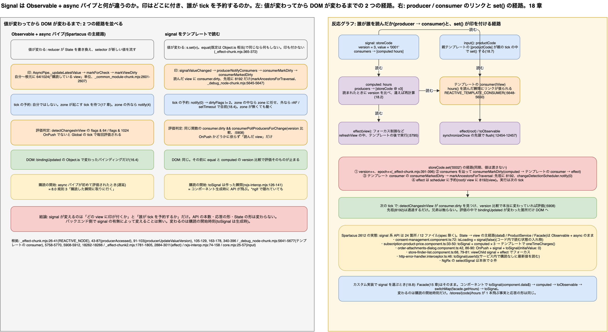

# 18. Signal API: 印の付け方が view 単位から「読んだ場所」単位に変わる

> **図**: 17 Signal の反応グラフと、Observable + async パイプとの経路の違い(`diagrams/spartacus-architecture.drawio`)。左: 値が変わってから DOM が変わるまでを「Observable + `async`」と「signal」で並べる。右: signal → computed → テンプレートの consumer という producer / consumer のリンクと、`set()` が印を付ける経路



> **この章が答える問い**: Signal は Observable + `async` パイプと何が違うのか。印はどこに付き、誰が tick を予約し、tick はどう見つけるのか。Spartacus 2612 はどこまで signal を使っていて、カスタム実装ではどう使えばよいのか

> **位置づけ**: 16 章(どの view に印が付くか)と 17 章(印が付く時刻・見つかる時刻)の続き。Angular 16 以降の反応性モデルを、同じ「印を付ける / 見つける」の語彙で説明する。Spartacus の標準コンポーネントは Observable + NgRx 主体なので、この章は「本家の読み方」というより「カスタム実装で signal を選んだとき、16〜17 章のどこが置き換わるか」の章

> **根拠の取り方**: 17 章と同じく、Angular 本体はミニアプリの `node_modules`(`@angular/core` 21.2.25)のビルド済みファイルを行番号で引く。signal の中核は `@angular/core/fesm2022/_effect-chunk.mjs`(反応グラフ)、`_effect-chunk2.mjs`(`signal()`、`effect()`)、`_debug_node-chunk.mjs`(テンプレートの consumer)、`rxjs-interop.mjs`(`toSignal` / `toObservable`)。Spartacus 側の利用箇所はクローン(v2612.0.0)を `grep` した結果で、`signal(` / `computed(` / `toSignal(` / `effect(` が本体のライブラリで使われているのは 24 箇所、ファイルにして 12 本(spec を除く)

### 18.0 先に話し言葉で: 「流れてきた」ではなく「読んだ」を記録する

Observable + `async` パイプの世界では、印は**値が流れてきた view** に付く。`async` パイプは値を受け取るたびに `markForCheck()` を呼び、自分の view から根元まで `64 | 1024` を立てる(16.3、17.4)。view は「この Observable を購読している」という事実で結ばれている。

signal の世界では、印は**その signal を読んだ場所**に付く。テンプレートの評価中に `count()` のように signal を呼ぶと、Angular は「この view はこの signal を読んだ」というリンクを張る。あとで `count.set(5)` が呼ばれると、signal はそのリンクを逆向きに辿って、読んだ view だけに「評価が必要」と伝える。先祖には「子孫に用あり」(`8192`)だけを付け、view 自身は `64` ではなく `consumer.dirty` という別の印で判定される。

結果として 3 つのことが変わる。

1. **OnPush と `markForCheck()` が要らなくなる。** 読んだ view に直接印が付くので、`async` パイプのように「購読している view」を経由しない。
2. **tick の予約を signal 自身がする。** `set()` の中で `changeDetectionScheduler.notify(0)` が呼ばれ、zone が無くても tick が予約される。zone があるときは zone に任せる(17.4 の `shouldScheduleTick`)。
3. **評価判定が「値のバージョン比較」になる。** `computed` は読まれるまで再計算せず、読まれたときに依存先のバージョンが変わっていなければ前の値を返す。

Spartacus 2612 の標準コンポーネントは、まだこの世界にはほとんど住んでいない。State は NgRx、view への配線は `async` パイプである。signal が使われているのは読み込みフラグやダイアログの件数表示といった局所的な場所に限られる(18.8)。だからこの章の主な読者は「カスタムコンポーネントで signal を使ってよいか、使ったら 16〜17 章のどこが変わるか」を知りたい人である。

## 18.1 用語と API

| API | 役割 | 作る | 読む | 書く | 根拠 |
|---|---|---|---|---|---|
| `signal(v)` | 書き込める値の入れ物(producer) | `signal(false)` | `s()` | `s.set(v)` / `s.update(fn)` | `_effect-chunk2.mjs:2723-2736`、中身は `createSignal`(`_effect-chunk.mjs:340-354`) |
| `computed(fn)` | 他の signal から導く値(producer かつ consumer)。読まれるまで計算しない | `computed(() => a() + b())` | `c()` | 不可 | `_resource-chunk.mjs:68`、中身は `createComputed`(`_effect-chunk.mjs:264-283`) |
| `effect(fn)` | signal を読んで副作用を起こす consumer。tick の中で実行される | コンストラクタ内で `effect(() => ...)` | | | `_effect-chunk2.mjs:2884-2925` |
| `input()` / `input.required()` | `@Input` の signal 版。親のバインディングが `set` する | `code = input<string>()` | `code()` | 親だけ | `core.mjs:36-57`、`:135-147` |
| `viewChild()` / `viewChildren()` | `@ViewChild` の signal 版。クエリ結果が変わると signal が変わる | `btn = viewChild('btn')` | `btn()` | | `_debug_node-chunk.mjs:9539-9572` |
| `toSignal(obs$)` | Observable → signal。**作った瞬間に購読する** | `toSignal(this.user$)` | `user()` | | `rxjs-interop.mjs:100-158` |
| `toObservable(sig)` | signal → Observable。中身は `effect` + `ReplaySubject(1)` | `toObservable(this.code)` | `subscribe` | | `rxjs-interop.mjs:74-98` |

用語の対応: **producer** = 読まれる側(`signal`、`computed`、`input`)、**consumer** = 読む側(`computed`、`effect`、テンプレート)。`computed` は両方である。

## 18.2 反応グラフの実体: version と dirty

signal の実装は、値そのものより「誰が誰を読んだか」の記録でできている。すべてのノードが同じ形を持つ。

```js
// _effect-chunk.mjs:26-41
const REACTIVE_NODE = {
  version: 0,              // 値が変わるたびに +1
  lastCleanEpoch: 0,       // 最後に「依存先に変化なし」と確認した時刻(全体で 1 つの epoch、:9)
  dirty: false,            // consumer として「依存先が変わったかもしれない」
  producers: undefined,    // 自分が読んだノードへのリンク(片方向リスト)
  producersTail: undefined,
  consumers: undefined,    // 自分を読んだノードへのリンク(live な consumer だけ)
  consumersTail: undefined,
  ...
  producerMustRecompute: () => false,
  producerRecomputeValue: () => {},
  consumerMarkedDirty: () => {},   // ← テンプレート / effect がここに「印を付ける処理」を差し込む
  consumerOnSignalRead: () => {}
};
```

### 読む: リンクを張る

`s()` は `signalGetFn` → `producerAccessed(node)` を呼ぶ(`:361-364`、`:43-87`)。このとき **`activeConsumer` が無ければ何もしない**(`:46-48`)。`activeConsumer` はテンプレート評価中や `computed` / `effect` の実行中だけ設定される(`consumerBeforeComputation`、`:134-137`)。つまりイベントハンドラの中で `s()` を読んでもリンクは張られない。テンプレートの中で読んだときだけ、その view の consumer に producer へのリンクが追加され、`lastReadVersion` に今の `version` が記録される。

### 書く: version を上げて consumer を汚す

```js
// _effect-chunk.mjs:365-372, 391-396
function signalSetFn(node, newValue) {
  if (!producerUpdatesAllowed()) throwInvalidWriteToSignalError(node);
  if (!node.equal(node.value, newValue)) {       // 既定の equal は Object.is 相当(defaultEquals)
    node.value = newValue;
    signalValueChanged(node);
  }
}
function signalValueChanged(node) {
  node.version++;
  producerIncrementEpoch();
  producerNotifyConsumers(node);                  // :105-123 consumers を辿って consumerMarkDirty
  postSignalSetFn?.(node);
}
```

`producerNotifyConsumers` は自分を読んだ consumer を 1 つずつ `consumerMarkDirty`(`:125-129`)する。`consumerMarkDirty` は `dirty = true` にしたうえで、その consumer がさらに producer でもあれば(= `computed`)**その先の consumer にも伝搬**し、最後に `consumerMarkedDirty` フックを呼ぶ。フックの中身がテンプレートなら「view に印を付ける」、effect なら「実行を予約する」である(18.3、18.5)。値は渡さない。「変わったかもしれない」という事実だけが伝わる。

### computed: 読まれるまで計算しない

`computed` の読み取りは `producerUpdateValueVersion`(`:91-103`)から始まる。

```js
// _effect-chunk.mjs:91-103 (抜粋)
function producerUpdateValueVersion(node) {
  if (consumerIsLive(node) && !node.dirty) return;              // live で dirty でなければ何もしない
  if (!node.dirty && node.lastCleanEpoch === epoch) return;     // この epoch で確認済み
  if (!node.producerMustRecompute(node) && !consumerPollProducersForChange(node)) {
    producerMarkClean(node); return;                            // 依存先の version が全部同じなら再計算しない
  }
  node.producerRecomputeValue(node);                            // ここで初めて fn() が走る
  producerMarkClean(node);
}
```

`consumerPollProducersForChange`(`:163-178`)は、自分が読んだ producer の `version` と、読んだときに覚えた `lastReadVersion` を比べる。1 つでも違えば再計算。これが「signal は `Object.is` で値を比べ、`computed` は version で依存を比べる」という 2 段構えで、`distinctUntilChanged` を自分で書かなくても同じ値の再計算が止まる理由である。

## 18.3 テンプレートが consumer になる: 印はどこに付くか

`refreshView` はテンプレートを評価する前に、その view 用の consumer を `activeConsumer` に設定する(`_debug_node-chunk.mjs:5758-5770`)。コンポーネントの view には `REACTIVE_LVIEW_CONSUMER_NODE`(`:5641-5651`)、`*ngIf` / `*ngFor` の埋め込み view(`tView.type === 2`、`viewShouldHaveReactiveConsumer`、`:5675-5677`)には一時的な `TEMPORARY_CONSUMER_NODE`(`:5657-5674`)が使われる。テンプレートの中で signal が 1 つでも読まれると、`consumerOnSignalRead` が `lView[REACTIVE_TEMPLATE_CONSUMER]` にその consumer を保存する(`:5648-5650`)。読まれなければ保存されず、プールに返される。

印を付けるのは `consumerMarkedDirty` フックである。

```js
// _debug_node-chunk.mjs:5645-5647  コンポーネントの view
consumerMarkedDirty: node => {
  markAncestorsForTraversal(node.lView);          // 自分には付けない。先祖に 8192、scheduler に notify(0)
},
// _debug_node-chunk.mjs:5661-5671  埋め込み view(*ngIf / *ngFor の中)
consumerMarkedDirty: node => {
  let parent = getLViewParent(node.lView);
  while (parent && !viewShouldHaveReactiveConsumer(parent[TVIEW])) parent = getLViewParent(parent);
  if (!parent) return;
  markViewForRefresh(parent);                     // 一番近いコンポーネント view に 1024、その先祖に 8192
},
```

tick 側は 16.3 で見た `detectChangesInView` の 4 行目で見つける。

```js
// _debug_node-chunk.mjs:5908-5912
shouldRefreshView ||= !!(consumer?.dirty && consumerPollProducersForChange(consumer));
...
if (consumer) consumer.dirty = false;
```

`consumer.dirty` が立っていても、`consumerPollProducersForChange` で version を確かめ、実は変わっていなければ評価しない。`requiresRefreshOrTraversal`(`_effect-chunk2.mjs:1781-1783`)も `consumer.dirty` を見るので、Targeted の周回でも拾われる。

### Observable + async パイプとの対応表

| | Observable + `async` パイプ | signal をテンプレートで読む |
|---|---|---|
| 印を付ける瞬間 | Observable が値を流した瞬間(`AsyncPipe._updateLatestValue`、`_common_module-chunk.mjs:2601-2607`) | `set()` / `update()` の中(`signalValueChanged` → `consumerMarkedDirty`) |
| 自分の view に付く印 | `64 Dirty` と `1024 RefreshView`(`markViewDirty`) | `consumer.dirty = true`(view のフラグは触らない) |
| 先祖に付く印 | `64 \| 1024` を根元まで全部 | `8192 HasChildViewsToRefresh` だけ(`markAncestorsForTraversal`)。先祖のテンプレートは評価されない |
| 兄弟 | 付かない | 付かない |
| OnPush の要否 | OnPush でないと毎 tick 評価される | 関係ない。Default でも OnPush でも、読んだ view だけが評価される(ただし Default の view は Global の tick で結局評価される、16.3) |
| tick の予約 | 自分ではしない。zone が起こす tick を待つ。zone の外なら `markForCheck` → `notify(4)` | `notify(0)` → `dirtyFlags \|= 2`。zone の中なら zone に任せる、外なら scheduler が rAF / `setTimeout` で予約(17.4) |
| 同じ値が来たとき | `markForCheck` は走る。評価後に `bindingUpdated` の `Object.is` で DOM 更新が止まる(16.4) | `equal`(既定は `Object.is` 相当)で `set()` 自体が何もしない。印も付かない |
| 購読の開始 | `async` パイプが初めて評価されたとき(遅延。6 章の「購読した瞬間に取りに行く」はここに乗る) | `toSignal` は**作った瞬間**に購読する(`rxjs-interop.mjs:126-141`)。コンポーネント生成時に API が飛ぶ |
| 後始末 | `async` パイプの `ngOnDestroy` | `toSignal` は `DestroyRef.onDestroy` で解除(`:145`) |

一番大きな違いは**購読の開始時刻**である。8.0 の規則 3「購読した瞬間に取りに行く」は `async` パイプの遅延購読を前提にしていた。`toSignal` はフィールド初期化の時点で購読するので、`*ngIf` で隠れていても API が飛ぶ。カスタムコンポーネントで `toSignal(this.facade.get(...))` と書くなら、「生成された瞬間に取りに行く」に変わることを知っておく必要がある。

## 18.4 tick の予約と Targeted モード

`markAncestorsForTraversal` の先頭は `changeDetectionScheduler.notify(0)` である(`_effect-chunk2.mjs:1794`)。`ChangeDetectionSchedulerImpl.notify` は `source 0` で `appRef.dirtyFlags |= 2`(ViewTreeTraversal)にする(`_debug_node-chunk.mjs:18262-18266`)。17.4 のとおり、Angular zone の中にいれば `shouldScheduleTick` が `false` を返して zone の tick を待ち、外にいれば自前で予約する。

zone が起こす tick は `dirtyFlags |= 1` なので常に Global(`mode 0`)で、Default の view は印が無くても評価される。これに対して scheduler が自前で起こす tick(zone の外からの `set()`、または `provideZonelessChangeDetection` の環境)は `1` を立てないので **Targeted(`mode 1`)** になる(`synchronizeOnce`、`:12469`)。Targeted では `1024`、`8192`、`consumer.dirty` の付いた view しか訪ねない。Spartacus 本体は zone モードなので通常は Global だが、「signal を使えば zone 無しでも動く」のはこの経路があるからである。

Spartacus 2612 は `provideZoneChangeDetection` を使っており(`app.config.ts:30`)、zoneless への切り替えは行っていない。標準コンポーネントの大半が `async` パイプに依存している以上、zone を外すと `async` パイプの `markForCheck` 経由(`notify(4)`)で動くことにはなるが、本家で検証された構成ではない。

## 18.5 effect: 「実行の予約」も印の一種

`effect(fn)` は、作られた場所に view があるか(`ViewContext` が注入できるか)で 2 種類に分かれる(`_effect-chunk2.mjs:2895-2905`)。

| | view effect(コンポーネント内で作成) | root effect(サービス内、または `injector` 指定) |
|---|---|---|
| `consumerMarkedDirty` | `view[FLAGS] \|= 8192; markAncestorsForTraversal(view); notify(13)`(`:2976-2980`) | `scheduler.schedule(this); notify(12)`(`:2959-2962`) |
| 実行される場所 | その view の `refreshView` の中、テンプレート評価の後、埋め込み view の前(`runEffectsInView`、`_debug_node-chunk.mjs:5682-5700`、呼び出し `:5795`) | `synchronizeOnce` の先頭、view の評価より前(`dirtyFlags & 16`、`:12454-12457`) |
| 初回 | 作成時に `consumerMarkedDirty` を呼んで予約(`:3000`) | 作成時に `notify(12)`(`:3010`) |

どちらも「signal が変わった瞬間に走る」のではなく、**次の tick の決まった位置で走る**。印を付ける時刻と見つける時刻が分かれているという 17 章の構造は、effect でも同じである。

Spartacus での実例は 2 つ。店舗検索の一覧は `viewChild` の signal と `effect` を組み合わせ、戻るボタンが DOM に現れた tick でフォーカスを当てる(`feature-libs/storefinder/components/store-finder-search-result/store-finder-list/store-finder-list.component.ts:68`、`:79-81`)。`viewChild` の signal は、クエリ結果が変わると内部のカウンタ signal が `update` され(`bindQueryToSignal`、`_debug_node-chunk.mjs:9548-9554`)、それを読んでいる effect が汚れる。もう 1 つは `ng-select` のアクセシビリティ用ディレクティブで、項目数 signal の変化を読み上げ文に変換する(`core-libs/storefront/shared/components/ng-select-a11y/ng-select-a11y.directive.ts:190-192`)。

## 18.6 Observable との橋: toSignal と toObservable

```js
// rxjs-interop.mjs:100-158 (抜粋)
function toSignal(source, options) {
  const state = signal({ kind: 1, value: options?.initialValue }, { equal, ... });   // :109-124
  const sub = source.subscribe({                                                        // :126-141 ← 作った瞬間に購読
    next: value => state.set({ kind: 1, value }),
    error: error => { state.set({ kind: 2, error }); ... },
  });
  destroyUnregisterFn = cleanupRef?.onDestroy(sub.unsubscribe.bind(sub));                // :145
  return computed(() => { const current = state(); switch (current.kind) { case 1: return current.value; case 2: throw current.error; ... } }, { equal: options?.equal });
}
```

`toSignal` は「Observable を購読して最新値を signal に書き写す」だけである。`initialValue` を与えなければ最初の値は `undefined`、`requireSync: true` なら同期的に最初の値が来ないと例外(`:142-144`)。`toObservable`(`:74-98`)は逆に `effect` の中で signal を読んで `ReplaySubject(1)` に流す。effect は tick の中で走るので、`toObservable` の値は **`set()` の直後ではなく次の tick** に届く。

## 18.7 input(): 親のバインディングが set() する

`input()` は `INPUT_SIGNAL_NODE`(`core.mjs:25-33`)で作られる signal で、書き込み口が `applyValueToInputSignal` → `signalSetFn` に限られている。親テンプレートの `[code]="x"` が評価され、`bindingUpdated` で変化ありと判定されると、`writeToDirectiveInput`(`_debug_node-chunk.mjs:4029-4058`)→ `applyValueToInputField`(`:330-336`)が `signalSetFn` を呼ぶ。つまり**親の tick の最中に `set()` が起き**、子の consumer が汚れ、同じ tick の数十行あとで子が評価される。17.4 の入口 3(`markDirtyIfOnPush`)も同時に走る(`setPropertyAndInputs`、`:5158-5166`)ので、OnPush の子には `64` も付く。

## 18.8 Spartacus 2612 での実態と、カスタム実装での使いどころ

### 本体で使われている場所

| 場所 | 何に使っているか | 根拠 |
|---|---|---|
| 同意管理(storefront 本体) | `isLoading = signal(false)` を `tap` で `set` し、コードの中で `isLoading()` として読む。テンプレートでは読んでいない(状態の入れ物として) | `core-libs/storefront/cms-components/myaccount/consent-management/components/consent-management.component.ts:72`、`:122`、`:268` |
| `ng-select` の a11y ディレクティブ | `effect` で項目数 signal を読み、読み上げ文を更新 | `core-libs/storefront/shared/components/ng-select-a11y/ng-select-a11y.directive.ts:190-192` |
| HTTP エラーハンドラ(core) | `userId = toSignal(userIdService.getUserId())`。サービスの中で「今のユーザー ID」を購読なしで同期的に読むため | `core-libs/core/src/error-handling/http-error-handler/http-error-handler.interceptor.ts:46` |
| サブスクリプション課金の価格表示 | `toSignal(getSubscriptionData(...))` → `computed` 3 つ → テンプレートで `oneTimeCharges()` を `*ngFor` | `feature-libs/subscription-billing/components/product/price/subscription-product-price.component.ts:33-50`、`.html:2, 19, 27` |
| サブスクリプション一覧 | `signal({...})` をクエリ条件の入れ物にし、`toObservable` で Facade に渡し、結果を `toSignal` で受ける | `feature-libs/subscription-billing/components/list/subscription-list.component.ts:8-9`、`:47`、`:62` |
| 注文の添付ファイルダイアログ | OnPush + `loadError = signal(false)` + `attachmentsCount = toSignal(..., { initialValue: 0 })` | `feature-libs/order/components/order-details/order-attachments/attachments-dialog/order-attachments-dialog.component.ts:42`、`:86-90` |
| 店舗検索の一覧 | `viewChild` signal + `effect` でフォーカス制御 | `store-finder-list.component.ts:68`、`:79-81` |

共通点は 2 つ。(1) NgRx の State から view への主経路(`CmsComponentData.data$`、`ProductService.get`、`ActiveCartFacade` …)は依然として Observable + `async` パイプで、signal は**その末端**で使われている。(2) 新しい機能ライブラリ(subscription-billing)ほど `toSignal` + `computed` の組み合わせが多い。NgRx の `selectSignal` は本体のライブラリでは使われていない(`grep` で 0 件)。

### カスタムコンポーネントで signal を使うなら

15 章の雛形(Facade が Observable を返す)はそのままで、コンポーネント側だけ変えられる。

```ts
// 15 章の雛形の購読部分を signal にした例(本家にこの形のコンポーネントは無い。18.1〜18.7 の規則から組んだもの)
export class StoreHoursComponent {
  private component = inject(CmsComponentData<CmsStoreHoursComponent>);
  private facade = inject(StoreHoursFacade);

  // data$ は cms/pages の応答から State に入った CMS コンポーネントの属性(4 章)。作った瞬間に購読される
  readonly data = toSignal(this.component.data$);
  // storeCode が変わるたびに Facade を呼び直す。Facade 側は Query なので State にあれば API は飛ばない(15 章)
  readonly hours = toSignal(
    toObservable(computed(() => this.data()?.storeCode)).pipe(
      filter(Boolean),
      switchMap((code) => this.facade.getHours(code))
    )
  );
}
```

```html
<!-- テンプレートが hours() を読んだ瞬間に、この view と hours の間にリンクが張られる -->
@if (hours(); as h) { <ul>@for (d of h.days; track d.code) { <li>{{ d.label }}: {{ d.open }}–{{ d.close }}</li> }</ul> }
```

16〜17 章の表のどこが変わるかを整理する。

| 観点 | `async` パイプ版(15 章の雛形) | signal 版 |
|---|---|---|
| API が飛ぶ時刻 | テンプレートが `data$ \| async` を初めて評価したとき | `toSignal` がフィールド初期化で購読した瞬間 = コンポーネント生成時(`ComponentWrapperDirective` の `createComponent` の直後、4 章) |
| 応答後に印が付く場所 | この view から根元まで `64 \| 1024` | この view に `consumer.dirty`、先祖に `8192` のみ |
| OnPush | 付けないと毎 tick 評価 | どちらでもよい(揃えるなら OnPush のまま) |
| 同じ値の応答 | 評価はされる、DOM は変わらない(16.6) | `equal` で止まれば評価もされない。ただし `toSignal` の `equal` は値の参照比較なので、新しいオブジェクトなら評価される |
| バックエンドに見える違い | 無い | 無い。`/stores/{code}/hours` が 1 本飛ぶ事実は同じ |

最後の行が結論である。signal は「フロントのどの view が評価されるか」を変えるだけで、「どの API が何本飛ぶか」「応答の形」「State の形」(5、7、12 章)には影響しない。バックエンド担当者が signal の有無で変えるべきことは無い。変わるのは購読の開始時刻だけで、それも 8.0 の規則 3 を「`toSignal` なら生成時」と読み替えれば済む。

## 18.9 まとめ

| | Observable + `async` パイプ | signal |
|---|---|---|
| 何を記録するか | 「この view はこの Observable を購読している」 | 「この view はこの signal を読んだ」(producer → consumer のリンク、`REACTIVE_NODE`) |
| 印を付けるのは誰か | `AsyncPipe` → `markForCheck` → `markViewDirty` | `signalSetFn` → `producerNotifyConsumers` → `consumerMarkedDirty` → `markAncestorsForTraversal` |
| 印の形 | `64 \| 1024` を自分〜根元 | `consumer.dirty` を自分、`8192` を先祖 |
| 見つけるのは誰か | `detectChangesInView` の `flags & 64` / `flags & 1024` | 同じ関数の `consumer?.dirty && consumerPollProducersForChange(consumer)` |
| tick の予約 | zone 任せ(zone 外なら `notify(4)`) | `notify(0)`。zone が無くても動く |
| 評価を止める仕組み | `bindingUpdated` の `Object.is`、PageSlot の `isDistinct` | `equal`、`computed` の version 比較、そのうえで `bindingUpdated` |
| Spartacus 2612 での位置 | State → view の主経路 | 末端の状態フラグ、新しい機能ライブラリの表示用 |

---

[目次](README.md) | ← [17. zone.js と変更検知の実行モデル: 印が付く瞬間と、印が見つかる瞬間](17-zone-rendering.md) | [19. Query / Command パターン: ストア無しで「取得済みなら取らない」と「更新したら取り直す」を作る](19-query-command.md) →
