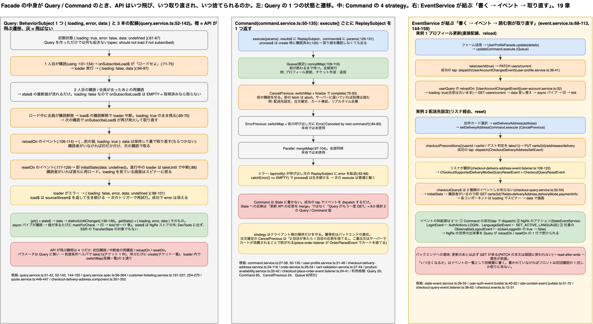

# 19. Query / Command パターン: ストア無しで「取得済みなら取らない」と「更新したら取り直す」を作る

> **図**: 18 Query の状態機械と Command の戦略、EventService が結ぶ経路(`diagrams/spartacus-architecture.drawio`)。左: `QueryService.create` が持つ 1 つの状態 `{ loading, error, data }` が、購読・再購読・`reloadOn`・`resetOn`・エラーでどう遷移し、どの遷移で API が飛ぶか。中: `CommandService.create` の 4 つの strategy。右: 「書く → イベント → 読む側が取り直す」の実例 2 つ(プロフィール更新、配送先設定)



> **この章が答える問い**: Facade の中身が NgRx ではなく Query / Command のとき、API はいつ飛び、いつ取り直され、いつ捨てられるのか。Command の strategy は何を守っていて、何を守らないのか。バックエンドはこの仕組みに対して何を前提にでき、何を提供すべきか

> **位置づけ**: 10.3〜10.5 で「2 方式のうち新しい方」として要約したものを、実装(`query.service.ts` 160 行、`command.service.ts` 140 行)まで降りて説明する。15 章の Facade 層の中身の片方。8.0 の 4 文(読みは State を見てから API、書きは API → State、トリガーは購読)が、NgRx 無しでどう実装されているか。16〜18 章との接点は「Query の `state$` を `async` パイプが購読して印を付ける」の 1 点

> **根拠の取り方**: すべて Spartacus のクローン(v2612.0.0)から引く。中核は `spartacus/core-libs/core/src/util/command-query/query.service.ts` と `command.service.ts`、イベント基盤は `core-libs/core/src/event/event.service.ts`。利用側は `feature-libs/user/account`、`user/profile`、`checkout/base`、`customer-ticketing`、`order`、`cart/base`、`core/src/product`。利用規模は `grep` の結果(`: Query<` のフィールド宣言 20 箇所、`: Command<` 65 箇所、25 ディレクトリ。strategy の明示は `CancelPrevious` 24 箇所、`Queue` 8 箇所、残りは既定の `Queue`)

### 19.0 先に話し言葉で: NgRx の 4 ファイルを 1 つの `create` に畳んだもの

NgRx で「ユーザー情報を取る」を書くと、Action(取りに行け)、Effect(Connector を呼ぶ)、Reducer(State に書く)、Selector(State から読む)の 4 つが要る(1.5、5 章)。Query はこれを `this.query.create(loader, { reloadOn, resetOn })` の 1 呼び出しに畳む。中にあるのは `{ loading, error, data }` を持つ `BehaviorSubject` が 1 つと、「誰かが購読したらロードする」「このイベントが来たら取り直す」「このイベントが来たら捨てる」の 3 本の配線だけである。

Command は書く側で、`this.command.create(factory, { strategy })` が返す `execute(params)` を呼ぶと、factory が返す Observable(Connector の PUT / POST)が走る。Command は結果を State に書かない。代わりに成功時に**イベントを 1 つ投げる**。そのイベントを `reloadOn` に書いた Query が取り直す。これが 8.0 の規則 2「書きは必ず API → State」の Query / Command 版で、State への書き込みは「更新 API の応答を merge する」のではなく「もう一度 GET する」で実現されている。

2 つを結ぶのが `EventService` である。`LoginEvent` や `LanguageSetEvent` のような NgRx 側の出来事もイベントに変換されているので、「言語が変わったら敬称一覧を取り直す」のような NgRx の世界と Query の世界をまたぐ配線が、`reloadOn: [LanguageSetEvent]` の 1 行で書ける。

この章で一番伝えたいのは次の 3 点である。

1. **API が飛ぶ瞬間は 4 つしかない。** 初回購読、ロード中に購読が切れたあとの再購読、`reloadOn`、`resetOn`。2 人目の購読や、ロード済みの再購読では飛ばない。
2. **Command の strategy はクライアント側の順序だけを守る。** `CancelPrevious` は 1 本目の購読を切るだけで、サーバーに届いた 1 本目は処理され得る。冪等性はバックエンドの責任のまま。
3. **更新のあとは再 GET が前提。** 更新 API の応答本文は(一部の例外を除き)画面に使われない。GET が更新を即座に反映すること(read-after-write)が、この設計が成り立つ条件になる。

## 19.1 部品と役割

| 部品 | 役割 | 実体 |
|---|---|---|
| `Query<T>` | 読み。`get()` が `Observable<T \| undefined>`、`getState()` が `Observable<QueryState<T>>` | `query.service.ts:39-42`、`QueryState` は `:33-37` |
| `QueryService.create(loader, { reloadOn, resetOn })` | Query を作る。loader は `() => Observable<T>`(Connector 呼び出し)。`reloadOn` / `resetOn` はイベントクラスか Observable の配列(`QueryNotifier`、`:31`) | `:52-142` |
| `Command<PARAMS, RESULT>` | 書き。`execute(params)` が `Observable<RESULT>` | `command.service.ts:27-29` |
| `CommandService.create(factory, { strategy })` | Command を作る。factory は `(params) => Observable<RESULT>` | `:50-135` |
| `CommandStrategy` | `Parallel` / `Queue`(既定)/ `CancelPrevious` / `ErrorPrevious` | `:31-38` |
| `EventService` | `register`(Observable をイベント型に登録)、`get`(イベント型を購読)、`dispatch`(1 件流す)。親クラスへの伝搬あり | `event.service.ts:68-113`、`:144-159` |
| 前提条件ヘルパ | loader / factory の先頭で `userId` / `cartId` / ルートパラメータを 1 回だけ取り、条件を満たさなければ例外 | `takeUserId(loggedIn)`(`user-id.service.ts:53-61`)、`checkoutPreconditions()`(`checkout-query.service.ts:66-84`)、`customerTicketingPreConditions()`(`customer-ticketing.service.ts:254-270`) |
| Connector / Adapter | HTTP を実際に発行する層(15 章) | 変更なし |

## 19.2 Query の実装: 1 つの BehaviorSubject と 3 本の配線

```ts
// query.service.ts:52-142 (抜粋、コメントは本章で付けたもの)
create<T>(loaderFactory, options?) {
  const initialState = { data: undefined, error: false, loading: true };          // :61-65
  const state$ = new BehaviorSubject<QueryState<T>>(initialState);                 // :67  ← State の実体。NgRx ストアの外にある

  const onSubscribeLoad$ = iif(() => state$.value.loading, of(undefined), EMPTY);  // :71-75 購読時、loading なら「ロードせよ」を 1 発
  const loadTrigger$ = this.getTriggersStream([onSubscribeLoad$, ...reloadOn, ...resetOn]); // :77-81
  const resetTrigger$ = this.getTriggersStream(resetOn);                            // :83
  const loader$ = loaderFactory().pipe(takeUntil(resetTrigger$));                   // :86  reset が来たら進行中のロードを中断

  const load$ = loadTrigger$.pipe(
    tap(() => { if (!state$.value.loading) state$.next({ ...state$.value, loading: true }); }), // :89-93 data は保持したまま loading
    switchMap(() => loader$),                                                       // :94  連続トリガーは最後だけ生かす
    tap((data) => state$.next({ loading: false, error: false, data })),             // :95-97
    catchError((error, source$) => { state$.next({ loading: false, error, data: undefined }); return source$; }), // :98-101 失敗しても配線は生きる
    share()                                                                         // :102
  );

  if (reloadOn) reloadTrigger$.subscribe(() => { if (!loading) state$.next({ ...state$.value, loading: true }); }); // :106-114 購読者がいなくても印だけ付ける
  if (resetOn)  resetTrigger$.subscribe(() => { if (not initial) state$.next(initialState); });                     // :117-129

  const query$ = using(() => load$.subscribe(), () => state$);                     // :131-134 購読が始まると load$ が動き、全員去ると止まる
  const data$ = query$.pipe(map((s) => s.data), distinctUntilChanged());            // :136-139
  return { get: () => data$, getState: () => query$ };                              // :141
}
```

`using` が要である。`query$` を誰かが購読した瞬間に `load$` の購読が始まり(= `loadTrigger$` が評価され、`onSubscribeLoad$` が「ロードせよ」を出す)、最後の購読者が去ると `load$` の購読が解除されて進行中のロードは中断される。`state$` 自体は残るので、次に誰かが購読すると前回の値がすぐ流れる。これが「取得済みなら取らない」の正体で、NgRx の Entity Loader(1.5)がストアの `success` フラグでやっていることを、`BehaviorSubject` の残存で代替している。

### 状態遷移表: どの出来事で API が飛ぶか

| 今の状態 | 出来事 | 遷移 | API | 根拠 |
|---|---|---|---|---|
| 初期(`loading: true, data: undefined`) | 1 人目が購読 | `onSubscribeLoad$` が発火 → loader 実行 → `{ data }` | **飛ぶ** | `:71-75`、spec `should load on subscription` |
| ロード済み | 2 人目が購読 | `state$` の最新値を受け取るだけ | 飛ばない | spec `should not call multiple times loaderFactory on multiple subscriptions` |
| ロード済み | 全員が購読解除 → 誰かが再購読 | `loading: false` なので `onSubscribeLoad$` は `EMPTY`。前回の `data` が流れる | 飛ばない | spec `should return state from previous subscription after resubscription` |
| ロード中 | 全員が購読解除 | `load$` の購読解除で loader 中断。`loading: true` のまま残る | 中断 | `:69-70` のコメント |
| ロード中で中断された | 再購読 | `loading: true` なので `onSubscribeLoad$` が再び発火 | **飛ぶ** | spec `should load once again if it was cancelled by unsubscribe` |
| ロード済み | `reloadOn` のイベント(購読者あり) | `loading: true`、**`data` は保持** → loader 再実行 → `data` 差し替え | **飛ぶ** | `:89-93`、`:106-114`、spec `should reload data immediately…` |
| ロード済み | `reloadOn` のイベント(購読者なし) | `loading: true` の印だけ付く。次の購読で `onSubscribeLoad$` が拾う | 次の購読で飛ぶ | `:106-114`、spec `should reload data after resubscription when there was 0 subscribers…` |
| 任意 | `resetOn` のイベント | 即 `initialState`(`data: undefined`)。進行中の loader は `takeUntil` で中断。購読者がいれば `loadTrigger$` 経由で直ちに再ロード | 購読者がいれば**飛ぶ** | `:86`、`:117-129`、spec `should clear state and reload data immediately…` |
| ロード中 | loader がエラー | `{ loading: false, error, data: undefined }`。`load$` 自体は `sourceStream$` を返して生き続ける | 次のトリガーで再試行 | `:98-101`、spec `should clear value on error` / `should clear error on successful emission` |

`reloadOn` と `resetOn` の違いは利用者に見える。`reloadOn` は古い `data` を出したまま裏で取り直す(画面はちらつかない)。`resetOn` は `data` を消してから取り直す(`loading` を見ているコンポーネントはスピナーに戻る。例: `checkout-delivery-address.component.ts:351-352` は `state.loading` をそのまま表示に使う)。

### パラメータ付きの Query は 3 通り

`Query` 自体はパラメータを取らない(`get()` は引数なし、`:39-42`)。パラメータは次のどれかで渡す。

| 方法 | 実例 | 取り直しの条件 |
|---|---|---|
| loader の先頭で文脈を 1 回だけ取る(前提条件ヘルパ) | チケット 1 件: `customerTicketingPreConditions()` が `userId` とルートの `ticketCode` を `take(1)` で取る(`customer-ticketing.service.ts:191-203`、`:254-270`) | ルートが変わっても自動では取り直さない。`resetOn` のイベントを別途投げる設計 |
| 呼ぶたびに新しい Query を作る | チケット一覧: `getTicketsQuery$(pageSize, currentPage, sort)` が毎回 `create`(`:205-227`) | 呼ぶたびに初期状態から。キャッシュは効かない |
| loader の中でパラメータの Observable に `switchMap` する | 見積一覧: `currentPage$` / `sort$` の変化を factory の中で反応的に扱い、`reloadOn: []` にしている(`quote.service.ts:446-447` のコメント) | パラメータが変わるたびに loader の中で取り直す。Query は 1 つのまま |

## 19.3 Command の実装: 実行のたびに ReplaySubject を 1 つ返す

```ts
// command.service.ts:50-135 (抜粋)
create(commandFactory, options?) {
  const commands$ = new Subject<PARAMS>();                 // :54 実行要求
  const results$ = new Subject<ReplaySubject<RESULT>>();   // :55 実行ごとの返却口
  switch (options?.strategy) {
    case CancelPrevious: case ErrorPrevious:
      process$ = zip(commands$, results$).pipe(switchMap(([cmd, notifier$]) =>   // :75-93 新しい要求が来たら前の購読を切る
        defer(() => commandFactory(cmd)).pipe(tap(notify(notifier$)), catchError(() => EMPTY),
          finalize(() => { if (!notifier$.closed && !notifier$.hasError) {
            options.strategy === ErrorPrevious ? notifier$.error(new Error('Canceled by next command')) : notifier$.complete(); } }))));
    case Parallel:
      process$ = zip(commands$, results$).pipe(mergeMap(...));                     // :97-104 同時に走らせる
    case Queue: default:
      process$ = zip(commands$, results$).pipe(concatMap(...));                    // :109-116 前が終わるまで待つ
  }
  this.subscriptions.add(process$.subscribe());            // :120 作った瞬間に購読済み → execute は呼ぶだけで走る
  execute = (parameters) => { const result$ = new ReplaySubject<RESULT>(); results$.next(result$); commands$.next(parameters); return result$; }; // :126-131
}
```

押さえる点は 4 つ。

- **`execute()` は購読しなくても実行される。** `process$` は `create` の時点で購読されている(`:120`)ので、`facade.update(details)` の戻り値を捨てても PATCH は飛ぶ(spec `should execute command without subscription`)。戻り値の `ReplaySubject` は結果を知りたい人のためのもので、遅れて購読しても結果が再生される。
- **エラーは呼び出し元にだけ届き、配線は壊れない。** `tap(notify(notifier$))` が `error` を返却口に転送し(`:62-68`)、`catchError(() => EMPTY)` が `process$` を生かす(`:79`、`:101`、`:113`)。次の `execute()` は普通に動く(spec `should continue processing other commands after a commandFactory error`)。
- **strategy は RxJS の 3 つの flatten 演算子の選択である。** `concatMap`(Queue)、`mergeMap`(Parallel)、`switchMap`(CancelPrevious / ErrorPrevious)。違いは「前の実行の Observable をどう扱うか」だけ。
- **`CancelPrevious` が切るのは購読。** `switchMap` が 1 本目の inner Observable を unsubscribe すると、`HttpClient` の teardown が `fetch` を abort する(17 章の `FetchBackend`、`_module-chunk.mjs:787-790`)。しかしサーバーが既に受け取っていれば処理は進む。クライアントが「無かったこと」にできるのは応答の受け取りだけである。

### strategy の選び方と本家の実例

| strategy | 挙動 | 向く操作 | 実例 |
|---|---|---|---|
| `Queue`(既定) | 前の実行が終わるまで次を待たせる。全部実行される | 順序が意味を持つ更新。二重クリックを「2 回とも、順に」処理してよいもの | プロフィール更新(`user-profile.service.ts:31-48`)、チケット作成・返信・添付(`customer-ticketing.service.ts:86-189`) |
| `CancelPrevious` | 新しい実行が来たら前の購読を切り、前の呼び出し元には `complete` だけ返す | 最新だけ意味がある更新・取得。連打で古い結果が後から届くのを防ぐ | 配送先の作成・設定・解除(`checkout-delivery-address.service.ts:34-119`)、注文確定(`order.service.ts:26-54`)、カート検証(`cart-validation.service.ts:27-44`)、リアルタイム在庫(`product-availability.service.ts:33-42`) |
| `ErrorPrevious` | 同上だが、前の呼び出し元に `Canceled by next command` のエラーを返す | 前の呼び出し元に「無効になった」と伝えたいとき | 本体では明示利用なし(spec のみ) |
| `Parallel` | 全部同時に走らせる | 互いに独立した操作 | 本体では明示利用なし(spec のみ) |

注文確定が `CancelPrevious` なのは「2 回目のクリックが来たら 1 回目の応答は捨てる」という意味であって、「1 回目の注文を取り消す」ではない。サーバー側ではカートが 1 回目で消費されるので 2 回目が失敗する、という形で二重注文が防がれている(`checkout-place-order-event.listener.ts:24-41` が `OrderPlacedEvent` でカートを捨てる)。

## 19.4 EventService が 2 つを結ぶ

```ts
// event.service.ts (抜粋)
register(eventType, source$)   // :68-84  Observable をイベント型の供給源として登録(複数可、MergingSubject)
get(eventType)                 // :90-96  イベント型の購読。子クラスのイベントも流れてくる
dispatch(event, eventType?)    // :105-113 1 件流す。eventType を渡せば平たいオブジェクトからインスタンスを作る(createFrom)
// :144-159 createEventMeta: 子クラスの出力を親クラスにも register する → get(親) で子が全部取れる
```

Query が `reloadOn: [SomeEvent]` と書くと、内部では `eventService.get(SomeEvent)` を購読する(`query.service.ts:144-155`)。イベントの供給源は 3 種類ある。

| 供給源 | 仕組み | 例 |
|---|---|---|
| Command の成功 | factory の `tap` で `eventService.dispatch` | `UserAccountChangedEvent`(`user-profile.service.ts:36-41`)、`CheckoutDeliveryAddressSetEvent`(`checkout-delivery-address.service.ts:78-87`)、`OrderPlacedEvent`(`order.service.ts:32-47`) |
| NgRx のアクション | `StateEventService.register({ action, event })` が `ActionsSubject` を `ofType` で絞って変換(`state-event.service.ts:36-55`) | `LoginEvent` ← `AuthActions.LOGIN`(`user-auth-event.builder.ts:40-45`)、`LanguageSetEvent` / `CurrencySetEvent` ← `SET_ACTIVE_LANGUAGE` / `SET_ACTIVE_CURRENCY`(`site-context-event.builder.ts:41-72`) |
| 別の Observable | `eventService.register(Event, obs$)` | `LogoutEvent` ← `isUserLoggedIn()` の `true → false`(`user-auth-event.builder.ts:57-63`) |

NgRx 側の出来事がイベントになっているおかげで、NgRx で管理されている言語・通貨・ログイン状態の変化を、Query が `reloadOn` / `resetOn` の 1 行で受けられる。10.5 の「③ いつ古くなるか」の答えがこの一覧である。

### 配線の 2 流儀: 直接と、リスナ経由

| 流儀 | 形 | 実例 | 利点 |
|---|---|---|---|
| 直接 | Command が投げたドメインイベントを、Query が `reloadOn` に直接書く | `updateCommand` → `UserAccountChangedEvent` → `userQuery.reloadOn`(`user-profile.service.ts:36-41` → `user-account.service.ts:26-35`)。`resetOn: [LoginEvent, LogoutEvent]` | 配線が 2 ファイルで追える |
| リスナ経由 | Command はドメインイベントだけ投げる。リスナがそれを「Query 用のイベント」(`XxxQueryReloadEvent` / `XxxQueryResetEvent`)に翻訳する。Query はその 2 種類しか知らない | チェックアウト: `checkoutQuery$` は `CheckoutQueryReloadEvent` と `CheckoutQueryResetEvent` だけを見る(`checkout-query.service.ts:32-54`)。`CheckoutDeliveryAddressSetEvent` → `CheckoutQueryResetEvent` はリスナ(`checkout-delivery-address-event.listener.ts:109-122`)。`LanguageSetEvent` / `CurrencySetEvent` → Reload、`LoginEvent` / `LogoutEvent` / `SaveCartSuccessEvent` / `RestoreSavedCartSuccessEvent` / `MergeCartSuccessEvent` / `OrderPlacedEvent` → Reset(`checkout-query-event.listener.ts:38-62`)。問い合わせチケットも同じ命名(`customer-ticketing.events.ts:9-24`) | 「いつ古くなるか」の方針がリスナに集まり、Facade を触らずに差し替えや追加ができる。`protected getCheckoutQueryReloadEvents()` を上書きすればイベントの追加もできる |

## 19.5 実例を時系列で

### プロフィール更新(直接配線、Queue)

| 順 | 何が起きるか | 根拠 |
|---|---|---|
| 1 | フォームの送信 → `UserProfileFacade.update(details)` → `updateCommand.execute({ details })`。戻り値は購読されなくても走る | `user-profile.service.ts:88-90`、`command.service.ts:120` |
| 2 | `Queue` なので前の更新が進行中なら待つ。factory: `takeUserId(true)`(匿名なら例外 → 呼び出し元に error)→ `PATCH users/current` | `:31-44`、`user-id.service.ts:53-61` |
| 3 | 成功の `tap` で `eventService.dispatch({ user: details }, UserAccountChangedEvent)` | `:36-41` |
| 4 | `userQuery` の `reloadTrigger$` が発火。`state$` が `{ ...前の値, loading: true }`。画面の名前は古いまま、`loading` だけ立つ | `user-account.service.ts:32`、`query.service.ts:106-114` |
| 5 | `loadTrigger$` にも同じイベントが入っているので loader 再実行 → `GET users/current` | `query.service.ts:77-81`、`:94` |
| 6 | 応答 → `state$.next({ loading: false, error: false, data })` → `get()` の `distinctUntilChanged` を通って `async` パイプへ → 印 → tick(16〜17 章) | `:95-97`、`:136-139` |

API は 2 本(PATCH + GET)。PATCH の応答本文は画面に使われない。イベントは `payload.details` を運んでいるが、`reloadOn` は中身を見ない(`getTriggersStream` は `merge` するだけ、`:144-155`)。

### 配送先の設定(リスナ経由、CancelPrevious、reset)

| 順 | 何が起きるか | 根拠 |
|---|---|---|
| 1 | 住所カードの選択 → `setDeliveryAddress(address)` → `setDeliveryAddressCommand.execute(address)` | `checkout-delivery-address.service.ts:166-168` |
| 2 | `CancelPrevious`: 別の住所を続けて選ぶと前の購読は切られ、前の `fetch` は abort | `:91-93`、`command.service.ts:75-93` |
| 3 | factory: `checkoutPreconditions()`(`userId` / `cartId` / ゲストカート判定を 1 回)→ `PUT carts/{cartId}/addresses/delivery?addressId=…` | `:66-90`、`:133-151` |
| 4 | 成功の `tap` で `CheckoutDeliveryAddressSetEvent` を dispatch | `:78-87` |
| 5 | リスナが受けて `CheckoutSupportedDeliveryModesQueryResetEvent` と `CheckoutQueryResetEvent` を dispatch(配送方法の候補と、チェックアウト全体の状態を両方捨てる) | `checkout-delivery-address-event.listener.ts:109-122` |
| 6 | `checkoutQuery$` が `initialState` に戻る(`data: undefined`)。購読者(配送先・配送方法・支払の各コンポーネント)がいるので直ちに再ロード → `GET carts/{cartId}?fields=deliveryAddress(FULL),deliveryMode(FULL),paymentInfo(FULL)` | `checkout-query.service.ts:42-54`、`query.service.ts:117-129` |
| 7 | 各コンポーネントは `getDeliveryAddressState()` の `loading` でスピナーを出し、`data` が来たら描く | `checkout-delivery-address.component.ts:93-94`、`:351-352` |

ここで reset(捨てて取り直す)が選ばれているのは、配送先が変わると配送方法や支払の妥当性も変わり、古い `data` を出し続けると誤った状態を見せるからである。逆にプロフィール更新で reload(保持して取り直す)なのは、古い名前を一瞬出していても害が無いからである。

## 19.6 NgRx との対応表

| NgRx(1.5、5 章) | Query / Command | 備考 |
|---|---|---|
| Action(`LoadUser`) | 購読そのもの(`onSubscribeLoad$`)、`reloadOn` のイベント | 「取りに行け」を明示的に発行する場所が無い。購読が引き金(8.0 規則 3) |
| Action(`UpdateUser`) | `command.execute(params)` | |
| Effect | `loaderFactory` / `commandFactory` | Connector を呼ぶ場所は同じ |
| Reducer + State | `state$`(`BehaviorSubject<QueryState<T>>`) | ストアの外。Redux DevTools に出ない |
| Selector | `get()` / `getState()` | `get()` は `distinctUntilChanged` 済み |
| Entity Loader の `loading / success / error / value` | `QueryState` の `loading / error / data` | `success` に相当するのは `!loading && !error` |
| 「取得済みなら取らない」= `success` フラグを見る | `state$` が残っていて `loading: false` なら `onSubscribeLoad$` が `EMPTY` | 同じ効果を別の仕組みで |
| 更新後の再取得 = Effect が成功アクションを見て `LoadCart` を dispatch(`cart.effect.ts:304-345`) | Command が dispatch したイベントを Query の `reloadOn` / `resetOn` が受ける | 「書いたら読み直す」は両方式で同じ設計 |
| SSR の TransferState(`ssrTransfer.keys`、7 章) | 無い。`state$` はただのローカル変数なので直列化されない | SSR で描いた Query はクライアントで取り直しになる |
| Clean アクションで捨てる | `resetOn` に自作イベント | 7.4 |

## 19.7 カスタム実装で決めること(10.5 の 4 問の補足)

10.5 の雛形(`CampaignEntryService`)はそのまま使える。実装を読んだうえで補う判断点は次の 4 つ。

1. **`reloadOn` か `resetOn` か。** 古い値を出し続けて害が無いなら `reloadOn`(ちらつかない)。古い値が誤りになるなら `resetOn`(スピナーに戻る)。ログイン・ログアウトは常に `resetOn`(別人のデータを一瞬でも出さない)。
2. **strategy。** 更新は `Queue` か `CancelPrevious`。「最新だけ意味がある」なら `CancelPrevious`、ただし 19.3 のとおりサーバーには届く。順に全部処理してほしいなら `Queue`。
3. **イベントの粒度。** 小さい機能なら直接配線(Command → ドメインイベント → `reloadOn`)。Query が 2 つ以上あり、無効化の条件が増えそうなら `XxxQueryReloadEvent` / `XxxQueryResetEvent` を切ってリスナで翻訳する(チェックアウト方式)。
4. **パラメータ。** ルートから取るなら前提条件ヘルパで `take(1)`。一覧のページングのように頻繁に変わるなら、見積一覧方式(loader の中で `switchMap`)にして Query を 1 つに保つ。

## 19.8 バックエンド担当者にとっての意味

- **更新のあとに必ず GET が来る。** `PATCH users/current` の直後に `GET users/current`、`PUT …/addresses/delivery` の直後に `GET carts/{id}?fields=…`。更新 API の応答本文は(注文確定の `Order` のような例外を除き)画面に使われないので軽くてよい。代わりに **GET が更新を即座に反映すること**(キャッシュやレプリカ遅延で古い値を返さないこと)が前提になる。
- **連打の防御は 2 段。** クライアントの strategy が応答の順序を整え、サーバーの冪等性(カートの消費、重複チェック)が実害を防ぐ。`CancelPrevious` は abort された 1 本目がサーバーで処理されることを止めない。
- **「いつ古くなるか」はイベントの一覧として渡す。** 12.5 / 10.6 の依頼書に「このリソースは、どの操作(自分の更新、ログイン、言語変更、注文確定 …)で古くなるか」を書けば、フロントはそれを `reloadOn` / `resetOn` に写すだけでよい。逆に書かれていなければ、フロントは初回購読の 1 回しか取りに来ない。
- **1 Query = 1 GET リソース。** Query はパラメータを持たないので、1 画面に必要なデータが 1 本の GET で返る形(`fields` で束ねる、12 章)に向く。細かく分けると Query と無効化イベントの組が増える。

---

[目次](README.md) | ← [18. Signal API: 印の付け方が view 単位から「読んだ場所」単位に変わる](18-signals.md) | [付録](appendix.md) →
