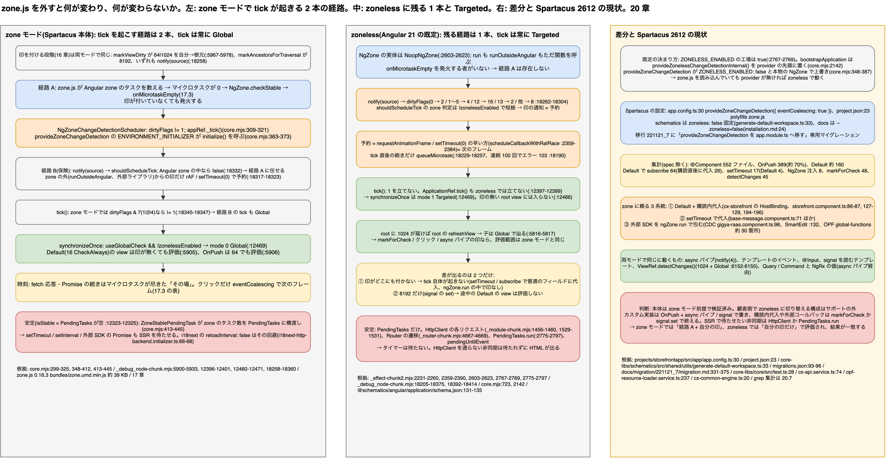

# 20. zone.js と zoneless: 「tick をいつ起こすか」を誰が決めるか

> **図**: 19 zone モードと zoneless の経路の差(`diagrams/spartacus-architecture.drawio`)。左: zone モードで tick が起きる 2 本の経路(zone.js が「マイクロタスクが 0」を見て起こす経路と、scheduler が自前で予約する経路)。中: zoneless に残る 1 本の経路と、その tick が Targeted になること。右: 2 つのモードの差分表と、Spartacus 本体が zone モードを維持している根拠



> **この章が答える問い**: zone.js を外すと、16〜17 章の「印を付ける」「印を見つける」のどこが変わり、どこが変わらないのか。Angular 21 では何も書かなければ zoneless なのに、Spartacus が `provideZoneChangeDetection` を明示して zone モードを続けている理由は何か。カスタム実装はどう書けば両方のモードで動くのか

> **位置づけ**: 16 章(印の種類)、17 章(zone モードの実行モデル)、18 章(signal)の続き。17 章の表と関数をそのまま使い、「zone モードと zoneless で値が変わる行」だけを取り出す。18.4 の末尾で触れた「zone が無くても動く経路」の全体像。**この章は変更検知の軸だけを扱う。signal を例に出す箇所があるが、zoneless にするために signal や NgRx の置き換えが要るわけではない**(状態管理の軸は 21 章、2 軸の切り分けは 21.1)

> **根拠の取り方**: Angular 側は `mini-spartacus/node_modules` の `@angular/core` 21.2.25(`fesm2022/core.mjs`、`_debug_node-chunk.mjs`、`_effect-chunk2.mjs`)、`@angular/common` の `_module-chunk.mjs`、`@angular/router` の `_router-chunk.mjs`、CLI の `@schematics/angular` を読む。Spartacus 側はクローン(v2612.0.0)の `projects/storefrontapp`、`core-libs/schematics`、`docs/migration/221121_7`、コンポーネントの `grep` 集計。17 章と同じく、ビルド後のコードに enum 名は残らないので、数値の横に TypeScript の名前を添える

---

### 20.0 先に話し言葉で: 変わるのは「印のあと」だけ

16 章の「印を付ける」は、zone モードでも zoneless でも 1 行も変わらない。`markViewDirty` も `markForCheck` も `async` パイプも、同じ関数が同じビットを立てる。変わるのは印が付いた**あと**の 2 点で、「誰が tick を予約するか」と「tick が根元から全部を見るか、印のある所だけを見るか」である。

zone モードでは、zone.js が「Angular zone の非同期の仕事が一段落した」のを見るたびに tick を起こす。印が無くても起きる。だから Default のコンポーネントは、`setTimeout` の中で普通のフィールドを書き換えただけでも次の tick で描き直される。zoneless では、印が付いたときだけ tick が予約される。印を付けずに値を変えると、画面はそのまま止まる。

Angular 21 では、何も書かなければ zoneless で起動する。Spartacus は `provideZoneChangeDetection({ eventCoalescing: true })` を明示して zone モードを維持している。本体のコンポーネントの約 3 割が Default で、購読の中でフィールドに代入する書き方や、外部ライブラリのコールバックを `ngZone.run` で包む書き方が残っているからである。逆に言えば、カスタム実装を OnPush と `async` パイプ(または signal)だけで書いておけば、どちらのモードでも同じ結果になる。

## 20.1 用語: 2 つのモードを作っている部品

| 部品 | zone モード(Spartacus 本体) | zoneless(Angular 21 の既定) |
|---|---|---|
| `NgZone` の実体 | `NgZone`(zone.js の fork、17.3) | `NoopNgZone`(`_effect-chunk2.mjs:2603-2623`)。`run` も `runOutsideAngular` もただ関数を呼ぶだけ |
| tick を起こす経路 | 2 本。① `NgZoneChangeDetectionScheduler` が `onMicrotaskEmpty` で起こす(`core.mjs:299-325`) ② `ChangeDetectionSchedulerImpl` が印の通知を受けて予約する(Angular zone の外からの通知だけ、17.4) | ② だけ。すべての印の通知が予約になる |
| tick の中のモード | Global(`mode 0`)。印の有無に関わらず Default の view を評価 | Targeted(`mode 1`)。`1024`、`8192`、`consumer.dirty` の付いた view から辿る |
| 「安定」の判定 | `PendingTasks` + zone が数えるタスク(`ZoneStablePendingTask` が橋渡し、`core.mjs:413-445`) | `PendingTasks` だけ(`HttpClient`、Router、`PendingTasks.run` が登録する) |
| 必要なファイル | `zone.js` を polyfills に(`projects/storefrontapp/project.json:23`、約 39 KB の minified バンドル `zone.js/bundles/zone.umd.min.js`) | 無し |
| 切り替えの印 | `provideZoneChangeDetection(...)`(`core.mjs:388-404`) | 何も書かない、または `provideZonelessChangeDetection()`(`_debug_node-chunk.mjs:18392-18402`) |

`ZONELESS_ENABLED` という DI トークンが分岐の正体である。`ChangeDetectionSchedulerImpl`(`:18210`)と `ApplicationRef`(`:12306`)がこれを `inject` し、以下で見る 5 箇所の `if (!this.zonelessEnabled ...)` で挙動を変える。

## 20.2 どちらのモードで動いているかはどう決まるか

### Angular 21 の既定は zoneless

`ZONELESS_ENABLED` の工場関数は `() => true` である(`_effect-chunk2.mjs:2767-2769`)。さらに `bootstrapApplication` の実体 `internalCreateApplication` は、アプリの provider 配列の**先頭**に `provideZonelessChangeDetectionInternal()` を置く(`core.mjs:2142`)。NgModule 版の `bootstrapModuleFactory` も同じ(`:723`)。

```js
// _debug_node-chunk.mjs:18403-18414
function provideZonelessChangeDetectionInternal() {
  return [
    { provide: ChangeDetectionScheduler, useExisting: ChangeDetectionSchedulerImpl },
    { provide: NgZone, useClass: NoopNgZone },
    { provide: ZONELESS_ENABLED, useValue: true },
  ];
}
```

`provideZoneChangeDetection` はこれを**上書き**する側である。`internalProvideZoneChangeDetection`(`core.mjs:348-387`)が `ZONELESS_ENABLED: false`(`:356-358`)、本物の `NgZone` の工場(`:359-362`)、`NgZoneChangeDetectionScheduler.initialize()` を呼ぶ `ENVIRONMENT_INITIALIZER`(`:363-374`)、`ZoneStablePendingTask.initialize()`(`:375-382`)を provide する。`eventCoalescing` は `getNgZoneOptions`(`:406-412`)で `shouldCoalesceEventChangeDetection` に写される。

したがって **`zone.js` を polyfills に入れていても、`provideZoneChangeDetection` を書かなければ zoneless で動く**。zone.js はパッチを当てて数を数え続けるが、誰もその結果を読まない。Spartacus の 2211.21 → 221121_7 の移行手順に「`provideZoneChangeDetection` を `main.ts` から `app.module.ts` へ移す」という専用のマイグレーションがあるのはこのためで(`core-libs/schematics/src/migrations/migrations.json:93-96`、`221121_7/move-zone-change-detection-to-main/index.ts:11-16`、`docs/migration/221121_7/migration.md:331-375`)、移し忘れると「Angular 21 に上げたら一部の画面が更新されなくなった」という症状として現れる。

両方書いた場合は dev モードで警告 408(`core.mjs:621-623`)、`provideZonelessChangeDetection()` を明示したのに `Zone` がグローバルにある場合は警告 914(`_debug_node-chunk.mjs:18394-18397`、「zone.js を polyfills から外せ」)が出る。

### CLI と Spartacus の schematics

`ng new` の `zoneless` オプションは既定 `true` で(`@schematics/angular/application/schema.json:131-135`)、`false` のときだけ `zone.js` を依存に加え(`application/index.js:133-134`)、polyfills に書く(`:250`)。Spartacus の schematics は生成するワークスペースに `zoneless: false` を固定し(`core-libs/schematics/src/shared/utils/generate-default-workspace.ts:33`)、インストール手順も `ng new my-spartacus-app --style=scss --ssr=false --zoneless=false ...` と書く(`docs/migration/221121_7/installation.md:24`、`docs/spa-bff-reference-implementation.md:186`)。生成される `app.config.ts` には `provideZoneChangeDetection({ eventCoalescing: true })` が入り(`core-libs/schematics/src/modernize-app-to-standalone-bootstrap-application/csr-and-ssr/create-app-config.ts:46`)、`zone.js ^0.16.0` が依存に追加される(`core-libs/schematics/src/dependencies.json:540`)。本家のデモアプリも同じ構成である(`projects/storefrontapp/src/app/app.config.ts:30`、`project.json:23`)。

## 20.3 tick を起こす経路: 2 本から 1 本へ

### zone モードの 2 本

```text
経路 A(zone が起こす)                              経路 B(scheduler が予約する)
Angular zone のマイクロタスクが 0 になる              markViewDirty / markForCheck / markAncestorsForTraversal
→ NgZone.checkStable → onMicrotaskEmpty              → changeDetectionScheduler.notify(source)   :18258
→ NgZoneChangeDetectionScheduler                     → dirtyFlags にビット                       :18262-18304
   dirtyFlags |= 1; appRef._tick()   core.mjs:309-321 → shouldScheduleTick()                      :18325-18336
                                                        Angular zone の中なら false → 経路 A に任せる :18332
                                                        外なら rAF / setTimeout(0) の早い方で予約   :18317-18323
                                                     → tick(): zone モードなら dirtyFlags |= 1      :18345-18347
```

17.3〜17.4 で見たとおり、Spartacus の通常の動作では経路 A しか動かない。経路 B は `runOutsideAngular` の中や zone を知らない外部ライブラリのコールバックからの印だけを拾う保険である。重要なのは経路 B の末尾で、zone モードでは scheduler が起こした tick でも `tick()` の冒頭で `dirtyFlags & 7`(1 ViewTreeGlobal、2 ViewTreeTraversal、4 ViewTreeCheck のいずれか)なら `1` を立てる(`:18345-18347`)。**zone モードの tick は、印のビットが立っている限り常に Global** である。

### zoneless の 1 本

```text
markViewDirty / markForCheck / markAncestorsForTraversal / setInput / view の attach …
→ notify(source)                                   :18258   source 5(Listener)も無視されない(:18259-18261 は zone モード限定)
→ dirtyFlags にビット                                :18262-18304
→ shouldScheduleTick()                              :18325-18336   zone の判定(:18332)は !zonelessEnabled で短絡 → 常に通る
→ 予約: rAF / setTimeout(0) の早い方                  :18317   scheduleCallbackWithRafRace(_effect-chunk2.mjs:2359-2384)
       (直前の tick から同じマイクロタスク列の中なら queueMicrotask) :18229-18257   scheduleCallbackWithMicrotask(:2385-2390)
→ tick(): dirtyFlags は触らない → appRef._tick()      :18337-18360
→ synchronizeOnce: mode = Targeted                  :12469
```

`NoopNgZone` には `onMicrotaskEmpty` を発火する者がいないので経路 A は存在しない。印の通知が唯一の起動源になる。予約の時刻は「次のフレーム」(`requestAnimationFrame` と `setTimeout(0)` の早い方)で、zone モードの `eventCoalescing` と同じ器である。違いは、zone モードではクリックだけがこの器に入り、`fetch` の応答や `Promise` の続きは「その場で」tick が走ったのに対し(17.3 の表)、zoneless ではすべての印が次のフレームまで待つことである。描画の遅れは最大 1 フレームで、代わりに同じフレーム内の印は 1 回の tick にまとまる。

tick の直後だけは例外で、`afterTick` を受けた scheduler が `useMicrotaskScheduler = true` にし(`:18229-18247`、zoneless のときだけ `:18234-18237` を通り抜ける)、次のマイクロタスクまでの間に来た通知は `queueMicrotask` で即座に流す(`:18248-18257`)。`afterRender` の中で状態を変えたときに次のフレームまで待たないための仕組みで、これが 100 回連続すると「endless change notifications」のエラー 103 になる(`:18190`、`:18201-18203`)。

## 20.4 tick の中: Global と Targeted で何が変わるか

`synchronizeOnce` の 1 行がモードを決める。

```js
// _debug_node-chunk.mjs:12460-12471
const useGlobalCheck = Boolean(this.dirtyFlags & 1);
...
for (let { _lView } of this.allViews) {
  if (!useGlobalCheck && !requiresRefreshOrTraversal(_lView)) continue;   // 印の無い root view は飛ばす
  const mode = useGlobalCheck && !this.zonelessEnabled ? 0 : 1;           // 0 = Global, 1 = Targeted
  detectChangesInternal(_lView, mode);
}
```

zoneless では `1` を立てる者がいない。`NgZoneChangeDetectionScheduler` は provide されず、手動の `ApplicationRef.tick()` も zone モードのときだけ `1` を立てる(`:12396-12401`、分岐は `:12397-12399`)。したがって zoneless の tick は常に Targeted で、`requiresRefreshOrTraversal` が偽の root view には入りもしない。

### view ごとの判定

17.5 の `detectChangesInView`(`:5900-5933`)の条件を、モード別に読み直す。

| view の状態 | Global(zone モード) | Targeted(zoneless) |
|---|---|---|
| Default(`16 CheckAlways`)、印なし | 評価する(`:5905`) | **評価しない**。`8192` があれば子孫だけ辿る(`:5916-5931`) |
| OnPush、`64 Dirty` のみ | 評価する(`:5906`) | 評価しない(`64` は Global 限定) |
| `1024 RefreshView` あり | 評価する(`:5907`) | 評価する |
| テンプレートの consumer が dirty(signal) | 評価する(`:5908`) | 評価する |
| 評価が決まった view の子 | `refreshView` が子を **Global** で辿る(`:5796`、`:5816-5817`) | 同じ。**ここから下は zone モードと同じ** |

最後の行が実務上の要点である。`markViewDirty` は自分から根元まで `64 | 1024` を立てる(`:5967-5978`)。root view に `1024` が付けば Targeted でも root の `refreshView` が走り、そこから下は Global で辿る。つまり **`markForCheck`、テンプレートのイベント、`async` パイプのどれか 1 つが印を付ければ、その tick で評価される範囲は zone モードと同じ**である。Default の view が「zoneless だから」評価されなくなるのは、次の 2 つの場合だけになる。

1. **印がどこにも付かない**。tick 自体が起きない。zone モードなら経路 A が Global の tick を起こして Default の view を全部評価していた
2. **印が `8192` だけ**(signal の `set()` のみ、18.4)。Targeted で consumer の view までは辿るが、途中の Default の view は評価しない。zone モードでは Angular zone の中の `set()` なら経路 A で Global になっていた

手動 API のうち `ViewRef.detectChanges()` は自分に `1024` を立てて `detectChangesInternal` を既定の Global で呼ぶので(`:6152-6155`、`:5705`)、両モードで同じに動く。`ApplicationRef.tick()` は zoneless では `dirtyFlags` が 0 なら `synchronize` のループに入らず(`:12441`)、何もしない。

## 20.5 きっかけ別の対応表(17.3 の表の zoneless 版)

| きっかけ | zone モード(Spartacus 本体) | zoneless |
|---|---|---|
| テンプレートの `(click)` | ハンドラの前に `markViewDirty(…, 5)`。tick は `eventCoalescing` で次のフレーム。Global | 同じ印。`notify(5)` が `4` を立てて次のフレームに予約。root に `1024` があるので評価範囲も同じ |
| OCC 応答 → NgRx / Query → `async` パイプ | `async` パイプの `markForCheck` → 印。続きが Angular zone に戻るので(17.3 末尾)、応答処理の直後に**その場で** tick | 同じ印 → `notify(4)` → **次のフレーム**で tick。評価範囲は同じ |
| `setTimeout` の中で普通のフィールドに代入(Default) | 印なし。zone が `macroTask` の終了を見て Global の tick → 描き直される | 印なし → **tick が起きない**。別の印が同じフレームに来れば巻き込まれて直るが、来なければ止まったまま |
| `subscribe` の中でフィールドに代入(Default) | 同上。購読元が何であれ、その続きが Angular zone の中なら描き直される | 同上。`async` パイプか `markForCheck` か `toSignal` に置き換えが要る |
| signal の `set()`(テンプレートで読んでいる) | Angular zone の中なら Global の tick。外なら経路 B で Targeted相当 | `8192` + `notify(0)` → 次のフレーム、Targeted。consumer の view だけ |
| 外部ライブラリのコールバック(決済 SDK、CDC)を `ngZone.run` で包む | `run` が Angular zone に入るので、中で何をしても `onLeave` で tick | `NoopNgZone.run` はただ呼ぶだけ。中で印が付けば(dispatch → `async` パイプ)tick、付かなければ何も起きない |
| `@Input` の変化 | 親の `refreshView` の中で `markDirtyIfOnPush`(17.4 入口 3)。親が評価されることが前提 | 同じ。親が評価されるかどうかは上の行で決まる |
| Router の遷移 | Guard / resolve の各段で tick(Promise の連鎖) | view の attach(`source 8`)と `async` パイプの印で tick。回数は減る |
| `ApplicationRef.tick()` | `1` を立てて Global | 印が無ければ何もしない |
| `ViewRef.detectChanges()` | その view に `1024`、下は Global | 同じ |
| SSR / hydration が待つ「安定」 | zone のタスクが 0 かつ `PendingTasks` が空 | `PendingTasks` が空(20.6) |

## 20.6 「安定」の判定と SSR

`ApplicationRef.isStable` は両モードとも `PendingTasksInternal.hasPendingTasksObservable` の否定である(`:12323-12325`、`whenStable` は `:12331-12343`)。差は**誰がタスクを登録するか**にある。

| 登録する者 | zone モード | zoneless |
|---|---|---|
| zone.js が数えるタスク(`setTimeout`、`setInterval`、XHR、`fetch`、`Promise`) | `ZoneStablePendingTask` が `onUnstable` でタスクを 1 つ登録し、`onStable` で外す(`core.mjs:413-445`)。zone が 1 つでも抱えていれば不安定 | 数えない |
| `HttpClient` の各リクエスト | 登録する(`@angular/common/fesm2022/_module-chunk.mjs:1456-1460`、`:1529-1531`。`finalize` で外す) | 同じ |
| Router の遷移 1 回 | 登録する(`@angular/router/fesm2022/_router-chunk.mjs:4667-4669`) | 同じ |
| 任意の非同期処理 | `PendingTasks.run(fn)` / `add()`(`_effect-chunk2.mjs:2775-2797`。外すときに `notify(11)`)、`pendingUntilEvent()`(`rxjs-interop.mjs:170-195`) | 同じ |

Spartacus の SSR は Angular の `CommonEngine` を継承した `CxCommonEngine` で描画し(`core-libs/setup/ssr/engine/cx-common-engine.ts:20`)、Angular 側が `isStable` を待ってから HTML を出す(hydration の警告文がこの依存関係を明記している。`core.mjs:1258-1261`)。zone モードの「安定」は zone のタスク数を含むので、**止まらないタイマーが 1 つあると SSR が終わらない**。本家にその痕跡がある。

```ts
// core-libs/core/src/i18n/i18next/i18next-backend/i18next-http-backend.initializer.ts:66-68
// Disable the periodical reloading. Otherwise SSR would not finish due to the pending task `setInterval()`
reloadInterval: false,
```

zoneless ではタイマーは安定判定に関与しない。OCC 呼び出しは `HttpClient` 経由なので zoneless でも待ってもらえるが、`HttpClient` を通らない非同期(生の `fetch`、外部 SDK の Promise、`setTimeout` で遅らせた読み込み)は**待たれずに HTML が出る**。zone モードでは「待ちすぎる」側に、zoneless では「待たなさすぎる」側に倒れる。後者を直す道具が `PendingTasks.run` である。

## 20.7 Spartacus 本体の現状と、zoneless にしない理由

### 設定の事実

- デモアプリ: `provideZoneChangeDetection({ eventCoalescing: true })`(`projects/storefrontapp/src/app/app.config.ts:30`)、polyfills に `zone.js`(`project.json:23`)
- schematics: `zoneless: false` 固定(20.2)。`zone.js ^0.16.0` を依存に追加
- テスト: `provideZoneChangeDetection()` でテスト環境を起動し(`core-libs/core/src/test.ts:28`、`projects/storefrontapp/src/test.ts:35`)、`zone.js/testing` を読む(`core-libs/setup/setup-jest.ts:7-8`)。`fakeAsync` を使う spec は 1,945 ファイル中 11 と少ない
- ミニアプリ(`playground/mini-spartacus`)も同じ構成(`src/app/app.config.ts:9`、`angular.json:46`)

### コンポーネントの集計(`grep`、spec と storefrontapp と schematics を除く)

| 項目 | 件数 | 読み方 |
|---|---|---|
| `@Component` を持つファイル | 552 | |
| うち `ChangeDetectionStrategy.OnPush` を含む | 389(約 70%) | 残り約 160 が Default |
| `ChangeDetectionStrategy.Default` を明示 | 4 | 大半は未指定 = Default |
| `markForCheck()` の呼び出し | 48 | 購読の中で代入する箇所の一部は自衛している |
| `.detectChanges()` の呼び出し | 45 | 両モードで同じに動く(20.4) |
| コンポーネント内の `setTimeout(` | 17 ファイル | うち Default は 4(`storefront.component.ts:184, 209`、`base-message.component.ts:71`、`asm-main-ui.component.ts:306`、`customer-selection.component.ts:396`)。いずれもフォーカス移動が主で、描画に効く代入は少ない |
| Default で `.subscribe(` を持つ | 64 ファイル | うち購読の直後 4 行以内に `this.x = ` がある(機械的な近似)もの 26 |
| `NgZone` を注入する | 8 ファイル | 下記 |

Default で購読の中に代入する典型が、ルートに近い `cx-storefront` 自身である。

```ts
// core-libs/storefront/layout/main/storefront.component.ts:86-87, 127-129, 194-196
@HostBinding('class.start-navigating') startNavigating: boolean;
@HostBinding('class.stop-navigating') stopNavigating: boolean;
...
this.navigateSubscription = this.routingService.isNavigating().subscribe((val) => this.onNavigation(val));
...
protected onNavigation(isNavigating: boolean): void {
  this.startNavigating = isNavigating === true;
  this.stopNavigating = isNavigating === false;
```

印はどこにも付かない。zone モードでは `isNavigating()` の元(NgRx の Router state)が更新された続きで経路 A の Global tick が走り、host binding が更新される。zoneless では、同じフレームに別の印(遷移先の `async` パイプなど)が来れば巻き込まれて更新され、来なければ古い class が残る。動くかどうかが隣の都合で決まる状態で、これが Angular の zoneless ガイドが OnPush か signal か `markForCheck` を要求する理由である。

`NgZone` の注入は 8 ファイルで、用途は 3 種類に分かれる。

- `CxApiService` が Web Components 向けに `ngZone` を公開(`core-libs/storefront/cms-structure/page/component/services/cx-api.service.ts:74`)。zoneless では `NoopNgZone` が渡る
- 外部 SDK のコールバックを Angular zone に戻す `ngZone.run`: SmartEdit(`feature-libs/smartedit/core/services/smart-edit.service.ts:132`)、CDC / Gigya(`integration-libs/cdc/components/gigya-raas/gigya-raas.component.ts:98`、`cdc/root/service/cdc-js.service.ts:171, 360, 744`)、OPF の決済 SDK 向け global functions(`integration-libs/opf/global-functions/core/services/**`、約 30 箇所)。zoneless では「中で印が付くか」に動作が依存する
- 外部スクリプト実行を zone の外に出す `runOutsideAngular`(`integration-libs/opf/base/root/services/opf-resource-loader.service.ts:237`)。zoneless では無意味だが無害

### 結論

Spartacus 本体は zone モードを前提に書かれ、検証されている。NgRx と Query / Command の値は `async` パイプで画面に届くので(4 章、19 章)、zoneless にしても大半の画面は `notify(4)` 経由で動くが、上に挙げた Default + 購読内代入、`setTimeout`、外部 SDK の 3 系統は保証が無くなる。SAP の schematics とドキュメントが `--zoneless=false` を指定している以上、顧客側で zoneless に切り替える構成はサポートの外にある。18.4 で「本家で検証された構成ではない」と書いたのはこの意味である。

## 20.8 カスタム実装を両モードで動く形にしておく

Spartacus 本体が zone モードでも、カスタムのコンポーネントを zone に頼らずに書いておけば、将来 SAP 側が zoneless に移ったときにカスタム部分の書き直しが要らない。規則は 4 つで、いずれも 11 章の雛形と 18.8 の例に既に含まれている。

1. **`changeDetection: ChangeDetectionStrategy.OnPush` を付ける。** zone モードで既に本体の 7 割がそうである。OnPush にすると zone の Global tick に「たまたま拾われる」ことが無くなり、zone モードのうちから印の漏れが見える
2. **非同期の値は `async` パイプか signal で画面に出す。** `subscribe` の中で `this.x = ` と書いた瞬間に、印を付ける責任が自分に移る。やむを得ず書くなら同じ場所で `cdr.markForCheck()`、または `toSignal` に置き換える(18.6)
3. **`setTimeout` や外部 SDK のコールバックの中で画面に効く値を変えるなら、signal の `set()` か `markForCheck()` で終える。** `ngZone.run` で包む書き方は zone モードでしか意味を持たない
4. **SSR で待ってほしい非同期は `HttpClient` を通すか、`PendingTasks.run` で包む。** 逆に待ってほしくないもの(ポーリング、アニメーション)は zone モードでも `runOutsideAngular` か `isBrowser()` の分岐で SSR から外す

この 4 つを守った実装は、zone モードでは「経路 A の Global tick に加えて自分の印でも評価される」、zoneless では「自分の印だけで評価される」となり、結果が一致する。

## 20.9 まとめ: 2 つのモードの対応表

| | zone モード | zoneless |
|---|---|---|
| 印を付ける(16 章) | 同じ | 同じ |
| tick を起こす者 | zone.js(`onMicrotaskEmpty`)+ 保険の scheduler | scheduler だけ。印の通知 = 予約 |
| tick の時刻 | マイクロタスクが尽きた**その場**(クリックだけ次のフレーム) | 常に**次のフレーム**(tick 直後の続きだけマイクロタスク) |
| tick のモード | Global。Default の view は印が無くても評価 | Targeted。ただし印が root に届けばそこから下は Global と同じ |
| 印なしで値を変えたとき | 次の tick で直る(Default)/ 直らない(OnPush) | 直らない(どちらも) |
| 安定の判定 | zone のタスク + `PendingTasks` | `PendingTasks` だけ |
| 既定(Angular 21) | `provideZoneChangeDetection` を明示 | 何も書かない |
| Spartacus 2612 | **これ**(`app.config.ts:30`、schematics、docs) | 未サポート |

## 20.10 バックエンド担当者にとっての意味

- **API の契約は変わらない。** どちらのモードでも OCC の呼び出し回数、順序、`fields` は 7〜10 章のままである。変わるのは応答が画面に反映される時刻(その場 → 次のフレーム)で、人間には見えない
- **SSR の「いつ安定か」の意味が変わる。** zone モードでは OCC の応答待ちに加えて、フロントのタイマーや外部スクリプトの Promise も SSR の所要時間に含まれる。SSR が遅い・終わらないという報告を受けたら、OCC の応答時間だけでなく「zone が抱えているタスク」を疑う(`i18next` の `reloadInterval: false` がその実例)。zoneless なら `HttpClient` の往復だけが SSR 時間を決めるので、OCC の応答時間がそのまま SSR の下限になる
- **Angular 21 への更新後に「画面が更新されない」と言われたら、最初に確認するのは `provideZoneChangeDetection` の有無。** zone.js が読み込まれていても、provider が無ければ zoneless で動く(20.2)。症状は「`setTimeout` や外部 SDK を使う画面だけが止まる」という部分的なもので、API のログには何も出ない
- **カスタムコンポーネントの依頼書に「OnPush + `async` パイプ(または signal)で書く」と 1 行入れておく。** 本体がどちらのモードでも、カスタム部分の動作が本体の tick の都合に左右されなくなる

---

[目次](README.md) | ← [19. Query / Command パターン: ストア無しで「取得済みなら取らない」と「更新したら取り直す」を作る](19-query-command.md) | [21. 状態管理の選択: NgRx(Store / Facade / Observable)と Signal(signal / computed / resource)](21-state-management.md) →
