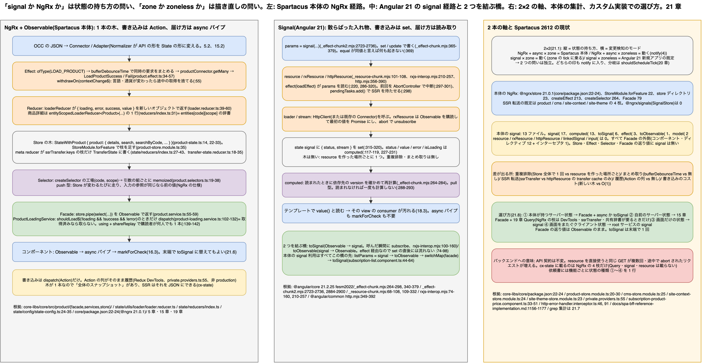

# 21. 状態管理の選択: NgRx(Store / Facade / Observable)と Signal(signal / computed / resource)

> **図**: 20 状態管理の 2 つの作り方と変更検知の 2 つのモード(`diagrams/spartacus-architecture.drawio`)。左: Spartacus 本体の NgRx 経路(OCC → Connector → Effect → Reducer → Store → Selector → Facade → `async` パイプ)。中: Angular 21 の signal 経路(`resource` / `rxResource` → `computed` → テンプレートの読み取り)と、2 つを結ぶ `toSignal` / `toObservable`。右: 「状態の持ち方」と「変更検知のモード」の 2×2 表、本体の集計、カスタム実装での選び方



> **この章が答える問い**: 「signal か NgRx か」は何を選ぶ問いで、「zone.js か zoneless か」(20 章)とはどう独立しているのか。NgRx の Store / Action / Reducer / Selector / Effect / Facade が担っている仕事は、signal の世界では何が担うのか。Spartacus 2612 はどこまで NgRx で、どこから signal なのか。カスタム実装では状態の種類ごとに何を選べばよいのか

> **位置づけ**: 5 章(API の形 → State の形)、15 章(Facade / Connector / Adapter)、19 章(Query / Command)が「NgRx とその周辺で状態をどう持つか」を書いた。18 章は signal の**反応の仕組み**(印の付き方)を書いた。この章は「状態をどこに置き、どう派生させ、サーバーからどう取り、コンポーネントへどう届けるか」という**状態管理の軸**だけを取り出して、NgRx と signal を同じ表に並べる。変更検知の軸(16・17・20 章)とは 21.1 で切り分ける

> **根拠の取り方**: Spartacus 側はクローン(v2612.0.0)の `core-libs/core/src/product`(Store / Effect / Selector / Facade が一式そろっている)、`core-libs/core/src/state`(ローダ部品と SSR 転送)、`feature-libs/subscription-billing`(本体で最も signal を使っている機能)を読む。Angular 側は `mini-spartacus/node_modules` の `@angular/core` 21.2.25(`fesm2022/_effect-chunk.mjs`、`_effect-chunk2.mjs`、`_resource-chunk.mjs`、`rxjs-interop.mjs`)と `@angular/common/fesm2022/http.mjs` を読む。NgRx 本体(`@ngrx/store` 21.0.1)のソースはどちらのクローンにも無いので、NgRx の内部動作は Spartacus 側の使い方から言えることに限り、仕様として知られていることは「NgRx の仕様」と明記する

---

### 21.0 先に話し言葉で: 「どこに置くか」と「いつ描き直すか」は別の問い

Angular の最近の話題には「signal」と「zoneless」が並んで出てくるので、同じ変化の表裏のように見える。実際には問いが 2 つある。1 つは「状態をどこに置いて、どう派生させて、コンポーネントにどう届けるか」で、NgRx の Store か signal かはこちらの問いである。もう 1 つは「値が変わったあと、画面をいつ描き直すか」で、zone.js か zoneless かはこちらの問いである。NgRx + `async` パイプは zoneless でも動くし、signal は zone モードでも動く。Spartacus 本体は「NgRx + zone モード」、Angular 21 で新規に作るアプリの既定は「signal + zoneless」で、対角線上にいるだけである。

NgRx で状態を持つと、Store という 1 つの木に全部の状態が入り、変更は Action を `dispatch` して Reducer が新しい木を返す形でしか起きない。サーバーとのやり取りは Effect が Action を見て行い、結果もまた Action で Store に戻る。コンポーネントは Facade を通して Selector で木の一部を Observable として受け取り、`async` パイプで表示する。5 章・15 章・19 章で見た流れはすべてこれである。

signal で状態を持つと、状態は `signal()` という入れ物ごとに散らばり、`set()` / `update()` で直接書く。派生は `computed()` が読まれたときに作り、サーバーからの取得は `resource()` / `rxResource()` が「パラメータの signal が変わったら読み直す」形で行う。コンポーネントはテンプレートで `value()` と読むだけで、`async` パイプも `markForCheck()` も要らない(18 章)。

Spartacus 2612 の本体は、状態の木も、取得も、Facade の返り値も NgRx + Observable のままである。signal が使われているのは 13 ファイルで、すべて「Facade が返す Observable を `toSignal` で受けて `computed` で加工する」か「画面だけの小さなフラグ」のどちらかに収まる。`resource` 系は 1 件も無い。だからカスタム実装の判断は「NgRx を signal に置き換えるか」ではなく、「Facade の外側(コンポーネント)で signal を使うか」と「自前の状態をどの入れ物に置くか」の 2 つになる。

## 21.1 2 本の軸を分ける

| | zone モード(16・17 章) | zoneless(20 章) |
|---|---|---|
| **NgRx + Observable + `async` パイプ** | `async` パイプが `markForCheck()` で印を付け(16.3)、zone.js がマイクロタスクの終わりで tick を起こす。印が無くても tick は起きる。**Spartacus 本体はここ** | 同じ印が `notify(4)` で tick を予約する(20.5)。印が root まで届くので評価範囲は同じ。本体の約 3 割の Default コンポーネントが問題になるのは、NgRx のせいではなく購読内代入のせい(20.7) |
| **signal + `computed` + テンプレートの読み取り** | テンプレートの consumer が汚れて `notify(0)` が呼ばれるが、zone の中なら予約せず zone の tick に乗る(18.4)。tick は Global | `notify(0)` が tick を予約し、Targeted で読んだ view だけ評価(20.4)。**Angular 21 の新規アプリの既定はここ** |

縦の軸がこの章、横の軸が 20 章である。どの組み合わせでも「値が変わる → 印が付く → tick → DOM」の骨格は同じで、変わるのは印の付き方(縦)と tick の起こし方(横)だけである。2 軸が独立している根拠は 18.4 と 20.5 の表にある。`async` パイプの印(`notify(4)`)と signal の印(`notify(0)`)はどちらも `ChangeDetectionSchedulerImpl.notify` に入り、zone の有無で分岐するのはその先の `shouldScheduleTick`(`_debug_node-chunk.mjs:18325-18336`)である。

## 21.2 用語の対応表: 同じ仕事を誰がするか

| 仕事 | NgRx(Spartacus 本体) | Query / Command(19 章) | Signal(Angular 21) |
|---|---|---|---|
| 状態の入れ物 | Store の木。機能ごとに `StoreModule.forFeature(PRODUCT_FEATURE, ...)` で枝を足す(`product-store.module.ts:35`)。形は `StateWithProduct { product: ProductsState }`(`product-state.ts:14, 22-33`) | `BehaviorSubject<QueryState<T>>` 1 つ(`query.service.ts:33-37`) | `signal(initialValue)`(`_effect-chunk2.mjs:2723-2736`)。木ではなく、サービスやコンポーネントのフィールドに散らばる |
| 書き込み | `store.dispatch(new LoadProduct(code, scope))`(`product-loading.service.ts:128-130`)→ Reducer が新しいオブジェクトを返す(`loader.reducer.ts:39-60`) | Query 内部の `state$.next(...)` | `sig.set(v)` / `sig.update(fn)`(`_effect-chunk.mjs:365-379`)。`equal` が同じと言えば何も起きない(`:369`) |
| 派生(読み取り専用の加工) | `createSelector(getProductState, details => ...)`(`product.selectors.ts:17, 23-30, 35-38`)。NgRx の仕様として、入力の参照が同じなら再計算しない | `get()` = `getState()` から `data` を取り出す(`query.service.ts:39-42`) | `computed(() => ...)`(`_resource-chunk.mjs:68-76`)。読まれるまで計算せず、依存先の version が変わっていなければ前の値(`_effect-chunk.mjs:264-284, 288-298`、18.2) |
| サーバーからの取得 | Effect: `ofType(LOAD_PRODUCT)` → `bufferDebounceTime` でまとめる → `productConnector.getMany` → `LoadProductSuccess` / `LoadProductFail`(`product.effect.ts:34-57`) | `loader` 関数(初回購読で 1 回) | `resource({ params, loader })` / `rxResource({ params, stream })`(`_resource-chunk.mjs:101-108`、`rxjs-interop.mjs:210-257`)。`params` の signal が変わるたびに読み直す |
| 取得済みなら取らない | `shouldLoad$`: `!loading && !success && !error` のときだけ dispatch(`product-loading.service.ts:102-112, 126-132`) | 状態機械(19.2) | 無い。`params` が同じ値なら `loadEffect` は走らないが、別のコンポーネントが同じ `resource` を作れば別に取る |
| 取り直し | Action を見るか、`getProductReloadTriggers`(言語・通貨の変更、`:151`) | `reloadOn` / `resetOn`(イベント) | `params` の変更、または `res.reload()`(`_resource-chunk.mjs:255-270`) |
| コンポーネントへの届け方 | Facade が `store.pipe(select(...))` を返す(`product.service.ts:55-61`)→ `async` パイプ | Facade が `query.get()` を返す → `async` パイプ | テンプレートで `value()` と読む。Observable を受けるなら `toSignal`(`rxjs-interop.mjs:100-160`) |
| SSR で状態を HTML に載せる | `ssrTransfer.keys` に挙げた枝を `TransferState` に書く meta reducer(`state/reducers/index.ts:27-43`、`transfer-state.reducer.ts:18-35`、`product-store.module.ts:20-30`) | 対象外(19.1) | `httpResource` だけ HttpClient の transfer cache を見る(`http.mjs:365-389`)。Spartacus の `ssrTransfer` とは別の仕組み |
| 開発ツール | Redux DevTools(`private.providers.ts:55`、非 production のみ) | 無し | Angular DevTools の signal グラフ(`debugName`、`_effect-chunk2.mjs:2730-2733`) |

Spartacus は NgRx の上に `StateUtils` という共通部品を載せている。`core-libs/core/src/state/utils/` に `loader`、`entity`、`entity-loader`、`scoped-loader`、`processes-loader`、`entity-processes-loader` の 6 系統があり、`{ loading, error, success, value }` の形(`loader.reducer.ts:39-60`)と、`entities[id]` 辞書(5.4)と、スコープ(`scoped-loader`)を組み合わせる。商品の `details` は `entityScopedLoaderReducer<Product>(PRODUCT_DETAIL_ENTITY)` 1 行で作られている(`product/store/reducers/index.ts:31`、`entity-scoped-loader.reducer.ts:20`)。signal の世界でこれに当たる共通部品は Angular には無く、`resource` の `status` / `value` / `error` / `isLoading`(`_resource-chunk.mjs:117-119, 227-231`)が単品の `LoaderState` に相当する。

## 21.3 置き場所と書き込み: 1 本の木か、散らばった入れ物か

NgRx では状態は 1 本の木で、書き込みは Reducer しかできない。商品 1 件の読み込みを例にすると、`LoadProduct` が dispatch されると `loaderReducer` が `{ ...state, loading: true }` を返し、`LoadProductSuccess` で `{ ...state, value: payload, loading: false, success: true }` を返す(`loader.reducer.ts:39-60`)。元のオブジェクトは触らない。だから Selector は参照比較だけで「変わったか」を判定でき、DevTools は Action の列を時系列で見せられ、SSR は木の一部をそのまま JSON にできる。

```ts
// core-libs/core/src/state/utils/loader/loader.reducer.ts:39-60(抜粋)
if (entity.load) {
  return { ...state, loading: true, value: getReducerIfExists(state.value) };
} else if (entity.error) {
  return { ...state, loading: false, error: true, success: false, value: getReducerIfExists(undefined) };
} else if (entity.success) {
  return { ...state, value: getReducerIfExists(action.payload), loading: false, error: false, success: true };
}
```

signal では入れ物ごとに書く。`signal()` は `createSignal` が作った getter に `set` / `update` / `asReadonly` を生やしたもので(`_effect-chunk2.mjs:2723-2736`)、`set` は `equal`(既定は `Object.is`)で同じと判定されなければ `node.value` を書き換えて `signalValueChanged` を呼ぶ(`_effect-chunk.mjs:365-373`)。木は無いので「全体のスナップショット」は存在しない。その代わり書き込みが O(1) で、誰がどの signal を読んでいるかは反応グラフが覚えている(18.2)。

この差が効くのは次の 3 点である。

1. **複数の場所で同じ状態を見るとき。** NgRx は Store に 1 つしか無いので一致する。signal はサービスのフィールドに置けば同じことができるが、コンポーネントのフィールドに置くとインスタンスごとに別物になる。
2. **状態の履歴や全体像を見たいとき。** NgRx は Action の列がそのまま履歴になる。signal には無い。
3. **SSR で状態を運びたいとき。** Spartacus の `ssrTransfer` は Store の枝を単位にしている(`state-config.ts:24-35`、同梱ドキュメント `core-libs/core/src/state/docs/configurable-state-management.md:1-20`)。signal に置いた状態は運ばれない。

## 21.4 派生: Selector と computed

Spartacus の Selector は「商品コードとスコープを引数に取る工場」になっている。

```ts
// core-libs/core/src/product/store/selectors/product.selectors.ts:19-38(抜粋)
export const getSelectedProductStateFactory = (code: string, scope = '') =>
  createSelector(getProductState, (details) =>
    (StateUtils.entityLoaderStateSelector(details, code) as any)[scope] || StateUtils.initialLoaderState);

export const getSelectedProductFactory = (code: string, scope = '') =>
  createSelector(getSelectedProductStateFactory(code, scope),
    (productState) => StateUtils.loaderValueSelector(productState));
```

工場を呼ぶたびに新しい memoized selector ができるので、メモ化は「この `code` + `scope` の selector」単位で効く。Facade はそれを `store.pipe(select(...))` に渡して Observable にする(`product.service.ts:55-61`)。Store が新しい木を出すたびに selector が走り、入力(`details`)の参照が変わっていなければ前回の値を返す(NgRx の仕様)。

`computed` は逆向きで、**書かれたときではなく読まれたときに**計算する。`createComputed` が返す getter は、呼ばれると `producerUpdateValueVersion(node)` で依存先の version を確かめ、変わっていれば `computation` をやり直し、変わっていなければ前の `node.value` を返す(`_effect-chunk.mjs:264-284`)。初期状態は `UNSET` で `dirty: true`(`:288-293`)なので、誰も読まなければ一度も計算されない。サブスクリプション課金の価格表示はこの形で、`toSignal` で受けた商品から `oneTimeCharges` / `recurringCharges` を `computed` で切り出している(`subscription-product-price.component.ts:33-51`)。

| | Selector | computed |
|---|---|---|
| 計算の時刻 | Store が変わったとき(push) | 読まれたとき(pull) |
| メモ化の単位 | selector インスタンス(工場なら引数の組ごと) | computed ノード 1 つ |
| 依存の宣言 | 引数に列挙 | 本文で読んだ signal が自動で依存になる |
| 入力が Observable | そのまま | `toSignal` で一度 signal にする |

## 21.5 サーバーからの取得: Effect + Loader と resource

NgRx 側の取得は 5 章と 19 章で見たとおり Action の往復である。商品で言えば、`ProductLoadingService.getProductForScope` が「まだ取っていなければ dispatch する」Observable と「値を select する」Observable を `using` で束ね、`shareReplay({ bufferSize: 1, refCount: true })` で購読者が何人いても 1 本にする(`product-loading.service.ts:98-143`)。Effect は同じタイミングの `LoadProduct` を `bufferDebounceTime` で集めて `productConnector.getMany` に渡す(`product.effect.ts:40-53`)。つまり「取得済みなら取らない」も「同時の要求をまとめる」も、Store の状態を見て決めている。

signal 側の `resource` は、取得を**パラメータの signal に従属する状態**として表す。

```ts
// @angular/core/fesm2022/_resource-chunk.mjs:286-320(抜粋、コメントは本章で付けたもの)
async loadEffect() {
  const extRequest = this.extRequest();                 // params signal を読む(= 依存)
  if (extRequest.request === undefined) return;         // params が undefined なら idle
  else if (currentStatus !== 'loading') return;
  this.abortInProgressLoad();                           // 前回の取得を AbortSignal で止める
  let resolvePendingTask = this.resolvePendingTask = this.pendingTasks.add();  // SSR / isStable を待たせる
  const { signal: abortSignal } = this.pendingController = new AbortController();
  const stream = await untracked(() => this.loaderFn({ params: extRequest.request, abortSignal, previous: { status: previousStatus } }));
  if (abortSignal.aborted || untracked(this.extRequest) !== extRequest) return;  // 古い応答は捨てる
  this.state.set({ extRequest, status: 'resolved', previousStatus: 'resolved', stream });
}
```

`resource()` は `params` と `loader` から `ResourceImpl` を作り(`_resource-chunk.mjs:101-108`)、コンストラクタで `effect(this.loadEffect)` を登録する(`:220`)。`params` が変わるたびに effect が走り、前の取得を中断して新しい取得を始める。結果は `status`(`idle` / `loading` / `reloading` / `resolved` / `error` / `local`)、`value`、`error`、`isLoading` の computed として読める(`:117-119, 227-231`)。`rxResource` は `stream` に Observable を渡せる版で、購読して最初の値を Promise で返し、`abortSignal` で `unsubscribe` する(`rxjs-interop.mjs:210-257`)。`httpResource` は URL や request を signal で組み立てて `HttpClient` に投げる版で、SSR では HttpClient の transfer cache を初期値に使う(`http.mjs:356-390`)。

| 観点 | NgRx Effect + Loader(Spartacus) | Query(19 章) | resource / rxResource |
|---|---|---|---|
| 取得の引き金 | Action(`dispatch`) | 初回購読、`reloadOn` | `params` の変化、`reload()` |
| 重複排除 | Store の `loading` / `success` を見る(`product-loading.service.ts:102-112`)。アプリ全体で 1 回 | Query インスタンスごとに 1 回 | 無し。`resource` を作った場所ごと |
| まとめ取り | `bufferDebounceTime` + `getMany`(`product.effect.ts:47-53`) | 無し | 無し |
| 中断 | `withdrawOn(contextChange$)`(`product.effect.ts:55`、言語・通貨が変わったら捨てる) | `resetOn` | `AbortController`(`_resource-chunk.mjs:297-301, 312`) |
| 安定判定(SSR) | HttpClient のリクエストが `PendingTasks` に入る(20.6) | 同左 | 同左に加えて `pendingTasks.add()`(`:298`)で loader 全体を待つ |
| HTML への状態転送 | `ssrTransfer.keys`(商品、CMS、site-context、site-theme の 4 枝が既定、`product-store.module.ts:20-30` ほか) | 無し | `httpResource` のみ HttpClient の transfer cache |
| 古い応答の扱い | Reducer が最後に来た Success を採用 | `switchMap` 相当 | `extRequest` の同一性を確認して捨てる(`:312, 322`) |

Spartacus 本体に `resource` / `rxResource` / `httpResource` / `linkedSignal` は 1 件も無い(`grep`、spec を除く)。取得の一本化・まとめ取り・SSR 転送が Store を前提に作られているので、本体の取得を `resource` に置き換える理由が今のところ無い。

## 21.6 コンポーネントへの届け方: async パイプ、toSignal、signal の読み取り

届け方は 3 つあり、どれも 16〜20 章の「印」に合流する。

| 届け方 | 印の付き方 | 購読の時刻 | zone / zoneless |
|---|---|---|---|
| `Observable` + `async` パイプ | 値が来るたびに `markForCheck()`(16.3) | 最初の tick でテンプレートが評価されたとき | 両方で同じ(20.5) |
| `Observable` → `toSignal()` → テンプレートで読む | `toSignal` の内部 `state` signal に `set` → 読んだ view の consumer が汚れる(18.3) | **`toSignal()` を呼んだ瞬間**(`rxjs-interop.mjs:126-141`)。フィールド初期化子に書けばコンストラクタ時 | 両方で同じ |
| `signal` / `computed` をテンプレートで読む | 同上 | 購読という概念が無い | 両方で同じ |

`toSignal` の中身は小さい。`signal({ kind: 1, value: initialValue })` を 1 つ作り、`source.subscribe` の `next` で `state.set(...)`、`error` で `kind: 2` を入れ、`DestroyRef.onDestroy` で `unsubscribe` する。返すのは `state()` を読んで `value` を取り出す `computed`(`rxjs-interop.mjs:100-160`)。したがって `toSignal(facade.get(code))` と書いた瞬間に Facade の Observable が購読され、`async` パイプと違って「テンプレートが読まなくても取得が始まる」。19 章の Query や 21.5 の `shouldLoad$` は購読を引き金にしているので、`toSignal` はその引き金を早める。

逆方向の `toObservable` は `effect` の中で signal を読んで `ReplaySubject(1)` に流す(`rxjs-interop.mjs:74-98`)。`effect` は tick の中で走るので(18.5)、`set()` の直後に同期的には流れない。サブスクリプション一覧はこの往復を使っていて、ソートとページを `signal` に持ち、`toObservable` → `switchMap` で Facade に渡し、結果を `toSignal` で受けている(`subscription-list.component.ts:44-64`)。

```ts
// feature-libs/subscription-billing/components/list/subscription-list.component.ts:44-64(抜粋)
listParams = signal({ sortCode: undefined, currentPage: 0 });
subscriptions$ = toObservable(this.listParams).pipe(
  switchMap((params) => this.subscriptionFacade.getSubscriptionList(this.PAGE_SIZE, params.currentPage, params.sortCode))
);
subscriptions = toSignal(this.subscriptions$);
```

「UI の入力は signal、Facade との境界は Observable、表示は signal」という配線で、Facade(NgRx)側を変えずに済んでいる。

## 21.7 Spartacus 2612 の構成: 木は NgRx、末端に signal

### NgRx が担っている範囲

| 事実 | 根拠 |
|---|---|
| `@spartacus/core` の peerDependencies に `@ngrx/store` / `@ngrx/effects` / `@ngrx/router-store` 21.0.1 | `core-libs/core/package.json:22-24`、ルート `package.json:181-184`(`store-devtools` は `:213`) |
| `StoreModule.forFeature` が 22 箇所、`store` ディレクトリが 23(core / feature / integration) | `grep`、spec を除く |
| `createEffect` 213、`createSelector` 264、`createFeatureSelector` を持つファイル 20 | 同上 |
| Facade(`facade` ディレクトリ配下の `@Injectable`)79 ファイル。返り値は Observable | 同上。例 `product.service.ts:39-46, 51-60`、`cms.service.ts:114-138` |
| `StateModule.forRoot()` の仕事は meta reducer(SSR 転送)の登録だけ | `state.module.ts:10-17`、`state/reducers/index.ts:27-43` |
| SSR 転送の既定対象は `product` / `cms` / `site-context` / `site-theme` の 4 枝 | `product-store.module.ts:20-30`、`cms-store.module.ts:25`、`site-context-store.module.ts:24`、`site-theme-store.module.ts:23` |
| Redux DevTools は storefrontapp の非 production だけ | `projects/storefrontapp/src/app/private/private.providers.ts:55` |
| `@ngrx/signals`(SignalStore)は未使用 | `grep` 0 件 |

### signal が使われている範囲

| API | 出現(spec を除く) | 典型 |
|---|---|---|
| `signal(` | 17 | 読み込み中フラグ(`consent-management.component.ts:72, 119-124`)、ダイアログの表示切替、一覧のクエリ条件(`subscription-list.component.ts:44-50`) |
| `computed(` | 13 | `toSignal` で受けた値の切り出し(`subscription-product-price.component.ts:37-51`、`subscription-cart-price-body.component.ts:25-31`) |
| `toSignal(` | 6 | Facade / `OutletContextData.context$` / `LaunchDialogService.data$` を signal にする(`subscription-product-price.component.ts:33-35`、`subscription-cart-price-body.component.ts:24`、`subscription-actions-modal.component.ts:67-68`、`http-error-handler.interceptor.ts:46`) |
| `effect(` | 3 | フォーカスや読み上げ文の更新(18.8) |
| `toObservable(` | 1 | `subscription-list.component.ts:52` |
| `model(` / `viewChild.required(` | 2 / 1 | signal 入力・クエリ |
| `resource(` / `rxResource(` / `httpResource(` / `linkedSignal(` / `input(` | 0 | |

ファイル数は 13。すべて Facade の外側(コンポーネント、1 件だけインターセプタ)にあり、Store・Effect・Selector・Facade の返り値に signal を使っている箇所は無い。`http-error-handler.interceptor.ts:46` の `userId = toSignal(inject(UserIdService).getUserId())` は「サービスの中で今の値を同期的に読む」用途で、`:91` で `this.userId()` と呼ぶ。

一方、リポジトリ同梱の新しいガイド(`docs/spa-bff-reference-implementation.md`)のサンプルコンポーネントは `signal('')` を状態の入れ物にしている(`:1156-1177, 1197-1217`)。本体のライブラリは NgRx を維持し、新規のサンプルは signal で書く、という段階にある。

## 21.8 カスタム実装での選び方: 状態の種類で決める

「NgRx か signal か」を一律に決めるのではなく、状態を 4 種類に分けて入れ物を選ぶ。

| 状態の種類 | 例 | 置き場所 | コンポーネントでの受け方 |
|---|---|---|---|
| ① Spartacus 本体が既に持っているサーバー状態 | 商品、カート、CMS コンポーネントの `data$`、ユーザー | 本体の Store(触らない)。Facade から受ける | `async` パイプ、または `toSignal(facade.get(...))` + `computed` |
| ② 自前のサーバー状態(自社 API) | 会員ランク、店舗在庫、見積 | 15 章の Facade / Connector / Adapter + 19 章の Query / Command。NgRx の feature store を足すのは、DevTools で追いたい・`ssrTransfer` に載せたい・複数画面で同じ `entities` 辞書を共有したい、のどれかがあるときだけ | 同上(Facade は Observable を返す) |
| ③ 画面だけの状態 | 開閉、タブ、ソート条件、ページ番号、送信中フラグ | コンポーネントのフィールドに `signal` | テンプレートで読む。Facade に渡すなら `toObservable` |
| ④ 画面をまたぐクライアント状態 | 比較リスト、ウィザードの進み具合 | `providedIn: 'root'` のサービスに `signal`(または `BehaviorSubject`)。永続化や SSR 転送が要るなら NgRx | `computed` で派生、テンプレートで読む |

この分け方で、Facade の返り値は Observable のまま保たれる。理由は 3 つある。(1) 本体の Facade が全部 Observable なので、合成(`combineLatest`、`switchMap`)の相手が揃う。(2) 19 章の `reloadOn` / `resetOn` と EventService は Observable の世界にいる。(3) `toSignal` は末端でいつでも挟めるが、逆に signal を返す Facade を Observable に戻すと `effect` 経由の非同期(`toObservable`)になり、同期的な初期値が取れない。

### 雛形: Facade は Observable、コンポーネントは signal

```ts
// 15 章の雛形(Facade が Observable を返す)はそのまま。コンポーネント側だけ signal にする
@Component({
  selector: 'cx-member-rank',
  changeDetection: ChangeDetectionStrategy.OnPush,
  template: `
    @if (rank(); as r) { <span>{{ r.name }}</span> }
    <button (click)="expanded.set(!expanded())">...</button>
  `,
})
export class MemberRankComponent {
  protected facade = inject(MemberRankFacade);          // 15 章の Facade。get(): Observable<MemberRank | undefined>
  rank = toSignal(this.facade.get());                   // ← ここで購読が始まる(21.6)。Query なら初回取得の引き金
  expanded = signal(false);                             // ③ 画面だけの状態
  label = computed(() => this.rank()?.name ?? '');      // 派生
}
```

守る規則は 4 つである。

1. **`toSignal` は初期化子かコンストラクタで 1 回。** メソッドやテンプレートの中で呼ぶと呼ぶたびに購読が増える(`rxjs-interop.mjs:101` の assert がその警告)。
2. **`toSignal` を書いた時点で取得が始まる**ことを前提にする。表示条件がある状態は、条件が整ってから購読したいなら `async` パイプか `rxResource` を使う。
3. **Facade の `get()` が同期的に値を出さない**ので、`toSignal` の初期値は `undefined`。テンプレートは `@if` で守る(`requireSync` は使えない。`rxjs-interop.mjs:142-144` で例外になる)。
4. **signal への書き込みは `effect` の中でも許される**(`allowSignalWrites` は廃止、`_effect-chunk2.mjs:2889-2891`)が、派生は `computed` で書き、`effect` は DOM や外部ライブラリへの副作用に限る(18.5)。

ここまで守れば、20 章の 4 規則(OnPush、`async` か signal、購読内代入をしない、SSR で待たせる非同期は HttpClient か `PendingTasks.run`)と両立し、zone モードでも zoneless でも同じに動く。

## 21.9 まとめ: 2 つの作り方の対応表

| 観点 | NgRx + Observable(Spartacus 本体) | Signal(Angular 21 の既定) |
|---|---|---|
| 状態の形 | 1 本の木。機能ごとの枝(`forFeature`) | 散らばった入れ物 |
| 書き込み | Action → Reducer(新しいオブジェクト) | `set` / `update`(`equal` で同値なら無視) |
| 派生 | Selector(push、参照比較でメモ化) | `computed`(pull、version 比較でメモ化) |
| サーバー取得 | Effect + Connector、Loader 状態で重複排除、`bufferDebounceTime` でまとめ取り | `resource` / `rxResource`(`params` に従属、`AbortController` で中断、重複排除は無し) |
| 届け方 | Facade の Observable → `async` パイプ | テンプレートで読む。境界は `toSignal` / `toObservable` |
| SSR 転送 | `ssrTransfer.keys`(Store の枝単位) | `httpResource` の transfer cache のみ |
| 履歴・可視化 | Redux DevTools(Action の列) | Angular DevTools(`debugName`) |
| 変更検知との関係 | `async` パイプの `markForCheck`(16.3) | consumer の dirty(18.3)。**どちらも zone / zoneless 両方で動く(21.1)** |
| Spartacus 2612 | Store 22 枝、Effect 213、Facade 79。本体の主経路 | 13 ファイル。Facade の外側だけ。`resource` 系は 0 |

## 21.10 バックエンド担当者にとっての意味

- **API の契約は変わらない。** NgRx でも signal でも、フロントが呼ぶのは同じ OCC / 自社 API で、同じ JSON を受け取る。5 章の「API の形 → State の形」の作り変えは NgRx の Normalizer / Effect / Reducer が担っていたが、signal にしても Normalizer(Adapter の中)は残る。変わるのは Reducer の代わりに `resource` の `loader` が値を置く場所になることだけである。
- **「取得済みなら取らない」の保証が弱くなる。** 本体の NgRx 経路は Store の `loading` / `success` を見てアプリ全体で 1 回しか取らない(21.5)。`resource` は作られた場所ごとに取るので、同じ画面に同じ `resource` を持つコンポーネントが 3 つあれば 3 回来る。カスタム実装が `resource` を直接使うなら、サーバー側のキャッシュ(`Cache-Control`、ETag)を前提にできるかを依頼書で確かめる。
- **中断されたリクエストが増える。** `resource` は `params` が変わると前の取得を `AbortController` で止める(`_resource-chunk.mjs:297-301`)。サーバーには途中で切れた接続として見える。冪等な GET なら問題ないが、ログの読み方が変わる。
- **SSR の HTML に載る状態の範囲。** Store に無い状態(Query、signal、`resource`)は `cx-state` に載らず、クライアントで再取得される(19.8、21.5)。「SSR では 1 回だけ呼ばれるはず」という前提は、NgRx の 4 枝(商品・CMS・site-context・site-theme)だけに成り立つ。
- **依頼書に書く 1 行。** 「この状態は ① 本体 Store ② 自前 Facade + Query ③ 画面だけ ④ 画面をまたぐクライアント状態 のどれか」を機能ごとに 1 行書く。②なら 19 章の「いつ古くなるか(イベント一覧)」、①なら「本体の取り直し条件(言語・通貨・ログイン)で足りるか」をあわせて書く。

---

[目次](README.md) | ← [20. zone.js と zoneless: 「tick をいつ起こすか」を誰が決めるか](20-zoneless.md) | [付録](appendix.md) →
