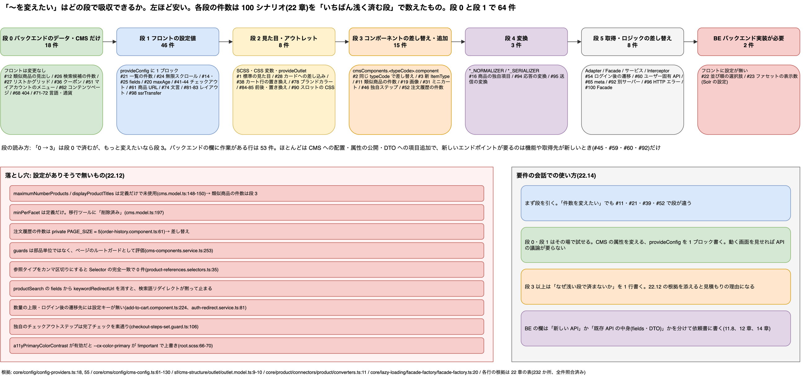

# 22. カスタマイズシナリオ 100: その要件はどの段で吸収できるか

> **図**: 21 カスタマイズの 7 段と 100 シナリオの分布(`diagrams/spartacus-architecture.drawio`)。左から安い順に 段 0(バックエンドのデータ・CMS 設定だけ)→ 段 1(フロントの設定値)→ 段 2(見た目・アウトレット)→ 段 3(コンポーネント差し替え)→ 段 4(変換)→ 段 5(取得・ロジック差し替え)→ BE(バックエンド実装が要る)。各段の件数と代表例、設定キーが無くてコードを書くしかない落とし穴



> **この章が答える問い**: 「〜を変えたい」という要件が出たとき、それはバックエンドのデータだけで済むのか、フロントの設定 1 行で済むのか、コンポーネントを書き換えるのか、新しい API が要るのか。よく出る要件 100 件について、どこを触ればよいかを本体のソースで示すと、どうなるか

> **位置づけ**: 11 章(カスタム CMS コンポーネント)、13 章(JSP からの移行)、15 章(Facade / Connector / Adapter)は「作る側」の手順を書いた。この章は逆向きに「要件 → 触る場所」を引く**索引**である。1 件ごとに段・フロントの作業・バックエンドの作業・根拠を 1 行で書き、詳しい仕組みは各章へ戻る

> **根拠の取り方**: クローン(v2612.0.0)を読み、各行の根拠は設定キー・クラス・トークンの**定義**の行を指す。表を短くするため、パスの先頭を次のように略す。`core/` = `core-libs/core/src/`、`sf/` = `core-libs/storefront/`、`styles/` = `core-libs/styles/`、`setup/` = `core-libs/setup/`、`fl/` = `feature-libs/`。根拠の行は全件、ファイルの存在と行数をスクリプトで照合した(22.13 の末尾)。デモ OCC での確認は 13 章・付録の範囲に限る

---

### 22.0 先に話し言葉で: 要件の 6 割は「書く」前に「設定する」で終わる

カスタマイズの相談は、だいたい「〜を変えたい」という形で来る。類似商品の件数を減らしたい、一覧を無限スクロールにしたい、チェックアウトのステップを 1 つ減らしたい、マイアカウントのメニューを増やしたい。どれも「新しい API を作る」「コンポーネントを一から書く」と考えがちだが、Spartacus は拡張点を段に分けて用意していて、多くは浅い段で吸収できる。

段は安い順に 7 つある。いちばん安いのは**バックエンドのデータや CMS の設定だけ**で済む場合で、フロントは何も変えない(類似商品の見出し、メニューの項目、404 ページ)。次が**フロントの設定値**で、`provideConfig` に 1 ブロック書けば終わる(一覧の件数、無限スクロール、チェックアウトのステップ)。その次が**見た目**(SCSS・CSS 変数)と**アウトレット**(既存の画面の前後や中に部品を差し込む)。ここまではコンポーネントのコードに手を入れない。

その先が**コンポーネントの差し替え**(同じ `typeCode` に自作のコンポーネントを登録する)、**変換**(API の JSON をフロントのモデルに直す Normalizer、逆向きの Serializer)、**取得とロジックの差し替え**(Adapter・Facade・サービス)と続く。最後が**バックエンドの実装が要る**場合で、フロントに設定が無く、API そのものが足りないときだけここに来る。

100 件を数えると、段 0 と段 1 だけで 3 分の 2 近くになる(22.13)。逆に「設定がありそうで無い」ものもある。注文履歴の件数はコードに 5 と書かれていて、設定では変えられない。類似商品の `maximumNumberProducts` は CMS 属性として定義されているのに、どこからも読まれていない。こういう落とし穴は 22.12 に集めた。要件が来たら、まずこの表で段を引き、浅い段から試す。

---

## 22.1 7 つの段

| 段 | 名前 | 触る場所 | 代表的な書き方 | 根拠 |
|---|---|---|---|---|
| **0** | バックエンドのデータ・CMS 設定だけ | Backoffice / ImpEx(CMS 属性、スロット配置、ナビゲーション、BaseStore) | フロントは変更なし | `core/occ/adapters/cms/converters/occ-cms-page-normalizer.ts:166`(CMS 属性は変換されずに State へ入る) |
| **1** | フロントの設定値 | `provideConfig` / `provideDefaultConfig` | `provideConfig({ view: { defaultPageSize: 24 } })` | `core/config/config-providers.ts:18, 55` |
| **2** | 見た目・アウトレット | SCSS 変数、CSS 変数、`provideOutlet`、`cxOutletRef` | `provideOutlet({ id, position: OutletPosition.AFTER, component })` | `sf/cms-structure/outlet/outlet.model.ts:9-10`、`sf/cms-structure/outlet/outlet.providers.ts:41` |
| **3** | コンポーネントの差し替え・追加 | `cmsComponents.<typeCode>.component`、`launch` 設定、DI | `cmsComponents: { ProductImagesComponent: { component: MyImages } }` | `core/cms/config/cms-config.ts:61, 130` |
| **4** | 変換 | `*_NORMALIZER` / `*_SERIALIZER` の multi provider | `{ provide: PRODUCT_NORMALIZER, useClass: MyNormalizer, multi: true }` | `core/product/connectors/product/converters.ts:11`、`core/util/converter.service.ts:35` |
| **5** | 取得・ロジックの差し替え | Adapter / Facade / サービスの `provide` 上書き、`HttpInterceptor` | `{ provide: ProductReferencesAdapter, useClass: MyAdapter }` | `core/product/connectors/references/product-references.adapter.ts:10`、`core/lazy-loading/facade-factory/facade-factory.ts:20` |
| **BE** | バックエンドの実装が要る | OCC の DTO・Controller、Solr、外部連携 | フロントに設定が無く、API の中身を変えるしかない | 各行の根拠を参照 |

**読み方。** 表の「段」は、その要件を満たす**いちばん浅い段**である。「0 → 3」は「段 0 で済むが、もっと変えたいなら段 3」の意味。バックエンドの欄が「なし」以外なら、段にかかわらずバックエンドの作業が要る。

---

## 22.2 CMS コンポーネント全般(1〜10)

| # | 要件 | 段 | フロントが書くもの | バックエンドの作業 | 根拠 |
|---|---|---|---|---|---|
| 1 | 標準コンポーネントの見た目だけ変える | 2 | CSS 変数(`--cx-color-primary` など)か `%cx-*` プレースホルダを上書き。標準スタイルを丸ごと外すなら `$skipComponentStyles` | なし | `styles/scss/_components.scss:7`、`styles/scss/theme/santorini/_variables.scss:182` |
| 2 | 標準コンポーネントを、同じ `typeCode` のまま自作に差し替える | 3 | `cmsComponents.<typeCode>.component` に自作クラス | なし | `core/cms/config/cms-config.ts:61, 130` |
| 3 | 新しい ItemType のコンポーネントを追加する | 3 | `cmsComponents` に新しい `typeCode`、コンポーネントで `CmsComponentData<T>.data$` を読む(11 章) | ItemType、cmsocc での公開、スロットへの配置 | `core/cms/config/cms-config.ts:130`、`sf/cms-structure/page/model/cms-component-data.ts:10` |
| 4 | API の応答より先に初期データを出す、API に無い UI 用の値を足す | 1 | `cmsComponents.<typeCode>.data`(CMS データとマージされる) | なし | `core/cms/config/cms-config.ts:85`、`sf/cms-structure/services/cms-components.service.ts:219` |
| 5 | 既存コンポーネントに CMS 属性を足して表示する | 3 | モデルの interface に属性を足し、テンプレートで読む。**変換は不要**(コンポーネント用の Normalizer は既定で登録されていない) | 属性の追加と cmsocc での公開 | `core/model/cms.model.ts:7`、`core/occ/adapters/cms/converters/occ-cms-page-normalizer.ts:166`、`core/cms/connectors/component/converters.ts:11` |
| 6 | 新しい ItemType を作らずに、コードだけのコンポーネントを置く | 3 | `cmsComponents` のキーに `flexType` の値を登録 | `CMSFlexComponent` を配置し、`flexType` を設定 | `core/occ/adapters/cms/converters/occ-cms-page-normalizer.ts:151`、`core/cms/config/cms-config.ts:43` |
| 7 | コンポーネントのある画面をガードで守る | 1 | `cmsComponents.<typeCode>.guards: [MyGuard]` | なし | `core/cms/config/cms-config.ts:77`、`sf/cms-structure/services/cms-components.service.ts:253`、`sf/cms-structure/services/cms-guards.service.ts:36` |
| 8 | 特定のコンポーネントを SSR で描かない | 1 | `cmsComponents.<typeCode>.disableSSR: true` | なし | `core/cms/config/cms-config.ts:75`、`sf/cms-structure/services/cms-components.service.ts:187` |
| 9 | コンポーネントのコードを遅延ロードする、画面外なら描画を遅らせる | 1 | `featureModules.<name>: { module: () => import(...), cmsComponents: [...] }`、または `deferLoading` | なし | `core/cms/config/cms-config.ts:92, 96, 109` |
| 10 | コンポーネントに子ルートや翻訳チャンクを持たせる | 1 | `childRoutes`、`i18nKeys` | なし | `core/cms/config/cms-config.ts:74, 76`、`sf/cms-structure/services/cms-components.service.ts:205` |

- **7 の注意。** `guards` はコンポーネント単位の表示制御ではない。ページ上の全 `typeCode` の `guards` を集めて、CMS ページのルートの `canActivate` として評価する。失敗するとページ遷移そのものが止まる。コンポーネントだけ隠したいなら、コンポーネント内の条件分岐か、バックエンドの CMS Restriction を使う。
- **5 の補足。** バックエンドが属性を返しさえすれば、フロントは変換なしで `data$` から読める。11 章の依頼書で「属性名と型」だけ渡せばよい理由がこれである。

---

## 22.3 商品詳細ページ(11〜20)

| # | 要件 | 段 | フロントが書くもの | バックエンドの作業 | 根拠 |
|---|---|---|---|---|---|
| 11 | 類似商品の取得件数を絞る | 3 | `ProductReferencesComponent` を差し替え、`loadProductReferences(code, type, pageSize)` に件数を渡す(表示だけなら `slice` でも可) | なし(OCC は `pageSize` に従う) | `core/product/facade/product-reference.service.ts:24`、`sf/cms-components/product/carousel/product-references/product-references.component.ts:80`、`core/occ/adapters/product/occ-product-references.adapter.ts:41` |
| 12 | 類似商品の見出しを変える | 0 | なし(CMS の `title` を表示している) | `ProductReferencesComponent` の `title` | `core/model/cms.model.ts:147`、`sf/cms-components/product/carousel/product-references/product-references.component.ts:67` |
| 13 | 参照タイプ(ACCESSORIES など)を増やす | 0 → 3 | なし。タイプごとにコンポーネントを 1 つ置く。1 つのカルーセルにまとめたいなら差し替え | `productReferenceTypes` を設定したコンポーネントの追加、商品参照データの登録 | `core/model/cms.model.ts:151`、`core/product/store/selectors/product-references.selectors.ts:35` |
| 14 | 商品詳細で取る項目を増やす | 1 | `backend.occ.endpoints.product.details` の `fields` を上書き | 項目が WsDTO に無ければ追加 | `core/occ/adapters/product/default-occ-product-config.ts:18` |
| 15 | 一部の項目だけを別のスコープで取る | 1 | `endpoints.product.<scope>` と `loadingScopes.product.<scope>` を定義し、`getProduct(code, '<scope>')` で読む | なし | `core/product/model/product-scope.ts:7`、`core/occ/config/loading-scopes-config.ts:14`、`core/occ/adapters/product/occ-product.adapter.ts:54`、`sf/cms-components/product/current-product.service.ts:27` |
| 16 | 商品データから独自の項目を組み立てる | 4 | `PRODUCT_NORMALIZER` に multi で追加し、`Product` をモジュール拡張 | なし(元データが返っていること) | `core/product/connectors/product/converters.ts:11` |
| 17 | 在庫やカート追加の周りの表示を変える | 0 → 2 | 在庫数の表示は CMS 属性だけで切り替わる。部品の追加は `ProductDetailOutlets` のアウトレット。ボタン自体は `ProductAddToCartComponent` の差し替え(段 3) | `inventoryDisplay` 属性 | `core/model/cms.model.ts:201`、`sf/cms-components/product/product-outlets.model.ts:7`、`fl/cart/base/components/add-to-cart/add-to-cart.module.ts:37` |
| 18 | タブを追加する | 0 → 3 | 既存の部品ならなし。新しい部品なら `cmsComponents` に登録。見出しは翻訳キー | `CMSTabParagraphContainer` の `components` に uid を足す | `sf/cms-components/content/tab-paragraph-container/tab-paragraph-container.module.ts:33`、`sf/cms-components/content/tab-paragraph-container/tab-paragraph-container.component.ts:106, 123` |
| 19 | 商品画像のギャラリーを作り替える | 3 | `cmsComponents.ProductImagesComponent.component` | なし | `sf/cms-components/product/product-images/product-images.module.ts:32` |
| 20 | 価格や在庫を一定時間で取り直す、イベントで取り直す | 1 | `backend.loadingScopes.product.<scope>.maxAge`(秒)/ `reloadOn: [イベント]` | なし | `core/occ/config/loading-scopes-config.ts:18, 22`、`core/occ/services/loading-scopes.service.ts:64` |

- **11 の注意。** 標準コンポーネントは `pageSize` を渡さない。Effect・Connector・Adapter は `pageSize` を受け取れるので、差し替えるのはコンポーネント 1 つで済む。CMS 属性の `maximumNumberProducts` は使えない(22.11)。
- **13 の注意。** Selector は参照タイプを完全一致で絞る。1 つの属性に `SIMILAR,ACCESSORIES` と書くと、OCC はデータを返すのに画面には 1 件も出ない。
- **20 の注意。** `maxAge` は秒で書き、内部で 1000 倍される。期限切れによる取り直しはブラウザでだけ動く(`core/product/services/product-loading.service.ts:159`)。

---

## 22.4 検索・商品一覧(21〜30)

| # | 要件 | 段 | フロントが書くもの | バックエンドの作業 | 根拠 |
|---|---|---|---|---|---|
| 21 | 1 ページの件数を変える | 1 | `view.defaultPageSize`(URL に `pageSize` があればそちらが優先) | なし | `sf/shared/config/view-config.ts:19`、`sf/cms-components/product/product-list/container/product-list-component.service.ts:197` |
| 22 | 並び順の選択肢や初期の並び順を変える | BE | 専用の設定は無い。初期値だけなら `ProductListComponentService` を差し替える(段 5)。表示名は翻訳 | Solr のソート設定(選択肢は検索結果の `sorts` として返る) | `sf/cms-components/product/product-list/container/product-list-component.service.ts:199`、`sf/shared/components/list-navigation/sorting/sorting.component.ts:51` |
| 23 | ファセットの初期表示数を変える | BE | 専用の設定は無い。フロントで変えるなら `FacetService` を差し替える(段 5) | Solr ファセットの表示件数 | `sf/cms-components/product/product-list/product-facet-navigation/services/facet.service.ts:27, 113` |
| 24 | 一覧を無限スクロールにする | 1 | `view.infiniteScroll: { active, productLimit, showMoreButton }` | なし | `sf/shared/config/view-config.ts:20`、`sf/cms-components/product/product-list/container/product-list.component.ts:65` |
| 25 | 検索結果で取る項目を増やす | 1 | `backend.occ.endpoints.productSearch.default` の `fields` を上書き | 項目が WsDTO に無ければ追加 | `core/occ/adapters/product/default-occ-product-config.ts:37` |
| 26 | 検索ボックスの候補件数、商品候補の表示を変える | 0 | なし。フロントで固定するなら `<cx-searchbox [config]>` かコンポーネントの差し替え | `SearchBoxComponent` の属性(`maxProducts`、`maxSuggestions`、`displayProducts` など) | `sf/cms-components/navigation/search-box/search-box.model.ts:7`、`sf/cms-components/navigation/search-box/search-box.component.ts:61, 251` |
| 27 | 一覧の初期表示をリストかグリッドにする | 0 | なし(ページテンプレート名で決まる) | ページテンプレートを `ProductGridPageTemplate`(グリッド)かそれ以外(リスト)にする | `sf/cms-components/product/product-list/container/product-list.component.ts:72` |
| 28 | 一覧の商品カードに部品を足す、カードを作り替える | 2 → 3 | `ProductListOutlets.ITEM_ACTIONS` / `ITEM_DETAILS` に差し込む。全面的に変えるなら `ProductListItemComponent` / `ProductGridItemComponent` を DI で差し替え | なし | `sf/cms-components/product/product-outlets.model.ts:13`、`sf/cms-components/product/product-list/product-list-item/product-list-item.component.ts:60` |
| 29 | 検索語で特定のページへ飛ばす | 0 | なし(Adapter が `keywordRedirectUrl` を受けると遷移する) | Solr のキーワードリダイレクト | `core/occ/adapters/product/occ-product-search.adapter.ts:60`、`core/occ/adapters/product/default-occ-product-config.ts:39` |
| 30 | カテゴリページの取得内容を変える | 1 | `productSearch` の `fields` を上書き。カテゴリの絞り込みはクエリ `:relevance:allCategories:<code>` で組み立てられる | Solr のインデックスとファセット | `core/occ/adapters/product/default-occ-product-config.ts:37`、`sf/cms-components/product/product-list/container/product-list-component.service.ts:41` |

- **25 の注意。** `fields` を上書きするときは `keywordRedirectUrl` を残す。消すと 29 のリダイレクトが黙って止まる。
- **30 の補足。** カテゴリページは `productSearchByCategory` を使っていない。このエンドポイントを使うのは商品カルーセルだけである。

---

## 22.5 カート(31〜40)

| # | 要件 | 段 | フロントが書くもの | バックエンドの作業 | 根拠 |
|---|---|---|---|---|---|
| 31 | ミニカートの表示を変える | 3 | `cmsComponents.MiniCartComponent.component`(データは `MiniCartComponentService` から) | なし | `fl/cart/base/components/mini-cart/mini-cart.module.ts:31`、`fl/cart/base/components/mini-cart/mini-cart-component.service.ts:40` |
| 32 | カート追加後のダイアログを変える | 3 | `launch.ADDED_TO_CART.component` を自作に | なし | `fl/cart/base/components/added-to-cart-dialog/default-added-to-cart-layout.config.ts:12`、`fl/cart/base/root/models/augmented.model.ts:12` |
| 33 | 数量の上限や刻みを変える | 3 | 設定キーは無い。`ItemCounterComponent` の `max` は `AddToCartComponent` が在庫数から入れるので、変えるならコンポーネントを差し替えるか継承する | 在庫数(`stockLevel`) | `sf/shared/components/item-counter/item-counter.component.ts:58`、`fl/cart/base/components/add-to-cart/add-to-cart.component.ts:224` |
| 34 | カートの行に独自の属性を出す | 1 + 2 | `endpoints.cart` の `fields` に足し、`CartOutlets.ITEM_DETAILS` に差し込む | 属性が DTO に無ければ追加 | `fl/cart/base/occ/config/default-occ-cart-config-factory.ts:17`、`fl/cart/base/root/models/cart-outlets.model.ts:13` |
| 35 | 保存カートを使えるようにする | 1 | `SavedCartRootModule` を入れる(schematics でも可) | 保存カート用の CMS コンポーネントとページ | `fl/cart/saved-cart/root/saved-cart-root.module.ts:34` |
| 36 | クーポン入力を出す、消す | 0 | なし | `CartApplyCouponComponent` をカートページのスロットに置く、外す | `fl/cart/base/components/cart-coupon/cart-coupon.module.ts:43` |
| 37 | チェックアウト前にカートを検証する | 1 | `cart.validation.enabled: true`(既定は false) | なし(OCC 標準) | `fl/cart/base/root/config/cart-config.ts:21`、`fl/cart/base/root/config/default-cart-config.ts:12`、`fl/cart/base/core/guards/cart-validation.guard.ts:29` |
| 38 | カートの行をまるごと作り替える | 2 | `CartOutlets.ITEM` を `REPLACE` で差し替え | なし | `fl/cart/base/root/models/cart-outlets.model.ts:11`、`fl/cart/base/components/cart-shared/cart-item/cart-item.component.html:2` |
| 39 | クイックオーダーの行数上限を変える | 0 | 検索候補の件数は `quickOrder.searchForm.maxProducts`(段 1) | `QuickOrderComponent` の `quickOrderListLimit` | `fl/cart/quick-order/components/quick-order/quick-order-list.module.ts:58`、`fl/cart/quick-order/root/config/quick-order-config.ts:15` |
| 40 | カートで取る項目を増やす | 1 | `backend.occ.endpoints.cart` / `carts` の `fields` を上書き | 項目が DTO に無ければ追加 | `fl/cart/base/occ/config/default-occ-cart-config-factory.ts:15, 17` |

- **36 の注意。** CMS の `typeCode` は `CartApplyCouponComponent` である。`CartCouponComponent` はフロントのクラス名で、CMS では使わない。

---

## 22.6 チェックアウト(41〜50)

| # | 要件 | 段 | フロントが書くもの | バックエンドの作業 | 根拠 |
|---|---|---|---|---|---|
| 41 | ステップの順番を変える、ステップを減らす | 1 | `checkout.steps`(配列の順が表示順。外すか `disabled: true`) | なし | `fl/checkout/base/root/config/checkout-config.ts:27`、`fl/checkout/base/root/config/default-checkout-config.ts:12` |
| 42 | 配送方法の初期選択を変える | 1 | `checkout.defaultDeliveryMode`(`FREE` / `LEAST_EXPENSIVE` / `MOST_EXPENSIVE` か配送コード) | 配送方法の定義 | `fl/checkout/base/root/config/checkout-config.ts:35`、`fl/checkout/base/root/config/default-checkout-config.ts:39` |
| 43 | ゲスト購入を許す | 1 | `checkout.guest: true` | なし(OCC 標準) | `fl/checkout/base/root/config/checkout-config.ts:39`、`fl/checkout/base/components/services/checkout-config.service.ts:24` |
| 44 | 既定の住所と支払いで一気に確認画面へ進める | 1 | `checkout.express: true` | なし(利用者に既定の住所と支払い方法が要る) | `fl/checkout/base/root/config/checkout-config.ts:31`、`fl/checkout/base/components/services/express-checkout.service.ts:30` |
| 45 | B2B の支払い種別(請求書払い)を入れる | 1 | B2B チェックアウトを入れる(先頭に支払い種別のステップが足される) | b2bocc の支払い種別 API、コストセンター | `fl/checkout/b2b/root/config/default-b2b-checkout-config.ts:15`、`fl/checkout/b2b/occ/config/default-occ-checkout-b2b-config.ts:23` |
| 46 | 独自のステップを足す | 3 | `CheckoutStepType` をモジュール拡張 → `checkout.steps` に追加 → ルート追加 → CMS ページと自作コンポーネント | 独自データを保存するなら API | `fl/checkout/base/root/model/checkout-step.model.ts:7`、`fl/checkout/b2b/root/model/augmented-types.ts:23`、`fl/checkout/base/root/config/default-checkout-routing-config.ts:14` |
| 47 | 注文確認ページに表示を足す | 3 | 注文確認用の CMS コンポーネントを差し替えるか、自作をスロットに足す(専用のアウトレットは無い) | スロットへの配置。注文 DTO に属性が無ければ追加 | `fl/order/components/order-confirmation/order-confirmation.module.ts:72`、`fl/order/root/model/order-outlets.model.ts:10` |
| 48 | 住所フォームに項目を足す | 3 + 4 | `AddressFormComponent` を差し替えて項目を足し、`ADDRESS_SERIALIZER` / `ADDRESS_NORMALIZER` で変換 | Address の DTO と WsDTO に項目を追加 | `core/user/connectors/address/converters.ts:12, 20`、`fl/user/profile/components/address-book/address-form/address-form.component.ts:173` |
| 49 | 住所を検証して候補を出す | 0 | なし(フォームが検証 API を呼び、結果が REVIEW なら候補ダイアログを出す) | 住所検証サービス(外部連携) | `fl/user/profile/components/address-book/address-form/address-form.component.ts:479`、`core/occ/adapters/user/default-occ-user-config.ts:21` |
| 50 | 注文前に利用規約への同意を求める | 0 | なし(標準で必須)。必須をやめるなら `CheckoutPlaceOrderComponent` の差し替え | 利用規約のコンテンツページ | `fl/checkout/base/components/checkout-place-order/checkout-place-order.component.ts:77`、`sf/cms-structure/routing/default-routing-config.ts:75` |

- **44 の注意。** `express`・`guest`・`defaultDeliveryMode` は `checkout.flows` があるとそちらで上書きされる(`fl/checkout/base/components/services/checkout-config.service.ts:33`)。ゲストのカートでは express は効かない。
- **46 の注意。** 完了チェックのガードは、知らないステップ型を「完了済み」として通す(`fl/checkout/base/components/guards/checkout-steps-set.guard.ts:106`)。独自ステップを飛ばせないようにするには、ガードも拡張する。
- **48 の注意。** `ADDRESS_SERIALIZER` には標準の実装が無く、素通しになる。チェックアウトの配送先住所でも同じトークンを使うので、1 か所の変換で両方に効く。

---

## 22.7 アカウント・認証(51〜60)

| # | 要件 | 段 | フロントが書くもの | バックエンドの作業 | 根拠 |
|---|---|---|---|---|---|
| 51 | マイアカウントのメニューに項目を足す | 0 | 遷移先が既存ページならなし。新しいページなら `routing.routes.<name>.paths` | ナビゲーションノードと `CMSLinkComponent` の追加 | `sf/cms-components/navigation/navigation/navigation.module.ts:35`、`sf/cms-components/navigation/navigation/navigation.service.ts:21` |
| 52 | 注文履歴の 1 ページ件数を変える | 3 | 設定キーは無い。`AccountOrderHistoryComponent` を差し替え、`getOrderHistoryList(pageSize)` に件数を渡す | なし | `fl/order/components/order-history/order-history.component.ts:61`、`fl/order/root/facade/order-history.facade.ts:70` |
| 53 | 会員登録フォームに項目を足す | 3 + 4 | `RegisterComponent` を差し替え、`UserSignUp` をモジュール拡張し、`USER_SIGN_UP_SERIALIZER` で変換 | 登録 API の DTO と Customer モデルに項目を追加 | `fl/user/profile/components/register/register.component.ts:75`、`fl/user/profile/core/connectors/converters.ts:24`、`fl/user/profile/root/model/user-profile.model.ts:33` |
| 54 | ログイン後の遷移先を変える | 5 | `AuthRedirectService.redirect()` を上書きするか、`AuthRedirectStorageService.setRedirectUrl()` で先に入れておく | なし | `core/auth/user-auth/services/auth-redirect.service.ts:81`、`core/auth/user-auth/services/auth-redirect-storage.service.ts:40` |
| 55 | OAuth のクライアントやトークンの取得先を変える | 1 | `authentication.client_id` / `client_secret` / `baseUrl` / `tokenEndpoint` / `revokeEndpoint` | OAuth クライアントの登録(スコープ、有効期限) | `core/auth/user-auth/config/auth-config.ts:36, 41, 53, 57`、`core/auth/user-auth/config/default-auth-config.ts:50` |
| 56 | 匿名利用者向けの同意バナーを出す | 0 + 1 | `anonymousConsents.registerConsent` / `requiredConsents` など | ConsentTemplate の登録、バナー用 CMS コンポーネントの配置 | `core/anonymous-consents/config/anonymous-consents-config.ts:15, 28`、`sf/cms-components/anonymous-consent-management/anonymous-consent-management.module.ts:34` |
| 57 | 代理操作(ASM)を使えるようにする | 1 | ASM の機能を入れ、`asm.agentSessionTimer` などを設定 | ASM 用の OAuth クライアント、エージェントの権限、CORS | `fl/asm/root/asm-root.module.ts:95`、`fl/asm/root/config/asm-config.ts:15`、`fl/asm/root/services/asm-enabler.service.ts:57` |
| 58 | 独自ページをログイン必須にする | 1 | `guards: [AuthGuard]`。サイト全体を閉じるなら `routing.protected: true` とルートごとの `protected: false` | なし | `core/auth/user-auth/guards/auth.guard.ts:22`、`core/routing/configurable-routes/config/routing-config.ts:39`、`core/routing/configurable-routes/routes-config.ts:47` |
| 59 | B2B の組織管理を入れる | 1 | 組織管理の機能と B2B 用の OCC 設定を入れる | B2B Commerce 拡張、B2B サイト、管理画面用の CMS コンポーネントとページ | `fl/organization/administration/root/administration-root.module.ts:64`、`setup/recipes/b2b/config/default-b2b-occ-config.ts:38` |
| 60 | ユーザー固有の独自 API を呼ぶ | 5 | `OccEndpoints` をモジュール拡張して `users/${userId}/...` を定義。Adapter で `buildUrl` に `userId` を渡す(15 章) | 独自 OCC API | `core/occ/occ-models/occ-endpoints.model.ts:21`、`core/occ/services/occ-endpoints.service.ts:111`、`core/auth/user-auth/facade/user-id.service.ts:57` |

- **52 の注意。** 件数は `private PAGE_SIZE = 5` と書かれている。private なので継承でも上書きできず、コンポーネントごと差し替えるしかない。
- **54 の注意。** 保存された遷移先が無いときはトップページ固定で、設定キーは無い。
- **57 の補足。** ASM の画面は URL に `?asm=true` を付けたときだけ起動する。

---

## 22.8 ルーティング・SEO(61〜70)

| # | 要件 | 段 | フロントが書くもの | バックエンドの作業 | 根拠 |
|---|---|---|---|---|---|
| 61 | 商品 URL の形を変える | 1 | `routing.routes.product.paths`(例: `'p/:productCode/:name'`) | URL に使う属性を足すなら商品の `fields` | `sf/cms-structure/routing/default-routing-config.ts:70`、`core/routing/configurable-routes/routes-config.ts:22` |
| 62 | CMS のコンテンツページを増やす | 0 | なし(最後のワイルドカードルートが CMS ページを引く) | ContentPage を作り `label`(URL)を付けて公開 | `sf/cms-structure/routing/cms-route/add-cms-route.ts:13`、`sf/cms-structure/guards/cms-page.guard.ts:26` |
| 63 | Angular 側に独自のルートを足す | 3 | `{ path: null, canActivate: [CmsPageGuard], component: PageLayoutComponent, data: { cxRoute: '<name>' } }` と `routing.routes.<name>.paths` | CMS で管理するなら ContentPage | `fl/asm/root/asm-root.module.ts:38`、`core/routing/configurable-routes/configurable-routes.service.ts:150` |
| 64 | URL のパラメータ名とデータの項目名を対応させる | 1 | `routing.routes.<name>.paramsMapping`(例: `{ productCode: 'code' }`) | なし | `core/routing/configurable-routes/routes-config.ts:36`、`sf/cms-structure/routing/default-routing-config.ts:72` |
| 65 | ページタイトルや meta description の作り方を変える | 5 | `PageMetaResolver` を継承した resolver を multi で登録 | タイトル・説明文のデータ | `core/cms/page/page-meta.resolver.ts:17`、`core/cms/page/page.resolvers.ts:31`、`core/cms/facade/page-meta.service.ts:32` |
| 66 | canonical URL の規則を変える | 1 | `pageMeta.canonicalUrl`(`forceTrailingSlash`、`forceHttps`、`forceWww`、`removeQueryParams`)。ページ種別ごとに変えるなら resolver(段 5) | なし | `core/cms/page/config/page-meta.config.ts:28, 43`、`core/cms/page/base-page-meta.resolver.ts:101` |
| 67 | 構造化データ(JSON-LD)を足す | 5 | `JSONLD_PRODUCT_BUILDER` か `SCHEMA_BUILDER` に multi で builder を追加 | 必要な商品属性 | `sf/cms-structure/seo/structured-data/builders/tokens.ts:15, 21`、`sf/cms-structure/seo/structured-data/structured-data.module.ts:36` |
| 68 | 404 ページの中身を変える | 0 | なし(パスを変えるときだけ `routing.routes.notFound.paths`) | `label` が `not-found` の ContentPage | `sf/cms-structure/routing/default-routing-config.ts:21`、`sf/cms-structure/guards/cms-page-guard.service.ts:107` |
| 69 | 外部サイトへの URL をハードリダイレクトにする | 1 | `ExternalRoutesModule.forRoot()` を入れ、`routing.internal` に内部の URL パターンを並べる | なし | `core/routing/external-routes/external-routes-config.ts:11, 18`、`core/routing/external-routes/external-routes.guard.ts:39` |
| 70 | パンくずの作り方を変える | 1 → 5 | Angular ルートなら `data.cxPageMeta.breadcrumb`。CMS ページは resolver の `resolveBreadcrumbs` を上書き(段 5) | ページタイトルのデータ | `core/cms/page/routing/route-page-meta.model.ts:21`、`core/cms/page/page.resolvers.ts:53`、`core/cms/model/page.model.ts:80` |

- **68 の補足。** 専用の 404 コンポーネントは無い。ガードが `notFound` の CMS ページを、要求された URL のまま表示する。
- **69 の補足。** `ExternalRoutesModule` は既定では入っていない。明示して import する。

---

## 22.9 サイトコンテキスト・翻訳・テーマ(71〜80)

| # | 要件 | 段 | フロントが書くもの | バックエンドの作業 | 根拠 |
|---|---|---|---|---|---|
| 71 | 言語を増やす | 0 | なし(起動時に BaseStore の言語一覧から設定が作られる)。固定するなら `context.language` | BaseStore に言語を追加し、ローカライズデータを用意 | `core/site-context/config/site-context-config.ts:15`、`core/site-context/config/config-loader/site-context-config-initializer.ts:82` |
| 72 | 通貨を増やす | 0 | なし。固定するなら `context.currency` | BaseStore に通貨を追加し、価格を用意 | `core/site-context/providers/context-ids.ts:8`、`core/site-context/config/config-loader/site-context-config-initializer.ts:86` |
| 73 | URL にサイト・言語・通貨を含める、外す | 1 | `context.urlParameters`(外すなら `[]`) | なし(CDN や SSR の URL 設計は別に要る) | `core/site-context/config/site-context-config.ts:16`、`core/site-context/services/site-context-url-serializer.ts:31` |
| 74 | 画面の文言を変える | 1 | `i18n.resources.<言語>.<チャンク>.<キー>` を上書き | なし | `core/i18n/config/i18n-config.ts:18, 78` |
| 75 | 翻訳を外部ファイルから読む、遅延ロードする | 1 | `i18n.backend.loadPath` か `i18n.backend.loader`、`i18n.chunks` | 外部ファイルを置くなら配信先 | `core/i18n/config/i18n-config.ts:30, 51, 68, 88` |
| 76 | 日付や数値の書式を変える | 1 | `cxDate` / `cxNumeric` パイプの `format` 引数。ロケールデータを `registerLocaleData` で登録 | なし | `core/i18n/date.pipe.ts:14`、`core/i18n/numeric.pipe.ts:13` |
| 77 | テーマを切り替えられるようにする | 1 | `siteTheme.optionalThemes`。固定するなら `context.theme` | CMS 側のテーマを使うときだけ BaseSite の `theme` と機能フラグ | `core/site-theme/config/site-theme-config.ts:15`、`core/site-theme/services/site-theme-initializer.ts:102`、`core/features-config/feature-toggles/config/feature-toggles.ts:670` |
| 78 | ブランドカラーを変える | 2 | SCSS の `$primary` などを `!default` より前で上書き、または CSS 変数 `--cx-color-primary` | なし | `styles/scss/theme/sparta/_variables.scss:27`、`styles/scss/root.scss:5` |
| 79 | アイコンを差し替える | 1 | `icon.symbols`、`icon.resources` | なし | `sf/cms-components/misc/icon/icon.model.ts:82, 103, 112` |
| 80 | 1 つのフロントで複数のベースサイトを出す | 1 | `context.baseSite`、`context.urlParameters` | BaseSite の URL パターン(静的に指定しなければ起動時に読む) | `core/site-context/config/site-context-config.ts:16`、`core/site-context/config/config-loader/site-context-config-initializer.ts:80` |

- **76 の注意。** ロケールは独立した設定ではなく、選択中の言語がそのまま使われる。ロケールデータが未登録だと英語の書式に戻り、警告が出る。
- **77 の補足。** 優先順位は、静的な `context.theme`、利用者が選んだテーマ、CMS の BaseSite のテーマ、の順。CMS のテーマを使う機能フラグは既定で無効である。
- **78 の注意。** 機能フラグ `a11yPrimaryColorContrast` が有効だと、`--cx-color-primary` が `!important` 付きで上書きされる(`styles/scss/root.scss:69`)。`:root` に書いた主色が効かないときはここを疑う。
- **80 の注意。** 静的な設定が無く、今の URL に合う BaseSite も無いと、起動時に例外になる。

---

## 22.10 レイアウト・スロット・アウトレット(81〜90)

| # | 要件 | 段 | フロントが書くもの | バックエンドの作業 | 根拠 |
|---|---|---|---|---|---|
| 81 | 新しいページテンプレートを使う | 1 | `layoutSlots.<テンプレート名>.slots`(と `pageFold`) | PageTemplate と ContentSlot の position を作る | `sf/layout/config/layout-config.ts:30, 102`、`sf/recipes/config/layout-config.ts:55` |
| 82 | ブレークポイントを変える | 1 | `breakpoints` | なし | `sf/layout/config/layout-config.ts:100`、`sf/layout/config/default-layout.config.ts:10` |
| 83 | ヘッダーのスロットの並びを変える | 1 | `layoutSlots.header.lg.slots` と `layoutSlots.header.slots` | なし(スロットの中身は CMS) | `sf/recipes/config/layout-config.ts:33-46` |
| 84 | 既存の画面の前後に部品を足す | 2 | `provideOutlet({ id, position: OutletPosition.BEFORE / AFTER, component })`、または `<ng-template cxOutletRef cxOutletPos>` | なし | `sf/cms-structure/outlet/outlet.model.ts:9`、`sf/cms-structure/outlet/outlet.providers.ts:41`、`sf/cms-structure/outlet/outlet.directive.ts:33` |
| 85 | テンプレート・スロット・部品を置き換える | 2 | `OutletPosition.REPLACE`。名前はテンプレート名、スロットの position、部品の `flexType` | なし | `sf/cms-structure/outlet/outlet.model.ts:10`、`sf/cms-structure/page/page-layout/page-layout.component.html:4`、`sf/cms-structure/page/slot/page-slot.component.html:3, 9` |
| 86 | ファーストビューの外を後から描く | 1 | `deferredLoading.strategy`、`layoutSlots.<テンプレート名>.pageFold`。部品単位なら `deferLoading` | なし | `sf/layout/config/layout-config.ts:45, 109`、`core/cms/config/cms-config.ts:96` |
| 87 | API を呼ばずに部品を置く | 1 | `provideCmsStructure({ componentId, pageSlotPosition })`、または `cmsStructure` | なし | `core/cms/config/cms-structure.config.ts:80`、`sf/cms-structure/utils/cms-structure.util.ts:31`、`sf/recipes/config/static-cms-structure.ts:11` |
| 88 | ページごとにレイアウトを変える | 0 + 1 | テンプレートごとの `layoutSlots`。もっと細かく分けるなら `PageLayoutService` の拡張(段 5) | ページに別の PageTemplate を割り当てる | `sf/cms-structure/page/page-layout/page-layout.service.ts:29, 54` |
| 89 | 読み込み中にスケルトンを出す | 2 | 汎用の仕組みは無い。`.ghost` クラスと `--cx-color-ghost` を自前のテンプレートで使う。スロットの読み込み中は `cx-pending` クラス | なし | `styles/scss/layout/_ghost.scss:9, 15`、`sf/cms-structure/page/slot/page-slot.component.ts:85` |
| 90 | スロット単位で CSS を当てる | 2 | `cx-page-slot[position="X"]` か `.X` クラス、`.page-fold`、テンプレート名のクラス | なし | `sf/cms-structure/page/slot/page-slot.component.ts:62, 79, 140`、`sf/cms-structure/page/page-layout/page-template.directive.ts:46` |

- **82 の注意。** SCSS 側のブレークポイント(Bootstrap のグリッド変数)は別に管理されている。両方を揃える。
- **85 の注意。** スロットのアウトレット名は uid ではなく position、部品のアウトレット名は `typeCode` ではなく `flexType` である。
- **86 の補足。** 本体のレシピではグローバルの遅延描画がコメントアウトされている(`sf/recipes/config/layout-config.ts:28-31`)。

---

## 22.11 通信・状態・計測(91〜100)

| # | 要件 | 段 | フロントが書くもの | バックエンドの作業 | 根拠 |
|---|---|---|---|---|---|
| 91 | 接続先の OCC を変える | 1 | `backend.occ.baseUrl` / `prefix`、または `<meta name="occ-backend-base-url">` | なし | `core/occ/config/occ-config.ts:15, 46`、`core/occ/config/default-occ-config.ts:12`、`core/occ/config/config-from-meta-tag-factory.ts:12` |
| 92 | 一部のデータを別のサーバーから取る | 5 | `{ provide: ProductAdapter, useClass: MyAdapter }` など Adapter を差し替え | 別サーバーの API | `core/product/connectors/product/product.adapter.ts:11`、`core/product/connectors/references/product-references.adapter.ts:10`、`core/occ/adapters/product/product-occ.module.ts:35` |
| 93 | リクエストにヘッダーを足す | 5 | `HttpInterceptor` を `HTTP_INTERCEPTORS` に multi で登録 | 必要なら CORS の許可ヘッダー | `core/occ/adapters/site-context/site-context-occ.module.ts:27`、`fl/tracking/personalization/root/http-interceptors/index.ts:15` |
| 94 | 応答を変換して独自の形にする | 4 | `*_NORMALIZER` に multi で追加 | なし | `core/product/connectors/product/converters.ts:11`、`core/util/converter.service.ts:35` |
| 95 | 送信データを変換する | 4 | `*_SERIALIZER` に multi で追加 | 受け取る API が新しい項目を受け付けること | `core/user/connectors/address/converters.ts:20`、`core/product/connectors/reviews/converters.ts:15` |
| 96 | 特定の HTTP エラーの扱いを変える | 5 | `HttpErrorHandler` を継承し、`responseStatus` と `hasMatch` / `getPriority` を実装して multi で登録 | なし | `core/global-message/http-interceptors/handlers/http-error.handler.ts:15`、`core/global-message/http-interceptors/index.ts:24` |
| 97 | 画面上部のメッセージの表示時間を変える | 1 | `globalMessages.<種別>.timeout` | なし | `core/global-message/config/global-message-config.ts:12, 19`、`core/global-message/config/default-global-message-config.ts:13` |
| 98 | SSR で HTML に埋め込むストアを増やす | 1 | `state.ssrTransfer.keys.<枝>: StateTransferType.TRANSFER_STATE` | なし | `core/state/config/state-config.ts:26`、`core/product/store/product-store.module.ts:25` |
| 99 | 画面の操作を計測タグに送る | 1 | `tagManager.gtm.events: [イベント型]`。独自に送るなら `EventService.get(...)` を購読 | タグマネージャー側の設定 | `fl/tracking/tms/core/config/tms-config.ts:24, 42`、`core/event/event.service.ts:90` |
| 100 | 本体の Facade のロジックを替える | 5 | `{ provide: ActiveCartFacade, useClass: MyActiveCartService }` をアプリのルートで | なし | `fl/cart/base/root/facade/active-cart.facade.ts:16, 46`、`core/lazy-loading/facade-factory/facade-factory.ts:20`、`fl/cart/base/core/facade/facade-providers.ts:28` |

- **93 の補足。** 本体の `SiteContextInterceptor` が足すのはヘッダーではなく `lang` / `curr` のクエリパラメータである。ヘッダーを足す実例は personalization のインターセプタにある。
- **96 の注意。** エラー処理を差し込むトークンは独立していない。抽象クラス `HttpErrorHandler` そのものに multi で登録する。
- **97 の補足。** 設定できるのは種別ごとの表示時間だけ。見た目を変えるならコンポーネントの差し替え(段 3)。
- **100 の注意。** Facade の実装は遅延ロードされるモジュールが自分の provider と一緒に持ち込む。差し替えはアプリのルートの injector で行い、後から読まれる provider に上書きされないことを確かめる。

---

## 22.12 落とし穴: 「設定がありそうで無い」もの

要件の会話で「設定で変えられるはず」と言われやすいのに、実際には無いものを集めた。依頼書を書く前にここを確かめると、見積もりがずれない。

| 期待されがちなこと | 実際 | 対応する段 | 根拠 |
|---|---|---|---|
| 類似商品の `maximumNumberProducts` で件数が決まる | モデルに定義があるだけで、どこからも読まれていない。`displayProductTitles` / `displayProductPrices` も同じ | 3(#11) | `core/model/cms.model.ts:148-150` |
| ファセットの `minPerFacet` で初期表示数が決まる | モデルに定義があるだけ。移行ツールには「削除済み」と書かれている | BE / 5(#23) | `core/model/cms.model.ts:197`、`core-libs/schematics/src/migrations/test/component-deprecations/data/product-facet-navigation-component.migration.ts:28-29` |
| 注文履歴の件数は設定できる | `private PAGE_SIZE = 5` の固定値 | 3(#52) | `fl/order/components/order-history/order-history.component.ts:61` |
| `guards` で部品ごとに出し分けられる | ページ全体のルートガードとして評価される | 部品内の条件分岐か CMS Restriction(#7) | `sf/cms-structure/services/cms-components.service.ts:253` |
| 参照タイプはカンマ区切りで複数書ける | OCC は返すが、Selector の完全一致で 0 件になる | 0(部品を分ける)/ 3(#13) | `core/product/store/selectors/product-references.selectors.ts:35` |
| `fields` は好きに削ってよい | `keywordRedirectUrl` を消すと検索語リダイレクトが黙って止まる | 1(#25, #29) | `core/occ/adapters/product/default-occ-product-config.ts:39` |
| 数量の上限は設定できる | 設定は無く、在庫数から入る | 3(#33) | `fl/cart/base/components/add-to-cart/add-to-cart.component.ts:224` |
| ログイン後の遷移先は設定できる | 設定は無く、保存された URL かトップ | 5(#54) | `core/auth/user-auth/services/auth-redirect.service.ts:81` |
| 独自のチェックアウトステップは完了チェックされる | 知らないステップ型はガードを素通りする | 3 + ガード拡張(#46) | `fl/checkout/base/components/guards/checkout-steps-set.guard.ts:106` |
| `:root` に書いた主色が効く | 機能フラグが有効だと `!important` で上書きされる | 2(#78) | `styles/scss/root.scss:66-70` |
| 住所の Serializer は標準で何かしている | 標準の実装は無く素通し | 4(#48) | `core/user/connectors/address/converters.ts:20` |
| 読み込み中のスケルトンは自動で出る | 汎用の仕組みは無い | 2(#89) | `styles/scss/layout/_ghost.scss:15` |

---

## 22.13 集計: 100 件はどの段に落ちたか

「0 → 3」「1 + 2」のように 2 つ書いた行は、最初の段(いちばん浅く済む段)で数えた。

| 段 | 件数 | 例 |
|---|---|---|
| 0 バックエンドのデータ・CMS だけ | 18 | 類似商品の見出し、クーポン、メニュー、404、言語・通貨、リスト / グリッド |
| 1 フロントの設定値 | 46 | 一覧の件数、無限スクロール、チェックアウトのステップ、`fields`、ルート、遅延描画、ssrTransfer |
| 2 見た目・アウトレット | 8 | ブランドカラー、カードへの差し込み、カート行の置き換え、スロット単位の CSS |
| 3 コンポーネントの差し替え・追加 | 15 | 類似商品の件数、画像ギャラリー、ミニカート、注文履歴の件数、独自ステップ |
| 4 変換 | 3 | 商品の Normalizer、応答の変換、送信の変換 |
| 5 取得・ロジックの差し替え | 8 | ログイン後の遷移、ユーザー固有 API、meta、JSON-LD、別サーバー、HTTP エラー、Facade |
| BE バックエンドの実装が必要 | 2 | 並び順の選択肢、ファセットの表示数 |

段 0 と段 1 で 64 件になる。バックエンドの欄に作業がある行は 53 件あるが、そのほとんどは「CMS に置く」「属性を公開する」「DTO に項目を足す」で、**新しいエンドポイントが要るのは #45・#59・#60・#92 のように、機能そのものや取得先が新しい場合だけ**である。

根拠の照合は次のスクリプトで行った。略記を展開し、ファイルが存在し、引用した行番号がファイルの行数以内であることを全件確かめている。

```sh
grep -oE '`(core|sf|styles|setup|fl|core-libs)/[^`]+:[0-9][0-9, -]*`' 22-customization-scenarios.md \
  | sed -e 's/`//g' -e 's#^core/#core-libs/core/src/#' -e 's#^sf/#core-libs/storefront/#' \
        -e 's#^styles/#core-libs/styles/#' -e 's#^setup/#core-libs/setup/#' -e 's#^fl/#feature-libs/#'
```

---

## 22.14 要件の会話での使い方

- **要件が来たら、まず段を引く。** 「件数を変えたい」は #11・#21・#39・#52 で段が違う。同じ言葉でも、部品ごとに設定の有無が違うからである。
- **段 0 と段 1 は、その場で試せる。** CMS の属性を変える、`provideConfig` を 1 ブロック書く。動く画面を見せると、API を作るかどうかの議論が要らなくなる。
- **段 3 以上は「なぜ浅い段で済まないか」を 1 行書く。** 22.12 の根拠を添えると、見積もりの理由になる。
- **BE の欄は、新しい API なのか、既存 API の中身なのかを分ける。** 「DTO に項目を足す」は 12 章の `fields` の話で、「新しいエンドポイント」は 15 章の Adapter の話である。依頼書(11.8、14 章)にはこの区別を書く。

---

[目次](README.md) | ← [21. 状態管理の選択: NgRx(Store / Facade / Observable)と Signal(signal / computed / resource)](21-state-management.md) | [付録](appendix.md) →
