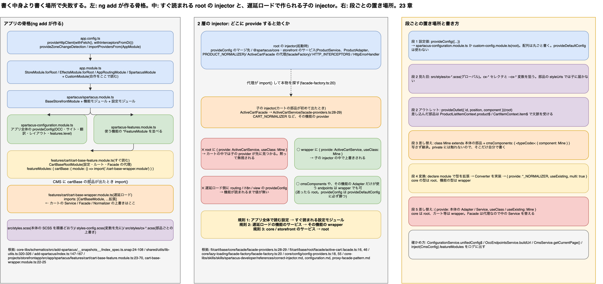

# 23. フロント側カスタマイズの実装ガイド: どのファイルに、何を、どう書くか

> **図**: 22 カスタマイズの置き場所(`diagrams/spartacus-architecture.drawio`)。左: `ng add` が作るアプリの骨格(`app.config.ts` → `AppModule` → `SpartacusModule` → 設定モジュール / 機能モジュール → 機能ごとの `*-feature.module.ts`(すぐ読む)と `*-wrapper.module.ts`(遅延ロード))。中: 「すぐ読まれる root の injector」と「遅延ロードされる子の injector」の 2 層と、上書きが効く場所・効かない場所。右: 段 1〜5 のカスタマイズを書くファイルの早見表



> **この章が答える問い**: 22 章で「段 1 の設定で済む」「段 3 の差し替えが要る」と分かったあと、実際にはアプリのどのファイルに、どんなコードを書けばよいのか。同じ `provide` を書いても効く場所と効かない場所があるのはなぜか

> **位置づけ**: 22 章は「要件 → 段」の索引だった。この章は「段 → ファイルとコード」の手引きである。11 章(カスタム CMS コンポーネントの雛形)と 15 章(Facade / Connector / Adapter の新規作成)は「新しく作る」話なので、この章は**本体の部品を設定・差し替え・拡張する**話に絞る。コード例は 22 章のシナリオ番号(#11 など)で引ける

> **根拠の取り方**: アプリの骨格は schematics のスナップショット(`core-libs/schematics/src/add-spartacus/__snapshots__/index_spec.ts.snap`)と、本体のサンプルアプリ(`projects/storefrontapp/src/app/spartacus/`)で確かめる。置き場所の規則は、本体に同梱されている開発者向けガイド(`core-libs/skills/skills/spartacus-developer/`、npm では `@spartacus/skills`)を一次資料にし、書かれていることをソースで裏付ける。API の名前と引数はクローン(v2612.0.0)で確かめた。ここに載せたコードは説明用の雛形で、アプリで動かして確かめたものではない

---

### 23.0 先に話し言葉で: 書く中身より、書く場所で失敗する

Spartacus のカスタマイズは、書くコード自体は短い。設定なら `provideConfig` のブロックを 1 つ、差し替えなら `{ provide: 元のクラス, useClass: 自分のクラス }` を 1 行書けば終わる。難しいのは**どのファイルに書くか**のほうで、正しいコードを書いても、置く場所が違うと黙って無視される。

理由は、Spartacus の機能の多くが**遅延ロード**されるからである。カート・チェックアウト・注文・ユーザーなどの機能は、その機能の CMS コンポーネントがページに出てきたときに初めて読み込まれ、そのとき**子の injector**が作られる。子の injector は自分の provider を持っているので、アプリの root に「カートのサービスをこれに替える」と書いても、カートの機能の中では子の provider が先に見つかり、root の上書きは使われない。

だから置き場所の規則は 3 つで足りる。**アプリ全体で読まれる設定は、すぐ読まれる設定モジュールに書く。遅延ロードされる機能のサービスを替えるときは、その機能のラッパーモジュールに書く。すぐ読まれる部分(`@spartacus/core` の商品など)のサービスを替えるときは root に書く。**この 3 つさえ守れば、あとは段ごとの書き方を覚えるだけである。

---

## 23.1 アプリの骨格: `ng add` が作るファイル

`ng add @spartacus/schematics` を実行すると、次のファイルができる。機能を足すたびに `features/` の下にフォルダが増える。

```text
src/
├─ styles.scss                         … Spartacus のスタイルを読み込む(順番が大事)
├─ styles-config.scss                  … スタイルの変数(styles.scss の先頭で読む)
└─ app/
   ├─ app.config.ts                    … provideHttpClient、provideZoneChangeDetection、AppModule の読み込み
   ├─ app.module.ts                    … StoreModule.forRoot、EffectsModule.forRoot、AppRoutingModule、SpartacusModule
   └─ spartacus/
      ├─ spartacus.module.ts           … BaseStorefrontModule + 下の 2 つ
      ├─ spartacus-configuration.module.ts … アプリ全体の provideConfig(OCC、サイト、翻訳、レイアウト)
      ├─ spartacus-features.module.ts  … 使う機能の *FeatureModule を並べる
      └─ features/
         ├─ cart/
         │  ├─ cart-base-feature.module.ts  … すぐ読む: CartBaseRootModule、featureModules の import()、翻訳
         │  └─ cart-base-wrapper.module.ts  … 遅延ロード: CartBaseModule と、その拡張
         └─ checkout/
            ├─ checkout-feature.module.ts
            └─ checkout-wrapper.module.ts
```

| ファイル | 役割 | 読まれる時期 | 根拠 |
|---|---|---|---|
| `app.config.ts` | `provideHttpClient(withFetch(), withInterceptorsFromDi())`、`importProvidersFrom(AppModule)` | 起動時 | `core-libs/schematics/src/add-spartacus/__snapshots__/index_spec.ts.snap:24-38` |
| `app.module.ts` | NgRx の root、`AppRoutingModule`、`SpartacusModule` | 起動時 | 同 `:40-53` |
| `spartacus.module.ts` | `BaseStorefrontModule`、機能モジュール、設定モジュールをまとめる | 起動時 | 同 `:55-72` |
| `spartacus-configuration.module.ts` | `provideConfig` で OCC の接続先、ベースサイト、翻訳、`features.level` | 起動時 | 同 `:74-108` |
| `features/<機能>/<名前>-feature.module.ts` | 機能の `*RootModule`(設定・ルート・Facade の代理)と、`featureModules` の `import()` | 起動時 | `core-libs/schematics/src/shared/utils/lib-utils.ts:320-326`、`projects/storefrontapp/src/app/spartacus/features/cart/cart-base-feature.module.ts:23-70` |
| `features/<機能>/<名前>-wrapper.module.ts` | 機能の本体モジュールと、その拡張・上書き | **その機能の CMS コンポーネントが初めて出たとき** | `projects/storefrontapp/src/app/spartacus/features/cart/cart-base-wrapper.module.ts:22-25`、`projects/storefrontapp/src/app/spartacus/features/checkout/checkout-wrapper.module.ts:30-33` |
| `styles.scss` / `styles-config.scss` | 本体の SCSS を順番どおりに読み込む。変数は先に読む | ビルド時 | `core-libs/schematics/src/add-spartacus/index.ts:147-167`、`projects/storefrontapp/src/styles-config.scss:1-2` |

`*-feature.module.ts` の中身はたとえば次のようになっている。`CART_BASE_FEATURE` の CMS コンポーネントが必要になったときに、`import()` でラッパーモジュールが読み込まれる。

```ts
// src/app/spartacus/features/cart/cart-base-feature.module.ts(サンプルアプリから抜粋)
@NgModule({
  imports: [CartBaseRootModule],                 // すぐ読む: 設定・ルート・Facade の代理
  providers: [
    provideConfig({
      featureModules: {
        [CART_BASE_FEATURE]: {
          module: () =>
            import('./cart-base-wrapper.module').then((m) => m.CartBaseWrapperModule),
        },
      },
    }),
  ],
})
export class CartBaseFeatureModule {}
```

根拠は `projects/storefrontapp/src/app/spartacus/features/cart/cart-base-feature.module.ts:23-35`。ミニカートとカート追加ボタンは、さらに別の遅延ロード単位になっている(同 `:36-55`)。

---

## 23.2 置き場所を決める規則

### 規則 1: アプリ全体で読まれる設定は、すぐ読まれるモジュールに書く

`provideConfig` は、置いたモジュールが読み込まれた時点で全体の設定にマージされる。遅延ロードされるモジュールに置くと、その機能が読まれるまで値が無い。ルーティング・翻訳・サイトコンテキスト・認証・`view`・レイアウトはアプリ全体で起動直後から読まれるので、必ずすぐ読まれる側に書く。逆に、`cmsComponents` の対応づけや、ある機能の Adapter だけが使うエンドポイントは、その機能の中だけで読まれるので、ラッパーモジュールに置いてもよい(`core-libs/skills/skills/spartacus-developer/references/configuration.md:11-19`)。

迷ったら、すぐ読まれる側に置けば必ず効く。`provideConfig` の値は、本体が `provideDefaultConfig` で入れた既定値より常に優先される(`core/config/config-providers.ts:18, 55`)。

### 規則 2: 遅延ロードされる機能のサービスは、その機能のラッパーモジュールで替える

遅延ロードされた機能は子の injector を作り、その中で `ActiveCartFacade → ActiveCartService` のような対応づけを自分で provide する(`fl/cart/base/core/facade/facade-providers.ts:28-29`)。root に `{ provide: ActiveCartService, useClass: ... }` と書いても、カートの機能の中では子の provider が先に見つかる。だから上書きは、その機能の本体モジュールと同じラッパーモジュールに書く(`core-libs/skills/skills/spartacus-developer/references/correct-injector.md:7-18`)。

### 規則 3: すぐ読まれる部分のサービスは root で替える

`@spartacus/core` の商品(`ProductService`、`ProductAdapter`、`PRODUCT_NORMALIZER`)や、`@spartacus/storefront` の部品は、`BaseStorefrontModule` と一緒にすぐ読まれる。これらの上書きは root(自分で作ったモジュールを `AppModule` か `SpartacusFeaturesModule` で import する)に書く。

### 早見表

| やりたいこと | 書くファイル | 22 章の例 |
|---|---|---|
| OCC の接続先、ベースサイト、言語、通貨、翻訳、ルート、`view`、レイアウト、認証 | `spartacus-configuration.module.ts`(または自作の設定モジュールを root で import) | #21, #24, #61, #73, #74, #81 |
| チェックアウト・カートの設定値(`checkout.*`、`cart.validation`) | 同上(機能の外からも読まれるので、すぐ読む側に置く) | #37, #41-44 |
| `cmsComponents` の差し替え・追加 | 自作の機能モジュール(root で import)。その機能専用ならラッパーでもよい | #2, #11, #19, #31 |
| アウトレット(`provideOutlet`) | 自作の機能モジュール(root で import) | #28, #34, #84 |
| `@spartacus/core` の商品まわりの Normalizer・Adapter・Service | 自作のモジュール(root で import) | #16, #92 |
| カート・チェックアウト・注文・ユーザーの Service・Facade・Normalizer | その機能の `*-wrapper.module.ts` | #48, #53, #100 |
| `HttpInterceptor`、`HttpErrorHandler` | 自作のモジュール(root で import) | #93, #96 |
| 本体の部品の見た目 | `src/styles/` の SCSS(グローバル) | #1, #78, #90 |

### 自作コードの置き場所(推奨)

本体が作るファイルには手を入れず、自分のコードは 1 か所にまとめると、`ng update` のときに差分が見やすい。

```text
src/app/custom/
├─ custom.module.ts                     … 下の各モジュールをまとめ、AppModule で import する
├─ config/custom-config.module.ts       … 段 1 の provideConfig(アプリ全体)
├─ product/
│  ├─ product-references/               … 段 3: 類似商品の差し替え
│  ├─ loyalty-points.normalizer.ts      … 段 4
│  └─ product-custom.module.ts
├─ outlets/                             … 段 2
└─ http/                                … 段 5: インターセプタ、エラー処理
src/styles/
├─ cx-mini-cart.scss                    … 本体の部品 1 つにつき 1 ファイル
└─ cx-product-references.scss
```

```ts
// src/app/app.module.ts
@NgModule({
  imports: [
    StoreModule.forRoot({}),
    EffectsModule.forRoot([]),
    AppRoutingModule,
    SpartacusModule,
    CustomModule,          // ← 自作のモジュールをまとめて root で読む
  ],
})
export class AppModule {}
```

---

## 23.3 段 0: バックエンドのデータ・CMS だけ

フロントのコードは書かない。CMS の属性(見出し、検索候補の件数、在庫の表示)、スロットへの配置、ナビゲーション、BaseStore の言語・通貨を変える。CMS の属性はフロントで変換されずにそのまま State に入る(`core/occ/adapters/cms/converters/occ-cms-page-normalizer.ts:166`)ので、バックエンドで値を変えれば次の画面遷移で反映される(7 章)。

フロント側で確かめるときは、今のページに CMS が何を置いたかをログに出す(`core-libs/skills/skills/spartacus-developer/references/cms-component-wiring.md:92-98`)。

```ts
// 確認用(どのコンポーネントでもよい。確かめたら消す)
inject(CmsService).getCurrentPage().subscribe((page) => console.log(page));
```

---

## 23.4 段 1: 設定値(`provideConfig`)

### 書く場所

`spartacus-configuration.module.ts` に足すか、`src/app/custom/config/custom-config.module.ts` を作って root で読む。どちらもすぐ読まれる。

```ts
// src/app/custom/config/custom-config.module.ts
import { NgModule } from '@angular/core';
import { OccConfig, provideConfig, RoutingConfig, I18nConfig } from '@spartacus/core';
import { LayoutConfig, ViewConfig } from '@spartacus/storefront';
import { CheckoutConfig, DeliveryModePreferences } from '@spartacus/checkout/base/root';
import { CartConfig } from '@spartacus/cart/base/root';

@NgModule({
  providers: [
    // #21 #24 一覧の件数と無限スクロール
    provideConfig(<ViewConfig>{
      view: {
        defaultPageSize: 24,
        infiniteScroll: { active: true, productLimit: 120, showMoreButton: true },
      },
    }),

    // #14 #25 取る項目を増やす。fields を書き換えるときは既定の文字列を写してから足す
    // #20 価格だけ 60 秒で取り直す
    provideConfig(<OccConfig>{
      backend: {
        occ: {
          endpoints: {
            product: {
              details:
                'products/${productCode}?fields=averageRating,stock(DEFAULT),description,availableForPickup,code,url,price(DEFAULT),numberOfReviews,manufacturer,categories(FULL),priceRange,multidimensional,tags,images(FULL),warrantyMonths',
            },
          },
        },
        loadingScopes: {
          product: { price: { maxAge: 60 } },
        },
      },
    }),

    // #61 #64 商品 URL の形
    provideConfig(<RoutingConfig>{
      routing: {
        routes: {
          product: {
            paths: ['p/:productCode/:name', 'product/:productCode'],
            paramsMapping: { productCode: 'code' },
          },
        },
      },
    }),

    // #74 文言の上書き(チャンク名 → キー)
    provideConfig(<I18nConfig>{
      i18n: {
        resources: {
          ja: { common: { searchBox: { placeholder: '商品名または品番で検索' } } },
        },
      },
    }),

    // #37 #43 #44 カート検証、ゲスト購入、エクスプレス
    provideConfig(<CartConfig>{ cart: { validation: { enabled: true } } }),
    provideConfig(<CheckoutConfig>{
      checkout: {
        guest: true,
        express: true,
        defaultDeliveryMode: [DeliveryModePreferences.LEAST_EXPENSIVE],
      },
    }),

    // #81 新しいページテンプレート(テンプレート名とスロットの position はバックエンドと揃える)
    provideConfig(<LayoutConfig>{
      layoutSlots: {
        MyCampaignPageTemplate: { pageFold: 'Section2', slots: ['Section1', 'Section2', 'Section3'] },
      },
    }),
  ],
})
export class CustomConfigModule {}
```

| 項目 | 根拠 |
|---|---|
| `view.defaultPageSize` / `infiniteScroll` | `sf/shared/config/view-config.ts:14-20` |
| `endpoints.product.details` の既定値 | `core/occ/adapters/product/default-occ-product-config.ts:18-19` |
| `loadingScopes.<モデル>.<スコープ>.maxAge`(秒) | `core/occ/config/loading-scopes-config.ts:18`、`core/occ/services/loading-scopes.service.ts:64` |
| `routing.routes.<名前>.paths` / `paramsMapping` | `core/routing/configurable-routes/routes-config.ts:22, 36` |
| `i18n.resources`(`common` チャンクの `searchBox.placeholder`) | `core/i18n/config/i18n-config.ts:78`、`core-libs/assets/src/translations/en/common.json:76-77` |
| `cart.validation.enabled` | `fl/cart/base/root/config/cart-config.ts:21` |
| `checkout.guest` / `express` / `defaultDeliveryMode` | `fl/checkout/base/root/config/checkout-config.ts:12, 31, 35, 39` |
| `layoutSlots` | `sf/layout/config/layout-config.ts:102` |

### 書くときの注意

- **配列は上書き、オブジェクトはマージ。** 設定はオブジェクトの中まで深くマージされるが、配列は丸ごと置き換わる(`core-libs/skills/skills/spartacus-developer/references/configuration.md:9`)。`checkout.steps` や `routing.routes.<名前>.paths` は、残したい要素も含めて全部書く。
- **`fields` の文字列も丸ごと置き換わる。** 既定の文字列を写してから項目を足す。`productSearch` では `keywordRedirectUrl` を消さない(22 章 #25)。
- **`provideDefaultConfig` はアプリで使わない。** 本体の既定値と同じ優先度になり、どちらが勝つかが provider の順番次第になる(同 `:58-85`)。

### 効いているかを確かめる

```ts
// 確認用: マージ後の設定全体
inject(ConfigurationService).unifiedConfig$.subscribe((c) => console.log(c.view, c.backend?.occ?.endpoints));
// 確認用: 実際に組み立てられる URL
console.log(inject(OccEndpointsService).buildUrl('product', { urlParams: { productCode: '1934793' }, scope: 'details' }));
```

`unifiedConfig$` は `core/config/services/configuration.service.ts:30`、`buildUrl` は `core/occ/services/occ-endpoints.service.ts:111` にある。

---

## 23.5 段 2: 見た目とアウトレット

### 本体の部品の見た目を変える(#1, #78, #90)

本体の部品は `styles` を持たず、`@spartacus/styles` のグローバル SCSS だけで見た目が決まっている。だから上書きもグローバル SCSS で書き、本体と同じ `cx-*` セレクタを狙う。部品を継承して `styleUrls` を足しても、Angular のカプセル化で子の `cx-*` 要素に届かない(`core-libs/skills/skills/spartacus-developer/references/styling.md:9-23`)。

```scss
// src/styles-config.scss … Spartacus の SCSS より前に読まれる変数
$useLatestStyles: true;
$primary: #1b2a4a;            // #78 SCSS 変数は !default より前で上書きする

// src/styles/cx-product-references.scss … 部品 1 つにつき 1 ファイル
cx-product-references {
  h4 { font-size: 0.875rem; }
  .price { color: var(--cx-color-primary); font-weight: 700; }
}

// src/styles/page-slots.scss … #90 スロット単位(position が属性とクラスに付く)
cx-page-slot[position='UpSelling'] { background: var(--cx-color-light); }
```

```scss
// src/styles.scss の末尾(本体の @import 群のあと)に足す
@import 'styles/cx-product-references';
@import 'styles/page-slots';

// CSS 変数で変えるなら :root に書く
:root {
  --cx-color-primary: #1b2a4a;
}
```

根拠: `styles/scss/theme/sparta/_variables.scss:27`(`$primary` の `!default`)、`styles/scss/root.scss:5`(SCSS 変数から `--cx-color-*` を作る)、`sf/cms-structure/page/slot/page-slot.component.ts:62, 140`(`position` の属性とクラス)。機能フラグ `a11yPrimaryColorContrast` が有効だと、`:root` の `--cx-color-primary` は `!important` で上書きされる(`styles/scss/root.scss:66-70`)。

### 既存の画面に部品を差し込む(#28, #34, #84)

アウトレットは、本体のテンプレートに名前付きで開けてある差し込み口である。差し込む部品は、差し込み先の文脈(商品・カートの行)を DI で受け取れる。

```ts
// src/app/custom/outlets/loyalty-badge.component.ts … 一覧の商品カードに差し込む(#28)
import { AsyncPipe } from '@angular/common';
import { ChangeDetectionStrategy, Component, inject } from '@angular/core';
import { ProductListItemContext } from '@spartacus/storefront';

@Component({
  selector: 'app-loyalty-badge',
  template: `@if (product$ | async; as product) {
    <span class="app-loyalty-badge">{{ product.loyaltyPoints }} pt</span>
  }`,
  changeDetection: ChangeDetectionStrategy.OnPush,
  imports: [AsyncPipe],
})
export class LoyaltyBadgeComponent {
  readonly product$ = inject(ProductListItemContext).product$;
}
```

```ts
// src/app/custom/outlets/custom-outlets.module.ts … root で読む
import { NgModule } from '@angular/core';
import { OutletPosition, provideOutlet, ProductListOutlets, ProductDetailOutlets } from '@spartacus/storefront';
import { CartOutlets } from '@spartacus/cart/base/root';

@NgModule({
  providers: [
    // 一覧の商品カードの詳細欄の後ろ
    provideOutlet({ id: ProductListOutlets.ITEM_DETAILS, component: LoyaltyBadgeComponent }),
    // 商品詳細の価格の前
    provideOutlet({ id: ProductDetailOutlets.PRICE, position: OutletPosition.BEFORE, component: CampaignLabelComponent }),
    // カートの行の詳細欄(行は CartItemContext.item$ で受け取る)(#34)
    provideOutlet({ id: CartOutlets.ITEM_DETAILS, component: WarrantyInfoComponent }),
  ],
})
export class CustomOutletsModule {}
```

| 項目 | 根拠 |
|---|---|
| `provideOutlet({ id, component, position })`、既定は `AFTER` | `sf/cms-structure/outlet/outlet.providers.ts:17-46` |
| `OutletPosition.BEFORE / REPLACE / AFTER` | `sf/cms-structure/outlet/outlet.model.ts:9-12` |
| 一覧の商品カードの差し込み口と、商品を受け取る `ProductListItemContext.product$` | `sf/cms-components/product/product-outlets.model.ts:13-16`、`sf/cms-components/product/product-list/product-list-item/product-list-item.component.html:33`、`sf/cms-components/product/product-list/model/product-list-item-context.model.ts:15-16` |
| 商品詳細の差し込み口 | `sf/cms-components/product/product-outlets.model.ts:7-12` |
| カートの行の差し込み口と `CartItemContext.item$` | `fl/cart/base/root/models/cart-outlets.model.ts:11-13`、`fl/cart/base/root/models/cart-item-context.model.ts:17-22` |

**アウトレットの名前の探し方。** 本体のテンプレートで `cxOutlet` を検索する。ページ全体・スロット・部品にも差し込み口があり、名前はそれぞれテンプレート名、スロットの `position`、部品の `flexType` である(`sf/cms-structure/page/page-layout/page-layout.component.html:4`、`sf/cms-structure/page/slot/page-slot.component.html:3, 9`)。部品の差し込み口が `typeCode` ではなく `flexType` である点に注意する。

---

## 23.6 段 3: コンポーネントの差し替え・追加

### 本体の部品を、同じ `typeCode` で自作に替える

**元のクラスを継承して、必要なところだけ上書きする。** ソースを写すと、本体の修正やセキュリティ対応が届かなくなる(`core-libs/skills/skills/spartacus-developer/references/extending-spartacus-classes.md:5-9`)。

例として、類似商品の件数を CMS 属性 `maximumNumberProducts` で絞れるようにする(#11)。本体の部品はこの属性を読まず、`loadProductReferences` に件数も渡していない(22 章)。

```ts
// src/app/custom/product/product-references/custom-product-references.component.ts
import { AsyncPipe, NgIf } from '@angular/common';
import { ChangeDetectionStrategy, Component } from '@angular/core';
import { RouterLink } from '@angular/router';
import { Product, UrlPipe } from '@spartacus/core';
import { CarouselScrollingComponent, MediaComponent, ProductReferencesComponent } from '@spartacus/storefront';
import { Observable, of } from 'rxjs';
import { filter, map, switchMap, tap, withLatestFrom } from 'rxjs/operators';

const FALLBACK_MAX = 8;

@Component({
  selector: 'app-product-references',
  templateUrl: './custom-product-references.component.html', // 本体のテンプレートと同じ構成
  changeDetection: ChangeDetectionStrategy.OnPush,
  imports: [NgIf, AsyncPipe, RouterLink, UrlPipe, CarouselScrollingComponent, MediaComponent],
})
export class CustomProductReferencesComponent extends ProductReferencesComponent {
  // 本体の items$ を置き換える。productCode$・componentData$・productReferenceService は protected なので使える
  override items$: Observable<Observable<Product | undefined>[]> = this.productCode$.pipe(
    withLatestFrom(this.componentData$),
    map(([code, data]) => ({
      code,
      type: data.productReferenceTypes ?? '',
      max: Number(data.maximumNumberProducts) || FALLBACK_MAX,
    })),
    tap(({ code, type, max }) => this.productReferenceService.loadProductReferences(code, type, max)),
    switchMap(({ code, type, max }) =>
      this.productReferenceService.getProductReferences(code, type).pipe(
        filter(Boolean),
        map((refs) => refs.slice(0, max).map((ref) => of(ref.target))),
      ),
    ),
  );
}
```

```ts
// src/app/custom/product/product-custom.module.ts … root で読む
import { NgModule } from '@angular/core';
import { CmsConfig, provideConfig } from '@spartacus/core';

@NgModule({
  providers: [
    provideConfig(<CmsConfig>{
      cmsComponents: {
        ProductReferencesComponent: { component: CustomProductReferencesComponent }, // キーは CMS の typeCode
      },
    }),
  ],
})
export class ProductCustomModule {}
```

| 項目 | 根拠 |
|---|---|
| 本体の `items$` と、使っている protected メンバー(`componentData$`、`productCode$`、`productReferenceService`) | `sf/cms-components/product/carousel/product-references/product-references.component.ts:42-47, 49-62, 76-88` |
| 本体のテンプレート(カルーセル、画像、名前、価格) | `sf/cms-components/product/carousel/product-references/product-references.component.html:1-17` |
| `loadProductReferences(code, type, pageSize)` | `core/product/facade/product-reference.service.ts:21-30` |
| `maximumNumberProducts` の定義 | `core/model/cms.model.ts:150` |
| 本体の対応づけ(`provideDefaultConfig`)。`provideConfig` のほうが勝つ | `sf/cms-components/product/carousel/product-references/product-references.module.ts:33-39` |

本体の `getProductReferences` は `private` なので呼べない。その部分だけは自分で書く(同 `:93-104`)。継承では足りず、`private` にしか手がかりが無いときは、写す前に「元のサービスを包んで委ねる」形を検討する。

**変更検知の戦略は元に合わせる。** 本体の部品の多くは `OnPush` だが、一部は `Default` で、子がそれを前提にしている。継承するときは元の戦略を変えない(`core-libs/skills/skills/spartacus-developer/references/extending-spartacus-classes.md:35`)。

### 新しい CMS コンポーネントを足す(#3)

11 章の雛形どおり、schematics で作るのが早い。

```sh
ng g @spartacus/schematics:add-cms-component --declareCmsModule=app/custom/campaign --cmsComponentDataModel=CmsCampaignComponent
```

作られるのは、`CmsComponentData<T>` を注入するコンポーネント、`provideConfig({ cmsComponents: { <クラス名>: { component } } })` を持つモジュール、テンプレートである(`core-libs/schematics/src/add-cms-component/index.ts:117-125, 165-200`)。**`cmsComponents` のキーはクラス名で作られる**ので、バックエンドの `typeCode` に書き換える(11 章)。

この部品を遅延ロードしたいときは、自作の機能として `featureModules` に登録する。

```ts
// src/app/custom/campaign/campaign-feature.module.ts … root で読む(中身は遅延ロード)
@NgModule({
  providers: [
    provideConfig({
      featureModules: {
        campaign: {
          cmsComponents: ['CampaignBannerComponent'],      // この typeCode が出たら読む
          module: () => import('./campaign.module').then((m) => m.CampaignModule),
        },
      },
    }),
  ],
})
export class CampaignFeatureModule {}
```

根拠は `core/cms/config/cms-config.ts:109-125`(`FeatureModuleConfig`)。Angular の `loadChildren` は使わない。URL ではなく CMS のスロットが読み込みのきっかけになるからである(`core-libs/skills/skills/spartacus-developer/references/lazy-loading.md:65-96`)。

### ダイアログを替える(#32)

カート追加後のダイアログは `cmsComponents` ではなく、レイアウト設定の `launch` で対応づけられている。

```ts
provideConfig(<LayoutConfig>{
  launch: {
    ADDED_TO_CART: { inlineRoot: true, component: CustomAddedToCartDialogComponent, dialogType: DIALOG_TYPE.DIALOG },
  },
}),
```

根拠は `fl/cart/base/components/added-to-cart-dialog/default-added-to-cart-layout.config.ts:10-18`。

---

## 23.7 段 4: 変換(Normalizer / Serializer)

OCC が返す項目をフロントのモデルに足すとき(#16)は、3 つの部品を書く。**必ず `multi: true` を付ける。**付け忘れると、本体の Normalizer の連鎖(画像の URL、整形済みの価格など)が丸ごと消える(`core-libs/skills/skills/spartacus-developer/references/normalizers.md:5-9`)。

```ts
// src/app/custom/product/product.model.ts … ① モデルを拡張する(宣言のマージ)
import '@spartacus/core';

declare module '@spartacus/core' {
  interface Product {
    loyaltyPoints?: number;
  }
}
```

```ts
// src/app/custom/product/loyalty-points.normalizer.ts … ② 変換を書く
import { Injectable } from '@angular/core';
import { Converter, Occ, Product } from '@spartacus/core';

@Injectable({ providedIn: 'root' })
export class LoyaltyPointsNormalizer implements Converter<Occ.Product, Product> {
  convert(source: Occ.Product, target: Product = {}): Product {
    target.loyaltyPoints = (source as any).loyaltyPoints;  // target を作り直さず、足して返す
    return target;
  }
}
```

```ts
// src/app/custom/product/product-custom.module.ts … ③ 登録する(23.6 と同じモジュールに足す。商品は core なので root)
import './product.model';  // ← この import が無いと ① の拡張は無視される
import { PRODUCT_NORMALIZER } from '@spartacus/core';

@NgModule({
  providers: [{ provide: PRODUCT_NORMALIZER, useExisting: LoyaltyPointsNormalizer, multi: true }],
})
export class ProductCustomModule {}
```

| 項目 | 根拠 |
|---|---|
| `Converter<SOURCE, TARGET>` | `core/util/converter.service.ts:21` |
| `PRODUCT_NORMALIZER` | `core/product/connectors/product/converters.ts:11` |
| 連鎖で使われる本体の Normalizer の登録 | `core/occ/adapters/product/product-occ.module.ts:44` |
| `ADDRESS_SERIALIZER` には標準の実装が無い(素通し) | `core/user/connectors/address/converters.ts:20` |

**置き場所。** 商品(`PRODUCT_NORMALIZER`)は `@spartacus/core` ですぐ読まれるので root に置く。カートの `CART_NORMALIZER`、注文の `ORDER_NORMALIZER`、ユーザー登録の `USER_SIGN_UP_SERIALIZER` は、その機能のラッパーモジュールに置く(規則 2)。項目は `fields` に入っていないと OCC から返ってこないので、段 1 のエンドポイント設定とセットで書く。

---

## 23.8 段 5: 取得・ロジックの差し替え

### Adapter を替えて、別の取得先から取る(#92)

類似商品を、OCC ではなく推薦エンジンから取る例。Adapter の契約(`load(productCode, referenceType, pageSize)`)を守れば、Facade・Effect・Store・コンポーネントは何も変えなくてよい(15 章)。

```ts
// src/app/custom/product/recommendation-references.adapter.ts
import { HttpClient } from '@angular/common/http';
import { inject, Injectable } from '@angular/core';
import { ConverterService, OccEndpointsService, PRODUCT_REFERENCES_NORMALIZER, ProductReference, ProductReferencesAdapter } from '@spartacus/core';
import { Observable } from 'rxjs';

@Injectable()
export class RecommendationReferencesAdapter implements ProductReferencesAdapter {
  private http = inject(HttpClient);
  private occEndpoints = inject(OccEndpointsService);
  private converter = inject(ConverterService);

  load(productCode: string, referenceType?: string, pageSize?: number): Observable<ProductReference[]> {
    const url = this.occEndpoints.buildUrl('recommendations', { urlParams: { productCode }, queryParams: { pageSize } });
    return this.http.get(url).pipe(this.converter.pipeable(PRODUCT_REFERENCES_NORMALIZER));
  }
}

// src/app/custom/product/product-custom.module.ts(root)
providers: [
  { provide: ProductReferencesAdapter, useClass: RecommendationReferencesAdapter },
  provideConfig({ backend: { occ: { endpoints: { recommendations: 'recommendations/${productCode}' } } } }),
],
```

根拠: `core/product/connectors/references/product-references.adapter.ts:10-24`(抽象 Adapter の契約)、`core/occ/adapters/product/product-occ.module.ts:53-54`(本体の対応づけ)、`core/occ/adapters/product/occ-product-references.adapter.ts:24-43`(本体の実装。`buildUrl` と `queryParams` の使い方)、`core/product/connectors/references/converters.ts:11`。新しいエンドポイント名を型付きで書くなら、`OccEndpoints` をモジュール拡張する(`core/occ/occ-models/occ-endpoints.model.ts:21`)。

### Service を継承して、1 つのメソッドだけ替える(#54)

ログイン後の遷移先は設定では変えられない(22 章)。`AuthRedirectService` を継承して `redirect()` を上書きする。

```ts
// src/app/custom/auth/custom-auth-redirect.service.ts
@Injectable({ providedIn: 'root' })
export class CustomAuthRedirectService extends AuthRedirectService {
  override redirect(): void {
    this.authRedirectStorageService.getRedirectUrl().pipe(take(1)).subscribe((url) => {
      url ? this.routing.goByUrl(url) : this.routing.go({ cxRoute: 'orders' }); // 既定はトップページ
      this.clearRedirectUrl();
    });
  }
}

// root のモジュール
providers: [{ provide: AuthRedirectService, useExisting: CustomAuthRedirectService }],
```

根拠: `core/auth/user-auth/services/auth-redirect.service.ts:81-93`(本体の `redirect()`。保存された URL が無いと `routing.go('/')`)。`authRedirectStorageService` と `routing` が `protected` であることは、継承する前にソースで確かめる。

### 遅延ロードされる機能の Facade を替える(#100)

カートの `ActiveCartFacade` は、root では**代理**(`facadeFactory`)で、本物は遅延ロードされたカートの中で `ActiveCartService` に対応づけられている。だから替えるのは Facade ではなく、**ラッパーモジュールの中の `ActiveCartService`** である(`core-libs/skills/skills/spartacus-developer/references/proxy-facade-pattern.md:48-64`)。

```ts
// src/app/spartacus/features/cart/cart-base-wrapper.module.ts
import { Injectable, NgModule } from '@angular/core';
import { CartBaseModule } from '@spartacus/cart/base';
import { ActiveCartService } from '@spartacus/cart/base/core';

@Injectable()
export class CustomActiveCartService extends ActiveCartService {
  override addEntry(productCode: string, quantity: number, pickupStore?: string): void {
    // 例: 業務ルールの確認を挟む
    super.addEntry(productCode, quantity, pickupStore);
  }
}

@NgModule({
  imports: [CartBaseModule],
  providers: [{ provide: ActiveCartService, useClass: CustomActiveCartService }], // ← root ではなくここ
})
export class CartBaseWrapperModule {}
```

根拠: `fl/cart/base/root/facade/active-cart.facade.ts:16, 46`(代理と抽象クラス)、`core/lazy-loading/facade-factory/facade-factory.ts:20`、`fl/cart/base/core/facade/facade-providers.ts:28-29`(遅延ロード側の対応づけ)。上書きする前に、`addEntry` の引数をソースで確かめる。**Facade にメソッドを足す**のは手順が 3 つに増える(抽象クラスの拡張、ラッパーでの対応づけ、root での代理の作り直し)ので、上書きで済むならそちらを選ぶ(同 `:66-129`)。

### HTTP の前後に処理を挟む(#93, #96)

```ts
// src/app/custom/http/custom-header.interceptor.ts … #93 ヘッダーを足す
@Injectable()
export class CustomHeaderInterceptor implements HttpInterceptor {
  intercept(req: HttpRequest<unknown>, next: HttpHandler): Observable<HttpEvent<unknown>> {
    return next.handle(req.clone({ setHeaders: { 'X-Channel': 'web' } }));
  }
}

// src/app/custom/http/conflict-error.handler.ts … #96 特定のエラーの扱いを替える
@Injectable({ providedIn: 'root' })
export class CustomConflictHandler extends HttpErrorHandler {
  responseStatus = HttpResponseStatus.CONFLICT;
  handleError(): void {
    this.globalMessageService.add({ key: 'custom.httpHandlers.conflict' }, GlobalMessageType.MSG_TYPE_ERROR);
  }
  getPriority(): Priority {
    return Priority.NORMAL;   // 本体の ConflictHandler は LOW。高いほうが選ばれる
  }
}

// src/app/custom/http/custom-http.module.ts(root)
providers: [
  { provide: HTTP_INTERCEPTORS, useClass: CustomHeaderInterceptor, multi: true },
  { provide: HttpErrorHandler, useExisting: CustomConflictHandler, multi: true },
],
```

根拠: `app.config.ts` の `withInterceptorsFromDi()`(`core-libs/schematics/src/add-spartacus/__snapshots__/index_spec.ts.snap:33`)があるので、DI に登録したインターセプタが効く。本体の登録例は `core/occ/adapters/site-context/site-context-occ.module.ts:27`。エラー処理は抽象クラス `HttpErrorHandler` に multi で登録する(`core/global-message/http-interceptors/handlers/http-error.handler.ts:15, 33-36, 61`、`core/global-message/http-interceptors/index.ts:24`)。本体の 409 の扱いは `core/global-message/http-interceptors/handlers/conflict/conflict.handler.ts:13-29`、優先度の値は `core/util/applicable.ts:7-25`。ヘッダーを足すときは、バックエンドの CORS 設定でそのヘッダーを許可してもらう。

---

## 23.9 よくある失敗と見分け方

| 症状 | よくある原因 | 確かめ方・直し方 |
|---|---|---|
| カート・チェックアウトのサービスを替えたのに、元の動きのまま | root に書いた(規則 2) | ラッパーモジュールに移す。どの機能が遅延ロードかは `inject(CmsConfig).featureModules` のキーで分かる(`core-libs/skills/skills/spartacus-developer/references/correct-injector.md:36-54`) |
| 設定が効かない | 遅延ロード側に置いた、`provideDefaultConfig` を使った、配列を一部だけ書いた | `unifiedConfig$` をログに出す(23.4) |
| 差し替えた部品が出ない | `cmsComponents` のキーがクラス名のまま、CMS がその `typeCode` を置いていない | `CmsService.getCurrentPage()` をログに出し、スロットの `typeCode` と比べる(23.3) |
| 画像の URL や価格が消えた | Normalizer の `multi: true` を忘れた | `multi: true` を付ける(23.7) |
| 足した項目が `undefined` | `fields` に入っていない、モデル拡張のファイルが import されていない | `buildUrl` で URL を出し、応答に項目があるかを見る(23.4) |
| 本体の部品に当てた CSS が効かない | 部品の `styleUrls` に書いた | `src/styles/` のグローバル SCSS に移す(23.5) |
| URL を変えたらリンクが壊れた | テンプレートで `/product/...` を直書きしている | `[routerLink]="{ cxRoute: 'product', params: product } \| cxUrl"` を使う(`core-libs/skills/skills/spartacus-developer/references/configurable-urls.md:3-17`) |

---

## 23.10 まとめ: 段ごとの書き方

| 段 | 書くもの | 置く場所 | 1 行で |
|---|---|---|---|
| 0 | なし | バックエンド | CMS の属性・配置・BaseStore を変える |
| 1 | `provideConfig({...})` | すぐ読まれる設定モジュール | 配列は丸ごと書く。`provideDefaultConfig` は使わない |
| 2 | グローバル SCSS、`provideOutlet` | `src/styles/`、root のモジュール | `cx-*` セレクタを狙う。差し込んだ部品は文脈を DI で受ける |
| 3 | 継承したコンポーネント + `cmsComponents` | root のモジュール(機能専用ならラッパー) | キーは `typeCode`。元の変更検知の戦略を変えない |
| 4 | `Converter` + `*_NORMALIZER` / `*_SERIALIZER` に `multi: true` | core の型なら root、機能の型ならラッパー | モデル拡張のファイルを import する |
| 5 | 継承した Service / Adapter を `provide` で差し替え | core なら root、遅延ロードの機能ならラッパー | Facade は代理なので、中の Service を替える |

---

[目次](README.md) | ← [22. カスタマイズシナリオ 100: その要件はどの段で吸収できるか](22-customization-scenarios.md) | [24. バックエンド側カスタマイズの実装ガイド: どの拡張に、何を、どう書くか](24-backend-customization-guide.md) →
