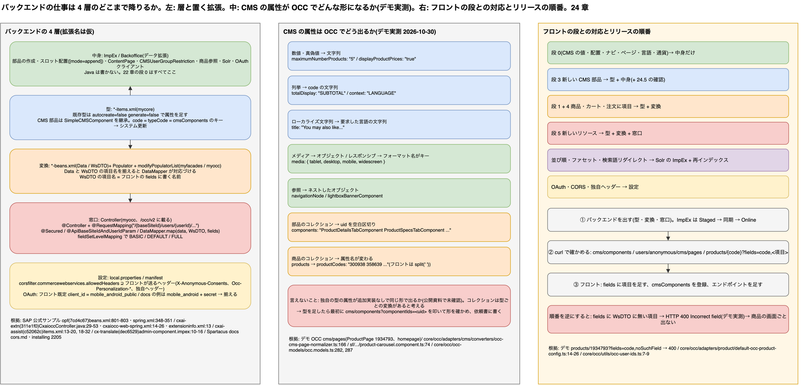

# 24. バックエンド側カスタマイズの実装ガイド: どの拡張に、何を、どう書くか

> **図**: 23 バックエンドの 4 層とフロントの段(`diagrams/spartacus-architecture.drawio`)。左: SAP Commerce の 4 層(型 `items.xml` → 中身 ImpEx → 変換 Data / WsDTO / Populator → 窓口 OCC Controller)と、それぞれを置くカスタム拡張。中: CMS 属性が OCC でどんな形になるか(デモ実測)。右: 22 章の段ごとに、バックエンドが触る層と、リリースの順番



> **この章が答える問い**: 22 章の表で「バックエンドの作業」欄に書いたこと(CMS への配置、属性の公開、DTO への項目追加、新しい API、Solr、CORS、OAuth)は、SAP Commerce のどの拡張の、どのファイルに、どんなコードで書くのか。フロントの設定とどこで噛み合うのか

> **位置づけ**: 23 章(フロント側の実装ガイド)の対になる章。12 章(何をどの単位で返すか)・13 章(JSP からの移行)・14 章(チェックリスト)が「判断」を書いたのに対して、この章は「書き方」を書く。コード例は 22 章のシナリオ番号(#11 など)で引ける

> **根拠の取り方**: SAP Commerce 本体のソースは公開されておらず、help.sap.com の該当ページもログインが要る。そこで根拠を 4 種類に分け、各コード例にどれを使ったかを書く。
> - **SAP 公式サンプル**: SAP / SAP-samples の GitHub にある、SAP が書いた拡張(下の表。コミットを固定して読んだ)。製品ドキュメントではないが、書き方の実例として使う
> - **Spartacus docs**: `sap.github.io/spartacus-docs` のインストール・CORS・機能ページ
> - **Spartacus のクローン**(v2612.0.0): フロントがバックエンドに期待している形。パスの略記は 22 章と同じ(`core/` = `core-libs/core/src/`、`sf/` = `core-libs/storefront/`、`fl/` = `feature-libs/`)
> - **デモ OCC の実測**: `composable-storefront-demo.eastus.cloudapp.azure.com:8443/occ/v2/electronics-spa`(2026-10-30 に取得)
>
> どれでも確かめられなかった書き方は **「一般形・要確認」** と書いた。拡張名(`mycore` など)は説明用の仮の名前である

| 略記 | リポジトリ(SAP が公開) | 読んだコミット | 中身 |
|---|---|---|---|
| `opf` | [SAP/sap-commerce-cloud-open-payment-framework-sdk](https://github.com/SAP/sap-commerce-cloud-open-payment-framework-sdk) | 7cd4c67 | 既存 Data への項目追加、既存 Converter への Populator 追加 |
| `cxai-extn` | [SAP-samples/cxii-commerce-extn](https://github.com/SAP-samples/cxii-commerce-extn) | 311e1f0 | OCC 拡張の構成、Controller、FieldSetLevelMapping |
| `cxai-assist` | [SAP-samples/cxii-shopping-assistant-ui-component](https://github.com/SAP-samples/cxii-shopping-assistant-ui-component) | c52062c | 既存型への属性追加、CMS コンポーネントの型、Restriction、Populator、`@Secured` |
| `cx-translate` | [SAP/cx-translate](https://github.com/SAP/cx-translate) | dec6529 | `@ApiBaseSiteIdAndUserIdParam`、CMS Restriction とスロットへの追記の ImpEx |
| `sample-setup` | [SAP-samples/cloud-commerce-sample-setup](https://github.com/SAP-samples/cloud-commerce-sample-setup) | c3f81d1 | Spartacus 用サンプルデータ(`spartacussampledata`)の ImpEx。CMS・Solr |

---

### 24.0 先に話し言葉で: バックエンドの仕事は 4 層のどこまで降りるか

フロントの段(22 章)に対応させると、バックエンドの仕事は 4 つの層に分かれる。いちばん浅いのは**中身**で、CMS のコンポーネントを作る、スロットに置く、属性の値を変える、商品参照を登録する。どれも ImpEx か Backoffice で済み、Java は書かない。22 章の段 0 はすべてここである。

次が**型**で、`items.xml` に属性や新しい ItemType を足す。CMS コンポーネントの属性なら、型を足して中身を入れれば、OCC の `cms/pages` に出てくる(24.5)。商品や注文の属性は、さらに**変換**の層まで降りる。facades の Data と OCC の WsDTO に項目を足し、Populator で値を詰める。最後が**窓口**で、既存の OCC に無いリソースを返すときだけ Controller を書く。

フロントとバックエンドが噛み合う場所は 3 つしかない。CMS の `typeCode` と属性名、OCC の URL と `fields`、そしてヘッダー(CORS)と OAuth のクライアントである。中でも `fields` は要注意で、フロントが `fields` に書いた項目がバックエンドの WsDTO に無いと、OCC は 400 を返す(24.10)。だから項目を足すときは、**バックエンドを先に出し、フロントの `fields` は後から足す**。

---

## 24.1 カスタム拡張の構成

SAP Commerce では、カスタマイズを用途別の拡張に分けて置く。OCC 用の拡張は `commercewebservices` を前提にして、同じ `/occ/v2` の Web アプリに載る。

| 拡張(仮の名前) | 置くもの | 本書の節 |
|---|---|---|
| `mycore` | `*-items.xml`(型)、サービス、DAO | 24.3 |
| `myfacades` | `*-beans.xml`(Data)、Populator、Converter の Spring 設定 | 24.6 |
| `myocc` | `*-beans.xml`(WsDTO)、Controller、`web/spring/*-web-spring.xml`(FieldSetLevelMapping) | 24.6、24.7 |
| `myinitialdata` などのデータ拡張 | ImpEx(CMS・商品参照・Solr・OAuth クライアント) | 24.4、24.8、24.9 |

OCC 拡張の骨格は次のとおり(`cxai-extn` の `cxaiocc`)。

```xml
<!-- myocc/extensioninfo.xml(抜粋) -->
<requires-extension name="commercewebservices"/>
```

```properties
# myocc/project.properties … /occ/v2 の Web アプリに載せる
ext.myocc.extension.webmodule.webroot=/occ/v2
```

```xml
<!-- myocc/resources/occ/v2/myocc/web/spring/myocc-web-spring.xml … Controller を拾う -->
<context:component-scan base-package="com.example.myocc.controllers" />
```

根拠: `cxai-extn` の `cxaiocc/extensioninfo.xml:13`、`cxaiocc/project.properties:14`、`cxaiocc/resources/occ/v2/cxaiocc/web/spring/cxaiocc-web-spring.xml:11-12`。拡張の雛形を作るテンプレート名(`yocc` など)は公開資料で確かめられなかったので、使っている版のドキュメントで確かめる。

---

## 24.2 フロントの段とバックエンドの作業の対応

| 要件の種類(22 章の例) | フロントの段 | バックエンドが触る層 | 本章 |
|---|---|---|---|
| CMS の属性値・配置・ナビ・ページを変える(#12, #26, #36, #51, #62, #68) | 0 | 中身(ImpEx) | 24.4 |
| 部品を一部の利用者にだけ出す(#7 の代わり) | 0 | 中身(Restriction の ImpEx) | 24.4 |
| 新しい CMS コンポーネント(#3) | 3 | 型 + 中身 | 24.3, 24.4, 24.5 |
| 商品・カート・注文に項目を足す(#14, #16, #34, #40, #48, #53) | 1 + 4 | 型 + 変換 | 24.3, 24.6 |
| 新しいリソースを返す(#60, #92) | 5 | 型 + 変換 + 窓口 | 24.7 |
| 並び順・ファセット・検索語リダイレクト(#22, #23, #29) | 0 / BE | 中身(Solr の ImpEx)+ 再インデックス | 24.8 |
| OAuth クライアント・CORS・独自ヘッダー(#55, #57, #93) | 1 / 5 | 設定(ImpEx、properties) | 24.9 |
| 言語・通貨・ベースサイト(#71, #72, #80) | 0 | 中身(ImpEx) | 24.9 |

---

## 24.3 型: `items.xml`

### 既存の型に属性を足す(#14, #16 の前提)

既存の型は `autocreate="false" generate="false"` で開き直し、`<attributes>` に足す。

```xml
<!-- mycore/resources/mycore-items.xml -->
<itemtype code="Product" autocreate="false" generate="false">
  <attributes>
    <attribute qualifier="warrantyMonths" type="java.lang.Integer">
      <persistence type="property"/>
      <modifiers optional="true"/>
    </attribute>
  </attributes>
</itemtype>
```

根拠: 同じ書き方で既存の型 `CxaiConfig` に 3 つの属性を足している例(`cxai-assist` の `cxaiaskproductocc/resources/cxaiaskproductocc-items.xml:18-32`)。`Product` に足すこと自体は一般形。

### 新しい CMS コンポーネントの型(#3)

`SimpleCMSComponent` を継承する。**`code` がそのまま OCC の `typeCode` になり、フロントの `cmsComponents` のキーになる**(11 章)。

```xml
<!-- mycore/resources/mycore-items.xml -->
<itemtype code="CampaignBannerComponent" extends="SimpleCMSComponent"
          autocreate="true" generate="true"
          jaloclass="com.example.mycore.jalo.CampaignBannerComponent">
  <attributes>
    <attribute qualifier="headline" type="localized:java.lang.String">
      <persistence type="property"/>
    </attribute>
    <attribute qualifier="maxItems" type="java.lang.Integer">
      <persistence type="property"/>
    </attribute>
    <attribute qualifier="showPrice" type="java.lang.Boolean">
      <persistence type="property"/>
      <defaultvalue>Boolean.TRUE</defaultvalue>
    </attribute>
  </attributes>
</itemtype>
```

根拠: `SimpleCMSComponent` を継承する型の定義(`cxai-assist` の `cxaiaskproductaddon/resources/cxaiaskproductaddon-items.xml:13-20`。この例は属性なし)。属性の書き方は上の既存型の例と同じ。フロントの対応づけは `core/cms/config/cms-config.ts:130`。

**属性の型は、単純な型(文字列・数値・真偽値・列挙)にしておくと、OCC に出す作業が要らない**(24.5)。商品の一覧のようなコレクションを持たせたいときは、24.5 の注意を先に読む。

### 独自の表示条件(Restriction)

「ログインした会員だけに出す」のような出し分けは、フロントの `guards` ではなくバックエンドの Restriction で行う(22 章 #7)。標準の `CMSUserGroupRestriction` で足りなければ、`AbstractRestriction` を継承して型を作る(`cxai-assist` の `cxaiaskproductocc/resources/cxaiaskproductocc-items.xml:34-44`)。標準のもので足りる場合は 24.4 の ImpEx だけで済む。

型を足したあとは、システムの更新(Update Running System)で型をデータベースに反映する。

---

## 24.4 中身: ImpEx

### 共通の変数

```text
$contentCatalog=electronics-spaContentCatalog
$contentCV=catalogVersion(CatalogVersion.catalog(Catalog.id[default=$contentCatalog]),CatalogVersion.version[default=Online])[default=$contentCatalog:Online]
```

根拠: `sample-setup` の `.../import/contentCatalogs/electronicsContentCatalog/opf-content.impex:9-10`。このサンプルは **Online を直接書いている**。本番運用では Staged に書いてカタログ同期で Online に出す(14 章)ので、`version` の既定値は環境に合わせて変える。

### コンポーネントを作ってスロットに置く(#3, #36)

```text
# 1. コンポーネントを作る(属性は 24.3 で足したもの)
INSERT_UPDATE CampaignBannerComponent;$contentCV[unique=true];uid[unique=true];name;headline[lang=ja];maxItems;showPrice
;;CampaignBanner01;Campaign Banner 01;秋のセール;5;true

# 2a. スロットの中身を丸ごと指定する(既存の部品も全部書く)
INSERT_UPDATE ContentSlot;$contentCV[unique=true];uid[unique=true];name;cmsComponents(uid,$contentCV)
;;Section1Slot-Homepage;Section1 Slot for Homepage;CampaignBanner01,ElectronicsHompageSplashBannerComponent

# 2b. 既存の並びを残して末尾に足す
UPDATE ContentSlot;$contentCV[unique=true];uid[unique=true];cmsComponents(uid,$contentCV)[mode=append]
;;Section1Slot-Homepage;CampaignBanner01
```

根拠: 部品の作成とスロットへの配置(Spartacus docs「Clear Cart」、`_pages/dev/features/clear-cart.md:51-60`)、`[mode=append]`(`cx-translate` の `docs/downloads/admin-component.impex:15-16`)。1 行目の型と属性は 24.3 の仮の型。スロットの uid は環境ごとに違うので、Backoffice か `cms/pages` の応答で確かめる。

**コードだけの部品**(フロントの `flexType` で対応づける)なら、型を作らずに `CMSFlexComponent` を置く。

```text
INSERT_UPDATE CMSFlexComponent;$contentCV[unique=true];uid[unique=true];name;flexType
;;ClearCartComponent;Clear Cart Component;ClearCartComponent
```

根拠: Spartacus docs「Clear Cart」(`clear-cart.md:51-52`)。フロントは `cmsComponents.ClearCartComponent` で受ける(`core/occ/adapters/cms/converters/occ-cms-page-normalizer.ts:151`)。

### コンテンツページを作る(#62)

```text
INSERT_UPDATE ContentPage;$contentCV[unique=true];uid[unique=true];name;masterTemplate(uid,$contentCV);label;title[lang=en];defaultPage[default='true'];approvalStatus(code)[default='approved'];homepage[default='false']
;;campaignPage;Campaign Page;ContentPage1Template;/campaign;Campaign

INSERT_UPDATE ContentSlotForPage;$contentCV[unique=true];uid[unique=true];position[unique=true];page(uid,$contentCV)[unique=true];contentSlot(uid,$contentCV)[unique=true]
;;Section2A-campaignPage;Section2A;campaignPage;Section2ASlot-campaignPage
```

根拠: ヘッダー行は `sample-setup` の `opf-content.impex:31, 36`。`label` が URL になり、フロントは追加のルートなしでこのページを表示する(`sf/cms-structure/routing/cms-route/add-cms-route.ts:13`)。`position` はフロントの `layoutSlots` のスロット名と一致させる(`sf/recipes/config/layout-config.ts:67-68` の `ContentPage1Template`)。

### 一部の利用者にだけ出す(#7 の代わり)

```text
INSERT_UPDATE CMSUserGroupRestriction;$contentCV[unique=true];uid[unique=true];name;userGroups(uid);includeSubgroups;components(uid,$contentCV)
;;MembersOnlyRestriction;Members only;customergroup;true;CampaignBanner01
```

根拠: ヘッダー行の形は `cx-translate` の `admin-component.impex:10`(元は `components(&linkRef)` で参照)。フロントは CMS を `users/${userId}/cms/pages` で取りにいく(`core/cms/config/default-cms-config.ts:15`)ので、ログインした利用者ごとに Restriction が評価された結果だけが届く。

### 商品参照を登録する(#13)

類似商品はデータだけで出る(13 章、22 章 #12〜13)。

```text
# 一般形・要確認(公開の SAP 資料で該当する ImpEx を見つけられなかった)
$productCatalog=electronicsProductCatalog
$catalogVersion=catalogversion(catalog(id[default=$productCatalog]),version[default='Staged'])[unique=true,default=$productCatalog:Staged]
INSERT_UPDATE ProductReference;source(code,$catalogVersion)[unique=true];target(code,$catalogVersion)[unique=true];referenceType(code)[unique=true];active;preselected
;300938;1934794;SIMILAR;true;false
```

デモでは `products/1934793/references?referenceType=SIMILAR` が 4 件、`300938` は 0 件を返す(13 章)。フロントの Selector は参照タイプを完全一致で絞るので、コンポーネントの `productReferenceTypes` には 1 つだけ書く(`core/product/store/selectors/product-references.selectors.ts:35`)。

---

## 24.5 CMS の属性が OCC でどんな形になるか(デモ実測)

バックエンドの担当者が最初に気にするのは「独自の属性を OCC に出すのに、DTO や Converter を書く必要があるか」である。**公開資料ではこの仕組みを確かめられなかった**ので、デモの `cms/pages` に出ている標準コンポーネントの属性の形を記録する。

| 属性の種類(CMS の型) | `cms/pages` での形 | デモの例 |
|---|---|---|
| 数値 | **文字列** | `ProductReferencesComponent.maximumNumberProducts: "5"`、`SearchBoxComponent.maxProducts: "5"` |
| 真偽値 | **文字列** | `displayProductPrices: "true"`、`container: "false"` |
| 列挙 | 文字列(列挙の code) | `MiniCartComponent.totalDisplay: "SUBTOTAL"`、`CMSSiteContextComponent.context: "LANGUAGE"` |
| ローカライズ文字列 | 要求した言語の文字列 | `ProductReferencesComponent.title: "You may also like..."` |
| メディア | オブジェクト(`url`、`altText` など) | `SimpleBannerComponent.media` |
| レスポンシブのメディア | フォーマット名をキーにしたオブジェクト | `SimpleResponsiveBannerComponent.media: { tablet, desktop, mobile, widescreen }` |
| 他の部品・ナビゲーションへの参照 | ネストしたオブジェクト | `CategoryNavigationComponent.navigationNode`、`MiniCartComponent.lightboxBannerComponent` |
| 部品のコレクション | **uid を空白で区切った文字列** | `CMSTabParagraphContainer.components: "ProductDetailsTabComponent ProductSpecsTabComponent ..."` |
| 商品のコレクション | **属性名が変わり**、商品コードを空白で区切った文字列 | `ProductCarouselComponent.productCodes: "300938 358639 ..."` |

取得: `GET /cms/pages?pageType=ProductPage&code=1934793&fields=DEFAULT` と `GET /cms/pages?pageType=ContentPage&pageLabelOrId=homepage&fields=DEFAULT`(2026-10-30)。

ここから言えることと、言えないことを分ける。

- **言えること。** 標準の部品では、単純な型の属性は文字列にして平らに並べられている。フロントもそれを前提にしていて、受け取った部品のデータを変換せずに State に入れ(`core/occ/adapters/cms/converters/occ-cms-page-normalizer.ts:166`)、`productCodes` を空白で分割している(`sf/cms-components/product/carousel/product-carousel/product-carousel.component.ts:74`)。フロントの型にも、決まった属性以外を受ける `otherProperties` がある(`core/occ/occ-models/occ.models.ts:282, 287`)。
- **言えないこと。** 独自の型の属性が、追加の実装なしで同じ形で出るかどうか。標準の部品の属性は全部出ているので、単純な型なら出る見込みは高いが、公開の SAP 資料では確かめられなかった。商品のコレクションは `products` が `productCodes` に変わっているので、**コレクションの属性には型ごとの変換があると考えるのが安全**である。
- **だから最初に確かめる。** 24.3 で型を足し、24.4 で部品を 1 つ置いたら、開発環境で次の 1 本を叩いて、属性が出るか、どんな形かを確かめる。出なければ cmsocc 側の変換を足す必要がある。

```sh
curl "https://<host>/occ/v2/<baseSite>/cms/components?componentIds=CampaignBanner01&fields=DEFAULT&lang=ja"
```

フロントはこの形をそのまま受け取るので、**数値も真偽値も文字列で届く**前提で書く(23 章の例では `Number(data.maximumNumberProducts)` で数値に直している)。依頼書(11.8)には、属性名と、実際に返る文字列の例を書く。

---

## 24.6 変換: 既存の OCC 応答に項目を足す(#14, #16, #34, #40)

商品の `warrantyMonths` を OCC の商品 API に出す例。触るファイルは 4 つ。

### ① Data と WsDTO に項目を足す(`*-beans.xml`)

```xml
<!-- myfacades/resources/myfacades-beans.xml … facades の Data -->
<bean class="de.hybris.platform.commercefacades.product.data.ProductData">
  <property name="warrantyMonths" type="Integer"/>
</bean>

<!-- myocc/resources/myocc-beans.xml … OCC の WsDTO -->
<bean class="de.hybris.platform.commercewebservicescommons.dto.product.ProductWsDTO">
  <property name="warrantyMonths" type="Integer"/>
</bean>
```

根拠: 既存の Data に項目を足す書き方は `opf` の `opfacceleratorcore/resources/opfacceleratorcore-beans.xml:801-803`(`CartData`)と `:160-161`(`AddressData`)。**`ProductData` / `ProductWsDTO` のパッケージ名は公開資料で確かめていない(一般形・要確認)。**使っている版の生成済みクラスで確かめる。Data と WsDTO の項目名を揃えると、DataMapper が名前で対応づける(12.4)。

### ② Populator を書く

```java
// myfacades/src/com/example/myfacades/populators/WarrantyPopulator.java
public class WarrantyPopulator implements Populator<ProductModel, ProductData> {
  @Override
  public void populate(final ProductModel source, final ProductData target) throws ConversionException {
    target.setWarrantyMonths(source.getWarrantyMonths());
  }
}
```

根拠: `Populator<SOURCE, TARGET>` を実装して `populate` で target に詰める形は、`cxai-assist` の `cxaiaskproductocc/src/com/sap/cxaiaskproductocc/populator/CxaiConfigAskProductPopulator.java:21, 37-50`。

### ③ 既存の Converter に Populator を足す(`*-spring.xml`)

```xml
<!-- myfacades/resources/myfacades-spring.xml -->
<bean id="warrantyPopulator" class="com.example.myfacades.populators.WarrantyPopulator"/>

<bean parent="modifyPopulatorList">
  <property name="list" ref="productConverter"/>
  <property name="add" ref="warrantyPopulator"/>
</bean>
```

根拠: `opf` の `opfacceleratorcore/resources/opfacceleratorcore-spring.xml:348-351`(`cartConverter` に Populator を足している)。**商品の場合、OCC がどの Converter(または `ProductOption` ごとに組み立てる Populator)を通るかは版によって違う(一般形・要確認)。**足したあと、②の Populator が呼ばれているかをログで確かめる。

### ④ `fields` でどう出すか

OCC の `fields` には、`BASIC` / `DEFAULT` / `FULL` の**レベル**と、**項目名を直接並べる**書き方がある。デモで確かめると、項目名を直接並べればその項目だけが返り、WsDTO に無い項目名を書くと 400 になる。

```sh
$ curl ".../products/1934793?fields=code,name,price(formattedValue),averageRating"
{ "averageRating" : 3.5, "code" : "1934793", "name" : "PowerShot A480", "price" : { "formattedValue" : "$99.85" } }

$ curl ".../products/1934793?fields=code,noSuchField"      # → HTTP 400
{ "errors" : [ { "message" : "Incorrect field:'noSuchField'", "type" : "ConversionError" } ] }
```

Spartacus の商品のエンドポイントは、`details` などのスコープごとに**項目名を直接並べている**(`core/occ/adapters/product/default-occ-product-config.ts:14-26`)。だから WsDTO に項目を足せば、フロントは `fields` の文字列に `warrantyMonths` を足すだけで受け取れる(23 章の段 1)。**`DEFAULT` レベルに含めたい**ときは FieldSetLevelMapping を書く。新しい WsDTO の場合の書き方は 24.7 にある。既存の `ProductWsDTO` のレベル定義に足す書き方は、公開資料で確かめられなかった(一般形・要確認)。

---

## 24.7 窓口: 新しいリソースの OCC API(#60, #92)

既存の OCC に無いリソース(12 章の ③④)を返すときだけ、Controller を書く。12.4 の一般形を、SAP 公式サンプルの書き方で具体化したもの。

```java
// myocc/src/com/example/myocc/controllers/LoyaltyController.java
@Controller
@RequestMapping("/{baseSiteId}/users/{userId}/loyalty")
public class LoyaltyController {
  protected static final String DEFAULT_FIELD_SET = FieldSetLevelHelper.DEFAULT_LEVEL;

  @Resource(name = "dataMapper")
  private DataMapper dataMapper;
  @Resource(name = "loyaltyFacade")
  private LoyaltyFacade loyaltyFacade;          // myfacades: LoyaltyData を返す

  @GetMapping
  @ResponseBody
  @Secured({ "ROLE_CUSTOMERGROUP" })            // ログイン会員だけ
  @ApiBaseSiteIdAndUserIdParam
  public LoyaltyWsDTO getLoyalty(@ApiFieldsParam @RequestParam(defaultValue = DEFAULT_FIELD_SET) final String fields) {
    final LoyaltyData data = loyaltyFacade.getForCurrentCustomer();
    return dataMapper.map(data, LoyaltyWsDTO.class, fields);
  }
}
```

```xml
<!-- myocc/resources/myocc-beans.xml -->
<bean class="com.example.myocc.dto.LoyaltyWsDTO">
  <property name="points" type="Integer"/>
  <property name="rank" type="String"/>
  <property name="expiresAt" type="java.util.Date"/>
</bean>

<!-- myocc/resources/occ/v2/myocc/web/spring/myocc-web-spring.xml -->
<bean parent="fieldSetLevelMapping" id="loyaltyFieldSetLevelMapping">
  <property name="dtoClass" value="com.example.myocc.dto.LoyaltyWsDTO"/>
  <property name="levelMapping">
    <map>
      <entry key="BASIC" value="points"/>
      <entry key="DEFAULT" value="BASIC,rank"/>
      <entry key="FULL" value="DEFAULT,expiresAt"/>
    </map>
  </property>
</bean>
```

| 書き方 | 根拠(SAP 公式サンプル) |
|---|---|
| `@Controller` + `@RequestMapping("/{baseSiteId}/...")`、`DataMapper` を `@Resource` で注入、`fields` の既定値 `FieldSetLevelHelper.DEFAULT_LEVEL`、`@ApiFieldsParam`、`dataMapper.map(data, XxxWsDTO.class, fields)` | `cxai-extn` の `cxaiocc/src/com/sap/cxai/controllers/CxaioccController.java:29-53` |
| `@Secured({ "ROLE_CUSTOMERGROUP" })` | `cxai-assist` の `cxaiaskproductocc/src/com/sap/cxaiaskproductocc/controllers/AssistantToolsController.java:43-46` |
| `@ApiBaseSiteIdAndUserIdParam`、未ログインでも呼べる `@SecurePortalUnauthenticatedAccess` | `cx-translate` の `commerce-extensions/cxtranslations/src/com/sap/cx/translations/occ/controllers/CxTranslationsController.java:153-155` |
| WsDTO を `*-beans.xml` で定義 | `cxai-extn` の `cxaiocc/resources/cxaiocc-beans.xml` |
| `fieldSetLevelMapping` を親にして `dtoClass` と `levelMapping`(BASIC / DEFAULT / FULL) | `cxai-extn` の `cxaiocc/resources/occ/v2/cxaiocc/web/spring/cxaiocc-web-spring.xml:14-26` |

**URL の形はフロントの都合で決める。** ユーザーに属するリソースは `/{baseSiteId}/users/{userId}/...` にする。フロントは `userId` に `current`(ログイン中)か `anonymous` を入れて呼ぶ(`core/occ/utils/occ-user-ids.ts:7-9`)。業務 ID は URL に出し、応答に ID を含める。そうしないとフロントの State に入らない(12 章、15 章)。

フロント側は、このエンドポイントを設定に 1 行足し、Adapter で `buildUrl('loyalty', { urlParams: { userId } })` を呼ぶ(15 章、23 章の段 5)。

---

## 24.8 検索: Solr(#22, #23, #29)

Spartacus の一覧は、並び順の選択肢(`sorts`)、ファセット、検索語のリダイレクト先(`keywordRedirectUrl`)を、検索 API の応答から読む(`core/occ/adapters/product/default-occ-product-config.ts:37-39`、`core/occ/adapters/product/occ-product-search.adapter.ts:60`)。だからこの 3 つはバックエンドの Solr の設定で決まる。

### 検索語でページに飛ばす(#29)

```text
$facetSearchConfigName=electronicsIndex
INSERT_UPDATE SolrCategoryRedirect;redirectItem(code,$productCatalogVersion)[unique=true];&redirectRefID
;578;$productCatalog-redirectRefID-slr

INSERT_UPDATE SolrFacetSearchKeywordRedirect;facetSearchConfig(name)[unique=true,default=$facetSearchConfigName];language(isocode)[unique=true,default=$lang];keyword[unique=true];matchType(code)[unique=true];redirect(&redirectRefID);ignoreCase[default=true]
 ;;;"slr";EXACT;$productCatalog-redirectRefID-slr;
```

根拠: `sample-setup` の `.../import/productCatalogs/electronicsProductCatalog/solr.impex:23-30`。フロントの `productSearch` の `fields` から `keywordRedirectUrl` を消すと、ここで設定しても飛ばなくなる(22 章 #25)。

### 項目を検索・ファセットに使う(#23)

```text
$solrIndexedType=electronicsProductType
INSERT_UPDATE SolrIndexedProperty;solrIndexedType(identifier)[unique=true];name[unique=true];type(code);multiValue[default=true];facet[default=true];facetType(code);facetSort(code);priority;visible;categoryField[default=true];fieldValueProvider;facetDisplayNameProvider;topValuesProvider
;$solrIndexedType;warrantyMonths;int;false;true;Refine;Alpha;3000;true;false;;;defaultTopValuesProvider
```

根拠: ヘッダー行は `sample-setup` の `.../import/stores/electronics/solr.impex:5, 9`(元の行は `customerCouponCode` を値の解決クラス付きで定義)。値の行は一般形で、`fieldValueProvider` の要否は属性の種類で変わる。

### 並び順を足す(#22)

```text
# 一般形・要確認(公開の SAP 資料で該当する ImpEx を見つけられなかった)
INSERT_UPDATE SolrSort;indexedType(identifier)[unique=true];code[unique=true];useBoost
;electronicsProductType;warranty-desc;false
INSERT_UPDATE SolrSortField;sort(indexedType(identifier),code)[unique=true];fieldName[unique=true];ascending[unique=true]
;electronicsProductType:warranty-desc;warrantyMonths;false
```

Solr の設定を変えたあとは、インデックスを作り直す。並び順の表示名はフロントの翻訳で付ける(`sf/shared/components/list-navigation/sorting/sorting.component.ts:51`)。

---

## 24.9 サイト・認証・CORS(#55, #57, #71〜73, #93)

### OAuth クライアント(#55)

フロントは既定で `client_id` に `mobile_android_public` を使う(`core/auth/user-auth/config/default-auth-config.ts:50`)。バックエンドにはこの ID のクライアントが要る。Spartacus docs のインストール手順は、次の形でクライアントを登録している。

```text
INSERT_UPDATE OAuthClientDetails;clientId[unique=true];resourceIds;scope;authorizedGrantTypes;authorities;clientSecret;registeredRedirectUri
;mobile_android;hybris;basic;authorization_code,refresh_token,password,client_credentials;ROLE_CLIENT;secret;http://localhost:9001/authorizationserver/oauth2_callback;
```

根拠: Spartacus docs「Installing SAP Commerce Cloud 2205 for use with Spartacus」(`_pages/install/backend/installing-sap-commerce-cloud-2205.md:105-108`)。**docs の例(`mobile_android` + secret)と、フロントの既定(`mobile_android_public`、secret なし)は一致していない。**どちらに揃えるかを決め、フロントの `authentication.client_id` / `client_secret`(23 章の段 1)とバックエンドの登録を同じ値にする。

### CORS と独自ヘッダー(#93)

```properties
corsfilter.commercewebservices.allowedOriginPatterns=https://www.example.com
corsfilter.commercewebservices.allowedMethods=GET HEAD OPTIONS PATCH PUT POST DELETE
corsfilter.commercewebservices.allowedHeaders=origin content-type accept authorization cache-control if-none-match x-anonymous-consents x-profile-tag-debug x-consent-reference occ-personalization-id occ-personalization-time x-channel
corsfilter.commercewebservices.exposedHeaders=x-anonymous-consents occ-personalization-id occ-personalization-time
corsfilter.commercewebservices.allowCredentials=true
```

根拠: Spartacus docs「CORS」(`_pages/install/cors.md:90-94`。docs の例は `allowedOriginPatterns=*` で、本番では使わないよう注意書きがある)。最後の `x-channel` は 23 章の段 5 で足した独自ヘッダーの例。フロントが送るヘッダーは、本体のソースで確かめられる。

| ヘッダー | 送る機能 | 根拠 |
|---|---|---|
| `X-Anonymous-Consents` | 匿名同意 | `core/model/consent.model.ts:32` |
| `Occ-Personalization-Id` / `Occ-Personalization-Time` | パーソナライズ | `fl/tracking/personalization/root/config/default-personalization-config.ts:13-14` |
| `sap-commerce-cloud-user-id` | ASM(代理操作) | `fl/asm/root/interceptors/user-id-http-header.interceptor.ts:31` |

ASM の `sap-commerce-cloud-user-id` は docs の一覧に入っていない。ASM を使うときは、ASM 用の CORS 設定(docs が `corsfilter.assistedservicewebservices.*` として別に案内している)とあわせて確かめる。

### 言語・通貨・ベースサイト(#71〜73, #80)

フロントは起動時に、ベースサイトの言語・通貨の一覧と URL の構成(`urlEncodingAttributes`)を OCC から読んで設定を作る(`core/site-context/config/config-loader/site-context-config-initializer.ts:80-86`)。だから言語や通貨を増やす作業は、BaseStore の言語・通貨と、ローカライズされたデータ(商品名・価格)を ImpEx で入れるだけで、フロントの変更は要らない。BaseStore と BaseSite の ImpEx の列名は版で確かめる(一般形・要確認)。

---

## 24.10 リリースの順番と確かめ方

**バックエンドを先に出す。**フロントの `fields` に、まだバックエンドの WsDTO に無い項目を書くと、OCC は 400(`Incorrect field`)を返し、商品の画面ごと出なくなる(24.6 の実測)。順番は次のとおり。

1. バックエンド: 型・変換・窓口を出す。ImpEx で中身を入れる(Staged → 同期 → Online)
2. 確かめる: 下の `curl` で、項目が返ること、形が依頼書どおりであることを見る
3. フロント: `fields` に項目を足す、`cmsComponents` を登録する、エンドポイントを足す

```sh
B=https://<host>/occ/v2/<baseSite>
# CMS の部品が出るか、属性の形は(24.5)
curl "$B/cms/components?componentIds=CampaignBanner01&fields=DEFAULT&lang=ja"
# ページに置かれているか(フロントと同じ取り方)
curl "$B/users/anonymous/cms/pages?pageType=ContentPage&pageLabelOrId=/campaign&fields=DEFAULT"
# 商品に項目が出るか(項目名を直接並べる。無ければ 400)
curl "$B/products/1934793?fields=code,warrantyMonths"
# 商品参照
curl "$B/products/300938/references?referenceType=SIMILAR"
# ログイン会員だけの API(トークンを付ける)
curl -H "Authorization: Bearer <token>" "$B/users/current/loyalty?fields=DEFAULT"
```

---

## 24.11 まとめ: 層ごとの書き方

| 層 | 置く拡張 | 書くもの | フロントと噛み合う点 | 公開資料での確認 |
|---|---|---|---|---|
| 型 | `mycore` | `*-items.xml`(既存型は `autocreate="false"`、CMS 部品は `SimpleCMSComponent` を継承) | ItemType の `code` = `typeCode` = `cmsComponents` のキー | SAP 公式サンプルで確認 |
| 中身 | データ拡張 / Backoffice | ImpEx(部品、スロット、ページ、Restriction、商品参照、Solr、OAuth) | スロットの `position` = `layoutSlots` のスロット名、`label` = URL | 部品・スロット・ページ・Restriction・Solr のリダイレクト・OAuth は確認。商品参照と並び順は一般形 |
| 変換 | `myfacades` / `myocc` | `*-beans.xml`(Data と WsDTO)、Populator、`modifyPopulatorList` | WsDTO の項目名 = フロントの `fields` に書く名前 | 書き方は確認。商品の Converter 名と DTO のパッケージは要確認 |
| 窓口 | `myocc` | Controller、WsDTO、`fieldSetLevelMapping` | URL = フロントのエンドポイント設定、`users/{userId}` = `current` / `anonymous` | SAP 公式サンプルで確認 |
| 設定 | `local.properties` / manifest | CORS、OAuth クライアント | `allowedHeaders` ⊇ フロントが送るヘッダー、`client_id` が一致 | Spartacus docs で確認(client_id の食い違いに注意) |

CMS の属性が OCC にどう出るか(24.5)だけは、仕組みを公開資料で確かめられなかった。新しい型を作ったら、最初に開発環境の `cms/components` を叩いて形を確かめ、その結果を依頼書に書く。

---

[目次](README.md) | ← [23. フロント側カスタマイズの実装ガイド: どのファイルに、何を、どう書くか](23-frontend-customization-guide.md) | [付録](appendix.md) →
