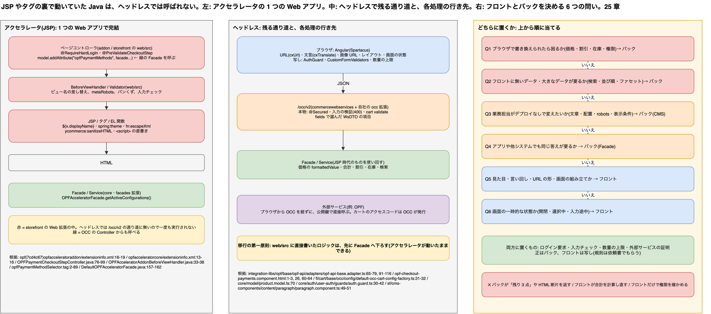

# 25. JSP やタグから Java を呼んでいた処理はどうなるか、フロントとバックの責務をどう分けるか

> **図**: 24 ビュー層の Java の行き先と責務の分け方(`diagrams/spartacus-architecture.drawio`)。左: アクセラレータでは 1 つの Web アプリの中で Controller → Model → JSP / タグ → HTML が完結していた。中: ヘッドレスでは storefront の Web 拡張が通り道から外れ、ブラウザの Angular と `/occ/v2` だけが残る。右: 処理をフロントとバックのどちらに置くかを決める 6 つの問い



> **この章が答える問い**: 既存のアクセラレータで、JSP・タグファイル・EL 関数・BeforeViewHandler・Validator などから呼んでいた Java は、Spartacus に移るとどうなるのか。どこへ移すのか。そもそも、ある処理をフロントとバックのどちらに置くかを、何で決めるのか

> **位置づけ**: 13 章は CMS コンポーネントのコントローラ(`fillModel()`)1 種類だけを扱った。この章はビュー層全体(ページコントローラ、タグ、EL 関数、BeforeViewHandler、Validator、ログイン要求の注釈)に広げ、最後に 12〜14 章、22〜24 章で個別に出てきた判断を「責務の分け方」の一般則にまとめる

> **根拠の取り方**: アクセラレータ本体(`yacceleratorstorefront`、`acceleratorstorefrontcommons`)のソースは公開されていない。そこで、**同じ機能を JSP 版と Spartacus 版の両方で SAP が実装している** Open Payment Framework(OPF)を突き合わせた。
> - **JSP 版**: [SAP/sap-commerce-cloud-open-payment-framework-sdk](https://github.com/SAP/sap-commerce-cloud-open-payment-framework-sdk) のコミット `7cd4c67`。以下 `opf/` は `core-customize/hybris/bin/custom/` を指す
> - **Spartacus 版**: クローンの `integration-libs/opf/`(v2612.0.0)
> - その他の Spartacus のパスは 22 章の略記(`core/` `sf/` `fl/`)に従う
> - アクセラレータ本体の内部(タグクラスの実装、`beforeViewHandlersList` を回す仕組みなど)は確かめていない。そこに頼る記述は「一般形・要確認」と書く

---

### 先に話し言葉で: タグの裏の Java は「動かなくなる」。だから、置き場所を選び直す

JSP の世界では、ブラウザに HTML を返すまでの全部が 1 つの Web アプリの中で起きていました。コントローラがファサードを呼んで Model に詰め、JSP とタグがそれを読み、タグの裏の Java が整形やエスケープをしていた。**Spartacus では、この Web アプリそのものが通り道から外れます。** ブラウザが受け取るのは Angular の JS と、`/occ/v2` が返す JSON だけ。JSP もタグも、`web/src` に書いた Java も、一度も実行されません(25.1)。

だから移行で最初にやるのは「タグをどう書き換えるか」ではなく、**タグの裏で動いていた Java を 1 つずつ拾い、置き場所を選び直す**ことです。拾い方には型があります。データを取っていたならファサードに残して OCC で出す。整形・URL・文言・エスケープならフロントに移す。権限チェックと入力チェックは、バックに必ず残し、フロントにも写しを置く(25.2)。

責務の分け方も同じ考え方で決まります。**改ざんされて困るもの、フロントが持っていないデータが要るもの、業務担当がデプロイなしで変えたいもの、他のチャネルでも同じ答えが要るものはバック。見た目、言い回し、URL の形、画面の一時的な状態はフロント**(25.5)。

---

### 25.1 何が起きるか: storefront の Web 拡張が通り道から外れる

アクセラレータの機能は、普通 2 つ以上の拡張に分かれている。OPF もそうなっている。

| 拡張 | 依存先 | 中身 | ヘッドレスで動くか |
|---|---|---|---|
| `opfacceleratoraddon`(addon。storefront に載る Web 拡張) | `acceleratorstorefrontcommons`、`addonsupport`(`opf/opfacceleratoraddon/extensioninfo.xml:16-19`) | ページコントローラ、BeforeViewHandler、Validator、JSP、タグ、`base_*.properties` | **動かない** |
| `opfacceleratorcore`(core / facades) | `commercefacades`、`acceleratorfacades`(`opf/opfacceleratorcore/extensioninfo.xml:13-16`) | `OPFAcceleratorFacade` とその実装 | 動く。ただし OCC から呼ばれれば |

ヘッドレスのリクエストは、ブラウザから `/occ/v2` の Web 拡張(`commercewebservices` と、24.1 で作る `myocc`)に入る。storefront の Web 拡張(`yacceleratorstorefront` と、そこに載る addon)の Spring MVC には入らない。だから **`web/src` に書いた Java は、コードとしては残っていても呼ばれない**。呼ばれるのは、`/occ/v2` の Controller から辿れる Facade と Service だけ。

ここから移行の第一原則が出てくる。

> **ビュー層(addon / storefront の `web/src`)にあるロジックは、OCC から呼べる層(facades / core 拡張)へ下ろしてから使う。**

OPF はこれを守っている。支払い方法の一覧はコントローラではなく `DefaultOPFAcceleratorFacade.getActiveConfigurations()`(`opf/opfacceleratorcore/src/de/hybris/platform/facade/impl/DefaultOPFAcceleratorFacade.java:157-162`)が取り、コントローラはそれを Model に詰めるだけ。自社のアクセラレータで同じ処理がコントローラやタグクラスの中に直接書かれていたら、移行の前にまず Facade へ切り出す。

---

### 25.2 ビュー層から Java を呼ぶ 8 つの形と、それぞれの行き先

アクセラレータで「JSP から Java が動く」経路は、だいたい次の 8 つ。左の列で自社のコードを棚卸しし、右の列の置き場所へ移す。

| # | JSP 側での形(OPF での実例) | 裏で動く Java | ヘッドレスでの行き先 | Spartacus 側の根拠 |
|---|---|---|---|---|
| 1 | `${opfPaymentMethod.displayName}` のような EL のプロパティ参照(`opfPaymentMethodSelector.tag:16-23`) | Data オブジェクトの getter | **自動**。項目が WsDTO にあり、フロントの `fields` に入っていれば JSON に出る(24.6) | `integration-libs/opf/checkout/components/opf-checkout-payments/opf-checkout-payments.component.html:26, 60-64` が同じ項目をそのまま表示 |
| 2 | コントローラの `model.addAttribute("opfPaymentMethods", facade.getActiveConfigurations())`(`OPFPaymentCheckoutStepController.java:85`) | Facade の呼び出し | **Facade は残す**。OCC の窓口(既存リソースか 24.7 の新しい Controller)から出す。CMS 部品の派生データなら 13.2 の B-1 / B-2 / B-3 | 25.3 |
| 3 | `${ycommerce:sanitizeHTML(...)}` のような EL 関数(`opfb2bacceleratoraddon/.../opfPaymentPage.jsp:95`)、価格・画像・URL を作るタグ | TLD に登録した静的メソッド、タグクラス | 整形・URL は**フロント**(`cxUrl`、`MediaService`)。HTML の無害化は**バック**(入稿時)、エスケープは Angular が自動で行う | 25.4 |
| 4 | `<spring:theme code="checkout.multi.paymentMethod.selectPaymentMethod"/>`(`opfPaymentMethodSelector.tag:13`、文言は `base_en.properties:18`) | Spring の MessageSource | **フロント**の i18n(`cxTranslate` と翻訳 JSON)。`base_*.properties` は移らない。キーも付け直しになる | `opf-checkout-payments.component.html:1-3` が `'opfCheckout.paymentOption' \| cxTranslate`、文言は `integration-libs/opf/checkout/assets/translations/en/opfCheckout.json` |
| 5 | `@RequireHardLogIn`(`OPFPaymentCheckoutStepController.java:77`、`opfb2bacceleratoraddon/.../OPFB2BOrderController.java:59`)、JSP 側の `sec:authorize` | Spring の interceptor | **バックに必ず残す**(OCC Controller の `@Secured`、24.7)。フロントの `AuthGuard` はログイン画面への案内で、守りではない | `core/auth/user-auth/guards/auth.guard.ts:30-42` |
| 6 | BeforeViewHandler(`OPFAcceleratorAddonBeforeViewHandler.java:33-38` はビュー名を addon 版に差し替える。登録は `opfacceleratoraddon-web-spring.xml:48-54`)、全ページ共通の Model 追加(`metaRobots`、パンくず、ヘッダーのカート) | `beforeViewHandlersList` に足した Bean | ビュー差し替えは**フロント**の `cmsComponents` 上書き(23.6)。robots・ページタイトルは**バック**の CMS ページ属性で、フロントの PageMetaResolver が `<head>` に書く。ヘッダーのカートはフロントの Facade が持っている | `core/cms/page/base-page-meta.resolver.ts:59-60` が `page.robots` を読む |
| 7 | `Validator.validate(form, errors)`(`OPFAddressValidator.java:21, 50`、`OPFB2BOrderController.java:61-66`) | Spring の Validator | **バックに残す**。ただし `web/src` の Validator は動かないので、Facade か OCC の受け口へ移す。フロントには UX 用の写しを置く | `sf/shared/utils/validators/custom-form-validators.ts:37, 201`(フロントの写し)、`core/global-message/http-interceptors/handlers/bad-request/bad-request.handler.ts:22`(バックの 400 を画面に出す) |
| 8 | タグの中の `<script>`(`opfPaymentMethodSelector.tag:32-89`)、`${resourcePath}/js/...` の読み込み | なし(ブラウザで動く JS) | Angular コンポーネントに書き直す。JS の直書きは移せない | 25.3 |

8 つのうち、**1 と 2 はバックに残り、3・4・6・8 の大半はフロントに移る。5 と 7 は両方に置く**。両方に置くものは、バックが本物、フロントが写しになる。

---

### 25.3 実例: 支払い方法の一覧を、JSP 版と Spartacus 版で比べる

同じ画面(チェックアウトの支払い方法の選択)を 2 つの実装で並べる。

**JSP 版(opf `7cd4c67`)**: コントローラが Facade を呼んで Model に詰める。

```java
// opf/opfacceleratoraddon/acceleratoraddon/web/src/.../OPFPaymentCheckoutStepController.java:76-99 から抜粋
@GetMapping(value = "/choose")
@RequireHardLogIn
@Override
@PreValidateCheckoutStep(checkoutStep = OPF_PAYMENT)
public String enterStep(final Model model, final RedirectAttributes redirectAttributes) ... {
    ...
    model.addAttribute("cartData", cartData);
    model.addAttribute("opfPaymentMethods", opfAcceleratorFacade.getActiveConfigurations());
    ...
    model.addAttribute("metaRobots", "noindex,nofollow");
    return OpfacceleratoraddonControllerConstants.Views.Pages.MultiStepCheckout.ChooseOpfPaymentPage;
}
```

ログインの要求(`@RequireHardLogIn`)とチェックアウト手順の前提確認(`@PreValidateCheckoutStep`)も、ここで注釈として付いている。どちらも storefront の interceptor が見るもので、ヘッドレスでは効かない(25.2 の 5)。

タグが受け取り、文言は `spring:theme`、エスケープは `fn:escapeXml` で処理する。開閉は `<script>` に直書きする。

```jsp
<%-- opf/opfacceleratoraddon/acceleratoraddon/web/webroot/WEB-INF/tags/responsive/checkout/multi/opfPaymentMethodSelector.tag:2, 13, 16-23 から抜粋 --%>
<%@ attribute name="opfPaymentMethods" required="true" type="java.util.List" %>
<spring:theme code="checkout.multi.paymentMethod.selectPaymentMethod" />
<c:forEach items="${opfPaymentMethods}" var="opfPaymentMethod">
  <li data-id="${fn:escapeXml(opfPaymentMethod.id)}">
    <span>${fn:escapeXml(opfPaymentMethod.displayName)}</span>
    ...
```

**Spartacus 版(`integration-libs/opf`)**: Facade(Spartacus の)→ Connector → Adapter が、**SAP Commerce を経由せず OPF の API を直接呼ぶ**。

```ts
// integration-libs/opf/base/opf-api/adapters/opf-api-base.adapter.ts:65-79
getActiveConfigurations(
  query?: OpfActiveConfigurationsQuery
): Observable<OpfActiveConfigurationsResponse> {
  return this.getHeaders().pipe(
    switchMap((headers) =>
      this.http.get<OpfActiveConfigurationsResponse>(
        this.getActiveConfigurationsEndpoint(query),
        { headers }
      )
    ),
    ...
    this.converter.pipeable(OPF_ACTIVE_CONFIGURATIONS_NORMALIZER)
  );
}
```

宛先は `opf.opfBaseUrl` + `active-configurations`(`integration-libs/opf/base/root/config/opf-config.ts:15-17`、`integration-libs/opf/base/opf-api/config/default-opf-api-base-config.ts:13`)。ヘッダーには公開鍵 `sap-commerce-cloud-public-key`(`integration-libs/opf/base/root/config/constants.ts:7`)を付ける。設定で有効にすると、**カートのアクセスコードを SAP Commerce の OCC から取って**、`sap-commerce-cloud-access-code` ヘッダーで付ける(`opf-api-base.adapter.ts:91-116`、`opf-config.ts:83-88`、エンドポイントは `fl/cart/base/occ/config/default-occ-cart-config-factory.ts:32` の `users/${userId}/carts/${cartId}/accessCode`)。

テンプレートは同じ項目をそのまま出し、文言は `cxTranslate` で引く(`opf-checkout-payments.component.html:1-3, 26, 60-64`)。

この比較から読めること:

1. **データの中身(`displayName`、`logoUrl`)は変わらない。** 変わったのは、誰が取りに行くかだけ。
2. **取りに行く経路は「必ず OCC 経由」とは限らない。** 外部サービスが公開鍵で呼べるなら、フロントが直接呼んでよい。その場合も、カートと結び付く証明(アクセスコード)は SAP Commerce が発行する。「誰に呼ばせるか」はフロントで決めてよいが、「呼んでよいという証明」はバックが出す。
3. **`metaRobots` のようにコントローラが全ページに足していた値は、行き先が別になる。** 25.2 の 6 のとおり。
4. **`fn:escapeXml` は要らなくなる。** Angular の `{{ }}` が自動でエスケープするから。

---

### 25.4 整形・URL・エスケープ: 「どちらが計算するか」の具体例

25.2 の 3 で分けた中身を、Spartacus のコードで確かめる。

| 処理 | JSP でやっていたこと | Spartacus での担当 | 根拠 |
|---|---|---|---|
| 価格の表示 | `format:price` 系のタグが通貨と言語に合わせて整形(一般形・要確認) | **バック**が `formattedValue` を作り、フロントはそのまま出す | `core/model/product.model.ts:70`、`sf/cms-components/product/product-summary/product-summary.component.html:14` |
| 合計・税・割引 | カート Data をそのまま表示 | **バック**。フロントはモデルに受けるだけで再計算しない | `fl/cart/base/root/models/cart.model.ts:63, 98`(`appliedOrderPromotions`、`totalPrice`) |
| 数量の上限 | コントローラが在庫を見てフォームを制限 | **両方**。フロントは `stockLevel` を上限にする(UX)。バックはカートの検証 API で本当にチェックする | `fl/cart/base/components/add-to-cart/add-to-cart.component.ts:222-224`、`fl/cart/base/occ/config/default-occ-cart-config-factory.ts:31`(`validate`) |
| 商品・カテゴリの URL | `c:url` やタグで組み立て | **フロント**。バックは code と名前だけ返す | `core/routing/configurable-routes/url-translation/url.pipe.ts:12-16`、13.1 (c) |
| 画像の URL | タグが絶対 URL を作る | **フロント**。バックは相対パスを返し、フロントが `backend.media.baseUrl` を前に付ける | `sf/shared/components/media/media.service.ts:383-387` |
| 文言 | `spring:theme` / `base_*.properties` | **フロント**の i18n。ただし商品名や CMS の文章はバックのデータ | `core/i18n/translate.pipe.ts:29` |
| HTML 断片 | `ycommerce:sanitizeHTML` で無害化して出力 | **バック**(入稿時)。段落コンポーネントは Angular の無害化を**明示的に外して** `innerHTML` に入れる | `sf/cms-components/content/paragraph/paragraph.component.html:1-4`、`paragraph.component.ts:49-51`(`bypassSecurityTrustHtml`) |

最後の行は見落としやすい。JSP では表示の直前に `sanitizeHTML` を通していたかもしれないが、Spartacus の段落はその関門を持たない。**CMS に入る HTML は、入稿の段階(Backoffice / SmartEdit の権限、ImpEx の内容)で信頼できるものに限る必要がある。**

---

### 25.5 フロントとバックの責務の分け方: 6 つの問い

ある処理をどちらに置くかは、次の 6 つの問いを**上から順に**当てて決める。最初に「はい」になったところで決まる。

| # | 問い | 「はい」なら | 例と根拠 |
|---|---|---|---|
| Q1 | **ブラウザで書き換えられたら困るか**(価格、割引、在庫の引き当て、権限、注文の可否) | **バック**。フロントに置くのは UX のための写しだけ | 合計はバック(25.4)。`AuthGuard` は案内で、守りは `@Secured`(25.2 の 5)。数量の上限はカートの `validate` で本当に確かめる |
| Q2 | **フロントが持っていないデータ、または大きなデータが要るか**(検索、並び順、ファセット、関連商品の選定、他ユーザーの情報) | **バック**。フロントは結果だけ受ける | 並び順・ファセット・検索語リダイレクトは Solr(24.8)。12 章の「リソース単位で返す」 |
| Q3 | **業務担当がデプロイなしで変えたいか**(文章、バナー、スロットの並び、ページタイトル、robots、表示条件) | **バック**の CMS / Backoffice | robots は CMS ページの値(`base-page-meta.resolver.ts:59-60`)。22 章の段 0 の 18 件がこれ |
| Q4 | **アプリや他システムなど、別のチャネルでも同じ答えが要るか** | **バック**の Facade | 25.1 の第一原則。ビュー層に書くと、そのチャネルでしか使えない |
| Q5 | **見た目、言い回し、URL の形、画面の組み立てか**(レイアウト、ボタンの文言、価格の置き場所、URL のパターン) | **フロント** | `provideConfig`(routing / i18n / layoutSlots)、SCSS、アウトレット(23 章の段 1〜3) |
| Q6 | **画面の一時的な状態か**(開閉、選択中のタブ、入力の途中、読み込み中) | **フロント**。バックには送らない | OPF の JSP 版が `<script>` で持っていた開閉状態は、Spartacus ではコンポーネントが持つ |

Q1〜Q4 はバック、Q5・Q6 はフロントに寄せる問いになっている。**迷ったら上の問いを優先する。** 例えば「キャンペーン期間中だけ価格の横にバッジを出す」は、見た目の話(Q5)に見える。しかし「期間中かどうか」は業務担当が変えたい判定(Q3)なので、判定はバック(CMS の表示条件か商品の属性)、バッジの見た目はフロントに分かれる。

#### 両方に置くもの: バックが本物、フロントが写し

| 処理 | バック(本物) | フロント(写し) |
|---|---|---|
| ログインが要るか | `@Secured`、OCC が 401 を返す | `AuthGuard` がログイン画面へ案内(`auth.guard.ts:30-42`) |
| 入力チェック | Facade / OCC の受け口で検証し、400 を返す | `CustomFormValidators` で送信前に知らせる(`custom-form-validators.ts:37, 201`)。400 は `BadRequestHandler` が画面に出す |
| 数量の上限 | カートの `validate` | `stockLevel` を上限にする |
| 外部サービスの呼び出し | 呼んでよいという証明(アクセスコード)を発行 | 実際に呼ぶ(OPF。25.3) |

写しはバックと同じ規則で書かないと、「フロントでは通ったのに 400」「フロントで止められたが、本当は通る」が起きる。**規則の正はバックに置き、フロントの写しを作るときはバックの規則を依頼書に書いてもらう**(14 章)。

#### やってはいけない分け方

| 分け方 | 何が起きるか | 正しい置き場所 |
|---|---|---|
| バックが表示用の文字列を返す(「残り 3 点」「送料無料まであと 500 円」) | 言語ごと・画面ごとに API を変えることになる。State に入れても使い回せない | バックは `stockLevel: 3` のような元の値。文言はフロントの i18n(13.5) |
| バックが HTML 断片を返す(JSP の部分テンプレートをそのまま API に) | Angular のテンプレートと、イベント処理と、エスケープが効かない | 構造化した JSON(13.2) |
| フロントが合計や割引を計算し直す | バックと食い違ったとき、注文の金額が画面と変わる | バックの `totalPrice` などをそのまま出す |
| フロントだけで権限を確かめる | URL を直接叩けば通る | バックの `@Secured`。フロントは案内 |
| コンポーネントごとに API を作る | State に入らず、他の画面で使えない | リソース単位の API(12 章) |
| ボタンの文言まで全部 CMS に入れる | 翻訳の管理が 2 か所に割れる。CMS の応答が太る | UI の文言はフロントの i18n。業務担当が変えたい文章だけ CMS |

---

### 25.6 移行の手順: 自社のアクセラレータを棚卸しする

25.2 の 8 つの形を、自社のコードから機械的に拾う。下のコマンドは一般形(パスはプロジェクトに合わせる)。

```bash
# 2. Model に詰めている値(コントローラごとの一覧)
grep -rn 'model.addAttribute\|addAttribute(' --include='*.java' */web/src */acceleratoraddon/web/src

# 3. EL 関数とタグクラス(TLD に登録した Java)
find . -name '*.tld' | xargs grep -n 'function-class\|tag-class'
grep -rhoE '\$\{[a-z]+:[A-Za-z]+\(' --include='*.jsp' --include='*.tag' . | sort | uniq -c | sort -rn

# 4. 文言キー
grep -rhoE 'spring:theme code="[^"]+"' --include='*.jsp' --include='*.tag' . | sort -u

# 5. ログイン要求
grep -rn '@RequireHardLogIn\|sec:authorize' --include='*.java' --include='*.jsp' --include='*.tag' .

# 6. BeforeViewHandler と、それを足している Spring 設定
grep -rln 'implements BeforeViewHandler' --include='*.java' .
grep -rn 'beforeViewHandlersList' --include='*.xml' .

# 7. Validator
grep -rln 'implements Validator' --include='*.java' */web/src */acceleratoraddon/web/src

# 8. タグや JSP に直書きした script
grep -rln '<script' --include='*.jsp' --include='*.tag' .
```

拾ったものを、次の順に処理する。

1. **2 と 7 で、ロジックが `web/src` に直接書かれているものを Facade へ下ろす。** これはアクセラレータが動いているうちにできる。JSP 版の動きを変えずに済むので、先にやってよい(25.1)。
2. **2 で Facade から取っている値を、OCC から出せるか確かめる。** 既存リソースの項目で足りるか(24.6)、新しい窓口が要るか(24.7)。CMS 部品の派生データなら 13.3 の基準を使う。
3. **5 と 7 を、OCC 側の `@Secured` と受け口の検証として置き直す。** フロントの写し(ガード、Validator)はその後で作る。
4. **3・4・6・8 をフロントの作業として 22 章のシナリオ表に当てる。** 文言は i18n、URL は routing、ビュー差し替えは `cmsComponents` の上書き、script はコンポーネント。
5. **14 章の依頼書に、2・5・7 の結果(項目名、権限、検証規則とエラーの形)を書く。**

---

### 25.7 まとめ

| 問い | 答え |
|---|---|
| JSP やタグから呼んでいた Java はどうなるか | storefront / addon の Web 拡張は `/occ/v2` の通り道に無いので、**一度も実行されない**。Facade / Service にあるロジックだけが OCC から使える |
| どこへ移すか | データを取る処理は Facade に残して OCC で出す。整形・URL・文言・ビュー差し替え・画面の JS はフロント。権限と入力チェックはバックに残し、フロントに写しを置く(25.2) |
| 最初にやること | `web/src` に直接書かれたロジックを Facade へ下ろす。アクセラレータが動いたままできる |
| 責務の分け方 | 6 つの問いを上から当てる。改ざんされて困る、フロントに無いデータが要る、業務担当が変えたい、他チャネルでも要る → バック。見た目・言い回し・URL の形、画面の一時状態 → フロント(25.5) |
| 両方に置くもの | ログイン要求、入力チェック、数量の上限、外部サービスの証明。**正はバック、フロントは写し** |

---

[目次](README.md) | ← [24. バックエンド側カスタマイズの実装ガイド: どの拡張に、何を、どう書くか](24-backend-customization-guide.md) | [付録](appendix.md) →
