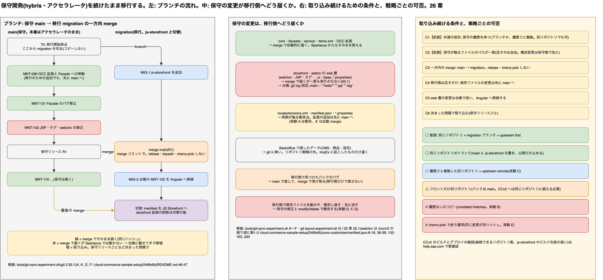

# 26. 保守の構成を変えずに、移行を並行させるリポジトリ戦略

> **図**: 25 保守と移行を並行させるリポジトリ戦略(`diagrams/spartacus-architecture.drawio`)。左: 方式 A(移行リポジトリへ `git subtree` で取り込む)。中: 方式 B(merge せず、デプロイ用の木を組み立てる)。右: どちらでも残るものと、選び方



> **この章が答える問い**: 保守チームは現行のリポジトリ(直下に `bin/`・`config/`)を一切変えない。移行チームは CCv2 の構成(`core-customize/`・`js-storefront/`)で開発する。この 2 つを並行して運用し、保守の変更を移行側へ届け続ける方法はあるか。何ができて、何ができないか

> **位置づけ**: 13 章と 25 章は「コードをどこへ移すか」を扱った。この章は「その作業を、保守と別の構成のリポジトリでどう並行させるか」を扱う

> **根拠の取り方**:
> - **CCv2 のリポジトリ構成**: SAP の公式サンプル [SAP-samples/cloud-commerce-sample-setup](https://github.com/SAP-samples/cloud-commerce-sample-setup) のコミット `546fe5b`(以下 `sample/`)と、SAP Learning の [Analyzing the Code Repository for the Build Process](https://learning.sap.com/courses/expanding-upon-technical-essentials-of-sap-commerce-cloud/examine-the-code-repository-connection-process-for-deployments_ad1539e5-2611-4de3-aea2-7b858bbc4455)
> - **git の挙動**: 小さな hybris 風のリポジトリを 2 つ作って再現した実験スクリプト。[`tools/git-parallel-repo-experiment.sh`](../tools/git-parallel-repo-experiment.sh)(実験 J。方式 A)と [`tools/assemble-deploy-experiment.sh`](../tools/assemble-deploy-experiment.sh)(実験 K。方式 B。組み立て本体は [`tools/assemble-deploy.sh`](../tools/assemble-deploy.sh))。git 2.50.1 で実行し、出力をそのまま載せる
> - **CCv2 の細部**(submodule を扱えるか、接続できるリポジトリの数、ビルドに使うブランチの指定)は help.sap.com を確かめられていない。そこに頼る記述は「要確認」と書く

---

### 先に話し言葉で: パスの違いは、移行側だけで吸収できる

結論から言うと、**できます**。保守チームは構成もブランチの運用も変えずに済みます。切替のあとも変える必要はありません。

保守と移行で違うのは、同じファイルの置き場所だけです。保守の `bin/custom/shop/...` は、CCv2 では `core-customize/hybris/bin/custom/shop/...` になります。この「頭に `core-customize/hybris/` を付ける」変換を、移行側だけで行えば済みます。やり方は 2 つあります。

- **方式 A: 移行リポジトリに、保守の履歴ごと取り込む。** `git subtree` を使うと、保守のコミットが `core-customize/hybris/` の下に付け替えられて、移行リポジトリに merge されます。git の 3-way merge が効くので、移行側が保守のファイルを書き換えていても、行が重ならなければ自動で合わさります(26.2)。
- **方式 B: merge しない。デプロイのたびに組み立てる。** 保守リポジトリの指定コミットを `core-customize/hybris/` に展開し、移行リポジトリの `js-storefront/` や `manifest.json` を重ねます。これを CCv2 につなぐデプロイ用リポジトリに commit します。2 つのリポジトリは互いを一切知りません(26.3)。

どちらを選んでも、**できないこと**が 2 つ残ります。これは構成の問題ではなく、並行開発そのものの性質です(26.5)。

- 両チームが同じファイルの同じ行を変えたら、誰かが手で解きます。
- 保守が直した JSP やタグは、Spartacus では動きません。台帳に載せて Angular へ手で移します。

---

### 26.1 前提: 何がずれていて、誰がどのファイルを持つか

**ずれているのはパスだけ。** CCv2 は、リポジトリ直下に `core-customize/`(必須)と `js-storefront/`(任意)を置き、それぞれに `manifest.json` を置く構成を求めます(SAP Learning の上記ページ。直下に 1 つの manifest を置く旧構成は「no longer recommended」)。サンプルも同じ形です(`sample/README.md:46-47`)。

| | 保守リポジトリ(変えない) | CCv2 での置き場所 |
|---|---|---|
| カスタム拡張 | `bin/custom/...` | `core-customize/hybris/bin/custom/...` |
| 設定 | `config/localextensions.xml`、`config/*.properties` | `core-customize/hybris/config/...` |
| ビルド定義 | (無い) | `core-customize/manifest.json`、`js-storefront/manifest.json` |
| Spartacus | (無い) | `js-storefront/` |

**ファイルの持ち主を決める。** 並行開発が楽になるかどうかは、移行側が保守のファイルを書き換える回数でほぼ決まります。

| 持ち主 | ファイル | 移行側での扱い |
|---|---|---|
| 保守 | `bin/`・`config/` の下にあるもの全部 | 移行側は原則として触らない。変えたいものは保守へ依頼して、保守のリリースで受け取る(upstream first) |
| 移行 | `js-storefront/`、`core-customize/manifest.json`、移行だけで使う新しい拡張(例: `bin/custom/migocc/`) | 自由に変える。保守とは衝突しない |
| 両方が変えたい | 既存の Facade や OCC 拡張、`localextensions.xml`、`*.properties` | 衝突点。できるだけ「保守へ依頼」か「manifest で足す」に寄せる |

**拡張とプロパティの追加は、`manifest.json` 側でできる。** サンプルの `core-customize/manifest.json` は、`extensions` に拡張を並べ(`:4-7`)、同じファイルの `useConfig.extensions` で `hybris/config/localextensions.xml` も読み込んでいます(`:49-56`)。プロパティも `properties` に直接書けます(`:58` 以降)。storefront の addon の指定も `storefrontAddons` にあります(`:8-18`)。つまり、移行で要る拡張や設定の追加の多くは、保守の `localextensions.xml` や `local.properties` を触らずに、移行が持つ `manifest.json` に書けます。両方を併記したときの優先順位は確かめていません(要確認)。

---

### 26.2 方式 A: 移行リポジトリへ `git subtree` で取り込む

**仕組み。** 移行リポジトリは別に作ります。そこへ保守リポジトリを remote として足し、`git subtree add` で保守の全履歴を `core-customize/hybris/` の下に取り込みます。以後は保守のリリースごとに `git subtree pull` を実行します。保守リポジトリには何も書き込みません。

```bash
# 一度だけ(移行リポジトリで)
git init mig && cd mig
git commit --allow-empty -m "MIG-root"
git remote add maint <保守リポジトリの URL>
git fetch maint
git subtree add --prefix=core-customize/hybris maint main      # --squash は付けない
# このあと js-storefront/ と core-customize/manifest.json を足す

# 保守リリースのたび
git fetch maint
git log --no-merges --format='%h %s' main..maint/main -- 'bin/custom/*/web/*' '*.jsp' '*.tag' 'config/*'   # 台帳
git subtree pull --prefix=core-customize/hybris maint main -m "sync maintenance R<n>"
```

**実験 J の結果**(`tools/git-parallel-repo-experiment.sh`)

| | 操作 | 結果 |
|---|---|---|
| J1 | `git subtree add` で移行リポジトリを作り、`js-storefront/`・`manifest.json`・移行専用の拡張を足す。Facade の 1 行も変える | 移行の直下は `core-customize` と `js-storefront` だけ。保守リポジトリのファイルは元のまま |
| J2 | 保守が自分の構成のまま、Facade の別の行・JSP・設定を変え、拡張を足し、古い拡張を消し、直下に `scripts/` を足す | 保守側は何も意識しない |
| J3 | 移行で `git subtree pull` | 6 ファイルがすべて `core-customize/hybris/` の下で反映された(追加・削除・変更)。Facade は両側の変更が合わさった。台帳には JSP と設定を触った保守コミットが出た |
| J4 | 移行の backend 変更を `git subtree split` で保守の構成に戻す | 保守の構成(`bin/`・`config/`)に戻るが、**移行専用の `bin/custom/migocc/` まで一緒に付いてくる**。保守へ渡すには向かない |
| J5 | 渡したいコミットだけを `git format-patch --relative=core-customize/hybris` で書き出し、保守で `git am -3` | 保守のパスに直った 1 ファイルの変更として入った。`-3` なしだと、保守が近くの行を変えていたため適用できなかった |
| J6 | 保守がそれをリリースしたあとで `git subtree pull` | 衝突なし。同じ変更が両側にあるだけなので合わさった |
| J7 | 両側が Facade の同じ行を変える | `CONFLICT (content)`。`core-customize/hybris/...` のパスで普通の衝突として出る |
| J8 | 移行側で JSP の履歴と blame を見る | 保守のコミット(M1、M3)が移行の履歴に並ぶ。blame は保守のコミットと保守のパスを指す |

**運用の決まり**

- **`--squash` を付けない。** 付けると保守のコミットが 1 つにまとまり、J8 のように保守のコミットを辿れなくなる。
- **保守へ返すときは `format-patch --relative` と `am -3` を使う(J5)。** `subtree split` は接頭辞の下を丸ごと持っていくので、移行専用の拡張まで混ざる(J4)。
- **取り込むのは本番に出た状態だけ。** 保守の main やリリースタグを `pull` する。作業中のブランチは取り込まない。
- **履歴は旧パスと並べて見る。** 移行リポジトリで `git log -- core-customize/hybris/<path>` とだけ書くと、取り込み前の保守のコミットが出ないことがある。`git log -- core-customize/hybris/<path> <path>` のように両方を並べるか、blame を使う(J8)。
- **接頭辞を打ち間違えると止まる。** 存在しない接頭辞を渡すと `fatal: 'core-customize/hybri' does not exist; use 'git subtree add'` で止まった。それでも、取り込みは alias かスクリプトに固定しておく。

**切替のあと。** 保守チームは構成を変える必要がありません。CCv2 は移行リポジトリにつなぎ、バックの開発は保守リポジトリのまま続けて、`subtree pull` で取り込み続けられます。いつか 1 つのリポジトリにまとめたくなったら、そのときに保守チームの都合で決めれば済みます。

---

### 26.3 方式 B: merge しない。デプロイのたびに組み立てる

**仕組み。** 保守リポジトリと移行リポジトリは、互いを remote にもしません。CI が、保守の指定コミットと移行の HEAD から CCv2 用の木を作り、CCv2 につなぐデプロイ用リポジトリに commit します。

```
移行リポジトリ
├── js-storefront/
└── core-customize/
    ├── manifest.json
    ├── overlay/          ← core-customize/hybris/ の上に重ねるファイル
    │   └── bin/custom/migocc/...        移行専用の拡張(保守には無いパス)
    │   └── bin/custom/shop/src/Facade.java   保守のファイルを置き換える場合だけ
    └── overlay.lock      ← 置き換えるファイルを、保守のどの版で見直したか(blob のハッシュ)
```

組み立ては [`tools/assemble-deploy.sh`](../tools/assemble-deploy.sh) で行います。手順は次のとおりです。

1. `git archive` で保守の指定コミットを `core-customize/hybris/` に展開する
2. 保守のファイルを置き換える overlay があれば、その保守ファイルの今の blob を `overlay.lock` と比べる。違っていれば止まる
3. overlay、`manifest.json`、`js-storefront/` を重ね、`DEPLOYED_FROM` に両方のコミットを書く

```bash
tools/assemble-deploy.sh <保守リポジトリ> <保守のタグ> <移行リポジトリ> out/
rsync -a --delete --exclude .git out/ deploy/ && git -C deploy add -A && git -C deploy commit -m "deploy R<n>"
```

**実験 K の結果**(`tools/assemble-deploy-experiment.sh`)

| | 操作 | 結果 |
|---|---|---|
| K1 | 最初の組み立て | `core-customize/hybris/` の下に保守のファイルと移行専用の拡張、Facade の overlay が入った。`DEPLOYED_FROM` に保守と移行のコミットが残った |
| K2 | 保守が、移行が置き換えていないファイルを変える(JSP、新しい拡張、`localextensions.xml`) | 何もしなくても次の組み立てに入った。デプロイの差分は 3 ファイル |
| K3 | 保守が、移行が置き換えている Facade を直す | `REVIEW: bin/custom/shop/src/Facade.java changed in maintenance` で止まり、デプロイ用リポジトリには何も commit されなかった |
| K4 | 移行が保守の差分を overlay に写し、`overlay.lock` を更新する | 組み立てが通った。Facade は両側の変更が入った |
| K5 | デプロイの履歴を見る | 各デプロイの `DEPLOYED_FROM` から、どの保守コミットが本番に入ったかが分かる |

**この方式の性質**

- **保守の変更が黙って消えることはない。** overlay は丸ごとの置き換えなので、比べなければ保守の修正を上書きして消す。それを `overlay.lock` で止めている(K3)。
- **その代わり、置き換えたファイルは毎回手で合わせる。** git の 3-way merge は効かない。overlay で保守のファイルを置き換えるのは数ファイルまでにする。拡張や設定の追加は `manifest.json` へ(26.1)、Facade の変更は保守へ依頼する(upstream first)。
- **保守のファイルを消すことはできない。** overlay は足すか置き換えるだけ。storefront を外すような変更は `manifest.json`(`storefrontAddons` は `:8-18`、`accstorefront` の aspect は `:320`)で表す。
- **CI が要る。** デプロイ用リポジトリを作る仕組みは、移行チームが持つ。

---

### 26.4 どちらを選ぶか

| | 方式 A: `git subtree` | 方式 B: 組み立て |
|---|---|---|
| 保守チームの作業 | なし | なし |
| 保守の変更の届き方 | merge。行が重ならなければ自動で合わさる(J3) | 展開。移行が置き換えていないファイルは自動で入る(K2) |
| 移行が保守のファイルを変えたとき | 3-way merge が効く。同じ行だけ衝突(J7) | 保守がそのファイルを変えるたびに止まり、手で写す(K3・K4) |
| 本番に入った保守コミットの追い方 | 移行リポジトリの履歴と blame(J8) | `DEPLOYED_FROM`(K5) |
| 道具 | git だけ | 組み立てスクリプトと CI |
| 向いている場合 | 移行で既存の Facade や OCC 拡張を何か所も変える | 移行の変更がほとんど新しい拡張と `manifest.json` で済む。2 つのリポジトリを完全に分けたい |

**推奨は方式 A。** 移行では、既存の Facade や OCC 拡張に手を入れる場面が必ず出ます(25.6)。そのたびに手で写す方式 B より、git に合わせさせる方式 A のほうが手間も見落としも少なくなります。方式 B は、移行側の変更を overlay 数ファイルまでに抑えられると分かっている場合に選びます。

---

### 26.5 どちらでも残るもの(できないこと)

| 残るもの | 理由 | 対処 |
|---|---|---|
| 同じ行の衝突 | 両チームが同じ行を変えれば、どちらを採るかは人が決めるしかない(J7、K3) | 衝突点(26.1 の「両方が変えたい」)を減らす。変更は保守へ依頼して、保守のリリースで受け取る |
| JSP・タグ・`web/src` の修正 | 取り込んでも、Spartacus の通り道(`/occ/v2`)では実行されない(25.1) | 保守リリースごとに台帳を出し、Angular へ移す。方式 A は 26.2 の `git log`。方式 B は `git -C <保守> log --no-merges <前回の DEPLOYED_FROM の保守コミット>..<今回> -- 'bin/custom/*/web/*' '*.jsp' '*.tag' 'config/*'` |
| Backoffice で直したデータ | git に無い | リポジトリ戦略の外。ImpEx に起こしたものだけが届く |
| CCv2 の仕様に頼る部分 | 確かめていない | submodule を CCv2 のビルドが扱えるか、保守リポジトリと移行リポジトリの両方をつなげるか、ビルドするブランチの指定。どちらの方式も CCv2 には 1 つのリポジトリしか見せないので、これらに頼らずに済む |

**取らないほうがよい形**

- **履歴なしでファイルをコピーした移行リポジトリ。** 共通の祖先が無いので、あとから merge できない(`refusing to merge unrelated histories`)。方式 A は `subtree add` で、保守の全履歴を最初から持たせる。
- **`git submodule` で保守リポジトリを `core-customize/hybris` に差し込む。** パスの違いは吸収できる。ただし、移行側が保守のファイルを変える場所が無い(submodule の中で変えると保守のリポジトリに commit することになる)。CCv2 のビルドが submodule を取りに行くかどうかも確かめていない(要確認)。

---

### 26.6 まとめ

| 問い | 答え |
|---|---|
| 保守の構成を変えずに並行できるか | できる。パスの違い(`bin/` ↔ `core-customize/hybris/bin/`)は移行側だけで吸収する |
| 方式 | A: 移行リポジトリへ `git subtree add` / `pull`(推奨)。B: merge せずデプロイのたびに組み立てる |
| 保守へ返すとき | A は `format-patch --relative=core-customize/hybris` + `am -3`。`subtree split` は移行専用の拡張まで混ざる |
| 移行が保守のファイルを変える回数 | 減らす。拡張と設定の追加は `manifest.json`(`sample/core-customize/manifest.json:4-7, 49-56, 58-`)、Facade の変更は保守へ依頼する |
| できないこと | 同じ行の衝突を無くすこと、JSP の修正を自動で Spartacus に届けること |
| 切替のあと | 保守は構成を変えなくてよい。A も B も、そのまま続けられる |

---

[目次](README.md) | ← [25. JSP やタグから Java を呼んでいた処理はどうなるか、フロントとバックの責務をどう分けるか](25-jsp-java-calls-and-responsibilities.md) | [27. フロントエンドだけでコンポーネントをカスタマイズする方法の一覧: 標準にある部品・JSP 由来の部品・無い部品](27-frontend-component-customization-catalog.md) →
