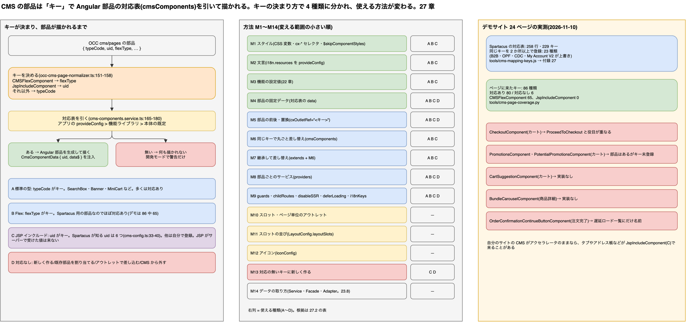

# 27. フロントエンドだけでコンポーネントをカスタマイズする方法の一覧: 標準にある部品・JSP 由来の部品・無い部品

> **図**: 26 フロントだけのコンポーネントカスタマイズ(`diagrams/spartacus-architecture.drawio`)。左: OCC の部品が Angular の部品に対応づくまでと、4 つの種類。中: 方法 M1〜M14 を、変える範囲の小さい順に。右: デモサイト 24 ページの実測



> **この章が答える問い**: バックエンドを触らずに、フロントエンド(Spartacus)だけで画面の部品を変える方法には何があるか。Spartacus が標準で持っている部品、アクセラレータの JSP で描かれていた部品、Spartacus に実装が無い部品で、やり方はどう変わるか。機能(ヘッダー、商品詳細、カート、チェックアウト……)ごとに、どの部品をどう変えるか

> **位置づけ**: 22 章は「要件から触る場所を引く」100 件、23 章は「書く場所」の規則を扱った。この章は部品の側から引く一覧。書く場所の規則は 23.2、データの取り方を変える話(Adapter・Facade)は 23.8 と 15 章に任せる

> **根拠の取り方**:
> - **Spartacus のソース**: `spartacus/` の `b7b028f`(2612.0.0)。パスは `spartacus/` からの相対
> - **登録されている対応の全件**: [`tools/cms-mapping-keys.js`](../tools/cms-mapping-keys.js) で `cmsComponents` を TypeScript の構文木から抜き出した(テスト・e2e・schematics は除く)。結果は付録 [extras/27-cms-component-mappings.md](extras/27-cms-component-mappings.md)
> - **実際のページに来る部品**: デモサイトの OCC から 24 ページ分の `cms/pages` を取り、[`tools/cms-page-coverage.py`](../tools/cms-page-coverage.py) で対応の有無を突き合わせた(2026-11-10 実測)
> - **コード例**: 既存の部品と同じ書き方にそろえた雛形で、ビルドして動かしてはいない

---

### 先に話し言葉で: 部品は「キー」で決まる。キーに何が使われるかで 4 種類に分かれる

Spartacus は、CMS のページに置かれた部品を 1 つずつ見て、**キー**を 1 つ決めます。そのキーで「どの Angular コンポーネントで描くか」の対応表(`cmsComponents`)を引きます。フロントだけのカスタマイズは、ほとんどがこの対応表か、そのまわりに手を入れることです。

キーの決め方は 3 通りです。普通の部品は `typeCode`。`CMSFlexComponent` は `flexType`。`JspIncludeComponent` は `uid`(`core-libs/core/src/occ/adapters/cms/converters/occ-cms-page-normalizer.ts:151-158`)。`JspIncludeComponent` は、アクセラレータで「この JSP を読み込め」と置いていた部品です。Spartacus はその uid を見て、Angular の部品に置き換えます。

そして、対応表にキーが無い部品は**何も描かれません**。開発モードでコンソールに警告が出るだけです(`core-libs/storefront/cms-structure/services/cms-components.service.ts:165-180`)。

だから最初の作業は仕分けです。自分のサイトのページに来る部品のキーを全部出し、Spartacus の対応表と突き合わせます(27.1)。対応があれば、見た目・文言・前後への差し込み・丸ごとの差し替えまで、フロントだけでできます(27.2)。対応が無ければ、Angular で新しく作って登録するか、CMS から外すかを決めます(27.3)。

---

### 27.1 仕分け: 4 つの種類

| 種類 | OCC での形 | キー | Spartacus の対応 | 例 |
|---|---|---|---|---|
| **A 標準の型** | `typeCode` が `SimpleBannerComponent` などの CMS の型 | `typeCode` | 多くはある | `SearchBoxComponent` → `SearchBoxComponent`(`core-libs/storefront/cms-components/navigation/search-box/search-box.module.ts:43`) |
| **B Flex** | `typeCode: "CMSFlexComponent"` と `flexType` | `flexType` | Spartacus 用に用意された部品なので、ほぼある | `CartComponent` → `CartDetailsComponent`(`feature-libs/cart/base/components/cart-details/cart-details.module.ts:37`) |
| **C JSP インクルード** | `typeCode: "JspIncludeComponent"` | `uid` | 型定義に 6 つの uid だけ挙がっている(`core-libs/core/src/cms/config/cms-config.ts:33-40`) | `ProductDetailsTabComponent`、`ProductSpecsTabComponent`、`ProductReviewsTabComponent`、`AccountAddressBookComponent`、`ForgotPasswordComponent`、`ResetPasswordComponent` |
| **D 対応なし** | A〜C のどれでも、キーが対応表に無い | — | 無い。何も描かれない | デモでは下の 6 件 |

**登録されている対応の数。** Spartacus 全体で 258 行、キーの種類は 229(付録)。どこにあるかの内訳は次のとおりです。

- `core-libs/storefront` に 46 行
- 機能ライブラリ(`feature-libs/`)に 180 行余り。order 37、organization 23、user 21、checkout 20、cart 20 など
- 連携ライブラリ(`integration-libs/`)に 40 行余り

23 種類のキーは 2 か所以上で登録されています。B2B、OPF、CDC、My Account V2 が、本体の対応を同じキーで上書きしているためです。これは M6(同じキーでの差し替え)と同じ仕組みです。

**デモサイトの実測**(24 ページ、2026-11-10。トップ、商品詳細、カテゴリ、検索、カート、ログイン、チェックアウト 3 画面、マイアカウント 9 画面、注文完了、店舗検索など)

- 来た部品のキーは 86 種類。80 種類に対応があり、6 種類に無かった
- 86 種類のうち 65 種類が `CMSFlexComponent` だった。`JspIncludeComponent` は 0 件
- 商品詳細のタブの中身(`ProductDetailsTabComponent` など)も `CMSFlexComponent` で来ていた。デモのデータは Spartacus 向けに作られているため。アクセラレータから引き継いだ自分のサイトの CMS データでは、ここが `JspIncludeComponent` のまま来ることがある

| デモで対応が無かったキー | 種類 | 置かれていたページ | 読み取れること |
|---|---|---|---|
| `CheckoutComponent` | Flex | カート | 同じページの `CartProceedToCheckoutComponent` が役目を持っている |
| `PromotionsComponent`、`PotentialPromotionsComponent` | Flex | カート | `PromotionsComponent` という Angular 部品はあるが、CMS のキーとしては登録されていない(`core-libs/storefront/cms-components/misc/promotions/promotions.module.ts:9-13`) |
| `CartSuggestionComponent` | 標準の型 | カート | Spartacus に実装が無い |
| `BundleCarouselComponent` | 標準の型 | 商品詳細 | Spartacus に実装が無い |
| `OrderConfirmationContinueButtonComponent` | Flex | 注文完了 | 遅延ロードの一覧には名前がある(`feature-libs/order/root/order-root.module.ts:58`)が、描く部品の対応は見つからない |

**自分のサイトで仕分ける手順**

```bash
# 1. Spartacus の対応表を抜き出す(typescript が要る)
node tools/cms-mapping-keys.js <spartacus のクローン> > keys.tsv
# 2. 自分の OCC からページを取り、対応の有無を出す
python3 tools/cms-page-coverage.py keys.tsv https://<host>/occ/v2/<site> \
  ContentPage:homepage ProductPage:<商品コード> CategoryPage:<カテゴリコード> ContentPage:/cart ContentPage:/login ...
# 先頭が NO の行が D(対応なし)。typeCode が JspIncludeComponent の行が C
```

---

### 27.2 方法の一覧(M1〜M14)

変える範囲の小さい順に並べています。「使える種類」は 27.1 の A〜D です。

| # | 方法 | 変えられるもの | 使える種類 | 書き方 | 根拠 |
|---|---|---|---|---|---|
| M1 | スタイル | 色・余白・並び。部品の見た目 | A B C(描かれていれば) | CSS 変数(`--cx-color-primary` など)を上書きする。部品のタグ名(`cx-banner` など)にスタイルを書く。本体のスタイルを消すときは `$skipComponentStyles` にタグ名を入れる | `projects/storefrontapp/src/cms-themes.scss:6`、`core-libs/styles/scss/_components.scss:4-7` |
| M2 | 文言 | ボタン名・見出し・メッセージ | A B C | `provideConfig({ i18n: { resources: { en: { cart: { cartDetails: { proceedToCheckout: '…' } } } } } })`。チャンク名とキーは本体の翻訳ファイルで探す | `core-libs/core/src/i18n/config/i18n-config.ts:74-78`、`feature-libs/cart/base/assets/translations/en/cart.json:2-4` |
| M3 | 機能の設定値 | 件数・表示形式・有効/無効など、本体が設定として開けている項目 | A B C | `provideConfig` で該当の設定を書く。何が開いているかは 22 章 | 22 章、23.4 |
| M4 | 部品の固定データ | API に無い表示用の値、読み込み前の初期値 | A B C D | 対応表の `data` に書く | `core-libs/core/src/cms/config/cms-config.ts:79-85` |
| M5 | 部品の前後・置き換え(アウトレット) | 部品の前や後ろに足す。部品の代わりに別の物を出す | A B C **D** | `cxOutletRef="<キー>"` と `cxOutletPos`(`before`・`after`・`replace`)、または `provideOutlet`。スロットはどの部品もキーを outlet 名にして包んでいるので、対応の無いキーにも使える | `core-libs/storefront/cms-structure/page/slot/page-slot.component.html:7-16`、`core-libs/storefront/cms-structure/outlet/outlet.model.ts:9-13`、`core-libs/storefront/cms-structure/outlet/outlet.providers.ts:41-47` |
| M6 | 同じキーで丸ごと差し替え | 部品の中身全部 | A B C | アプリの `provideConfig` の `cmsComponents` に、同じキーで自分の部品を書く | 下の「優先順位」 |
| M7 | 継承して差し替え | テンプレートだけ、メソッド 1 つだけ | A B C | 本体のクラスを `extends` した部品を作り、M6 で登録する | 23.6 |
| M8 | 部品ごとのサービス | その部品の中だけで使うサービス | A B C D | 対応表の `providers` | `core-libs/core/src/cms/config/cms-config.ts:62-73` |
| M9 | 部品の出し方の条件 | 表示の条件(`guards`)、部品の下の子ルート(`childRoutes`)、SSR で出さない(`disableSSR`)、画面に入るまで読まない(`deferLoading`)、先に読む翻訳(`i18nKeys`) | A B C D | 対応表の各項目 | `core-libs/core/src/cms/config/cms-config.ts:60-93` |
| M10 | スロット・ページ単位のアウトレット | スロットの前後や中身、ページテンプレート全体 | — | `cxOutletRef` にスロットの position 名、またはページテンプレート名を書く | `core-libs/storefront/cms-structure/page/slot/page-slot.component.html:1-5`、`core-libs/storefront/cms-structure/page/page-layout/page-layout.component.html:4` |
| M11 | スロットの並び | ページテンプレートごとのスロットの順番、画面幅ごとの出し分け | — | `LayoutConfig.layoutSlots` を `provideConfig` で書く | `core-libs/storefront/layout/config/layout-config.ts:37-56, 94-102`、本体の既定 `core-libs/storefront/recipes/config/layout-config.ts:32` |
| M12 | アイコン | アイコンの種類と描き方 | — | `IconConfig` の `symbols`・`resources` | `core-libs/storefront/cms-components/misc/icon/icon.model.ts:82-112` |
| M13 | 対応の無いキーに新しく作る | D の部品を描く | **D**(C の 6 つ以外の uid も) | Angular で部品を作り、M6 と同じ書き方でそのキーに登録する | 27.3 |
| M14 | 部品が使うデータの取り方 | 取得先・変換・状態 | — | Service・Facade・Adapter・Normalizer を替える。部品の外の話 | 23.7、23.8、15 章 |

**優先順位: アプリの `provideConfig` は、本体と機能ライブラリの対応に勝つ。**

- ライブラリは `provideDefaultConfig` で対応を書き、`DefaultConfigChunk` に入る。アプリの `provideConfig` は `ConfigChunk` に入る(`core-libs/core/src/config/config-providers.ts:18-27, 55-60`)。全体の設定は `deepMerge({}, DefaultConfig, RootConfig)` で作られるので、`ConfigChunk`(RootConfig)のほうが上に重なる(`core-libs/core/src/config/config-tokens.ts:10-12, 23-41`)
- 遅延ロードされる機能の部品でも同じ。機能の中の対応は「既定」として扱われ、その上にアプリの設定が `deepMerge` で重なる(`core-libs/storefront/cms-structure/services/cms-components.service.ts:126-133`)
- だから、B2B や OPF を入れていて同じキーが何か所かで登録されていても、アプリ側で書いたものが出る

---

### 27.3 種類ごとの手順

**A・B(対応がある)— M1 から順に、足りなければ次へ**

```ts
// M6: 同じキーで差し替える(アプリの spartacus-configuration.module.ts など。置き場所は 23.2)
provideConfig(<CmsConfig>{
  cmsComponents: {
    ProductAddToCartComponent: { component: MyAddToCartComponent },
  },
}),

// M7: 本体を継承して、テンプレートだけ替える
@Component({
  selector: 'app-banner',
  templateUrl: './my-banner.component.html',
  standalone: false,
})
export class MyBannerComponent extends BannerComponent {}
```

```html
<!-- M5: カートに入れるボタンの前に注意書きを足す(部品を替えない) -->
<ng-template cxOutletRef="ProductAddToCartComponent" cxOutletPos="before">
  <app-stock-note></app-stock-note>
</ng-template>
```

**C(JSP インクルード)— uid がキーになる**

1. OCC が返す `uid` を確かめる。上の 6 つなら、Spartacus の部品がそのまま出る(付録で場所を引ける)。
2. それ以外の uid は対応が無い(D と同じ)。Angular の部品を作り、**uid をキーにして**登録する(M13)。
3. JSP がサーバー側で受け取っていた値(コントローラーが model に積んだもの、タグが呼んでいた Java)は、フロントには来ない。部品が要るデータは OCC から取る(25 章)。足りなければ、その時点でフロントだけの話ではなくなる。
4. uid がキーなので、同じ JSP を別の uid で何か所にも置いていると、uid ごとに登録が要る。数が多いなら、CMS 側で `CMSFlexComponent` と `flexType` に置き換えるほうが楽(CMS のデータ作業。14 章)。

```ts
// uid が StoreInfoJspInclude の JspIncludeComponent を、自作の部品で描く
provideConfig(<CmsConfig>{
  cmsComponents: {
    StoreInfoJspInclude: { component: StoreInfoComponent },
  },
}),

// 部品の側: CMS のデータ(uid や属性)は CmsComponentData から読む
export class StoreInfoComponent {
  data$ = inject<CmsComponentData<CmsComponent>>(CmsComponentData).data$;
}
```

`CmsComponentData` は `uid` と `data$` を持つ(`core-libs/storefront/cms-structure/page/model/cms-component-data.ts:10-13`)。

**D(対応なし)— 4 つの選択肢**

| 選択肢 | いつ | 方法 |
|---|---|---|
| 役目が他の部品と重なっているので出さない | `CheckoutComponent`(カートの `CartProceedToCheckoutComponent` が同じ役目) | そのままでも何も描かれない。警告を消したいなら CMS のページから外す(CMS のデータ作業) |
| 新しく作る | 画面に要るのに実装が無い(`CartSuggestionComponent`、`BundleCarouselComponent`) | M13。データが OCC に無ければバックエンドの作業も要る(11 章の仕様書) |
| 既存の Angular 部品を割り当てる | 部品はあるのに CMS のキーとして登録されていない(`PromotionsComponent`) | M6 と同じ書き方で、そのキーに既存の部品を登録する。部品が要るデータ(入力)を CMS の部品が渡せるかは、部品のソースで確かめる |
| アウトレットで差し込む | 1 か所だけ何か出したい | M5 の `replace`。キーが outlet 名になっているので、対応が無くても差し込める |

---

### 27.4 機能別の一覧

主な部品のキーと、本体の Angular 部品の場所です。全件は付録にあります。どの方法を使うかの目安を右端に書きました。

| 機能 | キー(種類) | Angular 部品(場所) | よく使う方法 |
|---|---|---|---|
| ヘッダー: ロゴ・バナー | `SimpleBannerComponent`(A) | `BannerComponent`(`core-libs/storefront/cms-components/content/banner/banner.module.ts:39`) | M1、M7 |
| ヘッダー: 検索 | `SearchBoxComponent`(A) | `SearchBoxComponent`(`core-libs/storefront/cms-components/navigation/search-box/search-box.module.ts:43`) | M3(候補の件数など、22 章)、M6 |
| ヘッダー: ミニカート | `MiniCartComponent`(A) | `MiniCartComponent`(`feature-libs/cart/base/components/mini-cart/mini-cart.module.ts:31`) | M1、M7 |
| ヘッダー: カテゴリメニュー | `CategoryNavigationComponent`(A) | `CategoryNavigationComponent`(`core-libs/storefront/cms-components/navigation/category-navigation/category-navigation.module.ts:23`、`data` あり) | M4(`data` の上書き)、M1 |
| ヘッダー: 言語・通貨 | `CMSSiteContextComponent`(A) | `SiteContextSelectorComponent`(`core-libs/storefront/cms-components/misc/site-context-selector/site-context-selector.module.ts:36`) | M1、M2 |
| フッター | `FooterNavigationComponent`(A)、`AnonymousConsentManagementBannerComponent`(B) | `FooterNavigationComponent`(`core-libs/storefront/cms-components/navigation/footer-navigation/footer-navigation.module.ts:27`)、`AnonymousConsentManagementBannerComponent`(`core-libs/storefront/cms-components/anonymous-consent-management/anonymous-consent-management.module.ts:34`、`deferLoading`) | M1、M2 |
| コンテンツ | `CMSParagraphComponent`、`CMSLinkComponent`、`SimpleResponsiveBannerComponent`、`ProductCarouselComponent`(A) | `ParagraphComponent`(`core-libs/storefront/cms-components/content/paragraph/paragraph.module.ts:24`)、`LinkComponent`(`core-libs/storefront/cms-components/content/link/link.module.ts:19`)、`BannerComponent`(`core-libs/storefront/cms-components/content/banner/banner.module.ts:33`)、`ProductCarouselComponent`(`core-libs/storefront/cms-components/product/carousel/product-carousel/product-carousel.module.ts:45`) | M1、M7 |
| 商品一覧・検索結果 | `CMSProductListComponent`、`SearchResultsListComponent`、`ProductRefinementComponent`(A) | `ProductListComponent`(`core-libs/storefront/cms-components/product/product-list/product-list.module.ts:68, 84`)、`ProductFacetNavigationComponent`(`core-libs/storefront/cms-components/product/product-list/product-facet-navigation/product-facet-navigation.module.ts:23`) | M3(表示形式・件数)、M5(一覧の項目への差し込み)、M7 |
| 商品詳細: 上部 | `ProductImagesComponent`、`ProductIntroComponent`、`ProductSummaryComponent`(B) | `ProductImagesComponent`(`core-libs/storefront/cms-components/product/product-images/product-images.module.ts:32`。image-zoom を入れると `feature-libs/product/image-zoom/components/product-image-zoom/product-image-zoom.module.ts:55` が上書き)、`ProductIntroComponent`(`core-libs/storefront/cms-components/product/product-intro/product-intro.module.ts:29`)、`ProductSummaryComponent`(`core-libs/storefront/cms-components/product/product-summary/product-summary.module.ts:23`) | M5、M7 |
| 商品詳細: カートに入れる | `ProductAddToCartComponent`(A) | `AddToCartComponent`(`feature-libs/cart/base/components/add-to-cart/add-to-cart.module.ts:37`、`data` あり) | M4、M5、M6 |
| 商品詳細: タブ | `CMSTabParagraphContainer`(A)の中に `ProductDetailsTabComponent`・`ProductSpecsTabComponent`・`ProductReviewsTabComponent`(**C または B**) | `TabParagraphContainerComponent`(`core-libs/storefront/cms-components/content/tab-paragraph-container/tab-paragraph-container.module.ts:33`)、`ProductDetailsTabComponent`(`core-libs/storefront/cms-components/product/product-tabs/product-details-tab/product-details-tab.module.ts:24`)、`ProductAttributesComponent`(`core-libs/storefront/cms-components/product/product-tabs/product-attributes/product-attributes.module.ts:18`)、`ProductReviewsComponent`(`core-libs/storefront/cms-components/product/product-tabs/product-reviews/product-reviews.module.ts:43`) | M6、自作のタブは M13(uid か flexType で登録) |
| 商品詳細: 関連商品 | `ProductReferencesComponent`(A) | `ProductReferencesComponent`(`core-libs/storefront/cms-components/product/carousel/product-references/product-references.module.ts:35`) | M1、M7 |
| カート | `CartComponent`、`CartTotalsComponent`、`CartApplyCouponComponent`、`CartProceedToCheckoutComponent`(B) | `CartDetailsComponent`(`feature-libs/cart/base/components/cart-details/cart-details.module.ts:37`)、`CartTotalsComponent`(`feature-libs/cart/base/components/cart-totals/cart-totals.module.ts:18`)、`CartCouponComponent`(`feature-libs/cart/base/components/cart-coupon/cart-coupon.module.ts:43`)、`CartProceedToCheckoutComponent`(`feature-libs/cart/base/components/cart-proceed-to-checkout/cart-proceed-to-checkout.module.ts:31`) | M2、M5、M7。D の 4 件(27.1)をどうするか決める |
| チェックアウト | `CheckoutDeliveryAddress`、`CheckoutPaymentDetails`、`CheckoutPlaceOrder`、`CheckoutOrderSummary`、`CheckoutProgress`(B) | 本体は `feature-libs/checkout/base/components/` の下(例 `checkout-delivery-address/checkout-delivery-address.module.ts:37`、`guards` あり)。B2B・定期注文・OPF・Digital Payments を入れると同じキーが上書きされる(付録の「重複」) | M2、M5、M7。M6 で替えるときは `guards` も写す |
| 注文完了 | `OrderConfirmationThankMessageComponent` ほか(B) | `OrderConfirmationThankYouMessageComponent`(`feature-libs/order/components/order-confirmation/order-confirmation.module.ts:72`) | M2、M5 |
| マイアカウント | `AccountOrderHistoryComponent`(B)、`AccountAddressBookComponent`(**C または B**)、`UpdateProfileComponent`(B) | `OrderHistoryComponent`(`feature-libs/order/components/order-history/order-history.module.ts:68`)、`AddressBookComponent`(`feature-libs/user/profile/components/address-book/address-book.module.ts:36`)、`UpdateProfileComponent`(`feature-libs/user/profile/components/update-profile/update-profile.module.ts:67`)。My Account V2 や CDC を入れると上書きされる | M2、M7。`guards` に注意 |
| ログイン・会員登録 | `ReturningCustomerLoginComponent`、`RegisterCustomerComponent`(B)、`ForgotPasswordComponent`・`ResetPasswordComponent`(**C または B**) | `LoginFormComponent`(`feature-libs/user/account/components/login-form/login-form.module.ts:52`)、`RegisterComponent`(`feature-libs/user/profile/components/register/register.module.ts:55`)、`ForgotPasswordComponent`(`feature-libs/user/profile/components/forgot-password/forgot-password.module.ts:51`)、`ResetPasswordComponent`(`feature-libs/user/profile/components/reset-password/reset-password.module.ts:49`) | M2、M7。入力項目を足すなら M7 と M14 |
| 店舗検索 | `StoreFinderComponent`(B) | `StoreFinderComponent`(`feature-libs/storefinder/components/store-finder-components.module.ts:69`、`childRoutes` で画面を持つ) | M1、M7。子ルートを替えるなら M9 |

---

### 27.5 選び方

| やりたいこと | 方法 |
|---|---|
| 色・余白・並びだけ | M1 |
| 文言だけ | M2 |
| 本体が設定として開けている項目 | M3(22 章で探す) |
| 部品の前後に何か足す | M5 |
| 部品のテンプレートの一部、メソッド 1 つ | M7 |
| 部品をまるごと別物に | M6 |
| スロットの順番、スマホだけ出さない | M11 |
| 部品が何も描かれない(D) | 27.3 の 4 択。まず「要るのか」を決める |
| JSP の部品(C) | uid を確かめ、6 つ以外なら M13。JSP がサーバーで受けていた値は OCC から取る(25 章) |
| 表示ではなく、データの取り方を変える | M14(23.8) |

---

### 27.6 まとめ

| 問い | 答え |
|---|---|
| 部品はどう決まるか | キーで対応表(`cmsComponents`)を引く。キーは `typeCode`、Flex なら `flexType`、JSP インクルードなら `uid` |
| 種類 | A 標準の型、B Flex、C JSP インクルード、D 対応なし。D は何も描かれず、開発モードで警告だけ出る |
| 方法 | M1 スタイル → M2 文言 → M3 設定 → M4 固定データ → M5 アウトレット → M6 差し替え → M7 継承 → M8〜M9 対応表の他の項目 → M10〜M12 スロット・アイコン → M13 新規 → M14 データの取り方 |
| 優先順位 | アプリの `provideConfig` が、本体・機能ライブラリ・遅延ロードの対応より上に重なる |
| JSP の部品 | uid がキー。Spartacus が知っている uid は 6 つ。それ以外は自分で登録する。JSP がサーバーで受けていた値はフロントに来ない |
| 自分のサイトで最初にやること | `tools/cms-mapping-keys.js` と `tools/cms-page-coverage.py` で、来る部品のキーと対応の有無を出す |

---

[目次](README.md) | ← [26. 保守の構成を変えずに、移行を並行させるリポジトリ戦略](26-repository-strategy-parallel-maintenance.md) | [番外. サブエージェントとスキルの分け方](extra-agent-split-patterns.md) →
