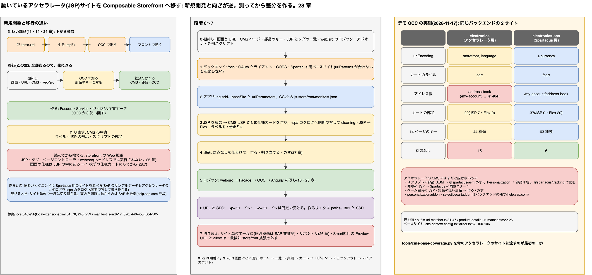

# 28. 動いている hybris(アクセラレータ)サイトを Composable Storefront へ移行する作業手順

> **図**: 27 アクセラレータからの移行手順(`diagrams/spartacus-architecture.drawio`)。左: 新規開発と移行で作業の向きが逆になること。中: 段階 0〜7。右: 同じバックエンドに 2 つのサイトを並べたデモの実測



> **この章が答える問い**: 新しい部品はバックオフィス(型と CMS)から作る、という流れはよく聞く。では、いまアクセラレータ(JSP)で動いているサイトを Composable Storefront へ移すときは、何をどの順番でやればいいか

> **位置づけ**: 新しく作る部品 1 つの手順は 11 章(フロントへの依頼書)・14 章(バックエンドのチェックリスト)・24 章(バックエンドの書き方)にある。この章は、すでにある画面・CMS・URL・ロジックをまとめて移すときの全体の順番を扱う。各段階の中身は既存の章(13・22〜27 章)へ案内する

> **根拠の取り方**:
> - **Spartacus のソース**: `spartacus/` の `b7b028f`(2612.0.0)。パスは `spartacus/` からの相対
> - **CCv2 の構成**: SAP の公開サンプル [SAP-samples/cloud-commerce-sample-setup](https://github.com/SAP-samples/cloud-commerce-sample-setup) の `546fe5b`(`ccs/` と略す)
> - **同じバックエンドでのアクセラレータ用 CMS と Spartacus 用 CMS の違い**: デモ OCC の `electronics`(アクセラレータ用)と `electronics-spa`(Spartacus 用)を、27 章の [`tools/cms-page-coverage.py`](../tools/cms-page-coverage.py) で同じ 14 ページずつ比べた(2026-11-17 実測)
> - **SAP 公式ドキュメント(help.sap.com、Composable Storefront 2211)**: 2026-11-17 に、`https://help.sap.com/http.svc/pagecontent?deliverableInfo=1&deliverable_id=<id>&file_path=<topic>.html` で本文を取得した(以下 [help] と略す)
>   - [FAQ](https://help.sap.com/docs/SAP_COMMERCE_COMPOSABLE_STOREFRONT/6c7b98dbe68f4a508cac17a207182f4c/36e63775a06d460c8f7ceb2368e96a13.html?version=2211)
>   - [Spartacus Sample Data Extension / CMS Changes Specific to the composable storefront Project](https://help.sap.com/docs/SAP_COMMERCE_COMPOSABLE_STOREFRONT/cfcf687ce2544bba9799aa6c8314ecd0/edc7f3a95ac4424b9cc5077d86a62e36.html?version=2211)
>   - [Installing SAP Commerce Cloud 2211-jdk21 for use with Composable Storefront](https://help.sap.com/docs/SAP_COMMERCE_COMPOSABLE_STOREFRONT/cfcf687ce2544bba9799aa6c8314ecd0/928ce101922944e3b546cf39d9831a4d.html?version=2211)
>   - [Setting Up CORS](https://help.sap.com/docs/SAP_COMMERCE_COMPOSABLE_STOREFRONT/cfcf687ce2544bba9799aa6c8314ecd0/c7822c94d74c446f8ebd3721eacaacc9.html?version=2211)
>   - [SmartEdit Integration](https://help.sap.com/docs/SAP_COMMERCE_COMPOSABLE_STOREFRONT/962112809f9a48f9b36aa05b208b3731/266db66bf8a7423193f30b5cacccd7ce.html?version=2211)
>   - アクセラレータ(2211 版のガイドは公開されておらず、最新が 2205 版): [WCMS Integration](https://help.sap.com/docs/SAP_COMMERCE/4c33bf189ab9409e84e589295c36d96e/8af9f8dc86691014b3e09a6aeb4664ec.html?version=2205)、[Adding a New CMS Page Template](https://help.sap.com/docs/SAP_COMMERCE/4c33bf189ab9409e84e589295c36d96e/8adbfc2d86691014a8fcf136b119868f.html?version=2205)、[Storefront Web Application Deconstructed](https://help.sap.com/docs/SAP_COMMERCE/4c33bf189ab9409e84e589295c36d96e/8af03fda8669101491e4aac2acaeb2dd.html?version=2205)、[Copying Files Between an AddOn and a Target Storefront](https://help.sap.com/docs/SAP_COMMERCE/b490bb4e85bc42a7aa09d513d0bcb18e/8acbff4b866910148e4be4ac7412dc83.html?version=2205)
>   - 機能ごとの要件: [Schematics](https://help.sap.com/docs/SAP_COMMERCE_COMPOSABLE_STOREFRONT/cfcf687ce2544bba9799aa6c8314ecd0/e38d45609de04412920a7fc9c13d41e3.html?version=2211)、[Feature Compatibility Matrix](https://help.sap.com/docs/SAP_COMMERCE_COMPOSABLE_STOREFRONT/6c7b98dbe68f4a508cac17a207182f4c/7f4265e58242466aba453632401cdff4.html?version=2211)、各機能のページ(28.3 の表)
>   - [Changes to Planned Removal Date for Deprecated Accelerator UI and Extensions](https://help.sap.com/docs/SAP_COMMERCE_CLOUD_PUBLIC_CLOUD/7e47d40a176d48ba914b50957d003804/1f1c6885781a4267a99c5d619d1f1edd.html?version=v2211)
> - **SAP Commerce 本体のソースは読めない**。[help] にも書かれていないものは「要確認」と書く。手順の分け方は、上の根拠から組み立てた筆者の整理

---

### 先に話し言葉で: 新規は「作る順」、移行は「測ってから差分を作る順」

新しい部品は、型(`items.xml`)→ 中身(ImpEx・Backoffice)→ OCC で出す → フロントで描く、の順に 1 つずつ作ります。何も無いところから積むので、バックエンドが先です。

移行はこれと向きが逆です。画面も CMS も URL もロジックも、もう全部あります。だから最初の仕事は作ることではなく、**棚卸しと測定**です。今あるページを OCC から取り、Spartacus がそのまま描ける部品と描けない部品を数えます。そのうえで、足りない部分だけを作ります。

もう 1 つの違いは、**捨てるものと残すものが分かれる**ことです。残るのは Facade・Service・型・商品データ・注文データで、Spartacus もこれを OCC 経由で使います。捨てるのは storefront の Web 拡張(JSP、タグ、ページコントローラ、`web/src`)です。ヘッドレスではこれらが一度も実行されません(25 章)。CMS の中身はその中間で、多くを作り直します。

ただし「JSP を捨てる」は「JSP を読まない」ではありません。アクセラレータでは、画面の仕様が書類ではなく JSP の中にあることが多いからです。何を表示し、どの条件で出し分け、どの文言を使い、どこへ送信していたか。これを JSP 1 枚ずつ読み出してから Spartacus の部品と突き合わせないと、移行後に「前はあった表示」が黙って消えます。CMS から JSP の部品が 0 になるのは、この読み出しが終わった結果です(28.7)。

SAP の FAQ は、アクセラレータから移す**直接の道は無い**と書いています([help] FAQ)。技術も作りもまったく違うからです(テンプレートとライブラリ、組み込みとヘッドレス、JSP と Angular)。そのうえで、考えておくことを 3 つ挙げています。

- 独自の機能には、Spartacus 用の API(OCC)が要る
- アクセラレータのスタイルはそのまま持っていけない
- 独自の CMS 部品には、Angular の部品を新しく作る必要がある

作るときは、**同じバックエンドに Spartacus 用のサイトをもう 1 つ並べ**ます。SAP のサンプルデータ自身がこの形です。アクセラレータ用のコンテンツカタログを写して `-spa` のカタログを作り、そこを Spartacus 向けに書き換えています(28.6)。デモ OCC にも、`electronics` と `electronics-spa` が並んでいます。

ただし、**お客さんに両方を同時に見せることは、SAP が推奨していません**(「複雑になるので、同時に動かすことは推奨しない」。[help] FAQ)。画面の一部だけを Spartacus に切り替える形は避け、サイト単位で一度に切り替えます(28.11)。

---

### 28.1 新規開発との違い

| | 新しい部品を作る(11・14・24 章) | 動いているサイトを移す(この章) |
|---|---|---|
| 出発点 | 何も無い | 画面・CMS・URL・ロジックが全部ある |
| 最初の作業 | 型を定義する(`items.xml`) | 今あるページを OCC で取り、部品のキーを数える(27.1) |
| バックエンドの仕事 | 型・ImpEx・Populator・OCC を足す | ほとんど足さない。`web/src` にあったロジックを Facade へ下ろし、足りない OCC を足す(25 章) |
| CMS | 新しい部品を 1 つ置く | ページごとに作り直す。ラベル、JSP の部品、スクリプトの部品(28.6〜28.8) |
| フロント | 部品を 1 つ作って登録する | 標準の部品をそのまま使い、足りない分だけ作る(27 章) |
| 終わり方 | 部品が出たら終わり | サイト単位で一度に切り替え、アクセラレータの storefront 拡張を外して終わり |
| SAP の公式の立場 | — | 直接の移行方法は無い。独自機能には API、スタイルは移せない、独自の CMS 部品は Angular で作り直す。両方を同時に動かすのは推奨しない([help] FAQ) |
| アクセラレータの今後 | — | UI のテンプレート拡張とアドオンは 2205 で deprecated。2027 年 9 月とされていた削除予定は、2026 年 6 月に取り消され、固定の削除日は無くなった。ただしヘッドレスへの移行は強く推奨され、今後の機能は OCC(REST)だけで出る。deprecated なのは UI 側で、バックエンドの機能モジュールではない([help] Changes to Planned Removal Date) |

---

### 28.2 全体の手順

| 段階 | やること | 成果物 | 詳しくは |
|---|---|---|---|
| 0 棚卸し | 画面と URL、CMS のページと部品、`web/src` のロジック、アドオン、外部スクリプトを一覧にする | 移行台帳 | 28.3 |
| 1 バックエンドを OCC で開く | `/occ` の Web アプリ、OAuth クライアント、CORS、Spartacus 用のベースサイト | `basesites` が新しいサイトを返す | 28.4 |
| 2 Spartacus アプリを作る | `ng add @spartacus/schematics`、ベースサイトと URL の形、CCv2 の `js-storefront/` | 空のホームが出る | 28.5 |
| 3 JSP を読み、CMS を Spartacus 向けにする | JSP 1 枚ずつ表示・出し分け・文言・操作・JS を書き出す。そのうえでページのラベル、JSP の部品を Flex へ、テンプレートとスロット | JSP ごとの仕様カード。`cms/pages` が全ページで 200 を返す | 28.6・28.7 |
| 4 部品を埋める | 対応の無いキーを仕分けて、作る・割り当てる・外す | 対応なしが 0 件 | 28.8 |
| 5 ロジックを移す | ページコントローラ・Validator・タグにあった処理を、Facade と OCC と Angular へ | 画面ごとの移植チケット | 28.9 |
| 6 URL と SEO | 商品・カテゴリ・コンテンツの URL、リダイレクト、SSR | 旧 URL が全部どこかに着く | 28.10 |
| 7 並行稼働と切り替え | リポジトリ、ログインとカート、SmartEdit、切り替えの単位、storefront 拡張を外す | 本番の切り替え | 28.11 |

段階 0〜2 は順番どおりに進めます。段階 3〜6 は画面ごとに回します(ホーム → 商品一覧 → 商品詳細 → カート → ログイン → チェックアウト → マイアカウント、など)。段階 7 のリポジトリの準備(26 章)は、段階 1 より前に決めておきます。

---

### 28.3 段階 0: 棚卸し

移行台帳の列は次のとおりです。1 行が 1 画面です。

| 列 | 取り方 |
|---|---|
| 画面と今の URL | storefront 拡張のページコントローラの `@RequestMapping` を grep する(25 章の grep) |
| CMS のページ | `cms/pages?pageType=ContentPage&pageLabelOrId=<ラベル>` などで取る。uid・テンプレート・ラベル |
| 部品のキーと対応の有無 | 27.1 の 2 つのスクリプト(`tools/cms-mapping-keys.js`、`tools/cms-page-coverage.py`)を、**今のアクセラレータのサイト**に向けて流す |
| `web/src` のロジック | ページコントローラ・BeforeViewHandler・Validator・タグ・EL 関数の呼び出し(25.1 の 8 つの形) |
| アドオン | `localextensions.xml` と CCv2 の `manifest.json` の `storefrontAddons`(`ccs/core-customize/manifest.json:8-17`)。アドオンの JSP 部分は Spartacus では動かない |
| 外部スクリプト | 分析タグ、同意バナー、決済のスクリプト。アクセラレータでは JSP に直書きされていることが多い |
| JSP・タグの一覧 | ページテンプレートの JSP、部品の JSP、`JspIncludeComponent` が指す JSP、タグ。storefront とアドオンの両方。読み方は 28.7 |

この段階で、**アドオンごとに Spartacus 側の受け手を決めます**。アドオンの JSP 部分は Spartacus では動きません。一方で、**バックエンドには残さなければならないアドオン**もあります。[help] の各機能ページで確かめた対応は次のとおりです(Composable Storefront 2211)。

| アクセラレータのアドオン | Spartacus のライブラリ | バックエンドに要るもの([help]) | ページ |
|---|---|---|---|
| `assistedservicestorefront` | `@spartacus/asm` | `assistedservicewebservices` 拡張と、その CORS(`corsfilter.assistedservicewebservices.*`) | [Assisted Service Module](https://help.sap.com/docs/SAP_COMMERCE_COMPOSABLE_STOREFRONT/eaef8c61b6d9477daf75bff9ac1b7eb4/8b02b85517af4804a6cc3743f54ead07.html?version=2211) |
| `smarteditaddon` | `@spartacus/smartedit` | 2105 以降と `spartacussampledata`(28.11) | [SmartEdit Integration](https://help.sap.com/docs/SAP_COMMERCE_COMPOSABLE_STOREFRONT/962112809f9a48f9b36aa05b208b3731/266db66bf8a7423193f30b5cacccd7ce.html?version=2211) |
| B2B のアドオン(組織・承認) | `@spartacus/organization`、`@spartacus/checkout`(B2B チェックアウト・定期注文) | B2C と B2B を並べるなら `occ.rewrite.overlapping.paths.enabled`(一部の B2B の OCC に `org` を付ける)。`b2bocc` を要件とする記述は見つからなかった | [B2B Commerce Organization](https://help.sap.com/docs/SAP_COMMERCE_COMPOSABLE_STOREFRONT/eaef8c61b6d9477daf75bff9ac1b7eb4/7baec2c402ab439ebd36cf215b72bf3f.html?version=2211) |
| `personalizationaddon` | `@spartacus/tracking`(personalization) | **`personalizationaddon` は残す**。文脈を OCC に出し、`PersonalizationScriptComponent` を供給するため。CORS に `occ-personalization-id`・`occ-personalization-time`。Backoffice で「Personalization for Commerce Web Services」を有効にする | [Personalization Integration](https://help.sap.com/docs/SAP_COMMERCE_COMPOSABLE_STOREFRONT/962112809f9a48f9b36aa05b208b3731/06a12afbc2fc4daaa9d5c9bbd8b02690.html?version=2211) |
| `ordermanagementaddon`(キャンセル・返品) | `@spartacus/order` | 2005 以降。Order Management の導入も検討。機能は CMS で置き、既定では無効 | [Cancellations and Returns](https://help.sap.com/docs/SAP_COMMERCE_COMPOSABLE_STOREFRONT/eaef8c61b6d9477daf75bff9ac1b7eb4/25194600d51a4bbba5c5c2dd15d7bcfe.html?version=2211) |
| `customerticketingaddon` | `@spartacus/customer-ticketing` | 2211 以降と `customerticketingocc` 拡張 | [Customer Service](https://help.sap.com/docs/SAP_COMMERCE_COMPOSABLE_STOREFRONT/eaef8c61b6d9477daf75bff9ac1b7eb4/7ecc65667bf34f19a2d4917fc18642f7.html?version=2211) |
| `selectivecartaddon`(あとで買う) | 本体の設定 `cart.selectiveCart.enabled: true`(既定は false。`feature-libs/cart/base/root/config/default-cart-config.ts:14-15`) | **`selectivecartaddon` は残す**(「The selectivecartaddon AddOn is also required」) | [Selective Cart](https://help.sap.com/docs/SAP_COMMERCE_COMPOSABLE_STOREFRONT/eaef8c61b6d9477daf75bff9ac1b7eb4/c202453f2e7e4499930689dc65a1ecbd.html?version=2211) |
| 同意・Cookie の通知 | 本体の Anonymous Consent(CMS の Flex 部品) | CORS の allowed / exposed ヘッダーに `x-anonymous-consents`。ConsentTemplate は `exposed=true` | [Anonymous Consent](https://help.sap.com/docs/SAP_COMMERCE_COMPOSABLE_STOREFRONT/eaef8c61b6d9477daf75bff9ac1b7eb4/7b5771346d9445e6a49dab9d62b6543a.html?version=2211) |

それ以外のライブラリ(店舗検索 `@spartacus/storefinder`、店舗受け取り `@spartacus/pickup-in-store`、保存カート・クイック注文 `@spartacus/cart` など)の一覧は、Schematics のページにあります。各機能が使える Composable Storefront と SAP Commerce の最低版は、Feature Compatibility Matrix にあります。

---

### 28.4 段階 1: バックエンドを OCC で開き、Spartacus 用のサイトを並べる

**Web アプリと拡張**: SAP の CCv2 サンプルは、1 つの環境でアクセラレータと OCC を同時に動かしています。`localextensions.xml` には次のものが並んでいます。

- **アクセラレータ**: `yacceleratorstorefront`(54 行)
- **OCC**: `commercewebservices`(78 行)、`cmsocc`(240 行)、`webservicescommons`(246 行)
- **Spartacus のサンプルデータ**: `spartacussampledata`(259 行)

`manifest.json` では、アクセラレータの Web アプリ(`accstorefront` の aspect、320 行)と、`commercewebservices` を `/occ` に載せる設定(504-505 行)が同じ環境にあります。移行中はこの形のまま進めます。

**CORS**: ブラウザが別の origin から OCC を呼ぶので、`corsfilter.commercewebservices.*` が要ります。

- **CCv2 サンプル:** `ccs/core-customize/manifest.json:446-458` に、許可する origin・ヘッダー・メソッドが並んでいます。
- **公式の例:** `allowedOriginPatterns=*` と `allowCredentials=true` を使います。2105 以降は `allowCredentials=true` と `allowedOrigins=*` を一緒に使えないからです([help] Setting Up CORS)。
- **本番:** どちらの例のワイルドカードも開発用です。本番では、Spartacus を配信する origin に絞ります(同)。

**公式のインストール手順で足す設定**([help] Installing … 2211-jdk21):

- `spartacussampledata` に入っている `custom.properties` を使う
- `authserver.oauthclientdetails.loginpageuri.allowed.hosts=<ストアフロントのホスト>`:Spartacus 側のログイン画面を使う場合
- `cookies.SameSite.enabled=true`
- 決済の模擬(`acceleratorservices.payment.sopmock.enabled=true`)はサンプルの店舗のための開発用で、本番では本物の決済代行とつなぐ

**OAuth クライアント**: Spartacus の既定の `client_id` は `mobile_android_public` です(`core-libs/core/src/auth/user-auth/config/default-auth-config.ts:50`)。公式の手順では、このクライアントを ImpEx で登録します。`public=true`、`authorizedGrantTypes=authorization_code,refresh_token`、`registeredRedirectUri` と `loginPageUri` はストアフロントの URL です([help] Step 3: Importing OAuth Client Credentials)。自社のクライアント名を使うなら、フロントの設定もそれに合わせます(24.9)。

**ベースサイト**: デモ OCC の `basesites` から、`electronics` と `electronics-spa` の値を抜き出しました(2026-11-17)。

| | `electronics`(アクセラレータ用) | `electronics-spa`(Spartacus 用) |
|---|---|---|
| `urlEncodingAttributes` | `storefront`, `language` | `storefront`, `language`, `currency` |
| `urlPatterns`(抜粋) | `?site=electronics`、`electronics.` で始まるホスト | 上の 2 つに加えて `https?://[^/]+/electronics-spa(…)`、`https?://localhost(:\d+)?/?$` |
| `theme` | `alpha` | `santorini` |

Spartacus は、ベースサイトを設定に固定していないとき、起動時に `basesites` を取ります。そして**今の URL に `urlPatterns` が合うサイト**を選びます(`core-libs/core/src/site-context/config/config-loader/site-context-config-initializer.ts:100-106`)。どのサイトにも合わなければ、`Cannot get base site config!` を投げて止まります(同 67 行)。この読み込みは、`context.baseSite` を静的に設定していないときだけ動きます(`core-libs/core/src/site-context/site-context.module.ts:34-40`)。URL に何を載せるかは `urlEncodingAttributes` から決まります。OCC の `storefront` は Spartacus の `baseSite` に読み替えられます(同 initializer 80 行・111-114 行)。

つまり、Spartacus 用のサイトを新しく作るなら、**Spartacus を配信する URL に合う `urlPatterns`** を入れておかないと起動しません。既存のアクセラレータのサイトをそのまま使う場合も、パターンを足す必要があります。

**サイトを新しく作るか、既存のサイトを使うか**: デモは新しく作る形です。新しいサイトにすると、CMS(28.6)をアクセラレータと別に作り直せるので、アクセラレータを止めずに作業できます。既存のサイトに Spartacus を向けると、CMS の変更がそのままアクセラレータの画面にも効いてしまいます。新しいサイトを作る場合も、商品カタログと価格・在庫のデータは共有できます。どの型のどの属性を共有するかは、自社のサイトの構成で確かめます。

---

### 28.5 段階 2: Spartacus アプリを作る

- **アプリを作る:** `ng add @spartacus/schematics` で骨格を作ります(23.1)。そのとき聞かれる OCC の接続先、ベースサイト、URL に載せる値(`urlParameters`)は、28.4 で作ったサイトに合わせます(`core-libs/schematics/src/add-spartacus/configuration.ts:143-145`)。
- **CCv2 に載せる:** サンプルは `js-storefront/manifest.json` で、アプリごとに SSR のエントリと CSR の webroot を指定しています(`ccs/js-storefront/manifest.json:1-14`)。
- **リポジトリ:** 保守と並行する場合のリポジトリの分け方は 26 章です。

この段階の完了条件は、ホームが空のレイアウトで表示されることです。ヘッダー、フッター、スロットの枠がそろえば十分です。ここで CMS の部品が欠けていても問題ありません。

---

### 28.6 段階 3: CMS を Spartacus 向けにする(実測)

同じバックエンドの 2 つのサイトから同じページを取り、部品の中身を比べました(`fields=DEFAULT`。2026-11-17)。

| ページ | `electronics` のラベル / 部品数 / JSP / Flex | `electronics-spa` のラベル / 部品数 / JSP / Flex |
|---|---|---|
| ホーム | `homepage` / 26 / 2 / 0 | `homepage` / 33 / 0 / 6 |
| カート | `cart` / 22 / 7 / 0 | `/cart` / 37 / 0 / 20 |
| ログイン | `login` / 15 / 4 / 0 | `/login` / 22 / 0 / 7 |
| アドレス帳 | `address-book` / 14 / 2 / 0 | `/my-account/address-book` / 22 / 0 / 7 |
| プロフィール変更 | `update-profile` / 14 / 3 / 0 | `/my-account/update-profile` / 21 / 0 / 6 |
| FAQ | `/faq` / 15 / 2 / 0 | `/faq` / 22 / 0 / 5 |

この表から、作り直すものが 3 つ分かります。

1. **ページのラベル**: Spartacus は、コンテンツページを URL のパスそのまま(`/my-account/address-book` など)で取りにいきます(3 章・4 章)。アクセラレータの CMS はラベルが `address-book` です。そのため、`pageLabelOrId=/my-account/address-book` で取ると `CMSItemNotFoundError` が返ります(実測)。`/cart` や `/login` はアクセラレータ側でも取れましたが、マイアカウントの下のページは取れませんでした。ラベルを URL の形にそろえるか、Spartacus のルートの `paths` をアクセラレータのラベルに合わせるかの、どちらかが要ります。
2. **JSP の部品を Flex へ**: 表の「JSP 0」は SAP がサンプルで作り終えた結果で、自社のサイトでは JSP を読んでから置き換えます(28.7)。アクセラレータの CMS は `JspIncludeComponent` で JSP を差し込んでいます。Spartacus 用の CMS では、同じ場所が `CMSFlexComponent` になっています(上の表で JSP が 0、Flex が増えている)。Spartacus は `JspIncludeComponent` の uid をキーに引くので(27 章)、作り直さなくても描ける部品があります。ただ、対応表に無い uid もあります(28.8)。
3. **部品の数が増える**: Spartacus 用のページは部品が多くなっています。アクセラレータでは JSP 1 枚が描いていた範囲を、Spartacus では複数の部品に分けて CMS に置くからです。カートは 22 個から 37 個に増えています。

**テンプレート名はそのまま使える**: どちらのサイトでも、テンプレート名は同じでした(`LandingPage2Template`、`CartPageTemplate`、`AccountPageTemplate`、`ContentPage1Template` など)。Spartacus の `LayoutConfig` も、このテンプレート名でスロットの並びを決めています(`core-libs/storefront/recipes/config/layout-config.ts:55-130`)。アクセラレータで独自に作ったテンプレートには、`layoutSlots` を足します(22 章、M11)。

**作り直し方(SAP のサンプルデータがやっていること)**: [help] の「Spartacus Sample Data Extension」に手順が書かれています。サンプルデータの `spartacussampledata` は、アクセラレータの店舗と商品カタログを共有したまま、Spartacus 用のサイト(`electronics-spa` など)を新しく作ります。その手順は次のとおりです。

1. 新しいコンテンツカタログ `<店舗>-spaContentCatalog` を作る(`import/contentCatalogs/` の `catalog.impex`)
2. アクセラレータの `<店舗>ContentCatalog:Staged` を、新しいカタログの Staged へ**同期で写す**(`sync.impex`)
3. Spartacus で使わないページ・スロット・部品を消す(`cleaning.impex`)
4. Spartacus 向けの変更を ImpEx で入れ、Staged から Online へ同期する

4 で入れる変更は、28.6 の実測とそのまま一致します。

| 変更 | 内容 |
|---|---|
| `JspIncludeComponent` → `CMSFlexComponent` | Angular のアプリで JSP を差し込む部品は意味が無いため。ただし後方互換のため Spartacus は `JspIncludeComponent` も扱う |
| ページのラベルを `/` 始まりに | ラベルがコンテンツページの URL になるため(例: `UPDATE ContentPage;…;label` で `login` → `/login`) |
| ヘッダーのスロットを足す | 全テンプレートに `SiteContextSlot`(言語・通貨の部品)、`SiteLinks`、`BottomHeaderSlot`(パンくずをここへ移す) |
| ミニカートのスロット | `OrderComponent` を外す |
| 新しいページ | `sale`・`help`・`contactUs`・`forgotPassword`・`resetPassword`・`register` |
| 商品詳細を CMS で組む | `ProductSummarySlot` に `ProductIntroComponent`・`ProductImagesComponent`・`ProductSummaryComponent`・`VariantSelector`・`AddToCart` を置く |
| その他 | 404 ページの中身、マイアカウントのナビにサインアウト、`SearchBoxComponent` の設定、チェックアウトまわりの CMS |

自社のサイトでも、同じ形がそのまま移行の手順になります。自社のアクセラレータのコンテンツカタログを `-spa` のカタログへ同期で写し、28.7 で読んだ JSP の仕様に沿って、消す・置き換える・足すを ImpEx で書きます。サンプルの ImpEx は、[help] の SAP Commerce Cloud Sample Repository の Release ページから入手するよう案内されています(本ノートでは中身を読んでいない)。

---

### 28.7 JSP を 0 にする前に: JSP の中身を読む

CMS の部品を Flex に付け替えるだけなら、ImpEx を書けば JSP の数は 0 になります。しかし、それでは JSP が担っていた仕様が引き継がれたかどうか分かりません。読まなければならない理由は 3 つあります。

**理由 1: CMS の数字に出る JSP は一部だけ**

28.6 の表で数えたのは `JspIncludeComponent` だけです。実際には、次の JSP も画面を作っています。

- ページテンプレートの JSP
- 普通の部品の型ごとの JSP
- タグ(`.tag`)
- アドオンが足したり差し替えたりした JSP

これらは CMS には出てきません。たとえば OPF のアドオンは、カートページ全体の JSP を自分のもので置き換えています。

- **置き換えている JSP:** `opfacceleratoraddon/acceleratoraddon/web/webroot/WEB-INF/views/responsive/pages/cart/cartPage.jsp`(opf SDK `7cd4c67`)
- **中で使っているタグ:** `<cart:cartValidation/>`、`<cart:cartPickupValidation/>`(14-15 行)
- **書いているもの:** ヘルプのポップアップと、その文言とサニタイズ(19-28 行)

**理由 2: 名前で対応が引けても、中身が同じとは限らない**

OCC は、`JspIncludeComponent` ごとに、どの JSP を使うかを `page` 属性で返します。デモの `electronics` の値は次のとおりです(`fields=FULL`、2026-11-17)。

| uid | `page` |
|---|---|
| `CartComponent` | `/WEB-INF/views/addons/selectivecartsplitlistaddon/responsive/pages/cart/cartDisplay.jsp` |
| `CartTotalsComponent` | `cartTotalsDisplay.jsp` |
| `CheckoutComponent` | `checkoutDisplay.jsp` |
| `PromotionsComponent` | `/WEB-INF/views/responsive/pages/cart/cartPromotionsDisplay.jsp` |
| `ReturningCustomerLoginComponent` | `accountReturningCustomerLogin.jsp` |
| `UpdateProfileComponent` | `accountProfileEditPage.jsp` |
| `CookieNotificationComponent` | `/WEB-INF/views/responsive/pages/consent/cookienotification.jsp` |

`CartComponent` は、Spartacus の対応表で名前が引ける部品でした(28.8)。しかし実際に描いていたのは、アドオン(`selectivecartsplitlistaddon`)が差し替えた JSP です。アドオンの JSP は、ビルドのときに storefront の `WEB-INF/views/addons/<アドオン名>/…` へ写されます。アドオンは storefront のどの資源でも上書きできます([help] Copying Files Between an AddOn and a Target Storefront)。Spartacus 側にも「あとで買う」に当たる機能があります。`cart.selectiveCart.enabled` で有効にし(`feature-libs/cart/base/components/cart-page-layout-handler.ts:63-66` の `isSelectiveCartEnabled`)、バックエンドの `selectivecartaddon` も残します(28.3)。とはいえ、アドオンの JSP が何を表示していたかを読まないと、どちらが同じ仕様なのか判断できません。

**理由 3: JSP がスロットの出し分けまで決めていた**

`cartPage.jsp` は、カートが空かどうかで出すスロットを切り替えています(41-59 行)。空でなければ `CenterLeftContentSlot`・`CenterRightContentSlot`・`BottomContentSlot` を出し、空なら `EmptyCartMiddleContent` を出します。

Spartacus では、この出し分けを `CartPageLayoutHandler` が受け持っています(`feature-libs/cart/base/components/cart-page-layout-handler.ts:33-56`)。ただし、Spartacus のカートページが並べるスロットは `TopContent`・`CenterRightContentSlot`・`EmptyCartMiddleContent` の 3 つだけです(`core-libs/storefront/recipes/config/layout-config.ts:109-111`)。アクセラレータで `CenterLeftContentSlot`(プロモーション)や `BottomContentSlot`(チェックアウトボタン)に置いた部品は、対応表で引けたとしても、**スロットごと描かれません**。

**JSP 1 枚から書き出すもの**

| 観点 | JSP での書き方(OPF のアドオンの実物) | Spartacus での行き先 |
|---|---|---|
| 表示する値と出どころ | `${cartData.code}`(`cartPage.jsp:25`)。出どころは 3 つある: コントローラが `model` に入れた値、CMS の属性(`${component.…}`)、タグや EL 関数の中の Java | OCC の `fields` にあるか確かめる。無ければ OCC を足す(24.6)。コントローラの値は 25 章 |
| 出し分け | `<c:if test="${empty cartData.rootGroups}">`(`cartPage.jsp:55`) | 部品のテンプレートの条件、レイアウトのハンドラ、CMS の Restriction |
| 文言 | `<spring:theme code="basket.page.cartHelpContent">`(`cartPage.jsp:26`) | Spartacus の i18n キーへ(01-8 章)。properties のキーと訳文を一覧にする |
| HTML の扱い | `ycommerce:sanitizeHTML`(`cartPage.jsp:27`) | CMS の HTML を描く部品の扱い(25 章) |
| 子の取り込み | `<cms:pageSlot>`・`<cms:component>`(36-58 行)、タグ `<cart:cartValidation/>`(14 行) | タグの中も読む。カートの検証は OCC の cart validate と Spartacus の検証の仕組みに対応させる |
| 操作と送信先 | `<form:form … action="${paymentFormUrl}" method="POST">`(`opfPaymentPage.jsp:39`) | 送信先のコントローラが何をするかを読み、OCC のどのリソースに当たるかを決める(12 章) |
| JS | `<script src="${resourcePath}/js/opfacceleratoraddon.js">`(`opfctascriptcomponent.jsp:1`)、`js-cart-help` のような JS 用のクラス(`cartPage.jsp:20`) | アクセラレータの JS が何をしていたかを読み、Angular の部品に移す |

結果は、JSP 1 枚につき 1 枚の**仕様カード**にまとめます。項目は、表示項目と出どころ、出し分けの条件、文言キー、操作と送信先、JS、取り込む子の 6 つです。そのカードを、Spartacus の対応する部品のテンプレート(`*.component.html`)と並べます。各行を次の 5 つに振り分けます。

1. 同じ
2. Spartacus にある(設定で有効にする)
3. OCC を足す
4. フロントを足す
5. やめる(業務と合意する)

ソースを読むだけでは足りない部分もあります。動いているアクセラレータの画面を、ログイン状態・カートの中身・権限を変えながら操作し、出し分けを実際に確かめます。

**一覧を作るコマンド**(storefront 拡張とアドオンの `web/webroot/WEB-INF` に向けて流す。OPF のアドオンで動くことを確かめた)

```bash
W=<拡張>/web/webroot/WEB-INF          # アドオンなら <アドオン>/acceleratoraddon/web/webroot/WEB-INF
# 文言キー
grep -rhoE 'code="[^"]+"' $W --include='*.jsp' --include='*.tag' | sort | uniq -c
# 表示に使っている値の根(fn・not・ycommerce などの関数は除いて読む)
grep -rhoE '\$\{[a-zA-Z]+(\.[a-zA-Z]+)*' $W --include='*.jsp' --include='*.tag' | sort | uniq -c | sort -rn
# 送信先と JS
grep -rnE '<form:form|action="|\.js"' $W --include='*.jsp' --include='*.tag'
# 使っているタグ(タグの中も読む)
grep -rhoE '<[a-z-]+:[a-zA-Z]+' $W --include='*.jsp' --include='*.tag' | sort | uniq -c | sort -rn
```

**JSP の場所の決まり**([help] WCMS Integration、Adding a New CMS Page Template。どちらも 2205 版のアクセラレータのガイド):

- **CMS 部品:**
  - 描くコントローラは、`<typeCode>Controller` という名前の bean です。無ければ `DefaultCMSComponentController` が使われ、部品の属性をそのまま model に入れます。
  - JSP の名前は、型コードを小文字にしたものです。
    - 既定のコントローラなら `WEB-INF/views/cms/` の下(例: `cmsparagraphcomponent.jsp`)
    - 専用のコントローラなら、そのコントローラが返すビュー名
  - **専用のコントローラがある型は、JSP だけでなくコントローラも読みます。**
- **ページテンプレート:** ページテンプレートの `frontendTemplateName` が JSP の名前です。例えば `layout/contentLayout2Page` は `WEB-INF/views/pages/layout/contentLayout2Page.jsp` に当たります。ログインやマイアカウントのような固定のページは、コントローラが直接ビュー名を返します。
- **`JspIncludeComponent`:** `page` 属性に、Web アプリの中の JSP のパスがそのまま入っています(OCC の `cms/pages?…&fields=FULL` で取れる。28.7 の表)。

この 3 つで、ページの JSP・部品の JSP・差し込まれる JSP を漏れなく拾えます。上の grep は、拾った JSP とタグの中身を読むためのものです。

---

### 28.8 段階 4: 対応の無い部品を埋める(実測)

27 章のスクリプトを、アクセラレータ用の `electronics` の 14 ページに流しました。対象はホーム・カート・ログイン・アドレス帳・プロフィール変更・FAQ・注文履歴・支払い情報・チェックアウトのログイン・注文完了・検索結果なし・404・商品詳細・カテゴリです。Spartacus 用の `electronics-spa` の同じページとも比べました。

| | `electronics`(アクセラレータの CMS のまま) | `electronics-spa`(Spartacus 用の CMS) |
|---|---|---|
| ページに来たキー | 44 種類 | 63 種類 |
| 対応なし | 15 | 6 |
| うち `JspIncludeComponent` | 20 種類中 8 が対応なし | JSP は 0 |

`electronics` で対応の無かった 15 件は、次の 4 つに分かれます。

| 分類 | キー | Spartacus 用の CMS(`electronics-spa`)ではどうなっているか | どうするか |
|---|---|---|---|
| 全ページに出るスクリプトの部品 | `AssistedServiceComponent`、`PersonalizationScriptComponent`、`ProfileTagScriptComponent` | ASM と Personalization の部品は無い。ProfileTag は Flex の `ProfileTagComponent`(対応あり) | ASM は CMS から外し、`@spartacus/asm` で受け持つ。**`PersonalizationScriptComponent` は外さない**。Spartacus の personalization は、`PlaceholderContentSlot` にあるこの部品から文脈を読む(`feature-libs/tracking/personalization/root/config/default-personalization-config.ts:11-18`。既定は `enabled: false`)。[help] Personalization Integration も、この部品を Staged と Online の `PlaceholderContentSlot` に置く ImpEx を示している。ProfileTag は `integration-libs/cds`(`integration-libs/cds/src/config/cds-config.ts`) |
| 全ページに出る同意の JSP | `AnonymousConsentManagementComponent`、`CookieNotificationComponent` | Flex の `AnonymousConsentManagementBannerComponent`・`AnonymousConsentOpenDialogComponent`(対応あり。`core-libs/storefront/cms-components/anonymous-consent-management/anonymous-consent-management.module.ts:17, 27`) | 部品を Spartacus 用のものに差し替える |
| ページ固有の JSP | `NewCustomerLoginComponent`、`OrderConfirmationContinueButtonComponent` | ログインのページは `ReturningCustomerRegisterComponent` などの Flex に置き換わっている。注文完了ページは Spartacus 用のサイトで取れず(404)、比べられなかった | 27.3 の C の手順で、既存の Angular の部品に割り当てるか、新しく作る |
| Spartacus 用の CMS でも対応が無いもの | `CheckoutComponent`、`PromotionsComponent`、`PotentialPromotionsComponent`、`ReturningCustomerCheckoutLoginComponent`、`CartSuggestionComponent`、`BundleCarouselComponent` | 同じ名前の Flex または型のまま残り、やはり対応なし(27 章の 6 件と同じ並び) | SAP のサンプルでも描かれていない。要るものだけを 27.3 の D の手順で作り、残りは CMS から外す |
| 実装の無い型 | `SaveForLaterCMSComponent`、`ChineseAccountAddressBookComponent` | 来ない | 使っていなければ CMS から外す |

`CartComponent`、`UpdateProfileComponent` など 12 件の `JspIncludeComponent` には対応がありました。Spartacus が、アクセラレータの JSP の uid と同じ名前をキーとして登録しているからです(27 章)。ただし、名前で引けても、Angular の部品が受け取るのは OCC の `CmsComponentData` だけです。JSP がサーバー側で受け取っていた値(ページコントローラが `model` に入れたもの)は来ません。見た目と動きが同じになるかは、画面ごとに確かめます(25 章)。

---

### 28.9 段階 5: ページコントローラと JSP のロジックを移す

25 章の手順を画面ごとに回します。

1. **Facade へ下ろす**: `web/src` に直接書かれたロジック(コントローラの中の計算、BeforeViewHandler の差し替え、Validator)を Facade へ移します。アクセラレータを動かしたまま変えられるので、移行の最初に保守のリリースで出せます(26 章の「upstream first」)。
2. **OCC を足す**: その Facade を OCC から呼べるようにします。`fields` の項目を足すか、新しいリソースを作ります(12 章・24.6・24.7)。応答の形は 13 章の規則に従います。ビューを返さず、State に入る形で返します。
3. **Angular に写す**: 見た目、文言、画面の一時的な状態はフロントで持ちます。ログイン必須や入力チェックは、正をバックエンドに置き、フロントには写しを置きます(25.4)。

チェックアウトと支払いは、このパターンの例外になりやすい部分です。決済代行の JSP やスクリプトは、Spartacus 用の連携ライブラリ(`integration-libs/opf`、`integration-libs/digital-payments` など)に置き換わることが多く、置き換えの単位が「画面」ではなく「決済の方式」になります(25 章の OPF の比較)。

---

### 28.10 段階 6: URL と SEO

**Spartacus の既定の URL**: 商品詳細は `product/:productCode/:name`、カテゴリは `category/:categoryCode` です(`core-libs/storefront/cms-structure/routing/default-routing-config.ts:62-72`)。アクセラレータとは形が違います。

**アクセラレータ形式の URL も受け付ける**: Spartacus は、設定の `paths` に加えて、`**/p/:productCode` と `**/c/:categoryCode` の形も、商品詳細とカテゴリのルートとして受け付けます。

- 商品詳細: `core-libs/storefront/cms-pages/product-details-page/product-details-url-matcher.ts:22-26, 31-36`
- カテゴリ: `core-libs/storefront/cms-pages/product-listing-page/product-listing-url-matcher.ts:22-26`

`p` や `c` の前にある部分(カテゴリ名や商品名)は読み捨てられます(`core-libs/storefront/cms-structure/routing/suffix-routes/suffix-url-matcher.ts:31-47`)。そのため、検索エンジンやブックマークに残っている `…/Open-Catalogue/Cameras/…/p/1934793` のような旧 URL も、Spartacus の商品詳細に着きます。

ただし、Spartacus が**作る**リンクは `paths` の 1 つ目の形になります。旧 URL のままリンクを作りたいなら、`routing.routes.product.paths` をアクセラレータの形に合わせて `provideConfig` します(22 章、23 章)。

**残りの URL**: コンテンツページは CMS のラベル(28.6)、マイアカウントとチェックアウトは Spartacus のルートの `paths` で決まります。棚卸し(28.3)の URL の一覧と突き合わせて、着かない URL を出します。着かない URL は、`paths` を足すか、Spartacus の前に置いた Web サーバーで 301 リダイレクトします。

**SSR**: 検索エンジンと初期表示のために、本番は SSR で配信します。サンプルの `js-storefront/manifest.json` でも `ssr.enabled: true` です(`ccs/js-storefront/manifest.json:6-9`)。SSR と TransferState の仕組みは 3 章と 8 章にあります。

---

### 28.11 段階 7: 並行稼働と切り替え

**リポジトリ**: 保守チームの構成を変えずに並行させる方法は 26 章です(方式 A: `git subtree`、方式 B: デプロイのたびに組み立てる)。

**ログインとカート**(画面ごとに切り替える場合だけの問題): アクセラレータは、ログインとカートを Web アプリのサーバー側のセッションで持ちます。Spartacus はブラウザの localStorage に持ちます。OCC のアクセストークンは `spartacus⚿⚿auth`、匿名のカートの識別子は `spartacus⚿<サイト>⚿cart` です([help] Cookie Reference)。そのため、2 つの画面の間でログインと匿名のカートはつながりません。2 つの画面の間でセッションやカートを共有する方法は、[help] には見つかりませんでした。会員のカートはバックエンドに保存されるので、OCC の `users/{userId}/carts` でどちらからも見えます。ログインしたときのカートの統合は、それぞれ別の仕組みで行われます。アクセラレータは `StorefrontAuthenticationSuccessHandler`、Spartacus は OCC の `POST users/{userId}/carts` に `oldCartId` を渡します([help] Storefront Web Application Deconstructed、Converting Anonymous Users to Registered Users)。SAP が同時稼働を推奨しない理由の 1 つがここです。

**切り替えの単位**:

| 単位 | 形 | 注意 |
|---|---|---|
| サイト全体を一度に | ドメインの向き先を Spartacus に変える | 推奨。ログインとカートの問題が出ない。準備期間が長い |
| ドメイン・国ごと | 国別のサイトを 1 つずつ切り替える | 1 つのサイトの中では一度に切り替えるので、これも筋がよい。ベースサイトが分かれていれば自然に分けられる |
| 画面(パス)ごと | 前段の Web サーバーで、パスごとに振り分ける | **SAP は、アクセラレータと Composable Storefront を同時に動かすことを推奨していない**([help] FAQ)。画面をまたぐとログインとカートが切れる。取るなら例外として、影響を調べてから |

**SmartEdit**: Spartacus 側には `@spartacus/smartedit` を入れます(`ng add @spartacus/smartedit`)。既定のプレビューのルートは `cx-preview`、既定の `allowOrigin` は `localhost:9002` です(`feature-libs/smartedit/root/config/default-smart-edit-config.ts:11-12`)。この 2 つを、自社の SmartEdit とストアフロントの URL に合わせます。バックエンド側の手順は 2 つです([help] SmartEdit Integration)。

- Backoffice の WCMS > Website > 自社のサイト > WCMS Properties で、**WCMS Cockpit Preview URL** を Spartacus のサイトの URL にする
- SmartEdit の Settings > Configuration Editor で、`whiteListedStorefronts` に Spartacus の URL を足す

前提として、SAP Commerce Cloud 2105 以降で、`spartacussampledata` が入っている必要があります。

**最後に外すもの**: 切り替えが終わったら、`manifest.json` からアクセラレータの Web アプリ(`accstorefront` の aspect)と `storefrontAddons` の指定を外し、`localextensions.xml` から `yacceleratorstorefront` を外します。アドオンは 1 つずつ判断します。`personalizationaddon` や `selectivecartaddon` のように、Spartacus の機能がバックエンドに要求するアドオンは残します(28.3 の表)。Facade・Service・型の拡張は残します。

---

### 28.12 1 画面ぶんのチケットの書き方

段階 3〜6 は、画面ごとに次のチケットで回すと漏れが少なくなります。

```text
画面: カート(旧 URL /cart、Spartacus ルート cart)
[JSP]   cartPage.jsp(空カートでスロットを出し分け)、cartDisplay.jsp(selectivecartsplitlistaddon が差し替え)、
        cartTotalsDisplay.jsp、checkoutDisplay.jsp を読み、仕様カードを作る。
        CenterLeftContentSlot・BottomContentSlot は Spartacus のレイアウトに無い → 置き場所を決める
[CMS]   ページ uid=cartPage、ラベル cart → /cart。テンプレート CartPageTemplate
        JSP の部品 7: 対応表で引ける 2(CartComponent・CartTotalsComponent)/ 対応なし 3(Checkout・Promotions・PotentialPromotions)/ 同意の 2 は Spartacus の部品へ
[部品]  対応なし: CartSuggestionComponent(使っていないので外す)、SaveForLaterCMSComponent(作る)
[ロジック] (例)CartPageController の数量の上限→ Facade へ。OCC の cart validate で返す。フロントは写し
[URL]   /cart は同じ。旧 /cart/checkout → Spartacus の checkout へ 301
[確認]  cms/pages?pageType=ContentPage&pageLabelOrId=/cart が 200。cms-page-coverage.py で NO が 0
```

---

### 28.13 まとめ

| 問い | 答え |
|---|---|
| 新規開発と何が違うか | 新規は型から作る。移行は今あるページを OCC で測ってから、差分だけを作る |
| 何が残り、何を捨てるか | Facade・Service・型・データは残る。storefront の Web 拡張(JSP・タグ・`web/src`)は捨てる。CMS の中身は作り直す |
| 最初の手順 | 棚卸し。27 章のスクリプトを**今のアクセラレータのサイト**に流す(デモでは 44 種類中 15 が対応なし) |
| バックエンドで最初にやること | `/occ`・OAuth クライアント・CORS。Spartacus 用のベースサイトを作り、配信する URL に合う `urlPatterns` を入れる(合わないと起動しない) |
| アドオン | 1 つずつ Spartacus の受け手を決める。`personalizationaddon`・`selectivecartaddon` のようにバックエンドに残すものもある(28.3) |
| JSP はどう扱うか | 捨てる前に読む。JSP 1 枚ごとに表示・出し分け・文言・操作・JS・子を書き出し、Spartacus の部品と突き合わせる。CMS に出る `JspIncludeComponent` は一部で、ページテンプレート・部品・タグ・アドオンの JSP も対象 |
| CMS で作り直すもの | ページのラベル(URL の形に)、JSP の部品(Flex に)、スクリプトの部品(ASM は外す。`PersonalizationScriptComponent` は残す)。テンプレート名はそのまま使える。ただしアクセラレータのスロットが Spartacus のレイアウトに無いことがある(カートの `CenterLeftContentSlot`・`BottomContentSlot`) |
| 旧 URL | `…/p/<コード>` と `…/c/<コード>` は既定で受け付ける。作るリンクを旧形式にするなら `paths` を変える |
| 公式の立場 | 直接の移行方法は無い。独自機能には API、スタイルは移せない、独自の CMS 部品は Angular で作り直す([help] FAQ) |
| CMS の作り直し方 | SAP のサンプルデータと同じ形: アクセラレータのコンテンツカタログを `-spa` のカタログへ同期で写し、`cleaning.impex` で消し、JSP → Flex、ラベルを `/` 始まり、ヘッダーのスロットなどを ImpEx で入れる |
| 切り替え | 作るときは同じバックエンドに 2 つのサイトを並べる。お客さんに見せるのはサイト単位で一度に切り替える。両方を同時に動かすのは SAP が推奨していない([help] FAQ) |

---

[目次](README.md) | ← [27. フロントエンドだけでコンポーネントをカスタマイズする方法の一覧: 標準にある部品・JSP 由来の部品・無い部品](27-frontend-component-customization-catalog.md) | [29. カスタマイズの種類と方法の総覧](29-customization-types-and-methods.md) →
