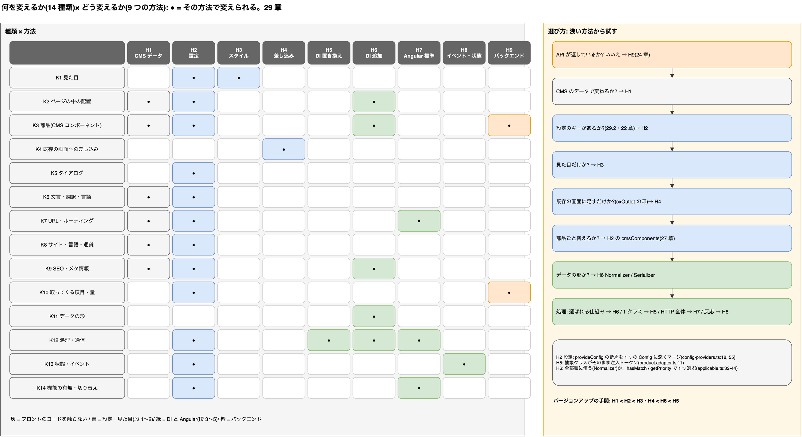

# 29-1. カスタマイズのサンプルを 1 つずつ読む

> **図**: 28 カスタマイズの種類 × 方法(29 章と同じ)。このページは、その表の ● のうち 10 個を実際に書いて動かしたもの



> **この章が答える問い**: 29 章の方法は、実際にはどう書き、本体のどこで読まれて効くのか。動かすとどうなり、どこでつまずくのか

> **位置づけ**: 29 章の総覧で「どの方法があるか」を示した。このページはその実例編で、[playground/customization-samples](../playground/customization-samples/) のサンプル 10 個を 1 つずつ説明する。29.6 は結果の一覧、このページはその中身の解説である

> **根拠の取り方**: サンプルは SAP/spartacus のクローン(`@spartacus/core` 221121.20.0、Angular 21.2)のデモアプリ `projects/storefrontapp` に組み込み、デモの OCC(electronics-spa)につないで動かした(2026-11-17)。「確かめ方」の結果は、そのときに画面とブラウザのコンソールで見たものである。本体の動きは、クローンのソースを 22 章と同じ略記で引用する: `core/` = `core-libs/core/src/`、`sf/` = `core-libs/storefront/`、`styles/` = `core-libs/styles/`、`fl/` = `feature-libs/`

---

### 先に話し言葉で: どのサンプルも「本体が読む場所に、自分のものを置く」だけ

Spartacus をカスタマイズするとき、本体のコードは書き換えない。本体はあちこちで「ここに置かれたものを読む」場所を用意している。カスタマイズとは、そこに自分のものを置くことである。

置く場所は 3 種類ある。

- 設定のオブジェクト
- DI のトークン
- テンプレートの印(アウトレット)

設定なら、本体は起動時に全部の断片をマージして読む。DI なら、本体が「このトークンの中身をください」と頼んだときに、自分のクラスが渡される。アウトレットなら、本体のテンプレートが「この名前の場所に登録された部品を描く」。

だから、どのサンプルも説明の順番は同じになる。何をしたいか。どこに何を置くか。本体はそれをいつ、どうやって読むか。そして、置いたのに効かないときは、たいてい「本体がそこを読んでいない」か「別の誰かが後から同じ場所に置いている」かのどちらかである。このページで出てくる 3 つの落とし穴も、この 2 つのどちらかに当てはまる。

---

### 0. 準備: サンプルの置き方と確かめ方

**ファイルの置き場所。** サンプルは `src/app/samples/` に置き、`SamplesModule` を 1 つ `AppModule` の `imports` に足す。こうすると、全部のサンプルを 1 行で入れたり外したりできる。

```ts
// app.module.ts(apply.sh が書き換えた後)
@NgModule({
  imports: [
    BrowserModule,
    StoreModule.forRoot({}),
    AppRoutingModule,
    EffectsModule.forRoot([]),
    SpartacusModule,
    SamplesModule,                                     // ← 足した
  ],
  providers: [privateProviders, sampleConfigProviders], // ← 後ろに足した(1 の落とし穴)
})
export class AppModule {}
```

**動かし方。** クローンで `npm ci` したあと、`apply.sh` でサンプルを組み込み、OCC の URL を渡して起動する。

```sh
/path/to/customization-samples/apply.sh /path/to/spartacus
cd /path/to/spartacus
CX_BASE_URL=https://composable-storefront-demo.eastus.cloudapp.azure.com:8443 npm start
```

**確かめる場所。** 以下の 2 ページで、全部のサンプルを確かめられる。

- 商品詳細ページ:`http://localhost:4200/electronics-spa/en/USD/item/358639`
- CMS に無いページ:`http://localhost:4200/electronics-spa/en/USD/sample/hello`

ログはブラウザの開発者ツールのコンソールに出る。サンプルが出す文字には `[H2 …]` のような印を付けてあるので、どのサンプルの結果かが画面で分かる。

**読む順番。** 浅い方法から順に並べた。

| # | サンプル | 方法 | 段 |
|---|---|---|---|
| 1 | URL の形を変える | H2 設定 | 1 |
| 2 | ボタンの文言を変える | H2 設定 | 1 |
| 3 | 色を変える | H3 スタイル | 2 |
| 4 | 既存の部品の前に 1 行足す | H4 差し込み | 2 |
| 5 | 本体の部品を自作に差し替える | H2 の `cmsComponents` | 3 |
| 6 | 商品データに項目を足す | H6 DI の追加 | 4 |
| 7 | ページのタイトルを変える | H5 DI の置き換え | 5 |
| 8 | 商品の取得先を差し替える | H5 DI の置き換え | 5 |
| 9 | すべての通信を計測する / ページを足す | H7 Angular の標準 | 5 |
| 10 | カートに入ったら知らせる | H8 イベント | 5 |

---

### 1. URL の形を変える(H2 設定)

#### やりたいこと

商品ページの URL を、本体の既定の `/product/358639/DSC-N1` から `/item/358639/DSC-N1` に変える。画面の中で作られる商品へのリンクも、同じ形にそろえる。

#### なぜこの方法か

URL の形は、本体の設定 `routing.routes.<ルート名>.paths` で決まっている(`sf/cms-structure/routing/default-routing-config.ts:70-73`)。設定にキーがあるので、コードを書く必要はない(29.4 の「設定のキーがあるか」で止まる)。

#### コード

```ts
// samples/h2-config.providers.ts(前半)
import { provideConfig, RoutingConfig } from '@spartacus/core';

export const sampleConfigProviders = [
  provideConfig(<RoutingConfig>{
    routing: {
      routes: {
        product: { paths: ['item/:productCode/:name', 'item/:productCode'] },
      },
    },
  }),
  // …(2 の文言の設定が続く)
];
```

- `provideConfig(...)` は、設定の断片を 1 つ登録する関数である。中身は multi provider で、何回呼んでもよい(`core/config/config-providers.ts:18`)。
- `<RoutingConfig>{...}` は型の注釈で、キーの書き間違いを型チェックで見つけるために付ける。実行時には何もしない。
- `product` はルートの名前である。本体は、商品ページへのリンクを作るときに、この名前で設定を引く。
- `paths` に 2 つ書いてある。商品名付きの形と、コードだけの形の両方を受け付けるためである。リンクを作るときは、渡された引数で埋められる最初の形が使われる。

#### 本体の中でどう効くか

1. 起動時、`provideConfig` の断片が全部 1 つの `Config` に深くマージされる。
   - **配列はマージされず、後から来たもので置き換わる**(`core/config/utils/deep-merge.ts:37`)。
   - そのため、本体の `['product/…', 'product/…']` は、こちらの `['item/…', 'item/…']` で丸ごと置き換わる。足したいなら、本体の値も自分で並べる。
2. アプリの初期化で `ConfigurableRoutesService` が動き(`core/routing/routing.module.ts:92-94`)、Angular のルート定義を書き換える。
   - `paths` が 1 つなら `path` に、複数なら URL の照合関数(matcher)にする(`core/routing/configurable-routes/configurable-routes.service.ts:87-103`、`core/routing/services/url-matcher.service.ts:33`)。
3. 画面の中のリンクは、`{ cxRoute: 'product', params: product } | cxUrl` のように、ルートの名前から作られる(`core/routing/configurable-routes/url-translation/semantic-path.service.ts:41`)。そのため、設定を変えるだけでリンクも変わる。
4. URL の先頭の `/electronics-spa/en/USD` は、サイトの情報として先に切り取られる(`core/site-context/services/site-context-url-serializer.ts:62`)。ルートの設定には書かない。

#### 確かめ方

- `/electronics-spa/en/USD/item/358639` を開くと、商品ページが表示された。
- 9 で作ったページの中のリンクも、`/electronics-spa/en/USD/item/358639` で作られた。

#### つまずきやすい点

最初は、この設定が効かず、`/item/358639` は Not Found になった。

原因は、デモアプリ自身が同じキーを設定していたことである。デモアプリは、`AppModule` の `providers: [privateProviders]` で `product.paths` を決めている(`projects/storefrontapp/src/app/private/private.providers.ts:36-39`)。

Angular では、モジュール自身の `providers` は、`imports` したモジュールの providers より後に並ぶ。設定の断片は後のものが勝つので、`SamplesModule` の中に書いた設定は、`AppModule` の設定に負けていた。

対処として、`AppModule` の `providers` の最後にも `sampleConfigProviders` を足した。設定が効かないときは、まず同じキーを書いている場所を探す。`grep -rn "routes:" src/` のように探せば早い。

#### 実務での使いどころ

- アクセラレータ時代の URL に合わせる。ただし、`…/p/<コード>` の形は本体が既定で受け付ける(28.10)。
- SEO の都合で、URL に商品名やカテゴリ名を入れる。
- URL のパラメータと商品データの項目の対応は `paramsMapping` で変える。デモアプリは `name` を `slug` に対応させている。そのため、`slug` を持たない商品データでリンクを作ると、名前の無い短い形 `/item/358639` になった。

---

### 2. ボタンの文言を変える(H2 設定)

#### やりたいこと

商品ページのボタン「Add to cart」の文言だけを「Add to cart (sample)」に変える。ほかの翻訳はそのまま使う。

#### なぜこの方法か

画面の文言は、本体の翻訳ファイルから出ている。キーは `product` チャンクの `addToCart.addToCart`(`core-libs/assets/src/translations/en/product.json:82-88`)。翻訳は設定 `i18n.resources` で上書きできるので、ここも設定で済む。

#### コード

```ts
// samples/h2-config.providers.ts(後半)
provideConfig(<I18nConfig>{
  i18n: {
    resources: {
      en: { product: { addToCart: { addToCart: 'Add to cart (sample)' } } },
    },
  },
}),
```

- `resources` の下は、言語(`en`)→ チャンク(`product`)→ キーの入れ子である。
- 変えたいキーの 1 つだけを書く。

#### 本体の中でどう効くか

翻訳の初期化で、`i18n.resources` の中身が、言語とチャンクごとに翻訳ライブラリ(i18next)へ足される(`core/i18n/i18next/i18next-initializer.ts:79-91`)。

`addResourceBundle(lang, chunkName, resources, true, true)` の最後の 2 つの `true` は、「深くマージする」と「同じキーは上書きする」の意味である。だから、書いたキーだけが置き換わり、同じチャンクの他のキーは残る。

#### 確かめ方

商品ページのボタンが「Add To Cart (Sample)」になった。大文字になっているのは本体の CSS で、文字列そのものは `Add to cart (sample)` である。開発者ツールで、ボタンの `aria-label` が「Add to cart (sample), AC Adapter AC-L200」になっていることも確かめた。

#### つまずきやすい点

- キーの場所を間違えやすい。翻訳ファイルを開き、チャンク名(ファイル名)とキーの入れ子を確かめてから書く。
- 言語を増やすなら、言語ごとに書く。`en` だけを書くと、他の言語では本体の文言のまま出る。

#### 実務での使いどころ

- 業務の用語に合わせる(「Add to cart」→「見積りに追加」など)。
- 自作の部品の文言は、`i18n.chunks` に新しいチャンクを足して、同じように `resources` に書く(29.2 の K6)。

---

### 3. 色を変える(H3 スタイル)

#### やりたいこと

サイトの主な色(ボタン、リンク、カートのアイコン)を紫にする。

#### なぜこの方法か

本体のスタイルは、色を CSS 変数で参照している。変数の値を 1 か所で変えれば、それを使っている部品が全部変わる。部品ごとに CSS を書く必要はない。

#### コード

```scss
// samples/h3-theme.scss(styles.scss の最後で @import する)
cx-storefront {
  --cx-color-primary: #7b2cbf;
  --cx-color-primary-accent: #5a189a;
}
```

- `--cx-color-primary` は主な色、`--cx-color-primary-accent` はホバー時などの濃い色である。
- 書く場所は `:root` ではなく `cx-storefront`。理由は下の「つまずきやすい点」。
- `styles.scss` の最後で読み込むのは、本体のスタイルより後に置くためである。

#### 本体の中でどう効くか

CSS 変数は、要素の祖先をたどって、いちばん近くで定義された値が使われる。`cx-storefront` は、Spartacus の画面全体を包む要素である。そこで定義すれば、中の部品は全部この値を使う。

#### 確かめ方

ボタン、パンくずのリンク、カートのアイコンが紫になった。開発者ツールで、`getComputedStyle(document.querySelector('cx-storefront')).getPropertyValue('--cx-color-primary')` が `#7b2cbf` を返すことも確かめた。

#### つまずきやすい点

最初は `:root` に書いたが、色は変わらなかった。値を調べると、`:root` では `#7b2cbf` なのに、`cx-storefront` では本体の `#055f9f` になっていた。

原因は、本体の機能フラグである。デモアプリは、コントラストを上げる機能フラグ `a11yPrimaryColorContrast` を有効にしている(`projects/storefrontapp/src/app/spartacus/spartacus-features.module.ts:384`)。

- このフラグが有効だと、`cx-storefront` が `useFeatureStyles('a11yPrimaryColorContrast')` を呼ぶ(`sf/layout/main/storefront.component.ts:123`)。
- その結果、アプリのいちばん外側の要素(デモアプリでは `app-root`)に、`cxFeat_a11yPrimaryColorContrast` というクラスが付く(`core/features-config/services/feature-styles.service.ts:65-66, 130-135`)。
- 本体の CSS は、そのクラスに `--cx-color-primary: #055f9f !important` を定義している(`styles/scss/root.scss:66-70`)。

`:root` は `app-root` より外側なので、`app-root` で決めた値に負ける。その内側の `cx-storefront` で定義し直せば、子孫はそちらを使う。

色が変わらないときは、開発者ツールで、どの要素で変数の値が変わっているかをたどる。

#### 実務での使いどころ

- ブランドの色、フォント、角の丸みを変える。
- 特定の部品のスタイルだけを丸ごと自作にしたいときは、`$skipComponentStyles` で本体のスタイルを外してから書く(29.2 の K1)。

---

### 4. 既存の部品の前に 1 行足す(H4 差し込み)

#### やりたいこと

商品ページの「カートに追加」の部品のすぐ上に、「Free shipping over $100」という 1 行を出す。本体の部品はそのまま残す。

#### なぜこの方法か

本体の部品を差し替える(5)と、その部品の機能を全部自分で持つことになる。足すだけなら、アウトレットで前後に差し込むほうが軽い。バージョンを上げても、本体の部品の中身の変更に影響されない。

#### コード

```ts
// samples/h4-shipping-note.component.ts
@Component({
  selector: 'app-sample-shipping-note',
  standalone: true,
  changeDetection: ChangeDetectionStrategy.OnPush,
  template: `<p class="sample-note">[H4 outlet] Free shipping over $100</p>`,
  styles: [`.sample-note { margin: 0 0 8px; padding: 4px 8px;
            border-left: 4px solid var(--cx-color-primary); }`],
})
export class SampleShippingNoteComponent {}
```

```ts
// samples/samples.module.ts(該当部分)
provideOutlet({
  id: 'ProductAddToCartComponent',   // どこに
  position: OutletPosition.BEFORE,   // その前に
  component: SampleShippingNoteComponent, // これを
}),
```

- 差し込む部品は、普通の Angular の部品である。
- `id` はアウトレットの名前で、ここでは部品のキーを使う。
  - デモの商品ページの CMS の応答で、カートの部品は `typeCode: ProductAddToCartComponent` である。
  - Flex の部品でない場合、本体は `typeCode` をそのまま `flexType` に入れる(`core/occ/adapters/cms/converters/occ-cms-page-normalizer.ts:151`)。
- `position` は `BEFORE`(前)、`AFTER`(後)、`REPLACE`(置き換え)の 3 つ(`sf/cms-structure/outlet/outlet.model.ts:9-13`)。

#### 本体の中でどう効くか

1. `provideOutlet` は、`PROVIDE_OUTLET_OPTIONS` という multi のトークンに値を 1 つ足すだけである(`sf/cms-structure/outlet/outlet.providers.ts:41-47`)。
2. アプリの初期化で、本体がそのトークンの値を全部集め、`OutletService` に登録する(`sf/cms-structure/outlet/outlet.module.ts:55-68`)。
3. スロットのテンプレートは、部品を 1 つ描くたびに、その部品の `flexType` を名前にしたアウトレットで包んでいる(`sf/cms-structure/page/slot/page-slot.component.html:9`)。アウトレットは、自分の名前で登録された部品を探し、`BEFORE` なら本体の部品の前に描く。

#### 確かめ方

商品ページの数量欄の上に、紫の線付きで「[H4 outlet] Free shipping over $100」が出た。カートに追加するボタンは、本体のものがそのまま動いた。

#### つまずきやすい点

- 差し込めるのは、本体のテンプレートにアウトレットの印がある場所だけである。部品のキーのほかに、スロットの position(`page-slot.component.html:3`)とページテンプレート名(`sf/cms-structure/page/page-layout/page-layout.component.html:4`)にも印がある。
- 名前は CMS の応答で確かめる。`typeCode` と `flexType` は違うことがある(Flex の部品)。

#### 実務での使いどころ

- 商品ページにお知らせやバッジを足す。
- ヘッダーやフッターの前後に、共通の帯を出す。
- 差し込んだ部品からその場所のデータを使うときは、`OutletContextData` を注入する(`sf/cms-structure/outlet/outlet.model.ts:21`)。

---

### 5. 本体の部品を自作に差し替える(H2 の `cmsComponents`)

#### やりたいこと

商品ページで商品名を出している本体の部品を、自作の部品に替える。自作の部品は、商品名、商品コード、6 で作るバッジを出す。

#### なぜこの方法か

表示の中身を大きく変えたいときは、差し込み(4)では足りない。Spartacus は、CMS の部品のキーと Angular の部品の対応を設定 `cmsComponents` で持っている。同じキーに自作を登録すれば、本体の部品の代わりに自作が描かれる。

#### コード

```ts
// samples/k3-product-intro.component.ts
@Component({
  selector: 'app-sample-product-intro',
  standalone: true,
  imports: [AsyncPipe],
  changeDetection: ChangeDetectionStrategy.OnPush,
  template: `
    @if (product$ | async; as product) {
      <h1 class="sample-title">{{ product.name }}</h1>
      <p>
        [K3 component] code {{ product.code }}
        @if (product.sampleBadge) {
          <span class="sample-badge">[H6 normalizer] {{ product.sampleBadge }}</span>
        }
      </p>
    }
  `,
})
export class SampleProductIntroComponent {
  product$ = inject(CurrentProductService).getProduct();
}
```

```ts
// samples/samples.module.ts(該当部分)
provideConfig(<CmsConfig>{
  cmsComponents: { ProductIntroComponent: { component: SampleProductIntroComponent } },
}),
```

- `CurrentProductService` は、本体が用意している「今の URL の商品」を返すサービスである。商品詳細ページの部品は、たいていこれを使う。
- `getProduct()` は `Observable` を返す。テンプレートの `async` で購読し、データが届いたら描く(4 章・16 章)。
- `@if (… ; as product)` で、データが届く前(`null`)は何も描かない。
- `cmsComponents` のキー `ProductIntroComponent` は、CMS の応答の `flexType` である。デモの商品ページでは、この部品は `CMSFlexComponent` で、`flexType` が `ProductIntroComponent` になっている。

#### 本体の中でどう効くか

1. スロットが部品を描くとき、本体は部品のキーで `cmsComponents` を引く(`sf/cms-structure/services/cms-components.service.ts:165-168`)。本体の既定の登録より、こちらの登録が後に並ぶので、自作が返る。
2. 本体は、返った部品を、子の injector の付いた状態で生成する。そのため、部品の中で `CmsComponentData` や `CurrentProductService` を `inject` できる(3 章)。
3. `CurrentProductService.getProduct()` は、今の URL から商品コードを取り、`ProductService` で商品データを読む(`sf/cms-components/product/current-product.service.ts:36-48`)。読み込みは本体がまとめて行う(8)。

#### 確かめ方

商品名の下が「[K3 component] code 358639」という自作の表示になった。

#### つまずきやすい点

- 差し替えると、本体の部品が持っていた機能は全部なくなる。本体の部品は、評価の星とレビューへのリンクも出している(`sf/cms-components/product/product-intro/product-intro.component.html:2-9`)。自作の部品はそれを出さないので、必要なら自分で持ち直す。
- キーを間違えると、本体の部品のまま表示される。開発モードでは、どの部品にも対応が無いキーは、コンソールに `No component implementation found for the CMS component type` と出る(`cms-components.service.ts:170-176`)。ただし、本体の部品に対応しているキーを間違えた場合は、何も出ない。CMS の応答で `typeCode` と `flexType` を確かめる(27 章)。

#### 実務での使いどころ

- 表示の構成を大きく変える(商品ページの上部、ヘッダー、ミニカート)。
- アクセラレータの JSP の部品を Angular で作り直す(28 章)。新しい型の部品も、キーが新しくなるだけで書き方は同じ(11 章)。

---

### 6. 商品データに項目を足す(H6 DI の追加)

#### やりたいこと

商品データに、画面用の項目 `sampleBadge` を足す。価格が 500 以上なら `Premium`、それ未満なら `Value` にする。5 の部品はこの項目を表示する。

#### なぜこの方法か

部品の中で毎回計算してもよい。しかし、複数の部品が同じ値を使うなら、データを取ってきたときに 1 回作るほうがよい。Spartacus は、API の JSON をフロントの形に直す「変換」(Normalizer)を、multi のトークンで集めている。そこに 1 つ足せば、本体の変換の後に自作の変換が動く。

#### コード

```ts
// samples/h6-product.normalizer.ts
declare module '@spartacus/core' {
  interface Product {
    sampleBadge?: string;
  }
}

@Injectable()
export class SampleProductNormalizer implements Converter<any, Product> {
  convert(source: any, target: Product = {}): Product {
    const price = source?.price?.value;
    if (typeof price === 'number') {
      target.sampleBadge = price >= 500 ? 'Premium' : 'Value';
    }
    return target;
  }
}
```

```ts
// samples/samples.module.ts(該当部分)
{ provide: PRODUCT_NORMALIZER, useClass: SampleProductNormalizer, multi: true },
```

- `declare module '@spartacus/core'` は、TypeScript の型を足す書き方(module augmentation)である。本体の `Product` 型に `sampleBadge` を足すので、5 の部品で `product.sampleBadge` と書いても型エラーにならない。実行時には何もしない。
- `convert(source, target)` の `source` は OCC の JSON そのもの、`target` はそれまでの変換が作った結果である。自分の項目を足して `target` を返す。
- `multi: true` が大事である。付けないと、本体の変換を全部消して自作 1 つだけになる。
- 価格が無いときに何もしない理由は、下の「つまずきやすい点」で書く。

#### 本体の中でどう効くか

1. Adapter が OCC の応答を受け取ると、`converter.pipeable(PRODUCT_NORMALIZER)` を通す(`core/occ/adapters/product/occ-product.adapter.ts:29-33, 49-51`)。
2. `ConverterService` は、そのトークンに登録された変換を全部集め(`core/util/converter.service.ts:52-63`)、登録された順に 1 つずつ通す。前の結果が次の `target` になる(`converter.service.ts:134-136`)。
3. 変換の結果は状態(NgRx のストア)に入り、5 の部品は `CurrentProductService` 経由でそれを読む。

流れは、OCC の JSON → 本体の変換 → 自作の変換 → 状態 → 部品 の順になる。

#### 確かめ方

5 の部品に「[H6 normalizer] Value」というバッジが出た。DSC-N1 は $485.57、AC Adapter は $105.48 なので、どちらも `Value` である。

#### つまずきやすい点

- 商品データは、用途ごとの範囲(scope)に分けて取られ、あとで 1 つにまとめられる(8 と 22 章)。価格を含まない範囲の応答にも同じ変換が通る。そこで値を上書きすると、先に作った値が消えることがある。サンプルが「価格があるときだけ付ける」のはそのためである。
- 本体の変換を前提に書くなら、本体のモジュールより後に登録されるように置く(29.3)。

#### 実務での使いどころ

- バックエンドが返す独自の項目を、フロントで使いやすい形に直す(日付の文字列を Date にする、コードを表示名にする)。
- 逆向き(フロントのデータ → API に送る JSON)は `*_SERIALIZER` で同じように書く(29.2 の K11)。
- バックエンドが返さない項目は、ここでは作れない。必要なら OCC で返す(24 章)。

---

### 7. ページのタイトルを変える(H5 DI の置き換え)

#### やりたいこと

商品ページのブラウザのタブのタイトルの先頭に、`[H5 meta]` を付ける。タイトルの作り方(商品名 | カテゴリ | ブランド)は本体のまま使う。

#### なぜこの方法か

ページのタイトルは、ページの種類ごとの「メタ情報のリゾルバ」が作っている。商品ページは `ProductPageMetaResolver` である。本体のリゾルバを継承して 1 つのメソッドだけ替え、DI で置き換えれば、残りの動き(説明文、canonical、robots など)はそのまま使える。

#### コード

```ts
// samples/h5-product-page-meta.resolver.ts
@Injectable({ providedIn: 'root' })
export class SampleProductPageMetaResolver extends ProductPageMetaResolver {
  override resolveTitle(): Observable<string> {
    return super.resolveTitle().pipe(map((title) => `[H5 meta] ${title}`));
  }
}
```

```ts
// samples/samples.module.ts(該当部分)
{ provide: ProductPageMetaResolver, useExisting: SampleProductPageMetaResolver },
```

- `extends ProductPageMetaResolver` で、本体のリゾルバの機能を全部受け継ぐ。コンストラクタも受け継ぐので、書かなくてよい。
- `super.resolveTitle()` で本体のタイトルを取り、`map` で先頭に印を付ける。
- `useExisting` は「このトークンを頼まれたら、別のトークンのインスタンスを返す」という意味である。`SampleProductPageMetaResolver` は `providedIn: 'root'` なので、アプリに 1 つだけ作られる。

#### 本体の中でどう効くか

ここが、29 章の H5 と H6 がつながる例である。

1. 本体は、リゾルバを `PageMetaResolver` という multi のトークンで集めている。ただし、中身は直接ではなく `useExisting: ProductPageMetaResolver` で登録している(`core/product/product.module.ts:17-21`)。
2. 本体がリゾルバの一覧を頼むと、Angular は `ProductPageMetaResolver` のトークンを引く。このトークンは、こちらで自作に置き換えてある。そのため、一覧に入るのは自作のインスタンスになる。
3. ページが変わるたびに、本体は一覧から今のページに合うものを点数で選ぶ(`core/cms/facade/page-meta.service.ts:133-138`、`core/util/applicable.ts:32-44`)。選ばれたリゾルバの `resolveTitle()` の結果が、ブラウザのタイトルに入る(`sf/cms-structure/seo/seo-meta.service.ts:48`)。

自作を multi に足す(H6)のでなく、クラスのトークンを置き換えた(H5)のは、点数の勝負をしなくて済むからである。足した場合は、本体のリゾルバと同じ点数になり、どちらが選ばれるかを気にすることになる。

#### 確かめ方

商品ページのタブのタイトルが「[H5 meta] DSC-N1 | Digital Compacts | Sony」になった。カテゴリとブランドの部分は本体の作り方のままである。

#### つまずきやすい点

- `useClass` でなく `useExisting` にしたのは、自作のインスタンスを 1 つにするためである。`useClass` でも動くが、`SampleProductPageMetaResolver` を別の場所で注入すると、別のインスタンスが作られる。
- 継承は、本体のクラスの中身に依存する。本体のメソッド名や戻り値が変わると壊れる。バージョンを上げたら最初に確かめる場所である。

#### 実務での使いどころ

- タイトルにサイト名を付ける、説明文の作り方を変える。
- ページの種類そのものを足すなら、`PageMetaResolver` を継承した新しいクラスを multi で足す(29.2 の K9)。

---

### 8. 商品の取得先を差し替える(H5 DI の置き換え)

#### やりたいこと

商品データを取ってくる部分(Adapter)を自作に替える。サンプルでは、取得そのものは本体の OCC 用の処理に任せ、呼ばれ方をコンソールに記録するだけにした。別の API から取るなら、ここを書き換える。

#### なぜこの方法か

Spartacus のデータの取得は、Facade → Connector → Adapter の層になっている(15 章)。API の呼び方を知っているのは Adapter だけで、上の層はその抽象クラスにしか依存しない。Adapter を替えれば、上の層を変えずに取得先を変えられる。

#### コード

```ts
// samples/h5-product.adapter.ts
@Injectable()
export class SampleProductAdapter extends OccProductAdapter {
  override load(productCode: string, scope?: string): Observable<Product> {
    console.log(`[H5 adapter] load ${productCode} scope=${scope}`);
    return super.load(productCode, scope);
  }

  override loadMany(products: ScopedProductData[]): ScopedProductData[] {
    console.log(`[H5 adapter] loadMany ${products.map((p) => `${p.code}:${p.scope}`).join(', ')}`);
    return super.loadMany(products);
  }
}
```

```ts
// samples/samples.module.ts(該当部分)
{ provide: ProductAdapter, useClass: SampleProductAdapter },
```

- `ProductAdapter` は本体の抽象クラスで、そのままトークンとして使われている(`core/product/connectors/product/product.adapter.ts:11`)。
- `OccProductAdapter` は、その OCC 用の実装である。継承して、記録を足してから `super` に任せる。
- `load` は 1 件、`loadMany` は複数件(複数の範囲)を取るメソッドである。

#### 本体の中でどう効くか

1. 部品が商品データを頼むと、本体は「商品コード + 範囲」の読み込みを状態に依頼する。
2. 同じ瞬間に来た依頼は、まとめて Connector の `getMany` に渡される(`core/product/store/effects/product.effect.ts:46-51`)。
3. Connector は、Adapter に `loadMany` があればそれを、無ければ 1 件ずつ `load` を呼ぶ(`core/product/connectors/product/product.connector.ts:23-31`)。
4. OCC の `loadMany` は、範囲ごとの `fields` を 1 本の要求にまとめて送り、`load()` は経由しない(`core/occ/adapters/product/occ-product.adapter.ts:35-54`)。

#### 確かめ方

商品ページを開くと、コンソールに「[H5 adapter] loadMany 346944:attributes」が出た。`load` の記録は出なかった。

#### つまずきやすい点

最初は `load()` だけを替えていて、商品ページでは何も記録されなかった。上の 3 と 4 のとおり、商品ページの読み込みは `loadMany()` を通り、本体の `loadMany()` は `load()` を呼ばないからである。

継承して 1 つのメソッドだけ替えるときは、本体が実際にどのメソッドを呼ぶかを、呼ぶ側のコードで確かめてから書く。29.4 で「H5 はバージョンアップの手間がいちばん大きい」と書いたのは、こうした本体の中身への依存があるためである。

#### 実務での使いどころ

- OCC 以外の API(社内の在庫 API、検索エンジン)から取る。
- 記録やキャッシュを足す。ただし、通信全体に対してなら 9 のインターセプターのほうが軽い。
- 新しい業務データを扱うときは、Adapter・Connector・Facade を一式作る(15 章)。

---

### 9. すべての通信を計測する / ページを足す(H7 Angular の標準)

Spartacus は Angular のアプリなので、Angular の拡張点はそのまま使える。ここでは 2 つ書いた。

#### 9-a. すべての HTTP の所要時間を記録する

**やりたいこと。** アプリが送る HTTP の要求を全部、所要時間付きでコンソールに出す。

**なぜこの方法か。** 通信は、Spartacus の中のどの機能からでも Angular の `HttpClient` を通る。その前後に処理を挟む Angular の仕組みがインターセプターである。Adapter ごとに書く(8)より、1 か所で済む。

```ts
// samples/h7-timing.interceptor.ts
@Injectable()
export class SampleTimingInterceptor implements HttpInterceptor {
  intercept(req: HttpRequest<unknown>, next: HttpHandler): Observable<HttpEvent<unknown>> {
    const start = performance.now();
    return next.handle(req).pipe(
      finalize(() => {
        const path = req.url.replace(/^https?:\/\/[^/]+/, '').split('?')[0];
        console.log(`[H7 interceptor] ${req.method} ${path} ${Math.round(performance.now() - start)}ms`);
      })
    );
  }
}
```

```ts
{ provide: HTTP_INTERCEPTORS, useClass: SampleTimingInterceptor, multi: true },
```

- `next.handle(req)` が、次のインターセプター(最後は実際の送信)に渡す処理である。
- `finalize` は、応答が終わったとき(成功でも失敗でも)に 1 回動く。
- クラスで書くインターセプターは、`provideHttpClient(withInterceptorsFromDi())` が設定されているときに効く。デモアプリはそう設定している(`projects/storefrontapp/src/app/app.config.ts:28`)。本体のログインの処理も同じ仕組みを使っている(`core/auth/client-auth/http-interceptors/index.ts:13`)。

**確かめ方。** 商品ページを開くと、OCC の呼び出しごとにログが出た。例えば「[H7 interceptor] GET /occ/v2/electronics-spa/products/358639 522ms」。カートに追加したときは、カートの作成と商品の追加の 2 本の `POST` が出た。

**つまずきやすい点。** 最初は、要求に独自のヘッダー(`X-Sample`)を足すつもりだった。しかし、デモの OCC の CORS の設定が許すヘッダーは `content-type` だけだった(事前の `OPTIONS` の応答の `Access-Control-Allow-Headers`)。ブラウザから別のドメインの API にヘッダーを足すときは、バックエンドの CORS の許可が要る(28.4)。

#### 9-b. CMS に無いページを足す

**やりたいこと。** CMS にページを作らずに、`/sample/hello` というページを足す。中に、1 の設定から作った商品ページへのリンクを置く。

**なぜこの方法か。** Spartacus のページの多くは CMS のページから描かれるが、Angular のルートを足せば、CMS に無いページも作れる。ただし、ヘッダーやフッターも CMS のページのスロットから描かれる。そのため、外枠は既存の CMS のページから借りる。

```ts
// samples/h7-hello-page.component.ts
@Component({
  selector: 'app-sample-hello-page',
  standalone: true,
  imports: [RouterLink, UrlModule],
  template: `
    <section class="container">
      <h1>[H7 route] Hello from a non-CMS page</h1>
      <a [routerLink]="{ cxRoute: 'product', params: { code: '358639', name: 'DSC-N1' } } | cxUrl">
        Product link built from routing config
      </a>
    </section>
  `,
})
export class SampleHelloPageComponent {}
```

```ts
// samples/samples.module.ts(該当部分)
imports: [
  RouterModule.forChild([
    {
      path: 'sample/hello',
      component: SampleHelloPageComponent,
      canActivate: [CmsPageGuard],
      data: { pageLabel: '/help' },
    },
  ]),
],
```

- `RouterModule.forChild` は、Angular の普通のルートの足し方である。
- `canActivate: [CmsPageGuard]` は、ページを開く前に CMS のページを読み込む本体のガードである(`sf/cms-structure/guards/cms-page.guard.ts:26`)。
- `data: { pageLabel: '/help' }` で、どの CMS のページを読むかを決める。指定が無いと、URL(`/sample/hello`)をラベルにした CMS のページを探す。`pageLabel` があればそれを使う(`core/routing/store/reducers/router.reducer.ts:193-194`)。ここでは、デモにある「Help」のコンテンツページを使った。
- `cxUrl` パイプは、ルートの名前と引数から URL を作る(1)。`UrlModule` を `imports` すると使える。

**確かめ方。** `/electronics-spa/en/USD/sample/hello` を開くと、Help のページのヘッダー、パンくず、フッターの間に、自作の見出しとリンクが出た。中のリンクは `/electronics-spa/en/USD/item/358639` になった(1 の設定が効いている)。URL の先頭のサイトの部分は、ルートには書いていないが、Spartacus が処理した(1 の 4)。

**つまずきやすい点。**

- 最初は `canActivate` と `data` を付けずに書いた。このときは、URL を直接開くと、自作の見出しとリンクだけが出て、ヘッダーもフッターも出なかった。Spartacus のヘッダーとフッターは、CMS のページの応答に入っているスロットから描かれる。CMS のページを読まないルートでは、外枠も空になる。
- 借りた CMS のページの情報も一緒に使われる。上の例では、タブのタイトルとパンくずの見出しが「Help」になった。自分のタイトルを出したいなら、専用のコンテンツページを CMS に作ってラベルを指定するか、7 のメタ情報の仕組みで変える。

---

### 10. カートに入ったら知らせる(H8 イベント)

#### やりたいこと

商品がカートに入ったら、画面の上部に「[H8 event] 346944 x1 added」というメッセージを出す。

#### なぜこの方法か

カートの処理は、本体のカートの機能の中にある。それに反応するためにカートのサービスを置き換える(H5)のは重すぎる。Spartacus は、機能の中で起きたことを「イベント」として外に出している。受け取るだけなら、それを購読すればよい。

#### コード

```ts
// samples/h8-cart-added-message.service.ts
@Injectable({ providedIn: 'root' })
export class SampleCartAddedMessageService {
  private events = inject(EventService);
  private messages = inject(GlobalMessageService);
  private destroyRef = inject(DestroyRef);

  start(): void {
    this.events
      .get(CartAddEntrySuccessEvent)
      .pipe(takeUntilDestroyed(this.destroyRef))
      .subscribe((e) => {
        const text = `[H8 event] ${e.productCode} x${e.quantityAdded ?? e.quantity} added`;
        console.log(text);
        this.messages.add(text, GlobalMessageType.MSG_TYPE_CONFIRMATION);
      });
  }
}
```

```ts
// samples/samples.module.ts(該当部分)
provideAppInitializer(() => inject(SampleCartAddedMessageService).start()),
```

- `eventService.get(型)` は、そのイベントが起きるたびに値を流す `Observable` を返す(`core/event/event.service.ts:90`)。
- `CartAddEntrySuccessEvent` は、カートへの追加が成功したときのイベントである。中に、商品コード、数量、実際に増えた数量などが入っている(`fl/cart/base/root/events/cart.events.ts:66-76`)。
- `GlobalMessageService.add(文字, 種類)` は、画面の上部に出る共通のメッセージを出す。
- `provideAppInitializer` で、アプリの起動時に購読を始める。サービスは、誰かが注入するまで作られない。そのため、起動時に 1 回呼んで作らせる。
- `takeUntilDestroyed` は、アプリが終わるときに購読を止める後始末である。

#### 本体の中でどう効くか

1. カートへの追加が成功すると、カートの機能の中で NgRx のアクション `CART_ADD_ENTRY_SUCCESS` が流れる。
2. カートの機能は、そのアクションをイベント `CartAddEntrySuccessEvent` に変換して出す、と登録している(`fl/cart/base/core/event/cart-event.builder.ts:79-82`)。
3. `EventService` は、イベントの型ごとに、登録された出どころをまとめて流す(19 章)。

イベントの型は `@spartacus/cart/base/root`(すぐ読まれる部分)にある。カートの機能本体は遅延ロードされるが、型だけは最初から使えるので、起動時から購読できる。

#### 確かめ方

商品ページで「Add to cart」を押すと、コンソールに「[H8 event] 346944 x1 added」が出た。画面の上部にも同じ文の確認メッセージが出た。

#### つまずきやすい点

- 1 回目に試したとき、カートの確認のダイアログに隠れて、メッセージが見えなかった。確認メッセージは 3 秒で消える(`core/global-message/config/default-global-message-config.ts:12-13`)。ダイアログを閉じた時には、もう消えていた。表示だけで確かめにくいものは、コンソールにも出しておく。
- 購読を始めるのを忘れると、何も起きない(サービスが作られない)。

#### 実務での使いどころ

- 計測(タグマネージャーや分析ツールへの送信)。本体の CDS 連携も、同じイベントを受けて送っている(`integration-libs/cds/src/profiletag/services/profile-tag-push-events.service.ts`)。
- 「カートに入れたらおすすめを出す」のように、機能をまたいで反応する。
- 自作のイベントを出すなら `eventService.register(型, 流れ)`(`core/event/event.service.ts:68`)。

---

### まとめ: 10 個のサンプルで分かったこと

| # | 置いた場所 | 本体が読むところ | 動かして分かったこと |
|---|---|---|---|
| 1 | 設定 `routing` | 起動時にルートを組み立て、リンクを作るとき | 同じキーを後から書いた方が勝つ。配列は置き換わる |
| 2 | 設定 `i18n.resources` | 翻訳の初期化 | 書いたキーだけが置き換わる |
| 3 | CSS 変数 | ブラウザの CSS の継承 | 機能フラグが `!important` で決める変数があるので、内側で定義する |
| 4 | `PROVIDE_OUTLET_OPTIONS`(multi) | 起動時に集めてアウトレットに登録 | 名前は CMS の応答の `flexType` |
| 5 | 設定 `cmsComponents` | 部品を描くとき | 差し替えると本体の部品の機能はなくなる |
| 6 | `PRODUCT_NORMALIZER`(multi) | API の応答を変換するとき、登録順に全部 | 範囲ごとの応答に全部通るので、上書きに注意 |
| 7 | クラスのトークン `ProductPageMetaResolver` | multi の `useExisting` 経由で、ページが変わるたび | 置き換えは multi の中身にも効く |
| 8 | 抽象クラスのトークン `ProductAdapter` | Connector から | 本体がどのメソッドを呼ぶかを確かめてから替える |
| 9 | `HTTP_INTERCEPTORS`、Angular のルート | すべての通信、ルーティング | ヘッダーを足すならバックエンドの CORS の許可が要る。CMS に無いページの外枠は、`pageLabel` で CMS のページから借りる |
| 10 | イベントの購読 | 機能がイベントを出すとき | 起動時に購読を始める。消えるメッセージはログでも確かめる |

効かないときは、次の 2 つを順に疑う。

1. **本体がそこを読んでいるか。** 例:8 の `load()`、3 の `:root`。呼ぶ側のコードや開発者ツールで、読まれている場所を確かめる。
2. **別の誰かが後から同じ場所に置いていないか。** 例:1 の `AppModule` の設定。同じキーや同じトークンを書いている場所を探す。

---

[目次](README.md) | ← [29. カスタマイズの種類と方法の総覧](29-customization-types-and-methods.md) | [番外. サブエージェントとスキルの分け方](extra-agent-split-patterns.md) →
