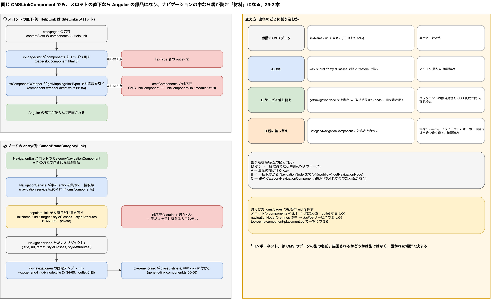
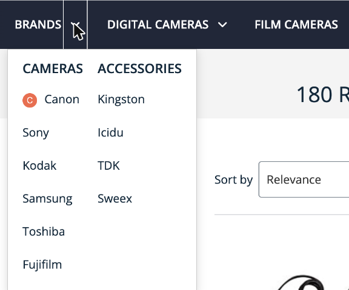
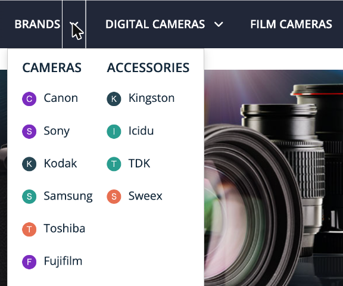
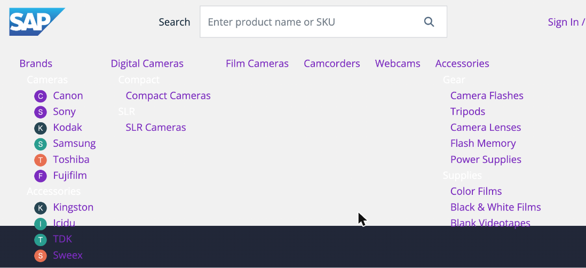

# 29-2. 描画される部品と、材料にされる部品: ナビゲーションの奥のリンクを変える

> **図**: 29 描画される部品と、材料にされる部品



> **この章が答える問い**: OCC の応答に `typeCode` を持った「コンポーネント」として載っているのに、`cmsComponents` の差し替えや outlet が効かない部品があるのはなぜか。ナビゲーションの奥にある Canon のリンクに会社のアイコンを付けるには、どこを変えればよいか

> **位置づけ**: 29 章の K3(部品)と H4(差し込み)の補足で、29-1 のサンプルの続き。29 章は「スロットに置かれた部品」を前提にしていた。この章は、親の部品の中に入れ子で入っている部品を扱う。入れ子の部品には、Angular の部品として描画されるものと、親が読むデータ(材料)にされるだけのものがある

> **根拠の取り方**: 本体の動きは、SAP/spartacus のクローンのソースを `path:line` で引用する(`sf/` = `core-libs/storefront/`)。部品の位置は、デモの OCC(electronics-spa)の `cms/pages` を [tools/cms-component-placement.py](../tools/cms-component-placement.py) で調べた。A・B・C の 3 つのサンプルは、29-1 と同じくクローンのデモアプリに組み込み、デモの OCC につないで画面で確かめた(2026-11-18)

---

### 先に話し言葉で: 「コンポーネント」という名前と、画面の部品は別のもの

CMS の「コンポーネント」は、バックエンドで管理するデータの型の名前である。Backoffice で作る部品は全部この型を持っていて、OCC の応答にも `typeCode` として載る。

一方、Spartacus が Angular の部品を作るのは、ある決まった通り道を通ったものだけである。その通り道は、`cxComponentWrapper` という印である。スロットに置かれた部品は、全部この印を通る。`cmsComponents` の差し替えも、flexType 名の outlet も、この通り道の上で効く。

ナビゲーションの中のリンクは、この通り道を通らない。親のナビゲーションが、リンクのデータから「表示名」と「行き先」だけを抜き出して、自分のテンプレートで文字のリンクを描く。リンクは部品として作られることがないので、差し替えようにも差し替える相手がいない。

ただし、入れ子なら必ず描画されないわけではない。タブのコンテナやバナーのカルーセルは、子の部品を自分で `cxComponentWrapper` に渡している。決め手は入れ子かどうかではなく、親が子をどう扱うかである。

---

### 29-2.1 きっかけ: Canon のリンクはどこにあるか

デモのホーム画面の `cms/components` の応答に、次の部品があった。

```json
{
  "uid": "CanonBrandCategoryLink",
  "typeCode": "CMSLinkComponent",
  "name": "Canon Link",
  "categoryCode": "brand_10",
  "linkName": "Canon",
  "url": "/c/brand_10",
  "target": "false"
}
```

これがページのどこにあるかを、ツールで調べる。

```sh
B=https://composable-storefront-demo.eastus.cloudapp.azure.com:8443/occ/v2/electronics-spa
python3 tools/cms-component-placement.py $B ContentPage:homepage --uid CanonBrandCategoryLink
# ContentPage:homepage  data  CanonBrandCategoryLink  CMSLinkComponent
#   ElectronicsCategoryNavComponent > ElectronicsCategoryNavNode > BrandsNavNode > BrandLinksNavNode > CanonBrandNavNode
python3 tools/cms-component-placement.py $B ContentPage:homepage --uid HelpLink
# ContentPage:homepage  slot  HelpLink  CMSLinkComponent  SiteLinks
```

同じ `CMSLinkComponent` でも、置かれ方が違う。

- **HelpLink**: スロット `SiteLinks` の直下にある。Angular の部品として描画される
- **CanonBrandCategoryLink**: スロット `NavigationBar` の `CategoryNavigationComponent`(uid `ElectronicsCategoryNavComponent`)の中で、ナビゲーションノードを 4 段下った先の entry にある。部品としては描画されない

---

### 29-2.2 スロットの直下: 描画される流れ

スロットの部品は、次の順で Angular の部品になる。

1. **部品を 1 つずつ回す**: `cx-page-slot` が、スロットの `components` を 1 つずつ回す(`sf/cms-structure/page/slot/page-slot.component.html:6`)
2. **flexType 名の outlet を置く**: 部品ごとに、flexType の名前で outlet を置く(`:9`)。flexType は、通常の部品では typeCode と同じ値である
3. **cxComponentWrapper に渡す**: outlet の中で、部品のデータを `cxComponentWrapper` に渡す(`:14`)
4. **対応表を引く**: `cxComponentWrapper` が `getMapping(flexType)` で対応表を引き(`sf/cms-structure/page/component/component-wrapper.directive.ts:82-84`)、書かれている Angular の部品を作る(`:90-`)

`CMSLinkComponent` の対応表は `LinkComponent` である(`sf/cms-components/content/link/link.module.ts:19`)。HelpLink は、この流れで `LinkComponent` として描かれる。

カスタマイズで割り込めるのは、2 の outlet と 4 の対応表の 2 か所である。どちらも、この流れの上にしかない。

---

### 29-2.3 ナビゲーションの中: 材料にされる流れ

Canon のリンクは、次の順で文字のリンクになる。

1. **親が作られる**: `CategoryNavigationComponent` は、29-2.2 の流れで描画される。親の部品は `sf/cms-components/navigation/category-navigation/category-navigation.module.ts:23` の対応表で作られる
2. **子をまとめて取得する**: 親は `NavigationService.getNavigationNode` を呼ぶ(`category-navigation.component.ts:23-25`)。サービスはノードの木から entry を全部集め(`sf/cms-components/navigation/navigation/navigation.service.ts:95-117`)、`cms/components` でまとめて取得する。取得は superType ごとに分けて行われる(`core-libs/core/src/cms/store/effects/navigation-entry-item.effect.ts:92-100`)。冒頭の JSON は、この応答の一部である
3. **5 項目だけを書き写す**: `populateLink`(`navigation.service.ts:166-193`)が、entry の `itemType` が `CMSLinkComponent` のときに、5 項目だけを `NavigationNode` に書き写す(型の定義は `navigation-node.model.ts:7-33`)
   - `linkName`(→ `title`)
   - `url`(行き先。`getLink` が決める。`:201-223`)
   - `target`
   - `styleClasses`
   - `styleAttributes`
4. **固定のテンプレートで描く**: `<cx-navigation-ui>` のテンプレートが、node ごとに `<cx-generic-link>{{ node.title }}</cx-generic-link>` を出す(`navigation-ui.component.html:34-60`)。このテンプレートには `cxOutlet` が 1 つも無い
5. **`<a>` に付け直す**: `cx-generic-link` は、`class` と `style` を自分の `@Input` で受け取る(`sf/shared/components/generic-link/generic-link.component.ts:55-56`)。受け取った値は、中の `<a>` に `[attr.class]` / `[attr.style]` として付ける(`generic-link.component.html`)

この流れには `cxComponentWrapper` が出てこない。だから、子のリンクに対しては次の 3 つのことが言える。

- **対応表が効かない**: `CMSLinkComponent` の対応表を差し替えても、ナビゲーションの中のリンクは変わらない
- **差し込めない**: outlet が無いので、リンク 1 本の前後に部品を差し込めない
- **独自の属性は使われない**: バックエンドが `CMSLinkComponent` に独自の属性を足しても、3 で書き写されない。`populateNavigationNode` と `populateLink` は `private` なので(`:125`, `:166`)、継承して書き写す項目を増やすこともできない

---

### 29-2.4 入れ子でも描画される親がある

入れ子の子を、自分で `cxComponentWrapper` に渡す親もある。クローンで `[cxComponentWrapper]` を使っているテンプレートは 4 つだった。

| 親 | 子の持ち方 | 子の描き方 | 子の差し替え |
|---|---|---|---|
| `cx-page-slot` | スロットの `components` | `page-slot.component.html:14` | 対応表と outlet(`:9`) |
| `CMSTabParagraphContainer` | 属性 `components`(uid を空白区切り)。`getComponentData` で 1 つずつ取る(`tab-paragraph-container.component.ts:106-107`) | `tab-paragraph-container.component.html:10` | 対応表と outlet(`:5`) |
| `RotatingImagesComponent`(バナーのカルーセル) | 属性 `banners`(uid を空白区切り。`banner-carousel.component.ts:37-39`) | `banner-carousel.component.html:11` | 対応表 |
| 商品詳細のタブ | `product-details-tab.component.html` の子 | `:9` | 対応表と outlet(`:7`) |

ナビゲーションの部品を使っているのは、`CategoryNavigationComponent`・`NavigationComponent`・`FooterNavigationComponent` の 3 つである(`getNavigationNode` / `createNavigation` を呼んでいるもの)。この 3 つの子は、どれも材料として使われる。

デモでは、商品ページのタブの中身がこの「描画される入れ子」に当たる。

```sh
python3 tools/cms-component-placement.py $B ProductPage:358639 | grep wrapper
# ProductPage:358639  wrapper  ProductDetailsTabComponent   ?  TabPanelContainer.components
# ProductPage:358639  wrapper  ProductSpecsTabComponent     ?  TabPanelContainer.components
# ProductPage:358639  wrapper  ProductReviewsTabComponent   ?  TabPanelContainer.components
# ProductPage:358639  wrapper  deliveryTab                  ?  TabPanelContainer.components
```

ツールの集計は次のとおりだった(ヘッダーとフッターの部品は、どちらのページにも入っている)。

| ページ | slot | wrapper | data |
|---|---|---|---|
| ホーム | 33 | 0 | 34 |
| 商品ページ(358639) | 33 | 4 | 34 |

---

### 29-2.5 見分け方

変えたい部品の uid が分かったら、次の順で調べる。

1. **`cms/pages` の応答で uid を探す**: ツールなら `--uid` で 1 行になる
   - `slot`(スロットの直下)または `wrapper`(描画される入れ子): `cmsComponents` の差し替え、または outlet(29 章の K3・K4)
   - `data`(ナビゲーションノードの entry): 29-2.6 の A・B・C
2. **ツールが無いとき**: ブラウザの開発者ツールで要素の親をたどる
   - その部品自身の要素(`cx-link` など)がある: 描画されている
   - 親の部品のテンプレートの中に、`cx-generic-link` などの汎用の要素しか無い: 材料にされている
3. **知らない親のとき**: 親のテンプレートで `cxComponentWrapper` と `cxOutlet` を探す。どちらも無ければ、子は材料にされている

---

### 29-2.6 Canon のリンクにアイコンを付ける 3 つの方法

サンプルは [playground/customization-samples](../playground/customization-samples/) にある。3 つは同じリンクを別の方法で変えるので、`samples/n-nested-link.providers.ts` の `NESTED_LINK_SAMPLE` で 1 つずつ有効にする。

| | 割り込む場所 | 親を変えるか | 出せるもの |
|---|---|---|---|
| A CSS | 最後に描かれる `<a>` | 変えない | CSS の飾り(`::before`) |
| B サービスの差し替え | 一括取得から `NavigationNode` までの間 | 変えない | CSS の飾り。画像の URL はデータから取れる |
| C 親の差し替え | 親の `CategoryNavigationComponent` | 自作に替える | 本物の `` など、何でも |

#### A: CSS だけで付ける(`samples/n1-brand-logo.scss`)

**やりたいこと。** コードを書かずに、Canon のリンクの左に丸いアイコンを付ける。

**なぜこの方法か。** 子のリンクは文字のリンクとして描かれるが、`<a>` はちゃんと DOM にある。見た目だけなら、CSS で `<a>` を狙えば足りる。

**コード。**

```scss
// A-1: FE だけで完結する版。<a> の href の末尾(/c/brand_10)で Canon を見分ける
cx-category-navigation a[href$='/c/brand_10']::before {
  content: '';
  display: inline-block;
  width: 20px;
  height: 20px;
  margin-inline-end: 6px;
  vertical-align: middle;
  background: no-repeat center / contain url("data:image/svg+xml,...");
}

// A-2: CMS で CanonBrandCategoryLink の styleClasses に "brand-logo brand-canon" を入れる版
cx-category-navigation a.brand-canon::before {
  background-image: url('/assets/brands/canon.svg');
}
```

**本体の中でどう効くか。**

- **A-1**: `<a>` の `href` は、`getLink` が返した `/c/brand_10` に、サイトの文脈(`/electronics-spa/en/USD`)を付けたものになる。デモでは `/electronics-spa/en/USD/c/brand_10` だった。だから、末尾一致(`$=`)で狙う
- **A-2**: CMS の `styleClasses` は、`populateLink` が書き写す 5 項目の 1 つである(`navigation.service.ts:185-186`)。`cx-navigation-ui` が `[class]` で `cx-generic-link` に渡し(`navigation-ui.component.html:50`)、`cx-generic-link` が中の `<a>` に付ける

**確かめ方。** ホーム画面で「Brands」の矢印を押す。Canon の左に「C」の丸が出る。開発者ツールの確認結果は次のとおりだった。

- `<a>` の `href`: `/electronics-spa/en/USD/c/brand_10`
- `::before`: `width` が `20px`、`background-image` が設定した SVG
- 親の `cx-generic-link` の `class`: `null`



**つまずきやすい点。**

- **`cx-generic-link` を狙っても効かない**: `class` は `cx-generic-link` 自身には付かず、中の `<a>` に付く。`cx-generic-link` が `class` を `@Input` として受け取るからである(`generic-link.component.ts:55`)。セレクタは `a.brand-canon` と書く
- **URL が変わると外れる**: A-1 は、CMS で URL が変わると効かなくなる。長く使うなら A-2 にして、どのリンクに付けるかを CMS 側で管理する
- **A-2 は画面で確かめていない**: デモの CMS は編集できないため。`styleClasses` が `<a>` に付くまでの流れは、B のサンプル(同じ経路で `sample-brand-logo` のクラスを付ける)で確かめた

**使いどころ。** 少数のリンクに飾りを付けるだけのとき。ブランドが増えるたびに CSS が 1 行増える。

#### B: NavigationService を差し替えて、データから付ける(`samples/n2-brand-logo-navigation.service.ts`)

**やりたいこと。** ブランドのリンク全部に、データから決めたアイコンを付ける。本番ではバックエンドが `CMSLinkComponent` に足した属性(例: `logoUrl`)の画像を使う。

**なぜこの方法か。** 独自の属性は `populateLink` で捨てられ、`populateLink` は `private` で上書きできない。ただし、上書きできる `public` の `getNavigationNode` がある。本体が作った node と、書き写される前の取得結果を突き合わせれば、画像の URL を node に戻せる。node に入れられるのは 5 項目だけなので、`styleClasses`(印のクラス)と `styleAttributes`(CSS 変数)に入れて、A と同じく CSS で描く。

**コード。**

```ts
@Injectable({ providedIn: 'root' })
export class SampleBrandLogoNavigationService extends NavigationService {
  override getNavigationNode(data$: Observable<CmsNavigationComponent>): Observable<NavigationNode> {
    const node$ = super.getNavigationNode(data$);
    if (!data$) {
      return node$;
    }
    // 本体と同じキーで、書き写される前の取得結果を読む(navigation.service.ts:54-56)
    const items$ = data$.pipe(
      filter(Boolean),
      switchMap((data) =>
        this.cmsService.getNavigationEntryItems((data.navigationNode ?? data).uid ?? '')
      ),
      filter(Boolean)
    );
    return combineLatest([node$, items$]).pipe(
      map(([node, items]) => this.withLogos(node, Object.values(items)))
    );
  }

  private withLogos(node: NavigationNode, items: any[]): NavigationNode {
    // node には uid が残らないので、url で元の item を探す
    const item = node.url ? items.find((it) => it.url && it.url === node.url) : undefined;
    const logo: string | undefined = item?.logoUrl ?? sampleBrandLogo(item);
    const result: NavigationNode = { ...node };
    if (logo) {
      result.styleClasses = [node.styleClasses, 'sample-brand-logo'].filter(Boolean).join(' ');
      result.styleAttributes = [node.styleAttributes, `--sample-brand-logo: url("${logo}")`]
        .filter(Boolean)
        .join('; ');
    }
    if (node.children) {
      result.children = node.children.map((child) => this.withLogos(child, items));
    }
    return result;
  }
}

// 登録(n-nested-link.providers.ts)
{ provide: NavigationService, useExisting: SampleBrandLogoNavigationService }
```

CSS は 1 つだけ書けばよい(`n1-brand-logo.scss` の最後)。

```scss
cx-category-navigation a.sample-brand-logo::before {
  /* 大きさは A と同じ */
  background: no-repeat center / contain var(--sample-brand-logo);
}
```

**本体の中でどう効くか。**

- **差し替えが効く範囲**: `NavigationService` は `providedIn: 'root'` である(`navigation.service.ts:19`)。`CategoryNavigationComponent` はコンストラクタでこのサービスを受け取るので(`category-navigation.component.ts:29-32`)、ルートで差し替えると親は自作のサービスを使う
- **取得結果はキャッシュから読む**: `getNavigationEntryItems` は、本体が一括取得した結果をストアから読むだけである(`core-libs/core/src/cms/facade/cms.service.ts:171-175`)。通信は増えない
- **取得結果には全部の属性が残っている**: 仮のアイコンを作る `sampleBrandLogo` は、`categoryCode` と `linkName` を取得結果から読む。`categoryCode` は書き写される 5 項目に入っていないが、取得結果には残っていた。バックエンドが足した属性も、OCC が返していれば同じように読める

**確かめ方。** 「Brands」を開くと、10 ブランド全部に頭文字の丸が出る。開発者ツールの確認結果は次のとおりだった。

- 10 本の `<a>` すべての `class`: `sample-brand-logo`
- `style`: `--sample-brand-logo: url("data:image/svg+xml,...")`
- `::before` の `background-image`: その画像



**つまずきやすい点。**

- **全部のナビゲーションに効く**: ルートで差し替えたサービスは、ヘッダー・フッターなど、このサービスを使う全部のナビゲーションに効く。`withLogos` の中で、対象を `brand_` などで絞る
- **`url` を持たないリンクは突き合わせられない**: node には uid が残らないので、url で元の item を探している。`url` が無く、`categoryCode` から行き先を作るリンク(`getLink` の `:206-213`)では、node の url が配列になり、一致しない。その場合は `categoryCode` で突き合わせる
- **バックエンドの準備が要る**: 本番で `logoUrl` を使うには、属性を OCC の応答に出す必要がある(24 章)。ナビゲーションの一括取得は `fields=DEFAULT` で呼ばれる(`core-libs/core/src/occ/adapters/cms/occ-cms-component.adapter.ts:54`)。足した属性が DEFAULT の応答に入るようにし、開発者ツールで確かめる

**使いどころ。** 親のナビゲーション(フライアウト、キーボード操作、アクセシビリティ)をそのまま使いたいが、画像や色をデータから決めたいとき。

#### C: 親を差し替えて、本物の `` で描く(`samples/n3-brand-category-navigation.component.ts`)

**やりたいこと。** アイコンを、CSS の飾りではなく `` として出す。CMS の Media を使う、`alt` で読み上げさせる、レスポンシブ画像にする、などのとき。

**なぜこの方法か。** `<cx-navigation-ui>` は `{{ node.title }}` の文字しか出さず、outlet も無い。`<cx-navigation-ui>` だけを差し替える方法も無い。この部品は親のテンプレートに直接書かれているので(`category-navigation.component.ts:20`、`category-navigation.component.html:1`)、DI でも対応表でも替えられない。差し替えられるのは、29-2.2 の流れで作られる親の `CategoryNavigationComponent` である。

**コード(要点)。**

```ts
@Component({
  selector: 'app-sample-brand-category-navigation',
  imports: [AsyncPipe, NgTemplateOutlet, GenericLinkComponent],
  template: `
    @if (view$ | async; as v) {
      <nav class="sample-nav" aria-label="Category (29-2 C)">
        <ng-container *ngTemplateOutlet="tree; context: { $implicit: v.node.children, items: v.items }" />
      </nav>
    }
    <ng-template #tree let-nodes let-items="items">
      <ul>
        @for (n of nodes; track $index) {
          <li>
            @if (n.url) {
              <cx-generic-link [url]="n.url">
                @if (logoOf(n, items); as src) {  }
                {{ n.title }}
              </cx-generic-link>
            } @else { <span>{{ n.title }}</span> }
            @if (n.children?.length) {
              <ng-container *ngTemplateOutlet="tree; context: { $implicit: n.children, items: items }" />
            }
          </li>
        }
      </ul>
    </ng-template>`,
})
export class SampleBrandCategoryNavigationComponent {
  private data$ = inject(CmsComponentData<CmsNavigationComponent>).data$;
  private cmsService = inject(CmsService);

  // 木の組み立てと一括取得は、本体の NavigationService をそのまま使う
  view$ = combineLatest([
    inject(NavigationService).getNavigationNode(this.data$),
    this.data$.pipe(
      filter(Boolean),
      switchMap((data) => this.cmsService.getNavigationEntryItems((data.navigationNode ?? data).uid ?? '')),
      filter(Boolean)
    ),
  ]).pipe(map(([node, items]) => ({ node, items: Object.values(items) as any[] })));
  // logoOf は B の withLogos と同じ突き合わせ
}

// 登録
provideConfig(<CmsConfig>{
  cmsComponents: { CategoryNavigationComponent: { component: SampleBrandCategoryNavigationComponent } },
})
```

**本体の中でどう効くか。** 親の `CategoryNavigationComponent` は、スロットの直下にある。だから 29-2.2 の対応表が効く(29-1 の K3 と同じ仕組み)。自作の部品は `CmsComponentData` で親のデータを受け取り、木の組み立ては本体のサービスに任せ、描き方だけを自分で決める。

**確かめ方。** 開発者ツールの確認結果は次のとおりだった。

- `cx-category-navigation`: 無くなった
- `app-sample-brand-category-navigation`: ある
- ``: 10 個(Canon の `<a>` の中に ``)



**つまずきやすい点(画面に出たもの)。**

- **メニューが開きっぱなしになる**: フライアウトが無くなり、木の全部が一度にヘッダーに並んだ。開閉、キーボード操作(`navigation-ui.component.html` の `keydown` / `focus` の処理)、`aria` の役割も自分で作り直す必要がある
- **見出しが見えない**: 見出し(`Cameras` など)が、背景と同じような色で見えなくなった。ヘッダーのスタイルは `cx-navigation-ui` の DOM の形を前提にしているので、形が変わると崩れる
- **差し替えは全部のページに効く**: 対応表の差し替えは typeCode 単位なので、`CategoryNavigationComponent` を使う全部の場所が替わる

**使いどころ。** 描き方を大きく変える(ブランドだけ画像のメニューにする、など)と決めたとき。アイコンを足すだけなら、A か B で済む。

---

### 29-2.7 選び方

| 変えたいこと | 方法 |
|---|---|
| 表示名・行き先・並び | 段階 0: CMS のデータ(FE は触らない) |
| 少数のリンクの見た目 | A: CSS(できれば CMS の `styleClasses` と組み合わせる) |
| データ(バックエンドの独自属性)で見た目を決める | B: `NavigationService` の差し替え + CSS 変数 |
| `` や別の構造を出す | C: 親の差し替え(開閉・キーボード操作・スタイルを作り直す覚悟で) |
| スロットの直下や wrapper の入れ子の部品 | 29 章の K3(対応表)・K4(outlet) |

浅い方法から試すのは 29 章と同じである。A と B は親をそのまま使うので、本体の更新に追従しやすい。C は親の描き方ごと引き取るので、本体の `cx-navigation-ui` が直ったり変わったりしても、自分の部品には入ってこない。

---

### 29-2.8 まとめ

- **言葉の違い**: 「コンポーネント」は CMS のデータの型の名前である。Angular の部品として描画されるのは、`cxComponentWrapper` を通ったものだけである
- **通るもの**: スロットの直下の部品と、タブのコンテナやバナーのカルーセルのように親が子を `cxComponentWrapper` に渡す入れ子の部品。`cmsComponents` の差し替えや outlet が効く
- **通らないもの**: ナビゲーションの中のリンク。親が 5 項目を読む材料で、差し替える相手がいない
- **変え方**: 割り込む場所で選ぶ。データ(段階 0)、最後の `<a>`(A)、材料を加工する場所(B)、親(C)
- **見分け方**: `cms/pages` で uid がどこにあるかを見る。`tools/cms-component-placement.py` が slot / wrapper / data に分けて出す

---

[目次](README.md) | ← [29-1. カスタマイズのサンプルを 1 つずつ読む](29-1-customization-samples-walkthrough.md) | [番外. サブエージェントとスキルの分け方](extra-agent-split-patterns.md) →
