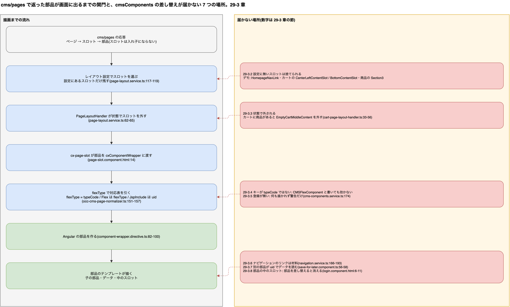

# 29-3. 差し替えが届かない場所: 7 つの例外とサブスロット

> **図**: 30 差し替えが届かない場所



> **この章が答える問い**: `cms/pages` に載っていて `typeCode` もある部品なのに、`cmsComponents` で差し替えても画面が変わらないのはどんなときか。なぜそうなっているのか。スロットの中にスロット(サブスロット)は作れるのか

> **位置づけ**: 29-2 章の続き。29-2 章はナビゲーションのリンク 1 つを掘り下げた。この章は、同じように「差し替えが届かない」場所を全部並べる。部品が画面に出るまでの流れを関門ごとに区切り、どの関門で止まるかで分類する

> **根拠の取り方**: 本体の動きは SAP/spartacus のクローンのソースを `path:line` で引用する(`sf/` = `core-libs/storefront/`、`core/` = `core-libs/core/src/`、`fl/` = `feature-libs/`)。「返ってきたのに描画されないスロット」は、クローンのデモアプリ(29-1 のサンプル入り)をデモの OCC につなぎ、ブラウザで数えた(2026-11-18)。数え方は、ページごとに `cms/pages` の全スロットと、画面にある `cx-page-slot` の `position` 属性を突き合わせた。条件は幅 1470px(lg)、未ログイン、カートに商品 2 個。候補は `getComponentData`・`getNavigationEntryItems`・`[cxComponentWrapper]`・`<cx-page-slot`・`implements PageLayoutHandler` を `core-libs`・`feature-libs`・`integration-libs` で全部 grep して洗い出した

---

### 先に話し言葉で: 差し替えは「最後の 1 歩」にしか効かない

`cmsComponents` の差し替えは、「この typeCode の部品を作るときは、こっちの Angular の部品を使って」という指示である。だから効くのは、部品を作るその瞬間だけになる。

部品がその瞬間にたどり着くまでには、いくつも関門がある。

1. スロットがレイアウト設定に載っているか
2. 今の状態(カートが空か、など)で外されていないか
3. 対応表を引くキーが何になるか

ここで止まった部品は、作られる瞬間が来ないので、差し替えも届かない。

作られた後にも抜け道がある。

- ナビゲーションのように、親が子をデータとしてしか使わない
- 別の部品が、uid を指定してデータだけを読みにくる
- 部品が、自分の中に別のスロットを持っている

こういうところでは、差し替えた部品とは別の場所で、元のデータが使われ続ける。

「どれも差し替えられる」と考えるより、「作られる瞬間まで来た部品だけが差し替えられる」と考えると、この章の 7 つは全部説明がつく。

---

### 29-3.1 全体像: 部品が画面に出るまでの関門

| 段 | 何をするか | 根拠 | ここで止まる例 |
|---|---|---|---|
| 1 | `cms/pages` がページ・スロット・部品を返す | `core/occ/adapters/cms/converters/occ-cms-page-normalizer.ts` | — |
| 2 | レイアウト設定で、描くスロットを選ぶ | `sf/cms-structure/page/page-layout/page-layout.service.ts:106-127` | 29-3.2 |
| 3 | `PageLayoutHandler` が、状態に応じてスロットを外す | `page-layout.service.ts:62-65` | 29-3.3 |
| 4 | `cx-page-slot` が部品を `cxComponentWrapper` に渡す | `sf/cms-structure/page/slot/page-slot.component.html:14` | — |
| 5 | flexType をキーに対応表を引く | `occ-cms-page-normalizer.ts:151-157`、`sf/cms-structure/page/component/component-wrapper.directive.ts:82-88` | 29-3.4、29-3.5 |
| 6 | Angular の部品を作る | `component-wrapper.directive.ts:90-` | (差し替えが効くのはここ) |
| 7 | 部品のテンプレートが、子の部品・データ・中のスロットを描く | 各部品のテンプレート | 29-3.6、29-3.7、29-3.8 |

デモで数えた「`cms/pages` で返ったのに描画されなかったスロット」は次のとおりだった。括弧の数字は、スロットに入っている部品の数である。

| ページ | 返ったスロット | 描画されなかったスロット |
|---|---|---|
| ホーム | 19 | HeaderLinks(0)、TopHeaderSlot(0)、PlaceholderContentSlot(0)、**HomepageNavLink(1)** |
| カート | 17 | 共通の 4 つ + **CenterLeftContentSlot(2)**、**BottomContentSlot(2)**、**EmptyCartMiddleContent(2)** |
| 商品(358639) | 17 | HeaderLinks(0)、TopHeaderSlot(0)、HomepageNavLink(1)、**Section3(1)** |
| カテゴリ(575) | 14 | 共通の 4 つ |

太字は、部品が入っているのに描画されなかったスロットである。理由は 29-3.2 と 29-3.3 で説明する。

---

### 29-3.2 レイアウト設定に無いスロットは捨てられる

**何が起きるか。** 描画するスロットは、`LayoutConfig.layoutSlots` のページテンプレートの設定で決まる。設定に載っていないスロットは、`cms/pages` で返っても捨てられる。

```ts
// page-layout.service.ts:117-126
if (config && config.slots) {
  const pageSlots = page.slots ? Object.keys(page.slots) : [];
  return config.slots.filter((slot) => pageSlots.includes(slot));   // 設定にあり、応答にもあるものだけ
} else if (!section) {
  this.logMissingLayoutConfig(page);
  return page.slots ? Object.keys(page.slots) : [];                  // テンプレートの設定が無いときだけ全部出す
} else { ... return []; }
```

**デモで捨てられていた部品。** 既定の設定は `sf/recipes/config/layout-config.ts` にある。

| スロット | 中の部品 | 理由 |
|---|---|---|
| `HomepageNavLink`(全ページ) | `HomepageNavLink`(`CMSLinkComponent`) | どのテンプレートにも、`header` / `navigation` のセクションにも無い(`sf/recipes/config/layout-config.ts:33-50`) |
| `CenterLeftContentSlot`(カート) | `PromotionsComponent`、`PotentialPromotionsComponent`(どちらも Flex) | `CartPageTemplate` の設定は `TopContent`・`CenterRightContentSlot`・`EmptyCartMiddleContent` の 3 つだけ |
| `BottomContentSlot`(カート) | `CartSuggestions`、`CheckoutComponent` | 同上 |
| `Section3`(商品) | `BundleCarouselComponent` | `ProductDetailsPageTemplate` の設定に無い |

**差し替えはどうなるか。** たとえば `PromotionsComponent` の対応表を差し替えても、カートページには何も出ない。部品が作られる段まで来ないからである。

**どうするか。** 出したいなら、`layoutSlots` のそのテンプレートにスロットを足す(29 章の K2)。逆に言うと、CMS でスロットを作っても、FE のレイアウト設定に足すまでは画面に出ない。アクセラレータから移行するときに、一番よく出会う形である(28 章)。

**見分け方。** 開発モードでは、テンプレートの設定そのものが無いときだけ警告が出る(`page-layout.service.ts:252-`)。テンプレートの設定はあるが、スロットが足りないだけのときは、警告は出ない。この章のように、`cms/pages` のスロットと画面の `cx-page-slot[position]` を突き合わせて調べる。

---

### 29-3.3 状態によってスロットが外される

**何が起きるか。** スロットを選んだ後で、`PageLayoutHandler` がスロットの一覧を加工できる(`page-layout.service.ts:62-65`)。カートページの handler は、カートの状態でスロットを外す(`fl/cart/base/components/cart-page-layout-handler.ts:33-56`)。

| カートの状態 | 外すスロット |
|---|---|
| 読み込み中で空 | `TopContent`、`CenterRightContentSlot`、`EmptyCartMiddleContent` |
| 商品がある | `EmptyCartMiddleContent` |
| 空だが「後で買う」に商品がある | `EmptyCartMiddleContent`、`CenterRightContentSlot` |
| 空 | `TopContent`、`CenterRightContentSlot` |

デモでカートに商品が 2 個あったので、`EmptyCartMiddleContent`(`EmptyCartParagraphComponent` と `ImportOrderEntriesComponent`)は描画されていなかった。

**差し替えはどうなるか。** 差し替えた部品が、ある状態のときにしか出ない。確かめるときは、その状態を作る必要がある。

**どうするか。** 出す条件を変えたいなら、handler を足すか差し替える。クローンで `implements PageLayoutHandler` を持つのは、カートと商品コンフィギュレーターの 3 つだった。

---

### 29-3.4 対応表のキーが typeCode ではない部品

**何が起きるか。** 対応表を引くキー(flexType)は、通常は typeCode と同じである。ただし次の 2 つは違う(`occ-cms-page-normalizer.ts:151-157`)。

| typeCode | 対応表のキー | 例 |
|---|---|---|
| `CMSFlexComponent` | 属性 `flexType` の値 | `CartComponent`、`PromotionsComponent` |
| `JspIncludeComponent` | `uid` | 27 章の 6 つ |

**差し替えはどうなるか。** `cmsComponents: { CMSFlexComponent: ... }` と書いても、どの部品にも当たらない。デモの 5 ページで一番多かった部品は `CMSFlexComponent`(52 個)なので、一番よく踏む。

**どうするか。** flexType の値をキーにする。29-1 の K3 は、`ProductIntroComponent`(Flex)をこの形で差し替えた。

---

### 29-3.5 対応表に登録が無い部品

**何が起きるか。** 対応表にキーが無いと、`cxComponentWrapper` は何もしない(`component-wrapper.directive.ts:86-88`)。開発モードでは、`No component implementation found for the CMS component type '…'` という警告が出る(`sf/cms-structure/services/cms-components.service.ts:174`)。デモアプリを動かしたときは、`ProfileTagComponent` でこの警告が出ていた。

**差し替えはどうなるか。** 「差し替える」相手がいない。`cmsComponents` に足せば描画されるので、除外ではなく新規の登録である。

**注意。** 登録の無い部品は、画面には何も出ない。ただし、`cms/pages` の応答には載っている。29-3.2 のスロットごと捨てられるケースと、画面の見た目では区別がつかない。警告が出るかどうかで見分ける。

---

### 29-3.6 ナビゲーションのリンクは部品にならない

29-2 章の内容である。ナビゲーションの部品(`CategoryNavigationComponent`・`NavigationComponent`・`FooterNavigationComponent`)は、ノードの entry を `cms/components` でまとめて取得する。そのうち `CMSLinkComponent` から 5 項目だけを書き写し、固定のテンプレートで文字のリンクにする(`sf/cms-components/navigation/navigation/navigation.service.ts:166-193`)。子のリンクは `cxComponentWrapper` を通らないので、対応表も outlet も効かない。デモでは、1 ページあたり 34 本(ヘッダーのカテゴリメニュー 26、フッター 8)がこれだった。

#### なぜ受け口が無いのか

技術的には作れる。Spartacus が作っていないだけである。SAP の資料やソースのコメントに理由が書かれているわけではない。以下はソースから読み取れる根拠と、そこからの推測である。

1. **CMS のデータの上で、entry は「部品を置く場所」ではなく「参照」である。**
   - entry が指せるのは部品だけではない。ページ(`AbstractPage`)や Media(`AbstractMedia`)も指せる。取得も superType ごとに分けて行う(`core/cms/store/effects/navigation-entry-item.effect.ts:92-100`)
   - Spartacus がリンクとして使うのは `CMSLinkComponent` だけで、ソースのコメントにも「now we only consider CMSLinkComponent」とある(`navigation.service.ts:169`)
   - スロットと部品は「ここにこれを描く」関係である。ノードと entry は「このメニュー項目の中身はこれ」という関係である
2. **メニューは、1 つの部品として、項目どうしの関係を前提に動いている。**
   - **矢印キーの移動**: 押されたリンクから `parentElement.parentElement`(`li`)を求め、その前後の `li` の中の `a` にフォーカスを移す(`sf/cms-components/navigation/navigation/navigation-ui.component.ts:263-275`)。どの項目も `li > cx-generic-link > a` の形をしている前提である
   - **Tab の順番と読み上げ**: Tab で止まるかを、階層の深さで決める(`:398-402`)。読み上げには「何件中何番目か」を使う(`navigation-ui.component.html` の `position` / `listLength`)
   - **段組み**: `wrapAfter` 件ごとに段を分ける(`:324-330`)
   - 項目を自由な部品に差し替えられると、この形が崩れたときに、キーボード操作が黙って壊れる。固定のテンプレートにしておけば、アクセシビリティを本体が保証できる
3. **件数が多い(推測)。** `cxComponentWrapper` は部品ごとに、描画してよいかの判定・対応表の検索・専用のインジェクタの作成・遅延ロードのモジュールの読み込みを行う(`component-wrapper.directive.ts:72-100`)。1 ページ 34 本のリンクを全部これに通すより、1 つのテンプレートで描くほうが軽い

#### 受け口を自分で作る(雛形・未確認)

`NavigationUIComponent` を継承し、テンプレートだけ自分のものにして、リンクを描く場所に outlet を置く。その部品を使う親(`CategoryNavigationComponent`)を、対応表で差し替える。

```html
<!-- 自分の NavigationUI のテンプレート(本体の navigation-ui.component.html を写し、リンクの所だけ変える) -->
<ng-template [cxOutlet]="'NavLink:' + node.url" [cxOutletContext]="{ node: node }">
  <cx-generic-link [url]="node.url" ...>{{ node.title }}</cx-generic-link>
</ng-template>
```

```ts
// 以後は、リンク 1 本ずつに部品を差し込める
provideOutlet({ id: 'NavLink:/c/brand_10', position: OutletPosition.REPLACE, component: MyCanonLinkComponent })
```

この方法では、本体が受け口を作らなかった理由が、そのまま自分の負担になる。

- **DOM の形を守る**: 差し込む部品の中にも `<a>` を置き、`li > … > a` の形を崩さない。崩すと矢印キーでの移動が壊れる
- **テンプレートの写しを保守する**: 本体の `navigation-ui.component.html` が更新されたら、手で写す
- **キーを用意する**: node には uid が残らないので、キーは url で作るか、29-2 章の B の方法で node に足す

この雛形は動かして確かめていない。アイコンを足すだけなら、29-2 章の A・B で足りる。

---

### 29-3.7 別の部品が uid を指定してデータを読む

**何が起きるか。** 部品の中には、別の CMS 部品のデータを uid で直接読み、自分のテンプレートで使うものがある。

- **例**: 「後で買う」の部品(`SaveForLaterComponent`)は、カートが空のときに `EmptyCartParagraphComponent` のデータを読む(`fl/cart/base/components/save-for-later/save-for-later.component.ts:56-58`)。読んだ `content` は、`innerHTML` で表示する(`save-for-later.component.html:1-7`)
- **同じ部品は、スロットでも描画される**: `EmptyCartParagraphComponent` は、スロット `EmptyCartMiddleContent` の直下にもある(デモで確認)
- **状態によっては、片方にしか出ない**: カートが空で「後で買う」に商品があるとき、29-3.3 の handler が `EmptyCartMiddleContent` を外す(`cart-page-layout-handler.ts:51-55`)。このとき、この文章は「後で買う」の中にしか出ない

**差し替えはどうなるか。** `CMSParagraphComponent` の対応表を差し替えると、スロットに描かれる方は変わる。しかし、「後で買う」の中の文章は元の形のまま出る。この結果はソースから読んだもので、画面では試していない(「後で買う」はログインが必要なため)。

**どうするか。**

- **文章を変えたい**: CMS で文章を変える。両方に反映される
- **出し方まで変えたい**: 読んでいる側(`SaveForLaterComponent`)を差し替える

**同じ形の箇所。** クローンで、部品のテンプレートの中で別の部品を uid で読んで使っているのは、この 1 か所だった。CDC 連携の `integration-libs/cdc/components/gigya-raas/gigya-raas.guard.ts:99-121` も部品のデータを読むが、ページを開いてよいかの判定に使うだけで、表示には使わない。

---

### 29-3.8 スロットの中のスロット(サブスロット)

#### CMS のデータでは、スロットは入れ子にならない

デモの `cms/pages` の応答を見ると、スロットが持つキーは `components`・`name`・`position`・`slotId`・`slotShared`・`slotUuid` の 6 つだけだった。ページも、`contentSlots` にスロットを平らに並べるだけである。データの上では、ページ → スロット → 部品 の 3 段で止まる。

入れ子に見える形は、Spartacus の側で 2 通りに作られる。

#### (a) 部品の中に部品を持つ(コンテナ部品)

データの上での「サブスロット」に近いのは、こちらである。子は `cxComponentWrapper` で描画されるので、対応表の差し替えも効く(29-2 章の 29-2.4)。

| コンテナ部品 | 子の持ち方 | 子の描き方 |
|---|---|---|
| `CMSTabParagraphContainer` | 属性 `components` に uid を並べる | `sf/cms-components/content/tab-paragraph-container/tab-paragraph-container.component.html:10` |
| `RotatingImagesComponent` | 属性 `banners` に uid を並べる | `sf/cms-components/content/banner-carousel/banner-carousel.component.html:11` |

#### (b) 部品のテンプレートの中に `<cx-page-slot>` を置く

画面の上で「スロットの中のスロット」になるのは、こちらである。クローンで `<cx-page-slot>` を書いているテンプレートは 3 つだった。

| テンプレート | 置き方 |
|---|---|
| `sf/cms-structure/page/page-layout/page-layout.component.html:13` | 通常の配置(レイアウト設定のスロットを並べる) |
| `sf/layout/main/storefront.component.html:15` | 外枠に固定で置く(`BottomHeaderSlot`) |
| `fl/user/account/components/login/login.component.html:6-11` | **部品の中**に置く(`HeaderLinks`) |

3 つ目の流れは次のとおりである。

1. **LoginComponent が置かれる**: `LoginComponent` は CMS ではなく、FE の静的な設定でスロット `SiteLogin` に置かれる(`sf/recipes/config/static-cms-structure.ts:15-18`)
2. **中にスロットを描く**: ログインしているときは、自分のテンプレートの中に `<cx-page-slot position="HeaderLinks">` を描く
3. **レイアウト設定には無い**: `HeaderLinks` はヘッダーのレイアウト設定(`sf/recipes/config/layout-config.ts:33-50`)に無い。だから 29-3.1 の表で「描画されなかったスロット」に入っていた(未ログインで、部品は 0 個)
4. **データと画面の違い**: データの上では、`SiteLogin` と `HeaderLinks` は同じページの平らなスロットである。画面の上でだけ、`SiteLogin` → `LoginComponent` → `HeaderLinks` と入れ子になる

**差し替えはどうなるか。** `LoginComponent` を対応表(`fl/user/account/components/login/login.module.ts:32`)で自作の部品に差し替えるとする。自作のテンプレートに `<cx-page-slot position="HeaderLinks">` を書かないと、`HeaderLinks` スロットごと画面から消える。CMS でそのスロットに部品を入れていても、表示されない。この結果はソースから読んだもので、画面では試していない(ログインが必要なため)。

**見分け方。** 部品を差し替える前に、元のテンプレートで `<cx-page-slot` を grep する。

#### 自分でサブスロットを作る

(b) の形をまねる。

1. 自作の部品のテンプレートに `<cx-page-slot position="MySubSlot" />` を置く
2. CMS で、そのページ(またはページテンプレート)に、位置 `MySubSlot` のスロットを作って部品を入れる
3. `layoutSlots` には `MySubSlot` を入れない。入れると、通常の配置と部品の中の 2 か所に描かれる

2 の CMS 側の細かい決まり(ページテンプレートに許される位置名の定義など)は、SAP Commerce の本体のソースが手元に無いので確かめていない。一般形として、要確認である。

---

### 29-3.9 調べ方の手順

差し替えたのに画面が変わらないときは、関門の順に調べる。

1. **`cms/pages` に載っているか**: `tools/cms-component-placement.py <OCC> <ページ> --uid <uid>` で、`slot` / `wrapper` / `data` のどれかを見る。`data` なら 29-3.6
2. **スロットが画面にあるか**: 開発者ツールで `document.querySelector('cx-page-slot[position="<スロット>"]')` を調べる。無ければ 29-3.2 か 29-3.3。テンプレートの `layoutSlots` を見て、載っていれば handler を疑う
3. **対応表のキーは合っているか**: 部品の `typeCode` が `CMSFlexComponent` なら `flexType`、`JspIncludeComponent` なら `uid` をキーにする(29-3.4)
4. **警告が出ていないか**: `No component implementation found` が出ていれば 29-3.5
5. **同じデータを別の場所で使っていないか**: 変わらない表示の要素の親をたどる。別の部品の中なら 29-3.7。その部品の対応表とテンプレートを見る
6. **差し替えた部品が、中にスロットを持っていなかったか**: 元のテンプレートで `<cx-page-slot` を grep する(29-3.8)

---

### 29-3.10 まとめ

- **差し替えが効く場所**: `cmsComponents` の差し替えが効くのは、部品が作られる瞬間(関門の 6 段目)だけである
- **作られる前に止まるもの**:
  - レイアウト設定に無いスロット(29-3.2)
  - 状態で外されるスロット(29-3.3)
  - キーの違い(29-3.4)
  - 登録が無い部品(29-3.5)
- **作られた後の抜け道**:
  - ナビゲーションのリンク(29-3.6)
  - uid でデータを読む部品(29-3.7)
  - 部品の中のスロット(29-3.8)
- **受け口が無いもの**: 仕組みとして受け口が無いのは、ナビゲーションのリンクだけである。理由は、entry が参照であることと、メニューが 1 つの部品としてキーボード操作を保証していることだと読める。受け口は自分でも作れるが、その保証を引き受けることになる
- **サブスロット**: スロットはデータの上では入れ子にならない。入れ子に見えるのは、コンテナ部品(子は描画される)か、部品のテンプレートの中の `<cx-page-slot>`(部品を差し替えると消える)のどちらかである

---

[目次](README.md) | ← [29-2. 描画される部品と、材料にされる部品](29-2-rendered-vs-data-components.md) | [番外. サブエージェントとスキルの分け方](extra-agent-split-patterns.md) →
