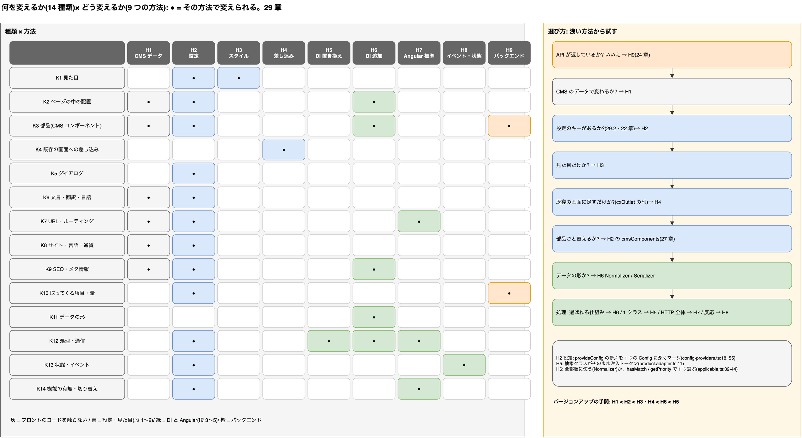
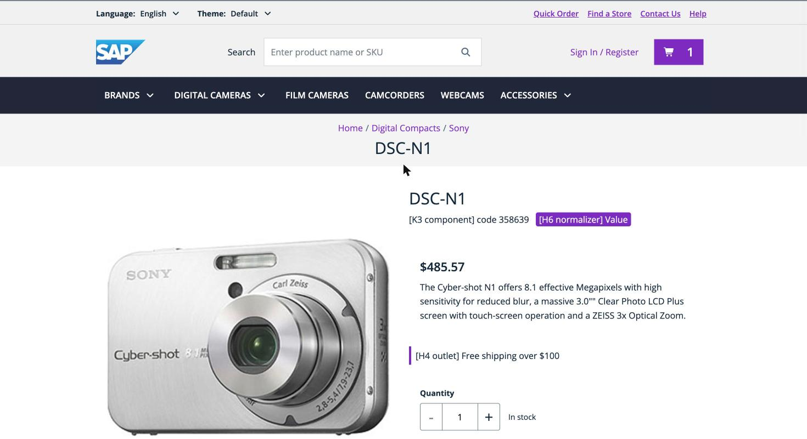

# 29. カスタマイズの種類と方法の総覧: 何を変えるか × どう変えるか

> **図**: 28 カスタマイズの種類 × 方法(`diagrams/spartacus-architecture.drawio`)。縦に「何を変えるか」(14 種類)、横に「どう変えるか」(9 つの方法)を並べ、どの方法で変えられるかを●で示す。下に、浅い方法から順に試す選び方



> **この章が答える問い**: Composable Storefront(Spartacus)では、何をカスタマイズできるのか。それぞれ、どの仕組みで変えるのか

> **位置づけ**: 3 つの章を横につなぐ**地図**である。22 章は「要件 → どの段か」の索引(100 件)、23 章は段ごとの書き方と書く場所、27 章は CMS の部品だけを詳しく扱う(M1〜M14)。この章は、拡張点を「何を変えるか」と「どの仕組みで変えるか」の 2 つの軸で並べ直し、各行から詳しい章へ戻れるようにする

> **根拠の取り方**: クローン(`core-libs/core/package.json` の version 221121.20.0)の、設定のクラス・トークン・抽象クラスの**定義**の行を引用する。パスは 22 章と同じく略す: `core/` = `core-libs/core/src/`、`sf/` = `core-libs/storefront/`、`styles/` = `core-libs/styles/`、`setup/` = `core-libs/setup/`、`fl/` = `feature-libs/`。29.6 のサンプルは、クローンのデモアプリ `projects/storefrontapp` に組み込み、デモの OCC につないで画面とコンソールで動作を確かめた(2026-11-17)。それ以外のコード例は書き方の形を示すもので、実行していない

---

### 先に話し言葉で: 変えられるものは多いが、変え方は 9 つしかない

Spartacus で変えられるものは多い。見た目、部品の並び、部品そのもの、文言、URL、API から取る項目、取ってきたデータの形、処理の中身、まで変えられる。ただ、変え方の仕組みを数えると 9 つしかない。

いちばん浅いのは、バックエンドの **CMS のデータ** を変えることで、フロントのコードは触らない。その次がフロントの **設定**(`provideConfig`)である。Spartacus のほとんどの機能は設定のオブジェクトを読んで動くので、件数・URL・部品の割り当て・翻訳・API の `fields` まで、ここで変えられる。

見た目は **スタイル**(CSS 変数・SCSS)で変える。既存の画面に何かを足したいときは **アウトレット** で差し込む。ここまでは本体のコードに手を入れない。

その先は Angular の DI を使う。

- **置き換え**:本体が抽象クラスや注入トークンで受け取っているもの(Adapter、Facade、サービス)を、自分のクラスに差し替える。
- **追加**:本体が「複数集めて、合うものを選ぶ」形で受け取っているもの(Normalizer、ページのメタ情報、HTTP のエラー処理など)に、自分の 1 つを足す。

さらに、Angular そのもの(ルート、ガード、インターセプター)と、イベントや状態の購読がある。最後が **バックエンドの実装** で、API が返さないものはフロントでは作れない。

困ったら、浅い方法から順に試す。設定で済むものをコードで書くと、バージョンを上げるたびに追従する手間が増える。

---

### 29.1 2 つの軸

**何を変えるか(種類)**

| # | 種類 | 例 |
|---|---|---|
| K1 | 見た目 | 色、余白、フォント、アイコン、ブレークポイント |
| K2 | ページの中の配置 | どのテンプレートにどのスロットを並べるか、画面の幅ごとの並び |
| K3 | 部品(CMS コンポーネント) | 本体の部品を自作に替える、新しい部品を足す |
| K4 | 既存の画面への差し込み | 商品名の後ろにバッジ、カートの行に 1 列 |
| K5 | ダイアログ・ポップアップ | 追加したらカートのダイアログ、住所の確認 |
| K6 | 文言・翻訳・言語 | ボタンの文言、言語の追加、右から左に書く言語 |
| K7 | URL・ルーティング | 商品ページの URL の形、新しいページ、ログインが必要なページ |
| K8 | サイト・言語・通貨 | ベースサイトの決め方、URL に言語と通貨を入れるか |
| K9 | SEO・ページのメタ情報 | タイトル、description、robots、canonical、構造化データ |
| K10 | 取ってくる項目・量 | 商品 API の `fields`、一覧の件数、部品を何件ずつ取るか |
| K11 | データの形 | API の JSON とフロントのモデルの変換 |
| K12 | 処理・通信 | 取得先を替える、1 つのメソッドだけ替える、HTTP の前後に処理を挟む、エラー時の動き |
| K13 | 状態・イベント | ログインやカート追加に反応する、ブラウザに保存する |
| K14 | 機能の有無・挙動の切り替え | 機能ライブラリを入れる・外す、本体の新しい挙動を有効にする、SSR、PWA、SmartEdit |

**どう変えるか(方法)**

| ID | 方法 | 何をするか | 仕組み |
|---|---|---|---|
| H1 | CMS のデータ | Backoffice / ImpEx で、部品の属性、スロットへの配置、ナビゲーション、ページのラベルを変える | フロントは CMS の応答をそのまま描く(22 章 段 0) |
| H2 | 設定 | `provideConfig({...})` を書く | 全部の設定が 1 つの `Config` に深くマージされ、各機能がそれを読む(29.3) |
| H3 | スタイル | CSS 変数、SCSS 変数、`$skipComponentStyles` で標準のスタイルを外す | 本体のスタイルは変数と `%cx-*` プレースホルダで書かれている |
| H4 | 差し込み(アウトレット) | `provideOutlet` か `*cxOutletRef` で、名前の付いた場所の前・後・置き換えに部品を置く | 本体のテンプレートに `cxOutlet` の印がある |
| H5 | DI の置き換え | `{ provide: 本体のクラス, useClass: 自作 }` | Adapter・Facade・サービスは抽象クラスかクラスを注入トークンにしている |
| H6 | DI の追加(multi) | `{ provide: トークン, useClass: 自作, multi: true }` | 本体が複数を集め、全部を順に使うか、点数の高いものを選ぶ(29.3) |
| H7 | Angular の標準 | ルートを足す、ガード、`HTTP_INTERCEPTORS` | Spartacus は Angular のアプリなので、Angular の拡張点はそのまま使える |
| H8 | イベント・状態 | `EventService.get()` で購読、`register()` で発行、`StatePersistenceService` で保存 | 機能をまたいだ通知はイベントで行う |
| H9 | バックエンドの実装 | items.xml、Populator、WsDTO、OCC の Controller(24 章) | フロントは API が返すものしか描けない |

---

### 29.2 総覧: 種類ごとの方法と書くもの

「段」は 22 章の段(0 = CMS データだけ、1 = 設定、2 = 見た目・アウトレット、3 = 部品、4 = 変換、5 = 取得・ロジック、BE = バックエンド)。

#### K1 見た目

| 変えたいもの | 方法 | 書くもの | 定義 | 段 | 詳しくは |
|---|---|---|---|---|---|
| 色・テーマ | H3 | `--cx-color-primary` などの CSS 変数を上書き | `styles/scss/root.scss:69`、`styles/scss/theme/high-contrast/light/_variables.scss:4` | 2 | 23.5 |
| 本体の部品のスタイルを丸ごと外す | H3 | `$skipComponentStyles: (cx-product-images)` を、スタイルを読み込む前に書く | `styles/scss/_components.scss:7` | 2 | 22 章 #1、23.5 |
| アイコン | H2 | `IconConfig`(`icon.symbols`、`icon.resources`) | `sf/cms-components/misc/icon/icon.model.ts:82` | 1 | 22 章 #79 |
| 画面の幅の区切り | H2 | `LayoutConfig.breakpoints` | `sf/layout/config/layout-config.ts:100` | 1 | 22 章 #82 |
| 画像のサイズ・形式 | H2 | `MediaConfig` | `sf/shared/components/media/media.config.ts:23` | 1 | — |
| テーマの切り替え | H2 | 候補は `siteTheme.optionalThemes`、固定するなら `context.theme` | `core/site-theme/config/site-theme-config.ts:17`、`core/site-context/providers/context-ids.ts:10` | 1 | 22 章 #77 |

#### K2 ページの中の配置

| 変えたいもの | 方法 | 書くもの | 定義 | 段 | 詳しくは |
|---|---|---|---|---|---|
| テンプレートごとのスロットの並び | H2 | `LayoutConfig.layoutSlots.<テンプレート名>.slots`(幅ごとに `lg` `xs` も) | `sf/layout/config/layout-config.ts:102` | 1 | 22.10 |
| スロットに入る部品 | H1 | CMS でスロットに部品を配置する | — | 0 | 11 章 |
| CMS に無いページやスロットを、フロントだけで用意する | H2 | `CmsStructureConfig.cmsStructure`(静的なページ・スロット・部品) | `core/cms/config/cms-structure.config.ts:79-80` | 1 | — |
| 条件でスロットを出し分ける | H6 | `PAGE_LAYOUT_HANDLER` に自作のハンドラを足す(例: 空のカートで別のスロット) | `sf/cms-structure/page/page-layout/page-layout-handler.ts:11, 15` | 5 | 28.6 |

#### K3 部品(CMS コンポーネント)

部品は「キー」(`typeCode`、`flexType`、JspInclude の `uid`)で選ばれる。キーの種類と 14 の方法は 27 章にまとめてある。

| 変えたいもの | 方法 | 書くもの | 定義 | 段 | 詳しくは |
|---|---|---|---|---|---|
| 本体の部品を自作に替える | H2 | `cmsComponents.<キー>.component` | `core/cms/config/cms-config.ts:61, 130` | 3 | 23.6、27.2 |
| 新しい部品を足す | H1 + H2 (+ H9) | 型と OCC での公開(BE)、`cmsComponents` に新しいキー | 同上 | 3 | 11 章、14 章 |
| 型を作らずにコードだけの部品を置く | H1 + H2 | CMS に `CMSFlexComponent` を置き `flexType` を付け、そのキーで登録 | `core/occ/adapters/cms/converters/occ-cms-page-normalizer.ts:151` | 3 | 27.1 |
| 部品に付ける動き(ガード・初期データ・SSR しない・遅延描画・子ルート・翻訳) | H2 | `guards` `data` `disableSSR` `deferLoading` `childRoutes` `i18nKeys` | `core/cms/config/cms-config.ts:74-77, 85, 92` | 1 | 22.2 |
| 部品のコードを遅延ロードする | H2 | `featureModules.<名前>: { module: () => import(...), cmsComponents: [...] }` | `core/cms/config/cms-config.ts:121, 129` | 1 | 22 章 #9 |
| 部品の描き方そのもの(Web Components など) | H6 | `ComponentHandler` を足す | `sf/cms-structure/page/component/handlers/component-handler.ts:21`、`sf/cms-structure/page/component/page-component.module.ts:29, 34` | 5 | — |

#### K4 既存の画面への差し込み

| 変えたいもの | 方法 | 書くもの | 定義 | 段 | 詳しくは |
|---|---|---|---|---|---|
| 名前の付いた場所の前・後に足す、テンプレート・スロット・部品を置き換える | H4 | `provideOutlet({ id, position, component })` か、テンプレートで `*cxOutletRef` | `sf/cms-structure/outlet/outlet.providers.ts:41`、`sf/cms-structure/outlet/outlet.model.ts:9-13`、`sf/cms-structure/outlet/outlet-ref/outlet-ref.directive.ts:17` | 2 | 23.5、22 章 #85 |
| 差し込んだ部品で、その場所のデータを読む | H4 | `OutletContextData` を注入する | `sf/cms-structure/outlet/outlet.model.ts:21` | 2 | 23.5 |

#### K5 ダイアログ・ポップアップ

| 変えたいもの | 方法 | 書くもの | 定義 | 段 | 詳しくは |
|---|---|---|---|---|---|
| 本体のダイアログを替える、自作のダイアログを開く | H2 | `launch.<LAUNCH_CALLER の値>: { inline: true, component, dialogType }`(アウトレットに出すなら `outlet` と `position`) | `sf/layout/config/layout-config.ts:124`、`sf/layout/launch-dialog/config/launch-config.ts:9, 93` | 3 | 23.6 |

#### K6 文言・翻訳・言語

| 変えたいもの | 方法 | 書くもの | 定義 | 段 | 詳しくは |
|---|---|---|---|---|---|
| 本体の文言を変える、言語を足す | H2 | `i18n.resources.<言語>.<チャンク>` に上書きしたい分だけ書く | `core/i18n/config/i18n-config.ts:18, 78` | 1 | 22.9 |
| 自作の翻訳を足す | H2 | `i18n.chunks` に新しいチャンク、`i18n.resources` に中身 | `core/i18n/config/i18n-config.ts:88` | 1 | 22.9 |
| 右から左に書く言語 | H2 | `DirectionConfig` | `sf/layout/direction/config/direction.config.ts:29` | 1 | — |
| CMS の中の文言(見出し、リンクの名前) | H1 | CMS の属性を言語ごとに入れる | — | 0 | 22 章 段 0 |

#### K7 URL・ルーティング

| 変えたいもの | 方法 | 書くもの | 定義 | 段 | 詳しくは |
|---|---|---|---|---|---|
| ページの URL の形(`/product/:productCode/:name` など) | H2 | `routing.routes.<ルート名>.paths`、`paramsMapping` | `core/routing/configurable-routes/config/routing-config.ts:26`、`core/routing/configurable-routes/routes-config.ts:22, 36` | 1 | 22.8 |
| ログインが必要なページ | H2 | `routing.routes.<ルート名>.protected`(全体は `routing.protected`) | `core/routing/configurable-routes/routes-config.ts:47`、`core/routing/configurable-routes/config/routing-config.ts:39` | 1 | 22.8 |
| CMS のコンテンツページを足す | H1 | ラベルが `/` で始まるコンテンツページを CMS に作る | — | 0 | 28.6 |
| CMS に無いページ、独自の URL の照合 | H7 + H2 | `RouterModule.forChild` でルートを足し、`canActivate: [CmsPageGuard]`。照合は `UrlMatcherService` で作る | `sf/cms-structure/guards/cms-page.guard.ts:26`、`core/routing/services/url-matcher.service.ts:18`、`core/routing/url-matcher/default-url-matcher.ts:35` | 3 | 22.8 |
| ログインの有無で入れるページを制御 | H7 | `AuthGuard` / `NotAuthGuard`、自作のガード | `core/auth/user-auth/guards/auth.guard.ts:22`、`core/auth/user-auth/guards/not-auth.guard.ts:21` | 3 | — |

#### K8 サイト・言語・通貨

| 変えたいもの | 方法 | 書くもの | 定義 | 段 | 詳しくは |
|---|---|---|---|---|---|
| ベースサイト・言語・通貨の候補と、URL に入れるもの | H2 | `context.baseSite`、`context.language`、`context.currency`、`context.urlParameters` | `core/site-context/config/site-context-config.ts:14-18` | 1 | 28.4 |
| 候補をバックエンドから取る | H1 | ベースサイトの `urlPatterns`、`urlEncodingAttributes`(`context.baseSite` を書かないとき) | — | 0 | 28.4 |

#### K9 SEO・ページのメタ情報

| 変えたいもの | 方法 | 書くもの | 定義 | 段 | 詳しくは |
|---|---|---|---|---|---|
| タイトル・description・robots・canonical をページの種類ごとに | H6 | `PageMetaResolver` を継承し、`pageType` / `pageTemplate` を決めて足す。点数の高い方が使われる | `core/cms/page/page-meta.resolver.ts:17, 47-53`、本体の登録例 `core/product/product.module.ts:18, 23` | 5 | 22.8 |
| 本体のリゾルバの一部だけ変える(タイトルに印を付けるなど) | H5 | 本体のリゾルバ(例 `ProductPageMetaResolver`)を継承し、クラスのトークンを置き換える | `core/product/product.module.ts:17-21` | 5 | 29.6 |
| SEO の設定(構造化データなど) | H2 | `SeoConfig` | `sf/cms-structure/seo/config/seo.config.ts:14` | 1 | — |
| CMS で持っているタイトル・description | H1 | CMS ページの属性 | — | 0 | — |

#### K10 取ってくる項目・量

| 変えたいもの | 方法 | 書くもの | 定義 | 段 | 詳しくは |
|---|---|---|---|---|---|
| API の URL と `fields` | H2 | `backend.occ.endpoints.<名前>`(例: `product.details` の `fields` に `warrantyMonths` を足す) | `core/occ/config/occ-config.ts:23`、既定値 `core/occ/adapters/product/default-occ-product-config.ts:14-20` | 1 | 24 章、10 章 |
| 商品データをどの範囲(scope)で取り、まとめるか | H2 | `backend.loadingScopes` | `core/occ/config/occ-config.ts:39`、`default-occ-product-config.ts:53-56` | 1 | — |
| 一覧の件数、ページ送り | H2 | `ViewConfig`、`PaginationConfig` | `sf/shared/config/view-config.ts:14`、`sf/shared/components/list-navigation/pagination/config/pagination.config.ts:15` | 1 | 22.4 |
| API が返さない項目 | H9 | WsDTO・`fieldSetLevelMapping`・Populator | — | BE | 24 章 |

#### K11 データの形

| 変えたいもの | 方法 | 書くもの | 定義 | 段 | 詳しくは |
|---|---|---|---|---|---|
| API の JSON → フロントのモデル | H6 | `{ provide: PRODUCT_NORMALIZER, useClass: 自作, multi: true }`(登録されたものが順に全部実行される) | `core/product/connectors/product/converters.ts:11`、`core/util/converter.service.ts:21`、カート `fl/cart/base/root/tokens/converters.ts:17`、注文 `fl/order/root/tokens/converters.ts:24` | 4 | 23.7 |
| フロントのモデル → API に送る JSON | H6 | `*_SERIALIZER`(例 `ADDRESS_SERIALIZER`) | `core/user/connectors/address/converters.ts:20` | 4 | 23.7 |
| CMS の部品の属性 | — | 変換は要らない。部品の属性はそのまま `data$` に入る | `core/occ/adapters/cms/converters/occ-cms-page-normalizer.ts:166` | — | 22 章 #5 |

#### K12 処理・通信

| 変えたいもの | 方法 | 書くもの | 定義 | 段 | 詳しくは |
|---|---|---|---|---|---|
| 取得先を替える(OCC 以外から取る) | H5 | `{ provide: ProductAdapter, useClass: 自作 }` など Adapter を替える | `core/product/connectors/product/product.adapter.ts:11`、`fl/cart/base/core/connectors/cart/cart.adapter.ts:10` | 5 | 15 章、23.8 |
| 本体のサービスの 1 メソッドだけ替える | H5 | 本体のクラスを継承し、`{ provide: 本体, useClass: 自作 }` | — | 5 | 23.8 |
| 遅延ロードされる機能の Facade を替える | H5 | 機能のラッパーモジュールで Facade を provide する | `core/lazy-loading/facade-factory/facade-factory.ts:20`、例 `fl/cart/base/root/facade/active-cart.facade.ts:16-17, 46` | 5 | 23.2 規則 2、23.8 |
| HTTP の前後に処理を挟む | H7 | `HTTP_INTERCEPTORS`(本体も使っている) | 本体の例 `core/auth/client-auth/http-interceptors/index.ts:13` | 5 | 23.8 |
| HTTP のエラーごとの動き(メッセージ、遷移) | H6 | `HttpErrorHandler` を継承して足す(`hasMatch` と `getPriority` で選ばれる) | `core/global-message/http-interceptors/handlers/http-error.handler.ts:15`、`core/util/applicable.ts:32-44` | 5 | — |
| 画面に出すメッセージの時間・種類 | H2 | `GlobalMessageConfig` | `core/global-message/config/global-message-config.ts:19` | 1 | — |
| ログイン(OAuth のクライアント、URL) | H2 | `authentication.client_id` など `AuthConfig` | `core/auth/user-auth/config/auth-config.ts:36, 41` | 1 | 28.4 |
| チェックアウトの手順 | H2 | `CheckoutConfig`(ステップの並び、配送方法の既定) | `fl/checkout/base/root/config/checkout-config.ts:22` | 1 | 22.6 |

#### K13 状態・イベント

| 変えたいもの | 方法 | 書くもの | 定義 | 段 | 詳しくは |
|---|---|---|---|---|---|
| ログイン・カート追加・ページ遷移などに反応する | H8 | `eventService.get(CartAddEntrySuccessEvent)` を購読 | `core/event/event.service.ts:90` | 5 | 22.11 |
| 自作のイベントを出す | H8 | `eventService.register(MyEvent, source$)` | `core/event/event.service.ts:68` | 5 | — |
| 自作の状態をブラウザに保存する | H8 | `StatePersistenceService.syncWithStorage` | `core/state/services/state-persistence.service.ts:21, 44` | 5 | — |
| SSR で作った状態を HTML に埋め込む範囲 | H2 | `state.ssrTransfer.keys` | `core/state/config/state-config.ts:26` | 1 | 6 章、01-5 |

ストアを直接触る(本体の Action を dispatch する、Selector を直接使う)のは避ける。Facade を通す(`@spartacus/skills` の `facades-not-store.md`、23 章)。

#### K14 機能の有無・挙動の切り替え

| 変えたいもの | 方法 | 書くもの | 定義 | 段 | 詳しくは |
|---|---|---|---|---|---|
| 機能ライブラリを入れる・外す | H7 + H2 | `ng add @spartacus/<機能>` が作る `*-feature.module.ts` を足す・消す | — | 1 | 23.1 |
| 本体の新しい挙動を有効にする(後方互換のための切り替え) | H2 | `features.<フラグ>: true`。テンプレートは `*cxFeature`、スタイルは `useFeatureStyles` | `core/features-config/config/features-config.ts:31, 48`、`core/features-config/directives/feature.directive.ts:11`、`core/features-config/utils/use-feature-styles.ts:32` | 1 | 番外の実例 |
| SSR のエンジンの動き(タイムアウト、キャッシュ) | H2 相当 | `server.ts` で `SsrOptimizationOptions` を渡す | `setup/ssr/optimized-engine/ssr-optimization-options.ts:18` | 1 | 6 章 |
| PWA / SmartEdit / パーソナライズ / スキップリンク | H2 | `PWAModuleConfig`、`SmartEditConfig`、`PersonalizationConfig`、`SkipLinkConfig` | `sf/cms-structure/pwa/pwa.module-config.ts:14`、`fl/smartedit/root/config/smart-edit-config.ts:14`、`fl/tracking/personalization/root/config/personalization-config.ts:14`、`sf/layout/a11y/skip-link/config/skip-link.config.ts:14` | 1 | 28.11 |

---

### 29.3 方法ごとの仕組み: なぜその書き方で効くのか

#### H2 設定: 全部が 1 つの `Config` にマージされる

`provideConfig` と `provideDefaultConfig` は、どちらも設定の断片を multi provider で登録する(`core/config/config-providers.ts:18, 55`)。起動時に断片が深くマージされ、`Config` という 1 つのオブジェクトになる(`core/config/config-tokens.ts:21`)。

本体の機能は `provideDefaultConfig` で既定値を出し、アプリは `provideConfig` で上書きする。そのため、書くのは変えたいキーだけでよい。`LayoutConfig` や `CmsConfig` などの設定クラスは、`Config` を型として見せているだけである(5 章・23.4)。

```ts
provideConfig(<CmsConfig & LayoutConfig>{
  cmsComponents: { ProductAddToCartComponent: { component: MyAddToCartComponent } },
  layoutSlots: { ProductDetailsPageTemplate: { slots: ['Summary', 'UpSelling'] } },
}),
```

#### H5 DI の置き換え: 抽象クラスがそのまま注入トークン

Adapter や Facade は、抽象クラスとして定義され、そのクラス自体を注入トークンにしている(例 `ProductAdapter` `core/product/connectors/product/product.adapter.ts:11`)。

同じトークンに `useClass` を書けば、本体のコードはそのまま自作のクラスを受け取る。置く場所を間違えると効かないので、23.2 の 3 つの規則に従う。

- アプリ全体で読まれるものは root に置く。
- 遅延ロードされる機能の中身は、その機能のラッパーモジュールに置く。

#### H6 DI の追加: 全部使うか、点数で選ぶか

multi provider で集められたものの使われ方は 2 通りある。

| 使われ方 | 例 | 書くときの注意 |
|---|---|---|
| 全部を順に使う | Normalizer / Serializer(`core/util/converter.service.ts:21`)、`HTTP_INTERCEPTORS` | 本体のものは消えずに残り、自作が加わる。本体の変換を前提に書くなら、本体のモジュールより後に登録されるように置く |
| 合うものから 1 つ選ぶ | `PageMetaResolver`、`HttpErrorHandler`、`ComponentHandler`、`PAGE_LAYOUT_HANDLER` | `Applicable` の `hasMatch` と `getPriority` で選ばれる(`core/util/applicable.ts:32-44`)。本体の既定より高い優先度を返さないと、自作が選ばれない |

優先度の目安は `Priority`(FALLBACK = -50、LOW = -10、NORMAL = 0、HIGH = 10、`core/util/applicable.ts:7-24`)。`PageMetaResolver` は `pageType` と `pageTemplate` が合うほど点数が上がる(`core/cms/page/page-meta.resolver.ts:40-53`)。

#### H4 差し込み: 本体のテンプレートにある印だけが対象

アウトレットで差し込めるのは、本体のテンプレートに `cxOutlet` の印がある場所だけである。CMS の構造の 3 か所にも印がある。

- ページテンプレート名(`sf/cms-structure/page/page-layout/page-layout.component.html:4`)
- スロットの position(`sf/cms-structure/page/slot/page-slot.component.html:3`)
- 部品の `flexType`(同 `:9`)

そのため、これらの名前を使えば、テンプレートやスロットを丸ごと置き換えたり、前後に足したりできる。印の無い場所に差し込みたいときは、部品の置き換え(K3)になる。

---

### 29.4 選び方: 浅い方法から試す

```
変えたいものは API が返しているか? ── いいえ → H9 バックエンド(24 章)。その後でフロントへ
        │ はい
CMS のデータで変わるか? ── はい → H1(フロントは触らない)
        │ いいえ
設定のキーがあるか?(29.2 の表、22 章) ── はい → H2
        │ いいえ
見た目だけか? ── はい → H3
        │ いいえ
既存の画面に足すだけか? ── はい → H4(印があれば)
        │ いいえ
部品ごと替えるか? ── はい → H2 の cmsComponents(27 章)
        │ いいえ
データの形か? ── はい → H6 Normalizer / Serializer
        │ いいえ
処理を替えるか? → 選ばれる仕組みなら H6、1 つのクラスなら H5、HTTP 全体なら H7、反応するだけなら H8
```

迷ったときの決め手:

- **バージョンアップの手間**は H1 < H2 < H3・H4 < H6 < H5 の順に増える。H5 は本体のクラスの中身に依存するので、本体が変わると壊れやすい。
- **1 つの要件に方法を混ぜてよい**。例:新しい部品は H9(型と OCC)+ H1(配置)+ H2(割り当て)、項目を足すなら H9(WsDTO)+ H2(`fields`)。

---

### 29.5 できないこと・避けること

| 内容 | 理由と代わり |
|---|---|
| API が返さない項目を、フロントだけで表示する | 作れない。バックエンドで返す(24 章) |
| 設定がありそうで無いもの(注文履歴の件数など) | コードに書かれている。22.12 の一覧を先に見る |
| 本体の `private` なメソッドだけを替える | 継承では替えられない。クラスを置き換えるか、公開されたメソッドを替える |
| 本体のストアを直接 dispatch・select する | 内部の形は予告なく変わる。Facade を通す |
| ライブラリの内部パス(`@spartacus/core/src/...`)を import する | 公開 API ではない。パッケージの入口から import する |
| 印の無い場所へのアウトレット | 部品の置き換えにする |
| 遅延ロードされる機能のサービスを root で替える | 効かない。機能のラッパーモジュールで替える(23.2 規則 2) |

---

### 29.6 サンプル実装: 本物の Spartacus で動かす

H2〜H8 を 1 つずつ実装したサンプルを [playground/customization-samples](../playground/customization-samples/) に置いた。SAP/spartacus のクローンに入っているデモアプリへ `apply.sh` で組み込み、デモの OCC(electronics-spa)につないで、全部が効くことを確かめた。2211 以降の `@spartacus/*` は公開 npm に無い(SAP のレジストリで配布)ため、クローンのソースのまま動かしている。



1 枚の商品詳細ページに、次の 5 つが同時に出ている。

- 紫の色(H3)
- 商品名の下の自作部品(K3)
- バッジ(H6)
- 数量の上の 1 行(H4)
- カートの件数

タブのタイトルには `[H5 meta]` が付き、URL は `/item/358639`(H2)になっている。

#### 全部を登録するモジュール

```ts
// samples/samples.module.ts(抜粋)
@NgModule({
  imports: [RouterModule.forChild([{ path: 'sample/hello', component: SampleHelloPageComponent }])], // H7
  providers: [
    ...sampleConfigProviders,                                                        // H2 URL・文言
    provideConfig(<CmsConfig>{
      cmsComponents: { ProductIntroComponent: { component: SampleProductIntroComponent } }, // K3
    }),
    provideOutlet({ id: 'ProductAddToCartComponent', position: OutletPosition.BEFORE,
                    component: SampleShippingNoteComponent }),                        // H4
    { provide: ProductAdapter, useClass: SampleProductAdapter },                     // H5
    { provide: ProductPageMetaResolver, useExisting: SampleProductPageMetaResolver }, // H5
    { provide: PRODUCT_NORMALIZER, useClass: SampleProductNormalizer, multi: true }, // H6
    { provide: HTTP_INTERCEPTORS, useClass: SampleTimingInterceptor, multi: true },  // H7
    provideAppInitializer(() => inject(SampleCartAddedMessageService).start()),      // H8
  ],
})
export class SamplesModule {}
```

#### 方法ごとの中身

| 方法 | 書いたもの(要点) | 画面・コンソールで確かめたこと |
|---|---|---|
| H2 設定 | `routing.routes.product.paths: ['item/:productCode/:name', 'item/:productCode']`、`i18n.resources.en.product.addToCart.addToCart` | `/item/358639` で商品ページが開き、作られるリンクも `/item/...` になる。ボタンが「Add To Cart (Sample)」になる(大文字は本体の CSS) |
| H3 スタイル | `cx-storefront { --cx-color-primary: #7b2cbf; }` | ボタン、リンク、カートが紫になる |
| H4 差し込み | 上の `provideOutlet`。名前は部品のキー | 数量の上に「[H4 outlet] …」が出る |
| K3(H2 の `cmsComponents`) | `CurrentProductService.getProduct()` を `async` で描く standalone の部品 | 商品名の下が自作の表示になる |
| H6 追加 | `convert(source, target)` で `price.value` から `target.sampleBadge` を作る。`declare module '@spartacus/core'` で `Product` に型を足す | 自作の部品にバッジが出る(Normalizer → 状態 → 部品の順に流れる) |
| H5 置き換え(メタ) | `ProductPageMetaResolver` を継承して `resolveTitle()` だけ替える | タブのタイトルが `[H5 meta] DSC-N1 \| Digital Compacts \| Sony` になる |
| H5 置き換え(Adapter) | `OccProductAdapter` を継承して `load()` と `loadMany()` で記録 | 商品詳細ページで `[H5 adapter] loadMany 346944:attributes` が出る |
| H7 インターセプター | `next.handle(req).pipe(finalize(...))` で所要時間を記録 | `[H7 interceptor] GET /occ/v2/electronics-spa/products/358639 522ms` などが OCC の呼び出しごとに出る |
| H7 ルート | `RouterModule.forChild` で `sample/hello` | `/electronics-spa/en/USD/sample/hello` が開く。サイトの接頭辞は Spartacus が処理する |
| H8 イベント | `eventService.get(CartAddEntrySuccessEvent)` → `GlobalMessageService.add(...)` | カートに追加すると「[H8 event] 346944 x1 added」が出る(確認メッセージは 3 秒で消える) |

H5 のメタ情報の例は、置き換えが multi provider にも効く例になっている。本体は `PageMetaResolver` の multi に `useExisting: ProductPageMetaResolver` で登録している(`core/product/product.module.ts:17-21`)。そのため、クラスのトークンを置き換えると、multi の中身も自作になる。

#### 動かして分かった落とし穴

ソースを読むだけでは気づかず、動かして初めて分かったことが 3 つある。どれも「書いたのに効かない」形で現れる。

| 症状 | 原因 | 対処 |
|---|---|---|
| `routing` の設定が効かず、`/item/...` が Not Found | デモアプリは `AppModule` 自身の `providers: [privateProviders]` で `product.paths` を決めている(`projects/storefrontapp/src/app/private/private.providers.ts:36-39`)。モジュール自身の providers は imports したモジュールより後に並ぶので、`SamplesModule` の設定が負ける | 同じキーを書くなら、最後に並ぶ場所(`AppModule` の `providers` の最後)に書く。設定が効かないときは、まず同じキーを書いている場所を探す(23.4) |
| `:root` で `--cx-color-primary` を変えても色が変わらない | 機能フラグ `a11yPrimaryColorContrast` が有効だと、`app-root` に付くクラスが `--cx-color-primary` を `!important` で決める(`styles/scss/root.scss:66-70`、`projects/storefrontapp/src/app/spartacus/spartacus-features.module.ts:384`)。`:root` の値は `app-root` より下に届かない | その内側の `cx-storefront` で変数を定義する。CSS 変数は近い祖先の値を継承する |
| Adapter の `load()` を替えても、商品詳細ページでは何も起きない | 商品詳細ページは複数の scope をまとめて取る `loadMany()` を使い、本体の `loadMany()` は `load()` を経由しない(`core/occ/adapters/product/occ-product.adapter.ts:29-57`) | 1 つのメソッドだけ替えるときは、本体がどのメソッドを呼ぶかを先に確かめる。H5 の「本体の中身に依存する」弱さがそのまま出た例 |

---

### 29.7 まとめ

| 方法 | 何を書くか | 段 | 主に使う種類 |
|---|---|---|---|
| H1 CMS のデータ | Backoffice / ImpEx | 0 | 配置、部品の中身、文言、ページ |
| H2 設定 | `provideConfig` | 1(部品の割り当ては 3) | ほぼ全部 |
| H3 スタイル | CSS 変数・SCSS | 2 | 見た目 |
| H4 差し込み | `provideOutlet` / `*cxOutletRef` | 2 | 既存の画面に足す |
| H5 DI の置き換え | `provide` + `useClass` | 5 | 取得先、ロジック |
| H6 DI の追加 | `provide` + `multi: true` | 4〜5 | 変換、メタ情報、エラー処理、描き方 |
| H7 Angular の標準 | ルート・ガード・インターセプター | 3〜5 | URL、HTTP |
| H8 イベント・状態 | `EventService`、`StatePersistenceService` | 5 | 反応、保存 |
| H9 バックエンド | items.xml・Populator・WsDTO | BE | API が返すもの |

---

[目次](README.md) | ← [28. 動いている hybris(アクセラレータ)サイトを Composable Storefront へ移行する作業手順](28-accelerator-to-composable-storefront-migration.md) | [番外. サブエージェントとスキルの分け方](extra-agent-split-patterns.md) →
