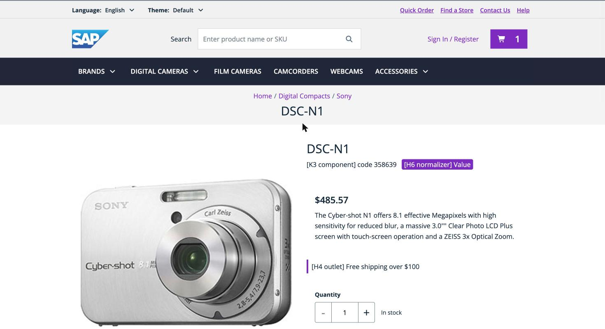

# customization-samples: 29 章のカスタマイズ方法を本物の Spartacus で動かす

[29 章](../../docs/29-customization-types-and-methods.md)の方法 H2〜H8 を 1 つずつ実装したサンプルです。1 つずつの解説は [29-1](../../docs/29-1-customization-samples-walkthrough.md) にあります。
SAP/spartacus のクローンに入っているデモアプリ `projects/storefrontapp` に組み込み、デモの OCC(electronics-spa)につないで動作を確かめました(2026-11-17、`@spartacus/core` 221121.20.0、Angular 21.2)。



## 動かし方

```sh
git clone https://github.com/SAP/spartacus.git && cd spartacus
npm ci
/path/to/customization-samples/apply.sh $PWD
CX_BASE_URL=https://composable-storefront-demo.eastus.cloudapp.azure.com:8443 npm start
# http://localhost:4200/electronics-spa/en/USD/item/358639
```

2211 以降の `@spartacus/*` は公開 npm ではなく SAP のレジストリ(repository.sap)で配布されています。そのため、ここではクローンしたソースのまま動かしています。デモアプリの開発ビルドは、`tsconfig.json` の paths でライブラリをソースから読みます。

自分のアプリ(`ng add @spartacus/schematics` で作ったもの)では、`samples/` を `src/app/` に置いてください。そのうえで `AppModule` の `imports` に `SamplesModule` を、`styles.scss` の最後に `h3-theme` を足します。

## サンプルと確認結果

| ファイル | 方法 | 何をするか | 確かめたこと |
|---|---|---|---|
| `h2-config.providers.ts` | H2 設定 | 商品ページの URL を `item/...` にする。「Add to cart」の文言だけを上書きする | `/item/358639` で商品ページが開く。作られるリンクも `/item/...`。ボタンの文言が変わる |
| `h3-theme.scss` | H3 スタイル | `--cx-color-primary` を紫に | ボタン・リンク・カートの色が変わる |
| `h4-shipping-note.component.ts` | H4 差し込み | 「カートに追加」部品の前に 1 行足す | 数量の上に表示される |
| `k3-product-intro.component.ts` | H2 の `cmsComponents` | `ProductIntroComponent`(flexType)を自作に差し替える | 商品名の下が自作の表示になる |
| `h6-product.normalizer.ts` | H6 追加 | `PRODUCT_NORMALIZER` に足し、価格から `sampleBadge` を作る | K3 の部品にバッジが出る |
| `h5-product-page-meta.resolver.ts` | H5 置き換え | `ProductPageMetaResolver` を継承し、タイトルの先頭に印を付ける | タブのタイトルが `[H5 meta] DSC-N1 \| ...` になる |
| `h5-product.adapter.ts` | H5 置き換え | `ProductAdapter` を継承版に替え、呼ばれ方を記録する | 商品詳細ページで `loadMany` が呼ばれる |
| `h7-timing.interceptor.ts` | H7 Angular | すべての HTTP の所要時間をコンソールに出す | OCC の呼び出しごとにログが出る |
| `h7-hello-page.component.ts` | H7 Angular | CMS に無いページ `/sample/hello`(外枠は `pageLabel: '/help'` で CMS のページから借りる) | Help のヘッダーとフッターの間に表示される。中のリンクは H2 の設定から `/item/358639` で作られる |
| `h8-cart-added-message.service.ts` | H8 イベント | `CartAddEntrySuccessEvent` を受けて画面にメッセージを出す | カートに追加すると、確認メッセージとログが出る |
| `samples.module.ts` | — | 上の全部をまとめて登録する | — |

## 動かして分かった落とし穴(29.7 に詳しく)

1. **設定が効かない**:デモアプリは `AppModule` 自身の `providers` で、同じ `routing.routes.product.paths` を決めていました。モジュール自身の providers は、imports したモジュールより後に並びます。そのため `SamplesModule` の設定が負けました。`apply.sh` では、`AppModule` の `providers` の最後にも足しています。
2. **色が変わらない**:デモアプリは機能フラグ `a11yPrimaryColorContrast` を有効にしています。このとき `app-root` に付くクラスが、`--cx-color-primary` を `!important` で決めます。`:root` ではなく、その内側の `cx-storefront` で変数を定義します。
3. **Adapter の `load()` を替えても何も起きない**:商品詳細ページは、複数の scope をまとめて取る `loadMany()` を使います。本体の `loadMany()` は `load()` を経由しません。
